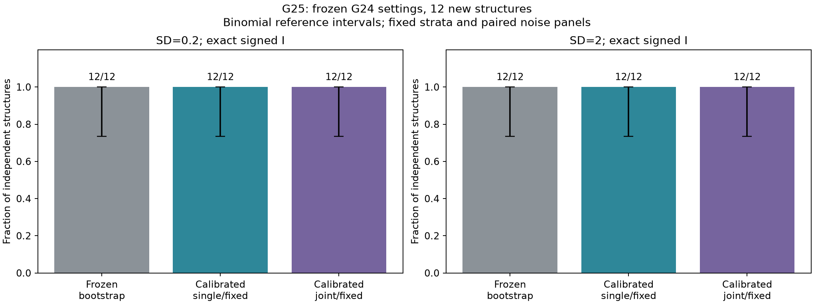
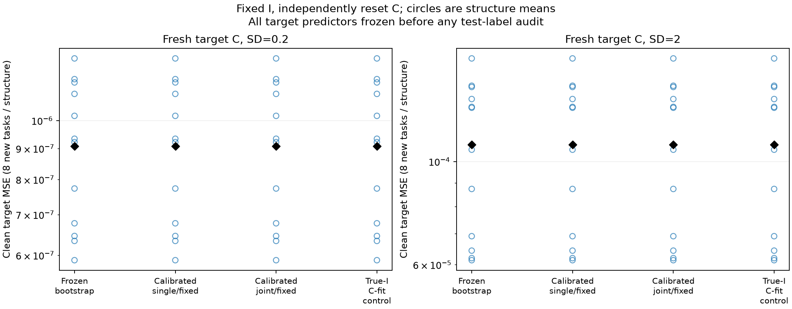
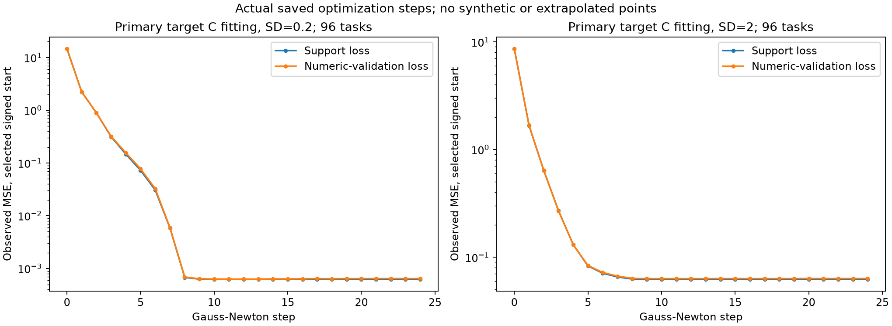
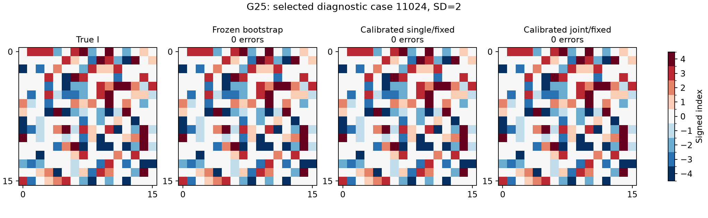

# G25: независимый контроль фиксированного метода G24

До получения новых данных зафиксированы настройки G24, 12 семейств (по четыре local/quartet_mix/random), четыре source-C и восемь новых target-C на I. Гиперпараметры, query-сетки, повторы, integer-solvers и численные старты не менялись. Основной метод — calibrated single/fixed, вторичные — bootstrap и calibrated joint/fixed. Отказы не исключались; неудачные семейства не заменялись.

|SD|Метод|Exact mask|Exact unsigned I|Exact signed I|Справочный binomial95% CI|Нет кандидата|
|---:|---|---:|---:|---:|---|---:|
|0.2|Frozen bootstrap|12/12|12/12|12/12|[0.735, 1.000]|0|
|0.2|Calibrated single/fixed|12/12|12/12|12/12|[0.735, 1.000]|0|
|0.2|Calibrated joint/fixed|12/12|12/12|12/12|[0.735, 1.000]|0|
|2|Frozen bootstrap|12/12|12/12|12/12|[0.735, 1.000]|0|
|2|Calibrated single/fixed|12/12|12/12|12/12|[0.735, 1.000]|0|
|2|Calibrated joint/fixed|12/12|12/12|12/12|[0.735, 1.000]|0|

Строгий заранее заданный критерий 12/12 основного метода на каждом шуме: выполнен. Это результат одной независимой контрольной серии; повторного HPO по её исходам не было.

Предварительный prefix-банк также дал 12/12. Поэтому G25 подтверждает воспроизводимость извлечения структуры, но не обнаруживает отдельного выигрыша калибровки или joint. Основной метод был выбран до данных и после результата не менялся. Исправление четырёх ошибок в открытом G24 остаётся отдельным наблюдением; новый контроль не доказывает необходимости этого дополнительного блока.

После позднего аудита различны 12/12 новых I, совпадений с прежними шестью G24: 0. Два уровня шума парные, это не 24 независимые геометрии. Объединённый binomial-интервал справочный: одинаковая вероятность успеха трёх классов не предполагается. Отдельные Clopper–Pearson интервалы внутри каждого класса сохранены в [stratum_intervals.json](stratum_intervals.json). Эти оценки не доказывают успех на всех структурах.

|SD|Метод|Завершённые target-задачи|Clean target MSE|Excess к true-I fit|
|---:|---|---:|---:|---:|
|0.2|Frozen bootstrap|96/96|9.07879e-07|0|
|0.2|Calibrated single/fixed|96/96|9.07879e-07|0|
|0.2|Calibrated joint/fixed|96/96|9.07879e-07|0|
|2|Frozen bootstrap|96/96|0.000108719|0|
|2|Calibrated single/fixed|96/96|0.000108719|0|
|2|Calibrated joint/fixed|96/96|0.000108719|0|

MSE сначала усреднена по восьми новым функциям одной геометрии, затем по геометриям. При отказе численная MSE приводится только для завершённых случаев, их число указано явно; отказ не считается нулевой ошибкой. Все target-C обучены с нуля при фиксированном I. Истинные C не используются даже в true-I численном контроле. Все target-предсказатели заморожены до первого target-test аудита.

Во всех трёх методах I канонически совпал с истинным. Для одинакового I, target-данных и стартов переиспользуется один численный fit с сохранением происхождения; разные target-функции всегда имеют свои независимо обученные C. Поэтому равенство MSE true-I контролю ожидаемо. Это не перенос source-коэффициентов и не отдельное доказательство глобальной оптимальности численного fit.

Кривые показывают фактически сохранённые шаги выбранных по numeric-validation стартов. Для остановившихся fit не дорисовывались будущие значения; на поздних шагах усредняются только имеющиеся наблюдения.

Плато наблюдаемой loss около 0.000625/0.0625 соответствует дисперсии шумного среднего при 64 повторах и SD0.2/2. Clean-test MSE оценивает ошибку относительно чистой функции и потому существенно ниже этого уровня.

Полные индексаторы: [SD0.2](confirmation_indexators_sd0.2.png), [SD2](confirmation_indexators_sd2.png). Цвет — целый индекс; сопоставление имён/знаков групп и hidden columns выполнено только после фиксации всех решений.

Обучающие данные и численные бюджеты унаследованы без изменений. Включая предварительный банк и новые G24-панели, цена составляет 275381223424 физических шумных ответов на source-функцию и условие, хотя Gaussian-средние симулируются аналитически. На target-функцию support4096 и validation1024, по64повтора; test8192. Это прежний known-common-bias/readout класс, не изображения, не свободные neuron-bias и не новое соревнование семи методов.

Парное измерение source C-fit: serial6.04с, batch3.01с; ускорение2.01×. Target C-fit: 3.64×. Это отдельные фазы с проверенным численным соответствием. CPU использован для prefix-поиска, GPU только0–3 для пакетных численных fits; GPU6/7 и чужие процессы не затрагивались.

В первоначальных 96 source-заданиях завершены 384 prefix-траектории: 365 полных и 19 частичных. Хотя бы один полный кандидат был в 93/96 отдельных source-задач. Начальный численный банк содержит 76 пар «условие, I» и 63 различных I. Повторный поиск: 228 полных и 12 частичных из 240 новых траекторий, плюс 24 frozen-контроля. Итоговый банк содержит 34 пары «условие, I» и 22 различных I. Таким образом, 12/12 относится к окончательному общему выбору, а не к каждому отдельному запуску.

Supervisor/session45892 завершён с кодом0. Все исходные предсказатели зафиксированы в 18:52:22 UTC, выборы I — в 18:52:32 UTC; после этого выполнен teacher-аудит. Все target-модели зафиксированы в 18:53:05 UTC, затем выполнен target-test аудит; отчёт готов в 18:53:25 UTC 5 ноября 2026. GPU-контексты серии освобождены. После этого контроля новых экспериментов не запущено.

Исходные данные: [comparison.csv](comparison.csv), [семейственные метрики](family_metrics.json), [summary/provenance](summary.json), [протокол](../protocol.json). Новый контроль завершён; дальнейшее расширение метода в него не входит.
