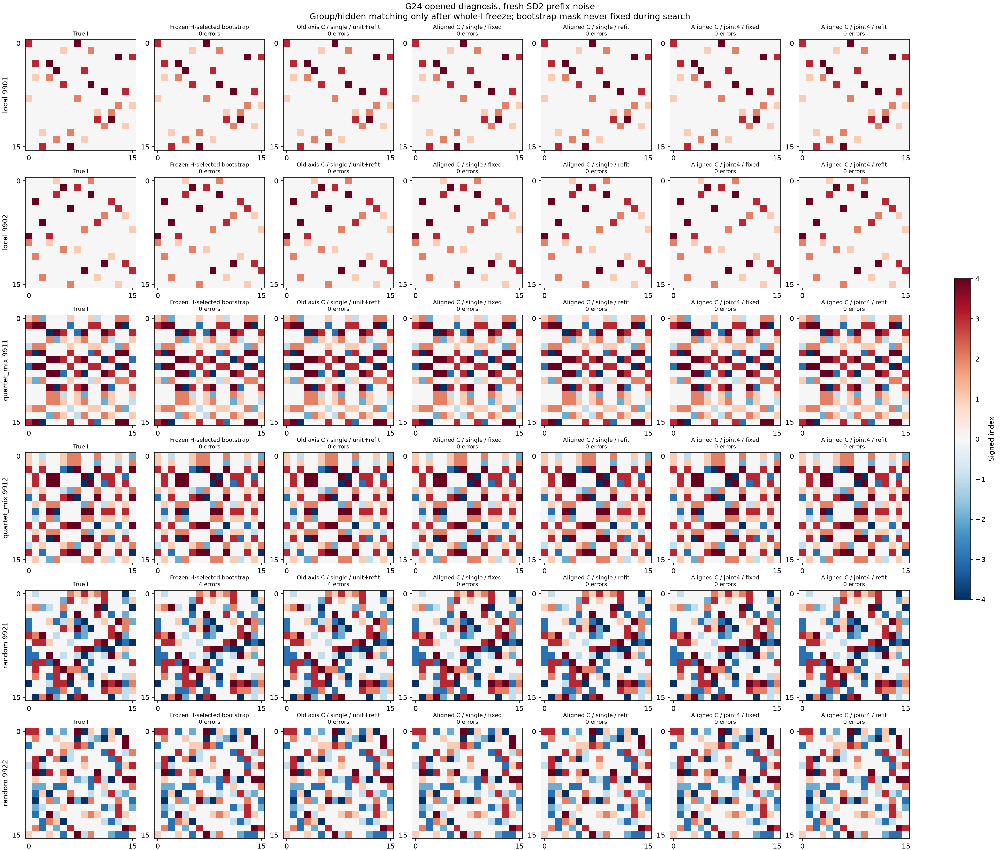
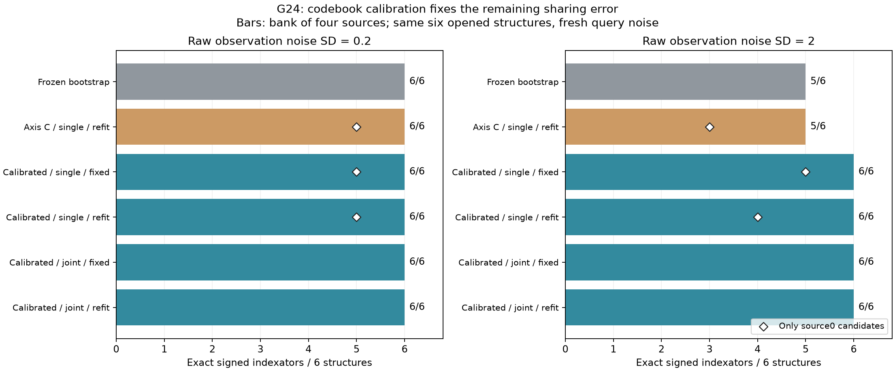
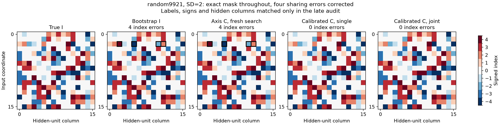

# G24: общий поиск prefix-counts при разных кодбуках

Открытая диагностика прежних шести G23-геометрий/четырёх source-C. Bootstrap выбран по старому numeric H, без старого meta/teacher, и зафиксирован до свежего шума. Все новые I строятся с пустого prefix; ни маска, ни отдельные назначения bootstrap не фиксируются. Четыре single-ветки объединяются в банк, joint имеет один общий поиск; число траекторий и compute не уравнены. Это не независимая confirmation.

|SD|Метод|Exact mask|Exact unsigned I|Exact signed I|Истина в банке|Потеря при выборе|Нет кандидата|
|---:|---|---:|---:|---:|---:|---:|---:|
|0.2|Frozen H-selected bootstrap|6/6|6/6|6/6|6|0|0|
|0.2|Old axis C / single / unit+refit|6/6|6/6|6/6|6|0|0|
|0.2|Aligned C / single / fixed|6/6|6/6|6/6|6|0|0|
|0.2|Aligned C / single / refit|6/6|6/6|6/6|6|0|0|
|0.2|Aligned C / joint4 / fixed|6/6|6/6|6/6|6|0|0|
|0.2|Aligned C / joint4 / refit|6/6|6/6|6/6|6|0|0|
|2.0|Frozen H-selected bootstrap|6/6|5/6|5/6|5|0|0|
|2.0|Old axis C / single / unit+refit|6/6|5/6|5/6|5|0|0|
|2.0|Aligned C / single / fixed|6/6|6/6|6/6|6|0|0|
|2.0|Aligned C / single / refit|6/6|6/6|6/6|6|0|0|
|2.0|Aligned C / joint4 / fixed|6/6|6/6|6/6|6|0|0|
|2.0|Aligned C / joint4 / refit|6/6|6/6|6/6|6|0|0|

Всего 288 новых prefix-поисков и 12 frozen-bootstrap контролей. Старые source train данные остаются численной целью; новые независимые prefix train/validation используются поиском, новые Gaussian H и meta — checkpoint/выбором. На новые наблюдения приходится 184549376 physical labels/source-function/noise condition; цена прежнего bootstrap не обнуляется. Все уникальные I проходят одинаковый fresh32signed C/GN24 fit и whole predictor freeze до meta-Y; whole selection freeze до teacher audit. Targettest G23 не использован.

Теория§34 доказывает равенство kernel joint-Gram пересечению kernels задач и условную устойчивость при точном global solver. Она не гарантирует правильных parents, словаря, локальной integer-сходимости или успеха всех I. Известность сумм task-loss/alternating fit/finite alphabet factorization раскрыта; приоритет нового полного алгоритма и общее превосходство ещё не установлены. Требуются независимые I, робастность и подходящие native/query контроли после заморозки схемы.

## Интерпретация завершённой абляции

Калиброванный fixed/single-банк уже даёт 6/6 при обоих шумах. Для этих агрегированных результатов не потребовались ни дополнительный prefix-refit, ни общий joint-поиск. С прежним осевым C повторение поиска на свежем шуме оставило 5/6 при SD2. Выделенное улучшение связано с калибровкой численных кодов перед полным повторением дискретного поиска; отдельный выигрыш joint не выявлен.

При single объединены кандидаты четырёх независимо решаемых функций, после чего один I выбирается по средней новой meta-ошибке. Это отличается от поиска по одной source0-функции:

| Только source0 | Exact I, SD0.2 | Полные кандидаты, SD0.2 | Exact I, SD2 | Полные кандидаты, SD2 |
|---|---:|---:|---:|---:|
| Прежний осевой C / refit | 5/6 | 5/6 | 3/6 | 4/6 |
| Калиброванный C / fixed | 5/6 | 5/6 | 5/6 | 5/6 |
| Калиброванный C / refit | 5/6 | 5/6 | 4/6 | 4/6 |

Source0 random9921 остаётся без полного кандидата при обоих шумах. При SD2 refit дополнительно отказывает на local9901. В общем банке кандидатов других функций достаточно для правильного I. В common4 у всех методов точны маски, а bank recall совпадает с числом точных выбранных I; условных ошибок selection нет.

На пяти панелях выше одна и та же random9921/SD2. Чёрные рамки показывают четыре ошибки назначения группы; маска точна ещё до калибровки. Имена/знаки групп и hidden columns сопоставлены только в позднем аудите. Новые figures не требуют новых fit или запросов.

300 выходов включают 276 полных и 24 частичных; 32 пары «условие, I» (26 различных canonical-I) прошли независимый окончательный fit четырёх кодбуков из 32 свежих знаковых стартов. Predictor freeze: 17:24:16 UTC; selection freeze: 17:24:35 UTC; затем teacher-аудит. Все фазы завершены, ожидающих G24-запусков нет.

Исполнение — CPU, восемь работников; чужие MPS-контексты GPU0–3 и GPU6/7 не затрагивались. Ошибка старого загрузчика после поиска и до numerical fit исправлена отдельным зарегистрированным адаптером, без изменения 300 готовых поисковых выходов, научной цели или данных. Парное CPU-измерение final-C fit: serial202.906 с против batch87.360 с, 2.3226×; максимальное отличие выбранного C 6.66e−16. Это ускорение конкретной фазы, не всего опыта.

G24 использует дополнительный query-бюджет на уже открытых шести структурах; конкуренты и новый target-transfer в этом этапе заново не запускались. Сравнение семи методов G23, история опытов, формулы и оба полных псевдоалгоритма доступны в [итоговом отчёте](../../../../FINAL_REPORT.md). Источники двух новых фигур: [provenance](final_figures_provenance.json), [source0 CSV](source0_comparison.csv).
