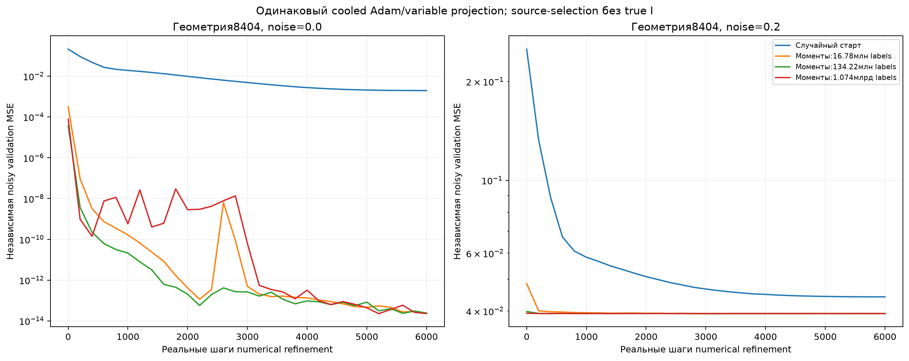

# G8: одинаковое numerical refinement из cold и moment-start

Четыре уже открытые fresh-C геометрии8401–8404, noise0/0.2. Это диагностика, **не новое подтверждение и не равное по total-labels сравнение**. На каждый вариант9 стартов/скоростей,6000 шагов, одинаковые262144 независимых refinement-наблюдения,8192 readout-support и8192 validation. Bias1 — gauge положительной ReLU-однородности; amplitude>=0/offset обучаются аналитически, все256 весов свободны. LR масштабируется одинаковым правилом initial-RMS и cosine-cooldown. Моментные варианты дополнительно использовали указанный G7 источник и pilot16384labels.

Checkpoint и старт выбираются по dense noisy validation MSE. После этого используется **дополнительная** exact scalar-DP в0/±4 центров; исходная маска не фиксируется. Hard-validation здесь оценивает проецированную матрицу с новым наблюдаемым readout-fit, без последующего C-fine-tuning; target-перенос данный опыт не выполняет.

|noise|Инициализация|Exact I /4|Среднее ошибок I|Dense validation MSE|Hard validation MSE|
|---:|---|---:|---:|---:|---:|
|0.0|Случайный старт|0/4|82.75|0.00478557|0.02898004|
|0.0|Моменты:1.074млрд labels|4/4|0.00|3.496677e-14|5.603845e-14|
|0.0|Моменты:134.22млн labels|4/4|0.00|1.319062e-11|5.376139e-11|
|0.0|Моменты:16.78млн labels|4/4|0.00|9.277034e-08|3.717804e-07|
|0.2|Случайный старт|0/4|105.00|0.04671234|0.07091943|
|0.2|Моменты:1.074млрд labels|4/4|0.00|0.03965207|0.03966688|
|0.2|Моменты:134.22млн labels|3/4|32.75|0.03966739|0.03970242|
|0.2|Моменты:16.78млн labels|2/4|55.50|0.04218295|0.05309134|

## Что именно диагностировано

Самый дорогой moment-start после refinement дал8/8 точных I. Но cold-Adam0/8 — результат этого режима, а не предел более сильной оптимизации: следующий G9 уже исправляет все четыре noiseless cold-случая полной кривизной. Поэтому headline о неизбежной неудаче плотных градиентных методов был бы неверен.

В8404noise0.2 средний бюджет даёт dense weight relative squared error0.000352, но scalar-DP131 ошибку I. Центры0.0353/1.437/4.822/8.320 показывают механизм: первый ненулевой код тратится на шум нулевых позиций, а два настоящих близких кода объединяются. Dense validation≈0.039267 после проекции становится≈0.039364. Это не объясняется только плохим source-fit и не устраняется одним требованием сделать softmax острее.

Все варианты заморожены до структурного аудита. Обоснование до запуска в THEORY.md§15, численные массивы/история выбора и хеши наблюдений сохранены. Улучшение после moment-start не доказывает новизну известных spectral-initialization/variable-projection/quantization компонентов или победу над matched-data native-конкурентами.
