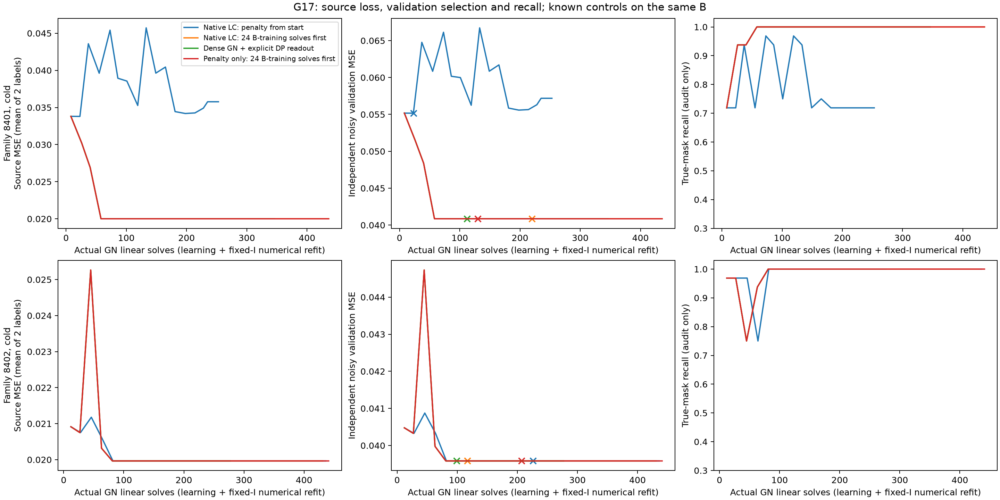
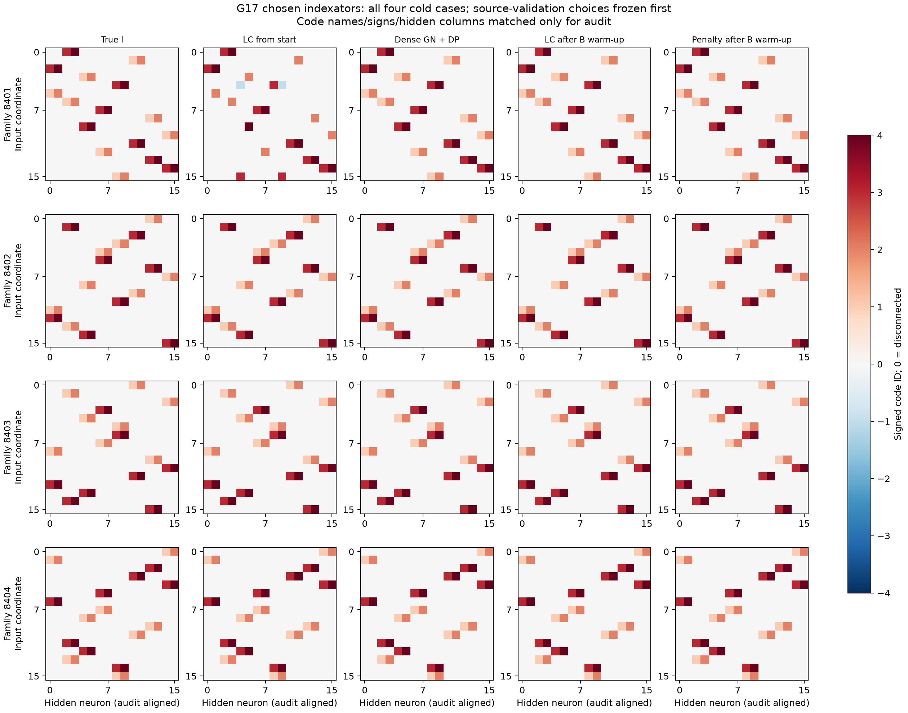
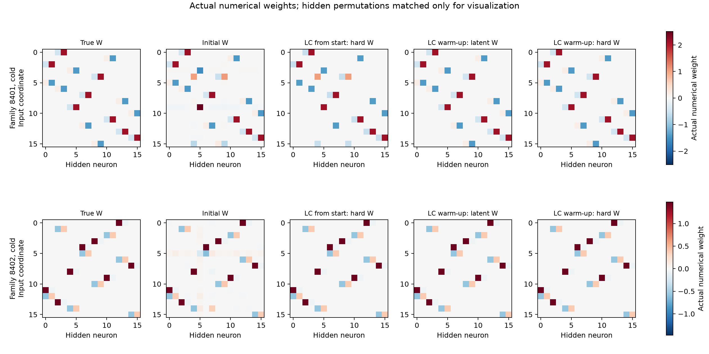

# G17: native LC и сильный плотный контроль на nonlinear DeepSets

Полноценный известный LC-контроль после короткого обучения на той жеB восстанавливает4/4 холодных и4/4 тёплых I. Плотный Gauss–Newton с явным DP-readout также4/4+4/4. Ранний LC без этой подготовки даёт3/4 cold. **Новый собственный метод, превосходящий эти контроли, не получен.**

## Протокол и адаптация

THEORY.md§24 до primary48fit.4 открытые G9/G16 геометрии8401..8404, поcold/first-warm(moment_pairs8388608),16inputs/16ReLU,4signed-кода+fixed0,общий positive bias+offset. SourceB1048576 входов, по2Gaussian noisy labels sigma.2:2097152 labels. Эти наблюдения и validation16384 точно те же, чтоG16, проверены SHA. Reference обучался наA; дорогая warm-moment стоимость сохраняется. Это8reference условий/4геометрии, не8 независимых структур и не новая confirmation.

LC — objective-level адаптация [Carreira-Perpiñán–Idelbayev2017](https://arxiv.org/abs/1707.04319): augmented Lagrangian/scaleddual, true-ReLU backtracking вGN L-step, exact signed scalar-DP C-step. Это native индексатор из собственного C-step; дополнительный внешний kmeans не добавлен. Penalty-only задаётu=0. DenseGN+DP — явно дополнительный readout. Все fixed-I checkpoint получают одинаковый source-only fit4C+b+d до12GN-solves; этот polishing не меняетI и не возвращается в latent trajectory. Это не неизменённые авторские скрипты и не finite-run гарантия глобального optimum.

Primary48:8reference×3метода×2settings. LC/penalty24mu stages от1e−6/1e−4 до10·maxeig(H0), max6L-solves/stage. Dense имеет тот жеmax144 L-solves иdamping1e−10/1e−4. Всеcheckpoint выбираются по observed validation; одна global setting/метод — по среднему8source-ошибок. Wholefreeze/HPO до нового trueI аудита. Source-MSE относится к среднему2labels сnoisevariance.02, validation — к single-label variance.04; их абсолютные уровни нельзя напрямую читать как overfit-gap.

После primary обнаружено: denseGN с малымdamping4/4cold, LC3/4. THEORY§24.5 до дополнительного запуска фиксирует4stage(mu=u=0) наB, затем20positive-stage. Это до24 unpenalized L-solves **внутри того жеmax144**, не добавочный оптимизационный бюджет. Same_data_warmup содержит32 новых LC/penalty fit; old dense16 не повторяются. Сохраняется и primaryрезультат. Изменение распределяет шаги между warm-up иpenaltyпутём и меняет сеткуpositive-mu; это не чистая изоляция одного скаляра и не доказательство единственной причины сбоя.

## Результаты source-validation selection

|Метод|Cold exact I|First-warm exact I|Cold mean observed validation MSE|Cold mean clean validation MSE (audit)|
|---|---:|---:|---:|---:|
|Native LC: penalty from start|3/4|4/4|0.04370452|0.0034438025|
|Penalty only: from start|3/4|4/4|0.04370452|0.0034438025|
|Dense GN + explicit DP readout|4/4|4/4|0.04012722|1.3180529e-07|
|Native LC: 24 B-training solves first|4/4|4/4|0.04012722|1.3180589e-07|
|Penalty only: 24 B-training solves first|4/4|4/4|0.04012722|1.3180549e-07|

G16 на тех жеB/reference: independent one-step+scalarDP2/4cold,4/4first-warm. Новый результат плотного контроля показывает: **один frozen-Jacobian шаг был недостаточен; повторная линеаризация и численное обучение наB исправляют все4cold**. Отсюда не следует, что исходнаяA-модель находилась в доказанном строгом local minimum, или что любой Adam/SGD обязан провалиться. Это также не новый structural метод — dense control с явным readout.

Warm-up усиливает LC до того же4/4; нельзя объявлять новую схему лучше LC по сравнению только с его ранним более слабым запуском. Penalty-only послеwarm-up тоже4/4: отдельный выигрышdual-переменной здесь не показан. Все выигравшие global settings —row0. Индивидуальные raw/polished losses, actual learning/refit solve counts, acceptedupdates, mu/primal residual иteacher recall сохранены. Полный путь не обязан монотонно улучшать validation; выбирается checkpoint, не последнийstage.

## Область вывода и следующий вопрос

80 новых source-fit, все6свободныхGPU0/1/2/3/6/7; чужие4/5не затрагивались. Software tests не создавались/не запускались. Данные иmaxчислоL-solves согласованы, фактическое числоGN/refit ивремя отличаются и вынесенывcomparison.csv; FLOP/time-matched победа не заявлена. Noisy G9 primarygates/abstentions не менялись. G17 — один underlying source-function на геометрию, нет нового target-C/transfer или независимого multi-function common-I подтверждения.

Простое исправление численного этапа уже снимает рассматриваемые cold ошибки. Следующая собственная схема должна показывать самостоятельный эффект сверх сильного dense/nativeLC, а не приписывать им неизбежный optimizer failure. Для большой цели остаются новый механизм извлечения общей структуры, независимые геометрии/разныеsource-C, misspecified noise и перенос толькоI. Дальнейший вариант должен сначала объяснить, какую наблюдаемую структурную информацию он использует, и пройти проверку близкой литературы.

