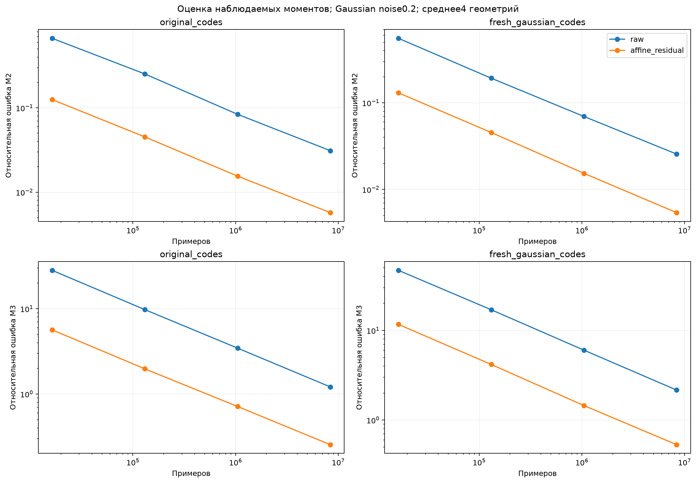
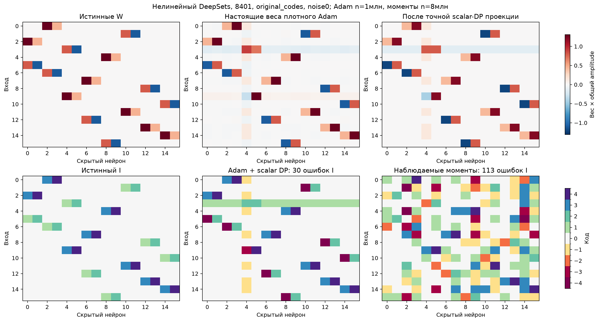
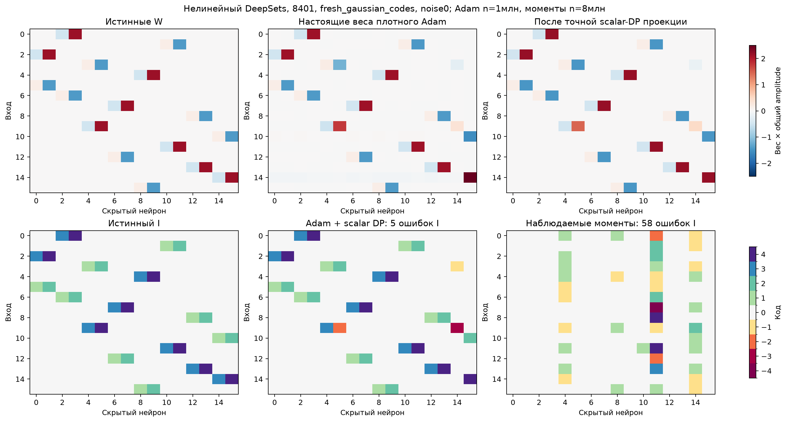

# G6: нелинейная диагностика наблюдаемости

Исходная архитектура synthetic DeepSets сохранена:16 входов,16 скрытых ReLU, общий bias и amplitude, сумма выходов. Четыре перестановки входов; два набора коэффициентов — прежние0.8/−1.1/1.3/0.45 и новый Gaussian C каждой геометрии; два уровня шума. Это8 функций ×2 шума, exploratory-диагностика, не финальный competitive benchmark. Алгоритмы не получают истинные координатные роли, маску, W, C или autograd учителя.

**Диагноз:** population M2/M3 восстанавливают8/8 индексаторов, максимальная относительная квадратичная ошибка W/b=5.19e-26. Поэтому при данных допущениях извлечение в принципе возможно. Но оценки из8млн обычных Gaussian примеров не дают ни одного точного I. После affine-control-variate ошибка M3 на исходных коэффициентах всё ещё около0.24; на свежих около0.51 даже без label-noise. Третий момент пропорционален малому bias0.15. Измеренный шум статистики и conditioning усиливаются whitening/разложением.

Gaussian Hermite/whitening/tensor reconstruction — **известный контроль**, связанный с NN-LIFT. Общий bias позволяет восстановить W/b из масштаба третьего момента. Это явно описанная специализация, не неизменённая реализация NN-LIFT и не заявленная новизна. Сквозная матричная диагонализация выбирает один из8 random sketches по наблюдаемому off-diagonal tensor residual. Если M2 не positive definite, контроль не выдаёт W.

Плотный Adam обучен реально,9 стартов/скоростей на каждый шум,3000 шагов и1млн фиксированных source-примеров; отдельная noisy validation выбирает checkpoint и старт. После этого применяется **дополнительная** точная scalar-DP проекция в0/±4 центров; она не является native индексатором Adam. На исходных C точны7/8 случаев, на новых C1/8. Это результаты конкретного numerical-бюджета; они не доказывают невозможности более долгой или другой настройки Adam. Бюджеты Adam и максимального moment-контроля различаются и указаны в таблице.

Новый Gaussian C в двух случаях имеет минимальный разрыв модулей около0.025; ещё один случай даёт condition(W)≈19.7. Низкая ошибка предсказаний поэтому ещё слабее гарантирует правильное выделение групп. Учитель открывается только после freeze learner_outputs.npz/learner_records.json каждого случая; oracle-моменты и hybrid-подстановки записаны отдельно.

## Точные результаты

|Функция|noise|Метод|n|Выдано /4|Exact I /4|Среднее ошибок выданного I|
|---|---:|---|---:|---:|---:|---:|
|fresh_gaussian_codes|0.0|affine_residual|8388608|4/4|0/4|80.50|
|original_codes|0.0|affine_residual|8388608|4/4|0/4|102.25|
|fresh_gaussian_codes|0.2|affine_residual|8388608|4/4|0/4|60.25|
|original_codes|0.2|affine_residual|8388608|4/4|0/4|90.25|
|fresh_gaussian_codes|0.0|dense_adam|1048576|4/4|0/4|45.25|
|original_codes|0.0|dense_adam|1048576|4/4|3/4|7.50|
|fresh_gaussian_codes|0.2|dense_adam|1048576|4/4|1/4|50.75|
|original_codes|0.2|dense_adam|1048576|4/4|4/4|0.00|
|fresh_gaussian_codes|0.0|raw|8388608|3/4|0/4|64.00|
|original_codes|0.0|raw|8388608|4/4|0/4|128.75|
|fresh_gaussian_codes|0.2|raw|8388608|3/4|0/4|83.00|
|original_codes|0.2|raw|8388608|4/4|0/4|120.00|

## Диагностические графики

Хитмапы используют заранее фиксированную первую геометрию8401, noise0. На ней нельзя оценивать средний результат. Скрытые столбцы/названия кодов выравниваются только при аудите. Весовые карты показывают настоящие численные веса × amplitude и их проекцию, не истинные W под названием Adam.

hybrid_oracle_diagnosis.json отдельно заменяет только M2 или только M3 population-значением. Это post-hoc диагноз, а не конкурент и не допустимый вход обучения. Данные позволили отделить сбой оценки статистики от принципиальной неидентифицируемости; алгоритмическое исправление требует отдельной теории и нового опыта. Успех линейного F-графа пока не заявляется для этих нелинейных параметров.
