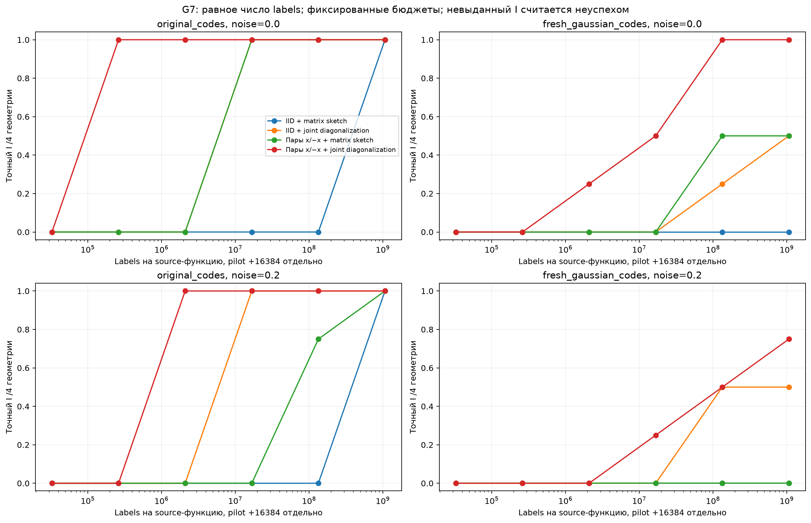
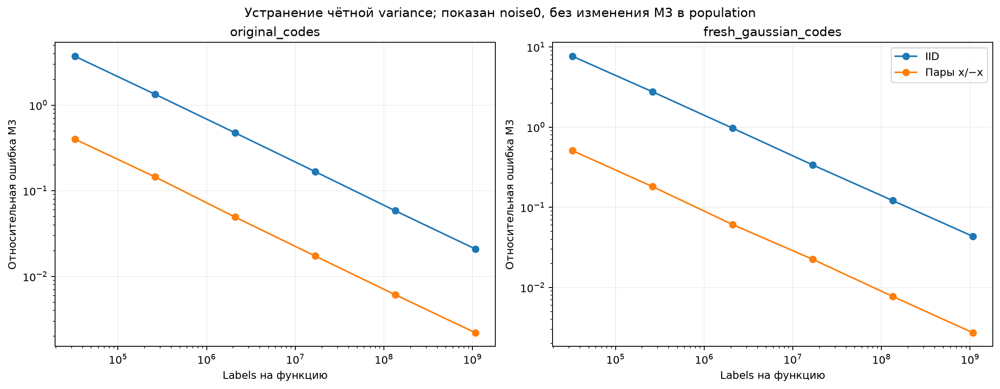
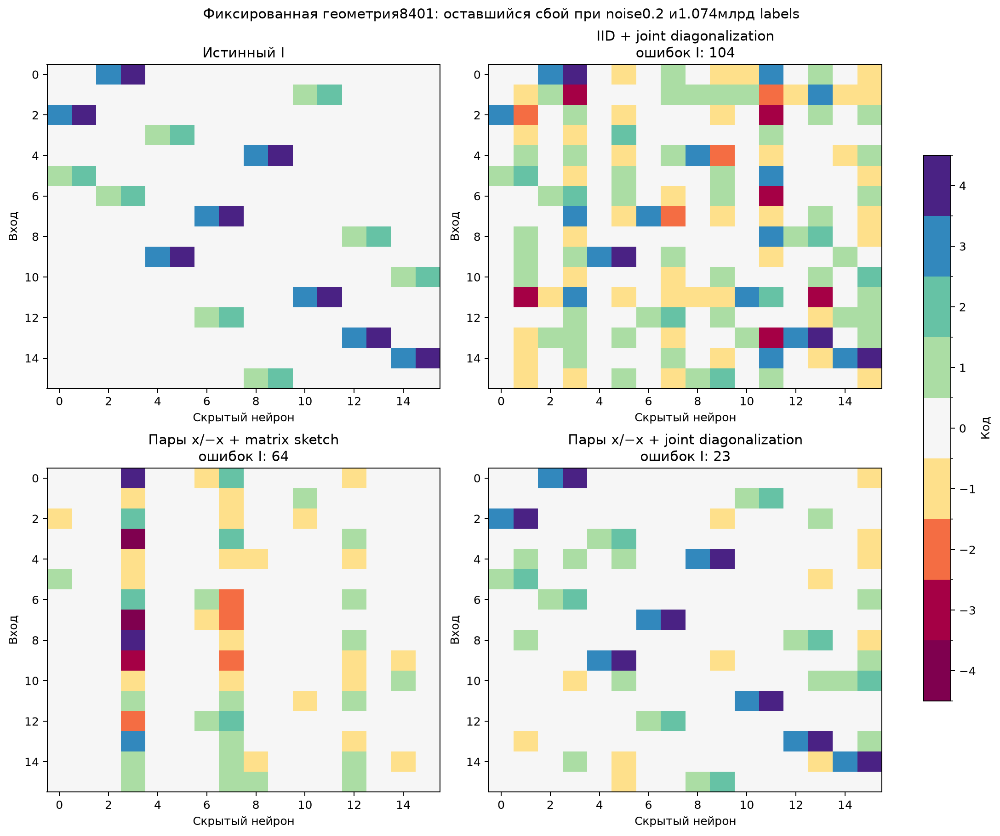

# G7: parity и совместная диагонализация

Диагностика G6 указала на ошибку третьего момента. THEORY.md§14 до запуска обосновывает две отдельные поправки: parity-сокращение чётной части функции и использование всех срезов тензора вместо одного matrix sketch. Обе техники известны; factor2×2 абляция проверяет их вклад. Восемь функций и четыре геометрии уже открыты в G6: это **exploratory**, не новые confirmation-семейства.

На каждый view выделено одинаковое число labels:2n IID наблюдений против n пар x/−x. Пары стоят двух labels, шум у них независим. Дополнительно одинаковый независимый pilot16384 labels оценивает affine-control-variate. Исходные роли координат, истинные W/C, численные bias/amplitude не подаются. Не используется autograd учителя. После извлечения W/b применяется явно дополнительная signed scalar-DP проекция с фиксированным нулём и4 центрами. Все prespecified бюджеты выполнены; teacher не управляет остановкой/выбором настроек.

**Что получилось:** на исходных C совместная диагонализация даёт4/4 при16.78млн labels даже с noise0.2; при этом обычный matrix sketch даёт0/4. Здесь joint-контроль IID тоже успешен: польза parity не должна приписываться всей комбинации без абляции. На свежих C без шума parity+joint достигает4/4 при134.22млн, IID+joint1/4. При noise0.2 максимальный бюджет1.074млрд даёт3/4 против2/4. Точное универсальное восстановление пока не достигнуто.

Источник statistical-улучшения измерен отдельно: у исходных C без шума при16.78млн labels относительная ошибка M3 снижается примерно0.167→0.017. Measurement-noise не сокращается таким же образом; в самом трудном почти коллинеарном семействе8401 одна ошибка остаётся даже при большом бюджете. Порядок величины числа labels — существенная цена. Это не практический high-efficiency результат и не matched-data победа над Adam/Yeh/LC/LUT-Q: таких новых конкурентов этот опыт не запускал.

Числа в таблицах — **точные I / четыре геометрии**. Бюджеты в заголовках — labels на одну функцию, без одинакового дополнительного pilot.

## original_codes, noise=0.0

|Метод|32,768|262,144|2,097,152|16,777,216|134,217,728|1,073,741,824|
|---|---:|---:|---:|---:|---:|---:|
|IID + matrix sketch|0/4|0/4|0/4|0/4|0/4|4/4|
|IID + joint diagonalization|0/4|0/4|0/4|4/4|4/4|4/4|
|Пары x/−x + matrix sketch|0/4|0/4|0/4|4/4|4/4|4/4|
|Пары x/−x + joint diagonalization|0/4|4/4|4/4|4/4|4/4|4/4|

## original_codes, noise=0.2

|Метод|32,768|262,144|2,097,152|16,777,216|134,217,728|1,073,741,824|
|---|---:|---:|---:|---:|---:|---:|
|IID + matrix sketch|0/4|0/4|0/4|0/4|0/4|4/4|
|IID + joint diagonalization|0/4|0/4|0/4|4/4|4/4|4/4|
|Пары x/−x + matrix sketch|0/4|0/4|0/4|0/4|3/4|4/4|
|Пары x/−x + joint diagonalization|0/4|0/4|4/4|4/4|4/4|4/4|

## fresh_gaussian_codes, noise=0.0

|Метод|32,768|262,144|2,097,152|16,777,216|134,217,728|1,073,741,824|
|---|---:|---:|---:|---:|---:|---:|
|IID + matrix sketch|0/4|0/4|0/4|0/4|0/4|0/4|
|IID + joint diagonalization|0/4|0/4|0/4|0/4|1/4|2/4|
|Пары x/−x + matrix sketch|0/4|0/4|0/4|0/4|2/4|2/4|
|Пары x/−x + joint diagonalization|0/4|0/4|1/4|2/4|4/4|4/4|

## fresh_gaussian_codes, noise=0.2

|Метод|32,768|262,144|2,097,152|16,777,216|134,217,728|1,073,741,824|
|---|---:|---:|---:|---:|---:|---:|
|IID + matrix sketch|0/4|0/4|0/4|0/4|0/4|0/4|
|IID + joint diagonalization|0/4|0/4|0/4|0/4|2/4|2/4|
|Пары x/−x + matrix sketch|0/4|0/4|0/4|0/4|0/4|0/4|
|Пары x/−x + joint diagonalization|0/4|0/4|0/4|1/4|2/4|3/4|

## Кривые и выбранные индексаторы

Хитмапа показывает заранее фиксированную первую fresh-геометрию8401. Это оставшийся трудный случай, не лучший отобранный пример. При максимальном n IID+joint имеет104 ошибки, parity+matrix64, parity+joint23. Поэтому низкую общую weight-MSE нельзя подменять точностью маски и групп.

## Статистика или локальный numerical-start

После freeze отдельно выполнен **oracle-only** контроль oracle_joint_initialization_diagnosis.json: совместная диагонализация observed-тензора инициализирована teacher-derived ортогональным базисом. Во всех восьми noisy fresh/view случаях она приходит к тем же значениям критерия и числу ошибок, что и обычный старт, в пределах округления. Для8401 parity+joint обе инициализации дают23 ошибки и objective≈0.84691649. Это не доказательство глобального оптимума, но конкретная проверка не поддерживает объяснение только плохим стартом solver.

Необходим следующий диагноз: почему оставшаяся неоднородная/коррелированная погрешность W/b нарушает zero/weak-code разделение при scalar-DP, и помогает ли observation-only numerical refinement перед hard projection. Нельзя напрямую приписывать Gaussian F-гарантию линейного этапа этим нелинейно оценённым W. Возможная комбинация метода имеет явные отличия от LUT-Q/DARTS, но её приоритет и превосходство над сильными конкурентами ещё не установлены.
