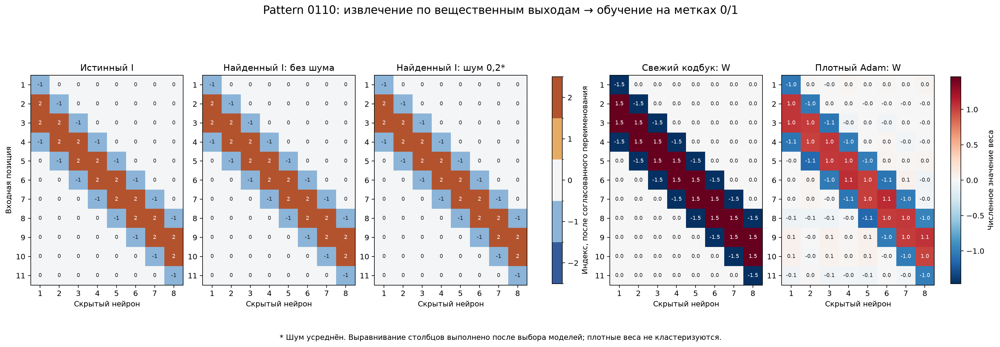
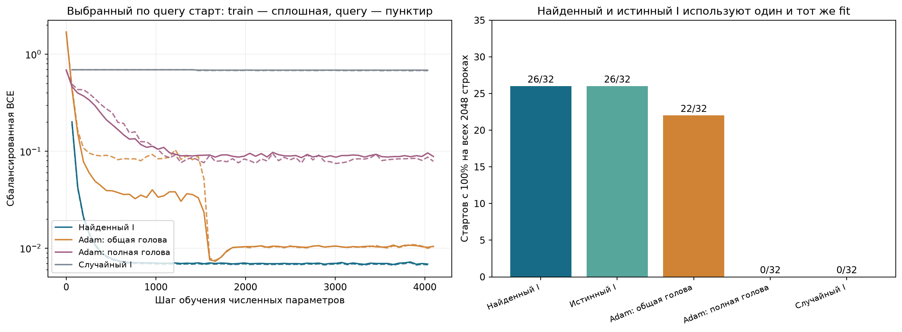

# Pattern 0110: prefix-восстановление и свежий кодбук

Эксперимент G26 завершён. Выполнен согласованный контроль: сначала поиск индексатора по вещественным выходам сети, которая решает 0110, затем отдельное обучение численных параметров по исходным бинарным меткам. Истинный I не поступает в поиск и выбор. Это контроль активного восстановления заданного класса сети, а не извлечение структуры только из меток 0/1.

## Модель и источник информации

Вход — 11 чисел, скрытых нейронов — 8, свободных чисел кодбука — 2. Алфавит индексов содержит ноль и две знаковые пары.

$$
\begin{aligned}
I_{dh}&\in\{0,\pm1,\pm2\},\\
W_{t,dh}&=\operatorname{sgn}(I_{dh})c_{t,|I_{dh}|},\\
f_t(x)&=\frac1{\sqrt8}\sum_{h=1}^{8}\left[-3+\sum_{d=1}^{11}x_d W_{t,dh}\right]_+.
\end{aligned}
$$

Teacher реализует восемь окон 0110. Его столбец содержит -c1,+c2,+c2,-c1 в соответствующих четырёх позициях. Четыре пары коэффициентов независимо сэмплированы из [0.8,1.3]² и скрыты от learner. Во всём этом диапазоне на бинарном кубе ненулевая активация окна возникает ровно при совпадении с 0110: полное совпадение даёт score больше 3, любой промах — меньше 3. Положительный выход teacher эквивалентен метке присутствия паттерна. Вещественный выход дополнительно содержит информацию о числе срабатываний и поведении вне бинарного куба.

Learner знает размеры, размер кодбука, общий bias -3 и readout. Ему не сообщают расположение окон, число активных связей, группы, численные коды или градиенты teacher. Все варианты связей 0/±1/±2 разрешены на каждом шаге.

## Перенос алгоритма и протокол

Изменены размеры D/H/K и известный bias. Отрицательный bias требует только поправки осевого тождества:

$$
[b+u]_+ + [b-u]_+ - 2[b]_+ = [|u|-|b|]_+.
$$

В осевом estimator используется модуль bias и корректный baseline. Семь численных стартов обобщены с четырёх кодов на два. Решатели QP, целых количеств и функциональная цель не изменялись. Для калибровки C использованы 4096 Gaussian-входов вместо объединённой осевой/prefix-панели предыдущего опыта. Все изменения объявлены в protocol.json до поиска. HPO, подбор по teacher или замена неудачных seed не выполнялись.

Для каждого из четырёх случайных порядков входных координат выполнены четыре source-поиска с разными C, четыре исходных варианта дискретного решателя и один цикл калибровки. Основной метод — повторные отдельные prefix-поиски при фиксированных калиброванных C, затем объединение кандидатов. Совместные количества нескольких задач — отдельный контроль. Четыре порядка относятся к одному и тому же I, а не к четырём независимым геометриям.

После свежего fit 32 знаковых инициализаций C для каждого I предсказатели фиксируются, затем отдельная meta-панель выбирает I. Все 24 выбора I заморожены до чтения структурной истины. Совпадение допускает только глобальное переименование/переворот знака групп и перестановку скрытых нейронов; входные позиции фиксированы.

| Метод | Точный I, чистые ответы | Точный I, сырой шум 0,2 с усреднением |
|---|---:|---:|
| Первичный prefix | 4/4 | 4/4 |
| Калибровка + отдельные prefix-поиски | 4/4 | 4/4 |
| Калибровка + совместный prefix-поиск | 4/4 | 4/4 |

Во всех выбранных I: 32 активные связи, две группы, F1 маски 100%, ошибок знакового шэринга 0/88. Первичный prefix уже восстанавливает I во всех случаях, поэтому добавочного выигрыша калибровки или совместного поиска на этом опыте нет.

Исходные траектории завершены: 128/128; повторные: 40/40. Полные следы сохранены, включая отказы.

## Свежая классификация 0110

После фиксации I все source-C и состояния оптимизатора отброшены. Обучаются два свободных кода и общие b/a/d, всего пять чисел. Используются только бинарные метки: 768 support, 256 query, 512 резервных наблюдений и 512 test. На каждый численный fit — 32 Gaussian-инициализации кодов, 4096 градиентных вычислений, Adam lr=0.03, L2=0.001, batch=128. В shared-fit первые 64 шага обучаются C и -C; query выбирает ветку, после чего обучение продолжается в том же общем бюджете. Query выбирает checkpoint и старт; test открывается после фиксации всех предсказателей.

Все найденные I совпадают с истинным с учётом симметрий. Поэтому найденный и oracle-I используют один и тот же свежий численный fit. Это явно зарегистрированное переиспользование идентичной задачи, не независимые 24 серии по 32 старта. Доля успешных стартов относится к одной серии из 32.

| Метод | Численных параметров | Test BA, 512 | BA на всех 2048 | Точных стартов на всех 2048 | Test balanced BCE |
|---|---:|---:|---:|---:|---:|
| Найденный индексатор | 5 | 100.00% | 100.00% | 26/32 | 0.006807 |
| Истинный индексатор | 5 | 100.00% | 100.00% | 26/32 | 0.006807 |
| Плотный Adam, общие b/a/d | 91 | 100.00% | 100.00% | 22/32 | 0.007576 |
| Плотный Adam, отдельные b/a | 105 | 96.96% | 97.88% | 0/32 | 0.120537 |
| Случайный индексатор | 5 | 55.14% | 54.93% | 0/32 | 0.686785 |

Плотный Adam с общей головой также достигает 100% на всём домене. Здесь нет преимущества нашего метода по выбранной итоговой точности; он получает точную компактную структуру. Сравнение не уравнивает стоимость данных: извлечение использовало дополнительные вещественные запросы. Сравнение 26/32 и 22/32 стартов является описательным, без утверждения статистически значимого превосходства.

## Хитмапы и динамика

Первые три панели — дискретные индексы, последние две — реальные веса свежего shared-fit и плотного Adam. Столбцы выровнены только после выбора моделей. Плотные веса не кластеризуются и не превращаются в маску. Исходные значения сохранены в figures/heatmap_values.npz.

## Шум, стоимость и ограничения

Сырой шум — Gaussian σ=0.2. Осевые ответы усредняются по 4,194,304 повторов, prefix-ответы — по 4,096, Gaussian fit/meta — по 64. Стандартные отклонения средних соответственно 0.00009766, 0.003125, 0.025. Поэтому таблица не означает устойчивость к неусреднённому шуму 0.2.

Номинальная цена шумного условия за все четыре порядка — 189,996,204,032 независимых шумных ответов на source-функцию. Средние Gaussian-ответов симулировались аналитически; физически это число повторов не вычислялось. Большой бюджет является существенным ограничением практического вывода.

Успех относится к фиксированному 0110, известному общему bias/readout и активному доступу к вещественным выходам на входах вне бинарного куба. Он не устанавливает извлечение шэринга из одного обычного бинарного датасета, перенос на другие паттерны или решение произвольного MLP.

## Воспроизводимость

Протокол и хеши исходников — protocol.json/code_snapshot. source_frozen.json фиксирует выбор I до аудита; classification/predictors_frozen.json — численные модели до test. structure_audit.json содержит все структурные метрики; fresh_source_evaluation.json — дополнительную оценку на 8192 новых вещественных входах после фиксации; classification_comparison.csv — таблицу классификации. Source-файлы прежних G23–G25 не изменялись. Программные тесты не создавались и не запускались. Численный fit выполнен пакетно на GPU 0; prefix/QP — на CPU, карты 6 и 7 не использовались.
