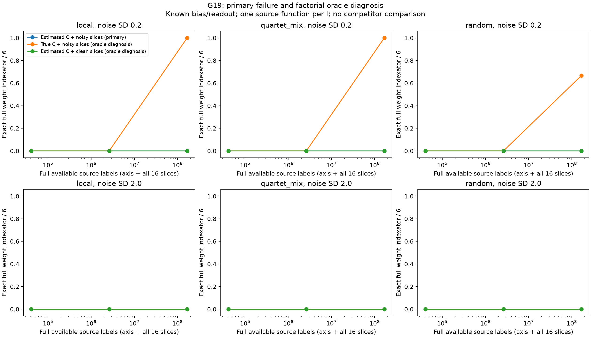
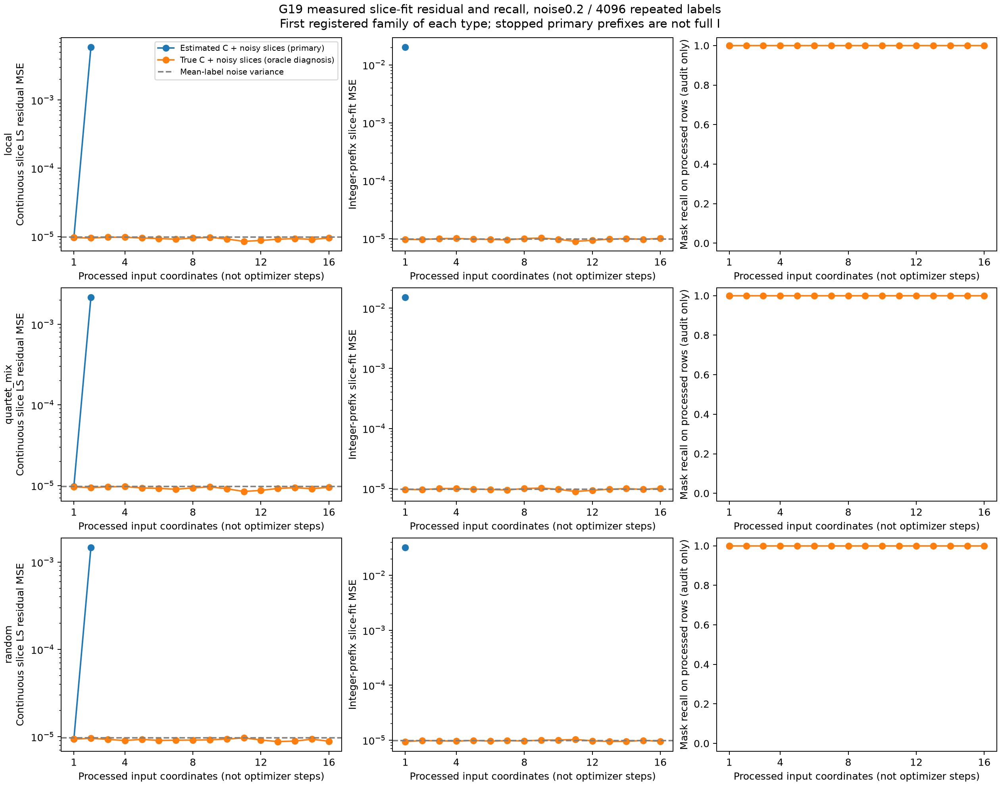
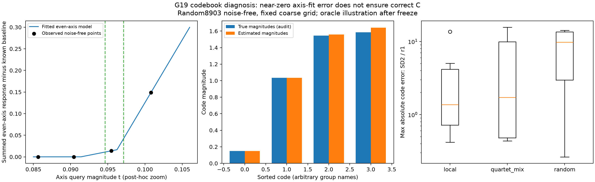
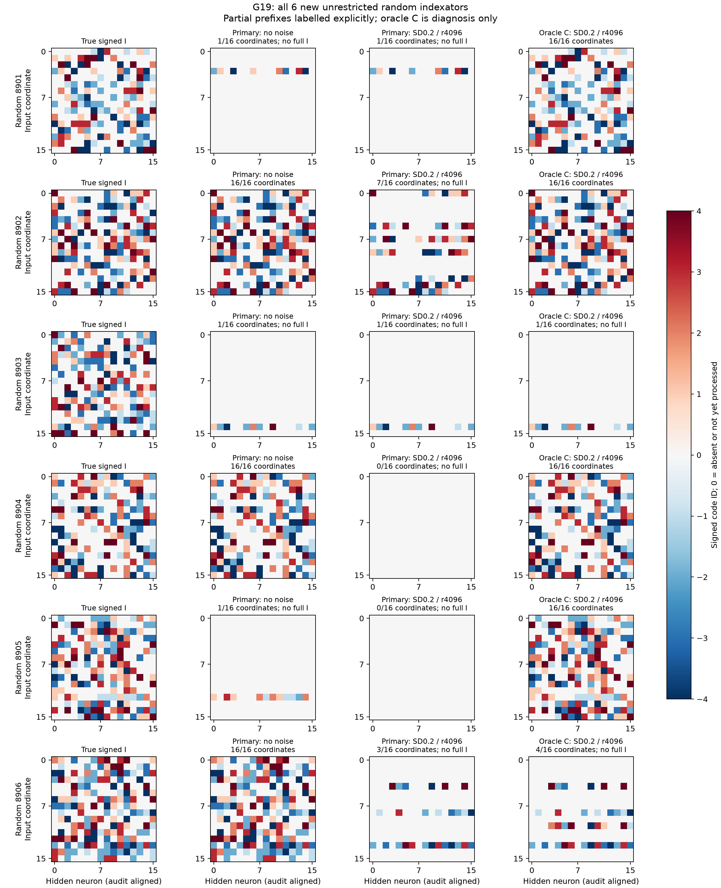

# G19: прямой подсчёт шаблонов индексатора

5 ноября 2026. **Без шума primary exact I15/18; с шумом0/108. Кандидат не готов.** Все18 source-fit и18 factorial-audit завершены на шести свободных V100. Ни конкурентной победы, ни полного multi-source/transfer результата нет.

## Механизм и условия

После G18 (одинаковые низкие моменты у разных I) THEORY.md §26 до запуска задаёт иной observable: значения функции на координатных срезах. Из even-axis queries оцениваются неизвестные модули четырёх кодов. Затем для каждого learned prefix нейронного вектора рассматриваются 0/±4 продолжения. Глобальная линейная LS оценивает **количества** нейронов каждого продолжения; integer rounding создаёт следующий multiset. После16 координат это полный signed I, без реконструкции плотной W и последующей её кластеризации. При нарушении неотрицательности/parent count/rank следует abstention.

Известны D=H16,K4, common bias0.15, положительный readout1/sqrt(H), offset0. Это дополнительное ограничение pilot. Маска, число активных весов, роли координат, размеры истинных модулей, численные C и teacher autograd learner недоступны. Переданы лишь запросы/шумные средние. Порядок координат независим от teacher. Шесть открытых G18 перестановок local/mixed имеют новые Gaussian C; ещё шесть новых arbitrary random signed I не имеют шаблона DeepSets. Одна функция на I, не общий I нескольких source-функций. Все18 fit/126 noise-budget состояний frozen до открытия teacher; все бюджеты сохранены, выбора по I нет.

При точном C и истинном предыдущем multiset full-column-rank design даёт точные количества без шума. Разные common-positive-bias ridge-atoms имеют разные kink-гиперплоскости; rich queries различают их. Это условная noiseless/stability мотивация, не гарантия noisy estimated-C восстановления. Generic reconstruction известен у [Rolnick–Kording2020](https://proceedings.mlr.press/v119/rolnick20a/rolnick20a.pdf), [Milli et al.2018](https://arxiv.org/pdf/1807.05185), [Daniely–Granot2023](https://arxiv.org/pdf/2105.09673). Segmented LS, variable projection, finite dictionary LS и integer rounding сами известны. Приоритет prefix-count комбинации пока не установлен, новый метод не объявлен доказанно лучшим.

## Primary: кодбук только из наблюдений

|Структура|Noise SD|Labels/query r|Точный полный I|Median max code error|Все доступные source labels|
|---|---:|---:|---:|---:|---:|
|local|0.0|1|6/6|6.16e-14|40,992|
|local|0.2|1|0/6|1.03e+00|40,992|
|local|0.2|64|0/6|6.81e-01|2,623,488|
|local|0.2|4096|0/6|1.97e-01|167,903,232|
|local|2.0|1|0/6|1.37e+00|40,992|
|local|2.0|64|0/6|6.31e-01|2,623,488|
|local|2.0|4096|0/6|8.70e-01|167,903,232|
|quartet_mix|0.0|1|6/6|1.54e-14|40,992|
|quartet_mix|0.2|1|0/6|8.50e-01|40,992|
|quartet_mix|0.2|64|0/6|1.65e-01|2,623,488|
|quartet_mix|0.2|4096|0/6|3.24e-02|167,903,232|
|quartet_mix|2.0|1|0/6|1.73e+00|40,992|
|quartet_mix|2.0|64|0/6|1.62e+00|2,623,488|
|quartet_mix|2.0|4096|0/6|2.31e-01|167,903,232|
|random|0.0|1|3/6|1.60e-03|40,992|
|random|0.2|1|0/6|1.35e+00|40,992|
|random|0.2|64|0/6|4.36e-01|2,623,488|
|random|0.2|4096|0/6|3.55e-02|167,903,232|
|random|2.0|1|0/6|9.80e+00|40,992|
|random|2.0|64|0/6|3.10e+00|2,623,488|
|random|2.0|4096|0/6|3.34e-01|167,903,232|

Без шума local6/6, mixed6/6, random3/6. Все15 выданных полных I точны. В noisy состояниях полных выдач нет: раннее округление нарушает допустимость или словарь теряет ранг. Это0/108 зависимых состояний, не108 независимых геометрий. Abstention не считать точным результатом. Хороший prefix или маска не подменяют полный I.

## Факторный диагноз после freeze

Меняем только C в словаре и/или шум slice labels. Primary/estimated-C, noisy slices неизменны. Oracle-ветви не используются для выбора/выдачи метода. При noise0.2/r4096:

|Структура|Estimated C + noisy slices|True C + noisy slices|Estimated C + clean slices|True C + clean slices|
|---|---:|---:|---:|---:|
|local|0/6|6/6|0/6|6/6|
|quartet_mix|0/6|6/6|0/6|6/6|
|random|0/6|4/6|0/6|6/6|

Known-C clean восстановил18/18 уникальных структур; этот одинаковый контроль сохранён для разных noise-состояний, **не считать его126 независимыми успехами**. True-C noisy при SD0.2/r4096 даёт16/18, при SD2/r4096 —0/18. Estimated-C clean остаётся0/18 в том же SD0.2/r4096 состоянии. Значит, C-stage уже достаточен для срыва, а при большом шуме отдельно ненадёжен и LS-rounding. Это не доказательство единственной причины во всех режимах.

## Почему нельзя исправить всё только увеличением повторов

Even-axis grid имеет257 точек t=0 и geomspace(.001,1024). У близких кодов короткая линейная область может содержать слишком мало точек, а непрерывные неизвестные amplitudes позволяют эквивалентные подгонки. Кроме этого numerical segmented-LS/variable-projection может оставить ненулевой остаток. В трёх noiseless random failure:

|Family|Число sampled точек между истинными соседними изломами|Max code error|Even-axis fit MSE|
|---|---|---:|---:|
|8901|7, 16, 2|3.19e-03|2.79e-08|
|8903|1, 7, 36|5.65e-02|3.01e-24|
|8905|2, 20, 7|2.96e-02|1.03e-06|

У8903 кодовая ошибка0.0565 при MSE около3.01e-24: почти нулевой fit на фиксированных точках не определяет кодбук. Между близкими true-kinks только одна точка; в continuous-amplitude модели одни и те же samples совместимы с разными близкими split. Истинные integer multiplicities в этом этапе ещё не использованы. В8901/8905 остаток ненулевой: solver/initial grid также требуют исправления. Не объявлять все три случая строгой информационной невозможностью или одним optimizer failure. Всё это post-hoc diagnosis после заморозки.

## Индексаторы и отсутствие численного baseline в этой серии

Нулём на неполном prefix показаны также ещё не обработанные координаты, поэтому он явно подписан **no full I**. Колонки и signed code names выровнены к teacher только для картинки/метрики. Здесь нет обученного dense SGD/Adam/GN baseline: его результаты из G17 нельзя переносить на эти панели или придумывать numerical W. Signed I плюс сохранённый codebook определяют реальные численные prefix-W, но при abstention это не выбранная полная модель.

## Стоимость и воспроизводимость

Root `results/20261105/prefix_census_g19`, код prefix_census.py/prefix_census_report.py; protocol, theory_at_registration, executed_code_snapshot, models_frozen.json. models/job_*.json/.npz содержат наблюдаемые axis/slice средние и prefixes; отдельные _audit.json/_audit_only.npz содержат teacher и factorial-контроли. Freeze-хеши проверены до отчёта. Сохранены source timings/axis-solver evaluations/rank/conditioning/reasons. Software tests не создавались/не запускались; минимальный Ruff, math/provenance аудит и просмотр четырёх фигур.

Полный panel содержит 40,992 query-точек (2×16×257 axis +16×2048 slices). Gaussian mean r независимых labels симулирован точно как f+sigma/sqrt(r)Z; стоимость **r labels**, не один. На r4096 полный доступный panel стоит 167,903,232 labels плюс8192 validation. Режимы paired по unit noise. Raw поле `primary_label_budget` в job.json считает только axis и фактически обработанные префиксы до abstention; оно **не включает** оставшиеся срезы, которые заранее сгенерированы и сохранены в NPZ. В comparison.csv/кривой recovery используем полную стоимость всех доступных средних, чтобы не скрывать эти данные. Prefix-trace budgets остаются счётчиком реально использованных последовательных шагов. Не смешивать эти две величины.

## Следующее изменение должно следовать из этого диагноза

Сначала исправить codebook stage: снять coarse-grid ambiguity, отделить её от недостатка SNR и локального numerical fit. Проверить более плотные/активные axis-query и ограничения целых multiplicities относительно прежнего непрерывного fit; теория/протокол до нового запуска. Затем отдельно проверить noise amplification LS-rounding и exact/feasible integer-count решения. Это предложения, не уже выполненные улучшения.

Для общей цели всё ещё нужны свободные bias/readout, собственный компонент с самостоятельным эффектом, общий I разных source-C, сильные native LC/Yeh/LUT-Q на тех же query/label budget, misspecified noise, новые независимые структуры и перенос только I на свежие C. Данные не ограничены намеренно, но большой счётчик виртуальных labels сам по себе не является конкурентной победой. Цель остаётся active.
