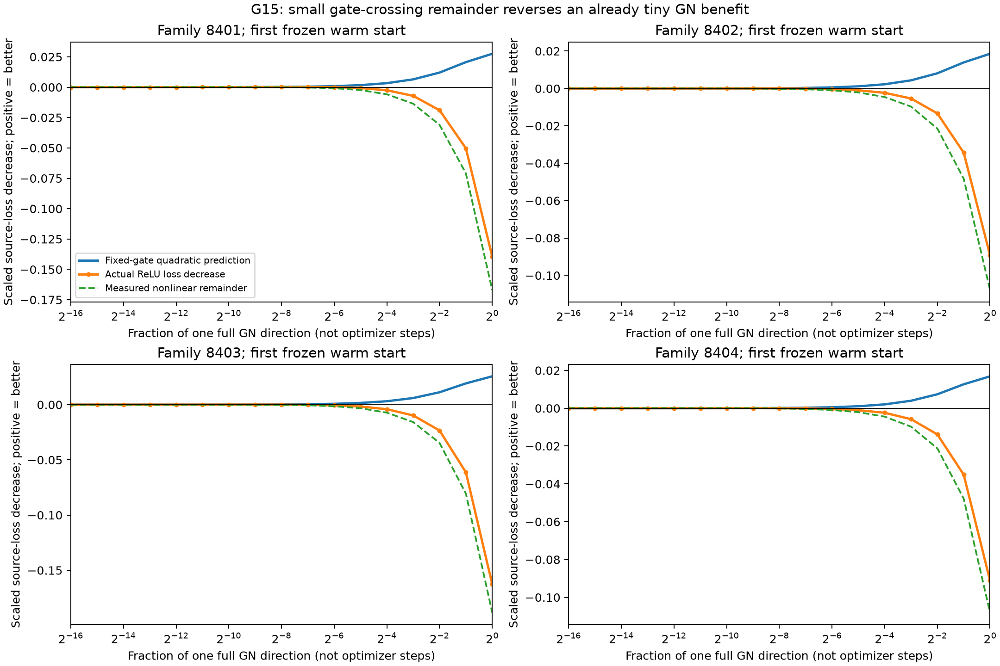
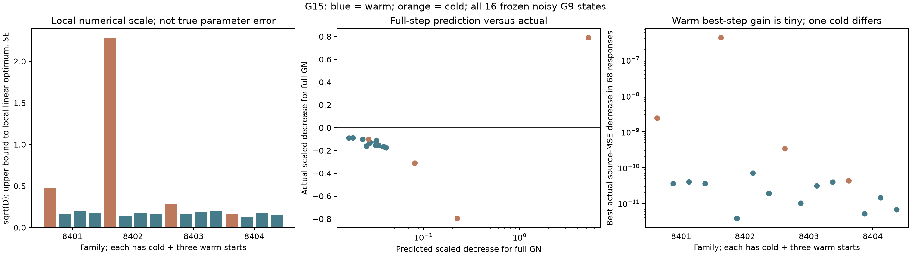

# G15: реальный ReLU-loss против fixed-gate квадратичного прогноза

Во всех12 noisy warm-состояниях полный GN-шаг **увеличивает** реальный source-loss, хотя локальная квадратичная модель предсказывает уменьшение. Точный измеренный остаток объясняет разницу. Это ограничение локальной fixed-gate модели около текущих весов, а не доказательство отсутствия информации о структуре.

## Протокол

THEORY.md§22 до запуска:16 замороженных G9 состояний,4 ранее открытые геометрии×cold/три warm moment-старта, noise.2,262144 прежних source-наблюдения,8192 прежних validation. Входы16, ReLU-нейроны16, общий positive bias и offset,258 параметров. Наблюдения восстановлены с точным прежним SHA256. Teacher используется только генератором для воспроизведения этих наблюдений; teacher-градиенты, новые labels, структура и C в направления не входят.

На каждом состоянии fullGN и relative-ridge1e−6/1e−4/1e−2, fractions2^−k,k=0..16:68 single-step ответов. Это не68 новых optimizer-шагов и не новая training trajectory. Все1088 responses сохранены; cohort заморожен. Шесть свободных GPU0/1/2/3/6/7; программные тесты не создавались и не запускались.

## Результаты

Scaled improvement = n·(oldMSE−newMSE)/sigmahat²; положительное число означает улучшение. D=n·gᵀH⁻¹g/sigmahat². Best fraction выбирается только по фактическому source-loss для диагностики; validation-change показывается отдельно и не называется новым независимым выигрышем.

|Геометрия/старт|D|Full GN: прогноз|Full GN: факт|Лучшая GN fraction|Лучший факт (все ridge)|
|---|---:|---:|---:|---:|---:|
|8401 cold|0.22548|0.22548|-0.79630|0.062500|0.015611|
|8401 warm 8388608|0.02753|0.02753|-0.13944|0.007812|0.000234|
|8401 warm 67108864|0.03885|0.03885|-0.16814|0.007812|0.000263|
|8401 warm 536870912|0.03198|0.03198|-0.15420|0.007812|0.000234|
|8402 cold|5.19673|5.19673|0.78947|0.500000|2.731167|
|8402 warm 8388608|0.01857|0.01857|-0.08925|0.000977|0.000025|
|8402 warm 67108864|0.03258|0.03258|-0.11212|0.015625|0.000458|
|8402 warm 536870912|0.02799|0.02799|-0.12858|0.003906|0.000125|
|8403 cold|0.08155|0.08155|-0.31041|0.031250|0.002218|
|8403 warm 8388608|0.02569|0.02569|-0.16261|0.001953|0.000066|
|8403 warm 67108864|0.03451|0.03451|-0.15588|0.003906|0.000203|
|8403 warm 536870912|0.04123|0.04123|-0.17694|0.007812|0.000259|
|8404 cold|0.02700|0.02700|-0.10243|0.007812|0.000282|
|8404 warm 8388608|0.01688|0.01688|-0.09117|0.001953|0.000034|
|8404 warm 67108864|0.03226|0.03226|-0.12411|0.003906|0.000095|
|8404 warm 536870912|0.02347|0.02347|-0.10155|0.001953|0.000044|

У warm-пусков лучшая GN fraction находится между1/1024 и1/64. Даже лучший из всех68 откликов уменьшает source-MSE лишь на3.82e-12..6.99e-11 при исходной MSE≈.04. Median sqrt(D)=0.173: это верхняя граница сдвига любого контраста до **локального линейного** optimum в единицах его SE. Она не является границей истинной ошибки theta или неизвестного нелинейного bias.

Максимальная ошибка точного равенства actual=quadratic+measured_remainder составляет1.446e-17. При полном GN доля сменивших gate событий у warm-пусков около7e−5..2e−4: малая доля не делает remainder пренебрежимым, когда предсказанное улучшение уже очень мало. Это научная проверка вычислимого тождества, не гарантия coverage.

Cold8402 отличается: D≈5.20, лучшая GN fraction=.5, scaled actual≈2.73. Там остаётся численная недооптимизация. Её нельзя объяснять тем же почти стационарным режимом, что warm. Validation-change лучшего source-шага отрицательный; это не доказательство улучшения переноса. Остальные cold также показаны отдельно вCSV/фигуре.

## Что меняет диагноз

Строгий G9-gate1e−4 не достигался, однако blanket-вывод «кодбук/сеть не обучена» для warm необоснован. В статистическом масштабе шаг мал; fixed-gate GN прогноз уже расходится с истинным loss из-за нелинейного остатка. При этом формула covariance остаётся лишь локальной/asymptotic мотивацией. Первичные G9 abstention/порог не изменены; post-hoc его ослабление не названо исправлением.

Новый алгоритм в G15 не обучался, новый I и transfer не оценивались. Следующий обоснованный вопрос — независимая one-step score оценка с контролем ReLU remainder/coverage, либо полноценный сильный native nonlinear baseline; сама one-step идея известна. Для общей цели всё ещё нужны дискретный shared-I across functions, сравнение с сильными конкурентами и содержательное новое отличие.

