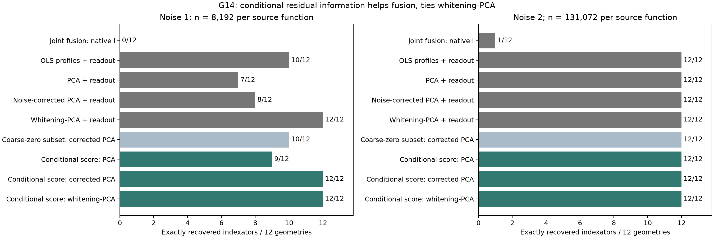
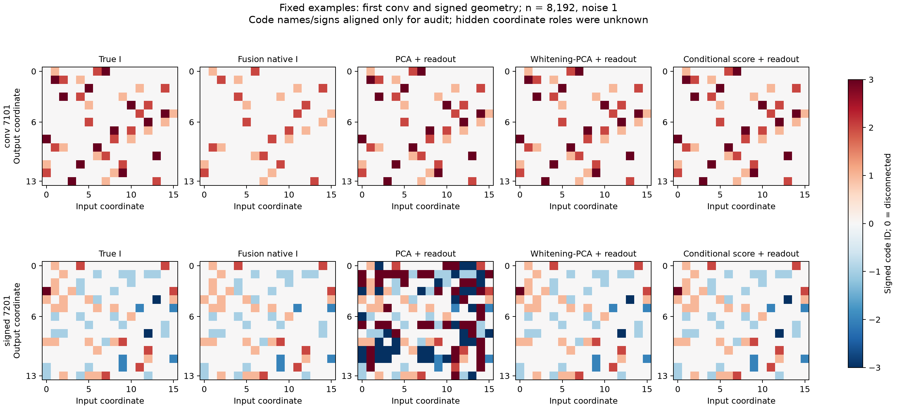
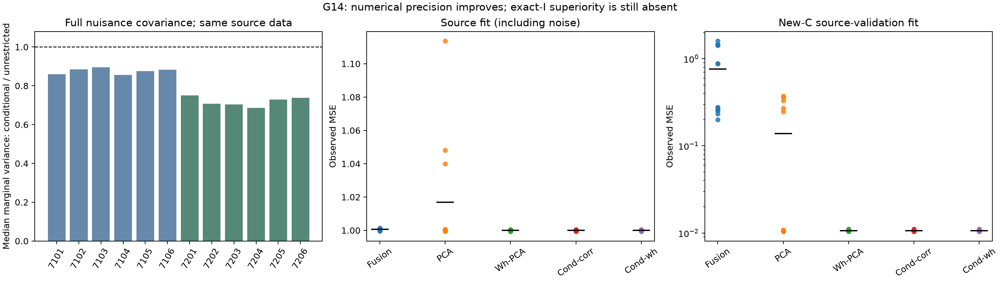
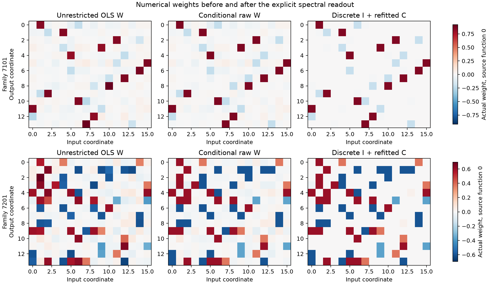

# G14: остаточный градиент с найденными равенствами

Условный GLS/score с corrected или whitening-PCA исправляет пропущенную слабую группу:12/12 точных I приn8192/noise1 вместо0/12 у native joint-fusion. **Прямой известный whitening-PCA на тех же данных также даёт12/12.** Преимущество собственного уточнения перед сильным контролем не найдено.

## Постановка и честность сравнения

THEORY.md§21 записан до запуска.48 ранее открытых G4 условий,12 геометрий (6 скрытых conv/6 signed),16 входов/14 выходов,128 функций,3 знаковых ненулевых кода плюс фиксированный0; std(C)=(1,.3,.03), condition100. Одни и те же sample-Gram/cross, все R=coarse-zero позиции свободны. Ни маска, ни размеры/места групп не даны. Coarse-I взят из замороженного G12; полная nuisance-covariance вычислена в линейной restricted-модели. Все48 новых состояний и source-only selections заморожены до нового аудита. Шесть GPU0/1/2/3/6/7 использованы; чужие процессы не затрагивались.

Это post-selection диагностика на уже открытых данных: правильность ранних равенств не гарантирована, поэтому Gaussian covariance формула не превращена в finite-sample сертификат после их выбора. Дальнейшая A/B независимая проверка пока не выполнена. Четыре режима повторяют одни12 геометрий и не являются48 независимыми структурами.

## Точное восстановление I

|Метод|Noise1 n8192|Noise1 n131072|Noise.2 n131072|Noise2 n131072|
|---|---:|---:|---:|---:|
|Joint fusion: native I|0/12|12/12|12/12|1/12|
|OLS profiles + readout|10/12|12/12|12/12|12/12|
|PCA + readout|7/12|12/12|12/12|12/12|
|Noise-corrected PCA + readout|8/12|12/12|12/12|12/12|
|Whitening-PCA + readout|12/12|12/12|12/12|12/12|
|Coarse-zero subset: PCA|7/12|12/12|12/12|12/12|
|Coarse-zero subset: corrected PCA|10/12|12/12|12/12|12/12|
|Coarse-zero subset: whitening-PCA|12/12|12/12|12/12|12/12|
|Conditional score: PCA|9/12|12/12|12/12|12/12|
|Conditional score: corrected PCA|12/12|12/12|12/12|12/12|
|Conditional score: whitening-PCA|12/12|12/12|12/12|12/12|
|Validation-selected conditional spectra|12/12|12/12|12/12|12/12|
|Validation-selected dense spectra|12/12|12/12|12/12|12/12|

PCA-контроли имеют явно обозначенный дополнительный signed readout. Для одного остаточного кода он решён exact scalar-DP; для rankK используется тот же32-start signed-vector Lloyd с выбором по собственной distortion. Native fusion не переименован в native spectral learner. Отдельные validation-selected строки используют только прежние32 full-C source-функции support4/query128; teacher-I не выбирает метод или restart.

## Что объясняет улучшение

В low-n серии median отношения marginal variance conditional/unrestricted равна0.803, диапазон по12 геометриям0.685..0.896. Учитываются nuisance-кодбуки и все off-diagonal ковариации. Corrected subset PCA даёт10/12, corrected conditional PCA12/12: pooling найденных равенств помогает слабому направлению. Но whitening subset и прямой whitening-PCA уже дают12/12; отдельный выигрыш по exact-I отсутствует. Уменьшение variance нельзя объявить конкурентной победой.

При большом n/noise.2 исходный coarse-I уже верен. Еслиg=K, residual-строки возвращают этот I без нового шага; их12/12 в этих строках не является независимым повторным успехом поиска. Приnoise2 большинство coarse-I теряли третью группу, но известные прямые профили/PCA также решают12/12.

Все численные W (unrestricted, conditional raw и I+C), индивидуальные спектры, source/query losses, selections и audit-aligned I сохранены вmodels. Веса после уточнения всё ещё требуют явного дискретного readout; это не исправление native DARTS. Нет выдуманной SGD-кривой: уточнение — closed-form solve/eigendecomposition. Actual-step G12-кривые остаются в его отдельном отчёте. Новое target transfer в G14 не запускалось; перенос G4/G12 не выдается за новый эксперимент.

## Вывод для дальнейшей работы

Слабая группа присутствует в наблюдениях; её потеря в raw fusion не является информационной невозможностью и не объясняется только незавершённым solver. Корректная геометрия шума уже достаточно её выделяет. Продолжать подбор scalar penalties на этой лёгкой для whitening серии ради заявления превосходства не обосновано. Нужна более показательная диагностика исходной нелинейной DeepSets и сильных native сравнений, а не новое имя GLS/PCA. Общая исследовательская цель остаётся active: преимущества, новая general процедура, независимое nonlinear подтверждение и устойчивость к нарушению noise-модели ещё не закрыты.

