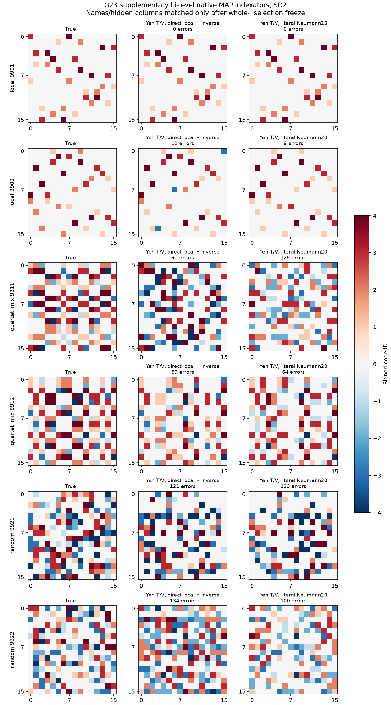
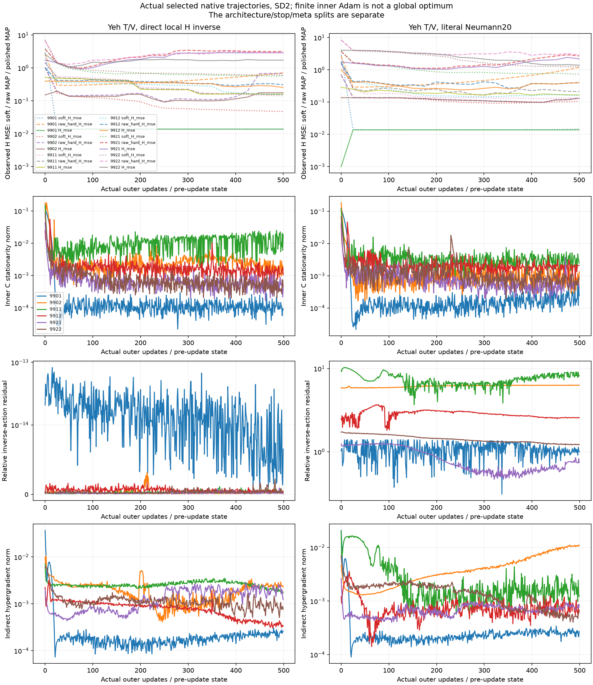

# G23: общая структура и отдельный bi-level контроль Yeh

Точный signed I — основной результат; маска и unsigned sharing считаются независимо. Все строки common4 на тех же шести независимых I, с четырьмя отдельными кодбуками. Это дополнительный pilot на прежних геометриях, не независимая confirmation.

|SD|Метод|Exact mask|Exact unsigned I|Exact signed I|Банк содержит true I|Выбор потерял true I|Нет I|
|---:|---|---:|---:|---:|---:|---:|---:|
|0.2|Functional prefix search|6/6|6/6|6/6|6|0|0|
|0.2|LC signed adaptation|3/6|3/6|3/6|3|0|0|
|0.2|Dense GN + DP readout|4/6|4/6|4/6|4|0|0|
|0.2|LUT-Q signed adaptation|2/6|2/6|2/6|2|0|0|
|0.2|Categorical joint ablation|2/6|2/6|2/6|2|0|0|
|0.2|Yeh T/V, direct local H inverse|1/6|1/6|1/6|1|0|0|
|0.2|Yeh T/V, literal Neumann20|1/6|1/6|1/6|1|0|0|
|2.0|Functional prefix search|6/6|5/6|5/6|5|0|0|
|2.0|LC signed adaptation|3/6|3/6|3/6|3|0|0|
|2.0|Dense GN + DP readout|4/6|4/6|4/6|4|0|0|
|2.0|LUT-Q signed adaptation|3/6|3/6|3/6|3|0|0|
|2.0|Categorical joint ablation|3/6|3/6|3/6|3|0|0|
|2.0|Yeh T/V, direct local H inverse|1/6|1/6|1/6|1|0|0|
|2.0|Yeh T/V, literal Neumann20|1/6|1/6|1/6|1|0|0|

G23 categorical joint — абляция, не полный Yeh. Supplement обучает один P на четырёх задачах: C/Adam на T, implicit P gradient на architecture V, hard-MAP checkpoint/HPO на отдельном H, fresh32signedC и meta-selection только после predictor freeze. Исходный single-source native bank также выбирается по четырём задачам; новый baseline дополнительно использует все четыре уже во время поиска. До16кандидатов/метод, одинаковый numeric/meta протокол; compute не уравнен.

[Статья Yeh et al., AISTATS2022](https://proceedings.mlr.press/v151/yeh22b/yeh22b.pdf), [зафиксированный авторский код](https://github.com/raymondyeh07/equivariance_discovery/tree/164fe57aba0939e7db62daf72a899b2f25ce93c7). Signed dictionary, known bias/readout, squared loss и несколько source-задач — явные адаптации. Direct4×4 inverse — стандартный численный контроль, не новизна; literal20 сохраняет конвенцию опубликованного helper. Конечные250innerAdam/minibatch steps не гарантируют стационарный или глобальный C. Численные diagnostics опубликованы, неудачные checkpoints/запуски не скрыты.

Source jobs: 24, numerical failure в 0; суммарное wall-time workers 6564.3s, не elapsed end-to-end и не matched FLOPs. Границы: known b/readout, Gaussian noise/means, высокий inherited physical-label budget порядка275.2bn/sourcecondition; новых labels0. Перенос C не выполнялся; отдельно требуется fixed-I fresh-C transfer и независимая проверка устойчивости/новизны. Общая цель остаётся активна.

Протокол, snapshot, все actual checkpoints и scalar diagnostics сохранены. Source1 в этом дополнении не запускался и не считается отказом. Метрики не объединяются с более ранними G21/G22 как будто это один benchmark.
