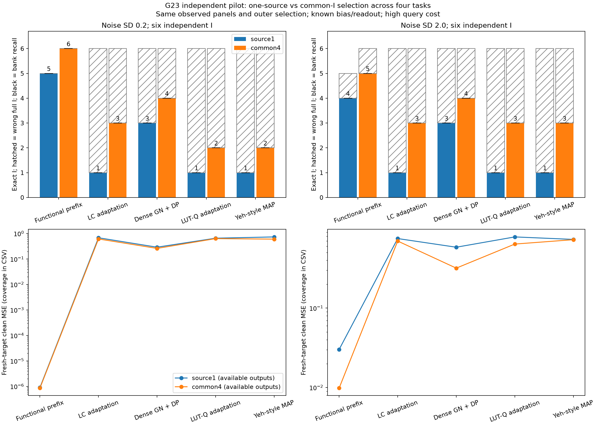
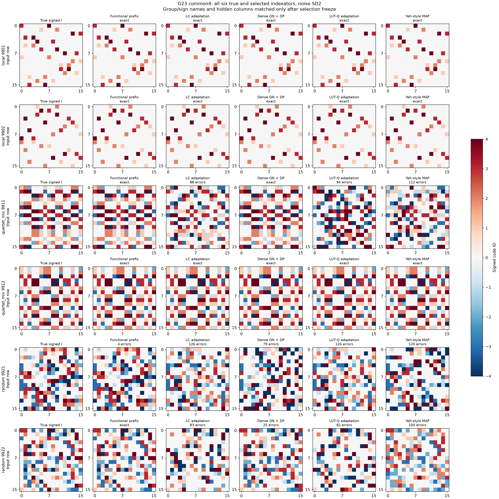
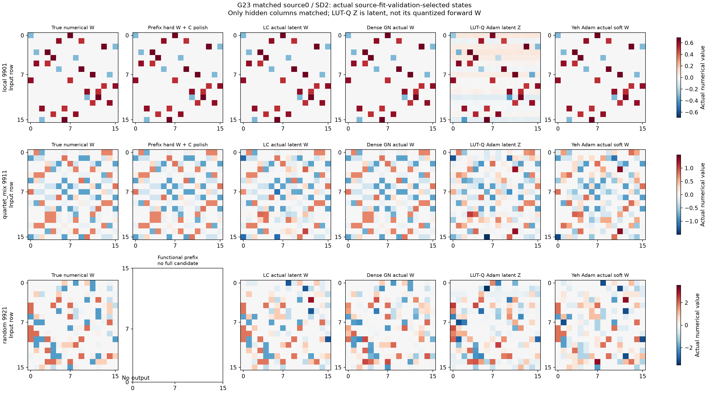
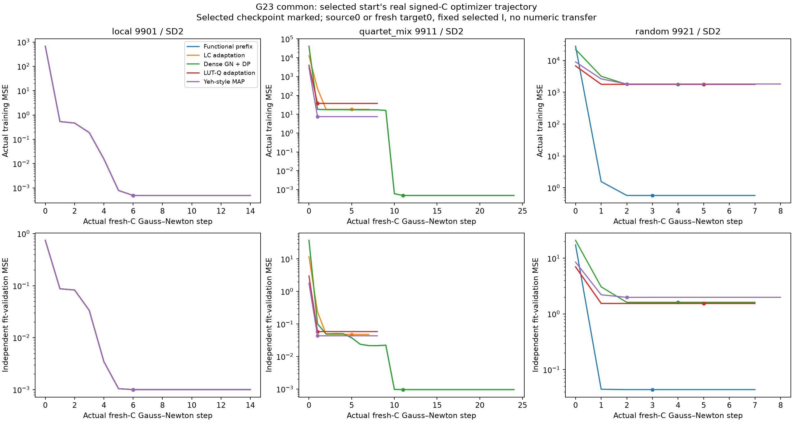
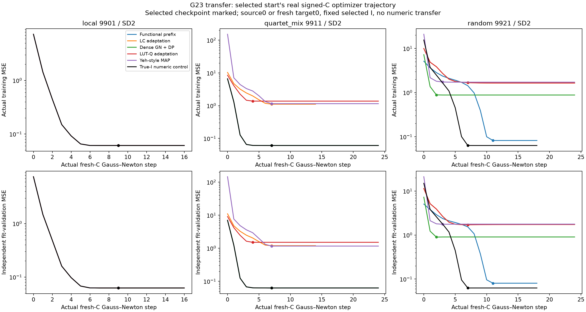
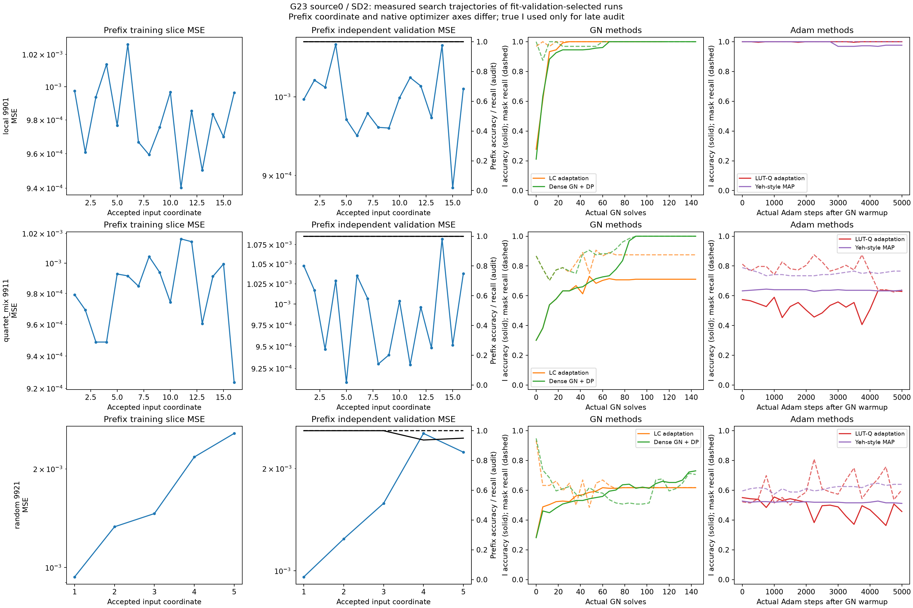

# G23: общий индексатор нескольких задач и перенос только структуры

Независимый пилот: шесть новых I, по две геометрии local/mixed/random, четыре независимых source-C и восемь новых target-C на I. 24 исходные и 48 целевых функций наблюдаются в двух парных шумовых условиях. Это шесть независимых структур, не 48 или 96 независимых геометрий.

| Шум | Выбор | Метод | Точный I / 6 | Истина в банке / 6 | Неверный полный I | Нет кандидата | Target coverage | Clean target MSE* | Excess к true-I* |
|---|---|---|---|---|---|---|---|---|---|
| 0.2 | source1 | Functional prefix | 5/6 | 5/6 | 0 | 1 | 40/48 | 9.07198e-07 | 0 |
| 0.2 | source1 | LC adaptation | 1/6 | 1/6 | 5 | 0 | 48/48 | 0.684098 | 0.684097 |
| 0.2 | source1 | Dense GN + DP | 3/6 | 3/6 | 3 | 0 | 48/48 | 0.291773 | 0.291772 |
| 0.2 | source1 | LUT-Q adaptation | 1/6 | 1/6 | 5 | 0 | 48/48 | 0.658505 | 0.658504 |
| 0.2 | source1 | Yeh-style MAP | 1/6 | 1/6 | 5 | 0 | 48/48 | 0.738966 | 0.738965 |
| 0.2 | common4 | Functional prefix | 6/6 | 6/6 | 0 | 0 | 48/48 | 8.61825e-07 | 0 |
| 0.2 | common4 | LC adaptation | 3/6 | 3/6 | 3 | 0 | 48/48 | 0.615423 | 0.615423 |
| 0.2 | common4 | Dense GN + DP | 4/6 | 4/6 | 2 | 0 | 48/48 | 0.261856 | 0.261855 |
| 0.2 | common4 | LUT-Q adaptation | 2/6 | 2/6 | 4 | 0 | 48/48 | 0.635201 | 0.635201 |
| 0.2 | common4 | Yeh-style MAP | 2/6 | 2/6 | 4 | 0 | 48/48 | 0.605223 | 0.605222 |
| 2.0 | source1 | Functional prefix | 4/6 | 4/6 | 1 | 1 | 40/48 | 0.0301683 | 0.030038 |
| 2.0 | source1 | LC adaptation | 1/6 | 1/6 | 5 | 0 | 48/48 | 0.748618 | 0.748499 |
| 2.0 | source1 | Dense GN + DP | 3/6 | 3/6 | 3 | 0 | 48/48 | 0.582477 | 0.582357 |
| 2.0 | source1 | LUT-Q adaptation | 1/6 | 1/6 | 5 | 0 | 48/48 | 0.785049 | 0.78493 |
| 2.0 | source1 | Yeh-style MAP | 1/6 | 1/6 | 5 | 0 | 48/48 | 0.730406 | 0.730286 |
| 2.0 | common4 | Functional prefix | 5/6 | 5/6 | 1 | 0 | 48/48 | 0.00985693 | 0.00973741 |
| 2.0 | common4 | LC adaptation | 3/6 | 3/6 | 3 | 0 | 48/48 | 0.696467 | 0.696347 |
| 2.0 | common4 | Dense GN + DP | 4/6 | 4/6 | 2 | 0 | 48/48 | 0.31789 | 0.31777 |
| 2.0 | common4 | LUT-Q adaptation | 3/6 | 3/6 | 3 | 0 | 48/48 | 0.638313 | 0.638194 |
| 2.0 | common4 | Yeh-style MAP | 3/6 | 3/6 | 3 | 0 | 48/48 | 0.724825 | 0.724706 |

*MSE и excess усреднены только по структурам с полным выходом; доля доступных задач приведена отдельно, отказы не объявлены нулевой ошибкой. Excess сравнивает с обучением свежего C на истинном I на тех же support/validation и с теми же 32 стартами; это численный контроль, не перенос истинного C.

## Протокол выбора и границы интерпретации

Каждый метод извлекает до четырёх уникальных I из каждой source-задачи по fit-validation. Общий банк объединяет четыре задачи. Для каждого I все четыре кодбука обучаются заново из 32 signed стартов. Все предсказатели заморожены до открытия отдельной meta-selection Y; затем заморожены все выбранные I и только потом открыт структурный аудит. Source1 ограничивает и происхождение, и оценку задачей0. Все методы используют одинаковые панели и общий внешний протокол.

На переносе I неизменен, C каждого нового задания обучается с нуля. Ни source-C, ни W не переносятся. Все target-модели заморожены до clean-test аудита. Gaussian интервалы относятся к различию design-risk фактически fitted предсказателей внутри одного фиксированного банка; это не сертификаты истинного I, population-risk или глобального численного optimum C.

LC, LUT-Q и Yeh-style — раскрытые адаптации известных objectives к signed кодбуку и известному bias/readout, а не неизменённые авторские скрипты. Dense GN + DP имеет явный дополнительный проекционный readout. Fixed-I numerical polish не изменяет назначения native-метода и не подаётся обратно в его траекторию. Больший HPO бюджет конкурентов сохранён полностью.

## Цена данных и вычислений

Source: 275,196,674,048 физических наблюдений на функцию/шум, включая все осевые, prefix, fit-validation и meta панели. На четыре source-функции одного I: 1,100,786,696,192. Точная симуляция Gaussian means не делает эти повторы бесплатными данными. Target: 2,621,440 noisy labels на восемь функций одного I/шум и отдельно 65,536 clean evaluations.

| Метод | Source jobs | Траектории | Сумма worker seconds |
|---|---|---|---|
| Functional prefix | 48 | 192 | 240.38 |
| LC adaptation | 48 | 576 | 6361.24 |
| Dense GN + DP | 48 | 576 | 6934.31 |
| LUT-Q adaptation | 48 | 576 | 17883.07 |
| Yeh-style MAP | 48 | 1152 | 32085.71 |

Worker seconds — сумма измеренных длительностей, не FLOPs и не календарное время всей параллельной серии. Численные fits одинаковых canonical I переиспользованы между методами только при одинаковых observations/initials; их общий учёт сохранён отдельно в summary.json, без заявления matched compute.

## Графики и артефакты

Последний рисунок показывает source0/SD2 и checkpoint по source-fit-validation, который может отличаться от выбранного общего I. LUT-Q показывает настоящий latent Z; он не обозначен как quantized forward W. Yeh показывает actual soft W. Численные значения не переименованы; выровнены только hidden columns.

Кривые используют сохранённые реальные шаги; coordinate-prefix, GN solves и Adam steps не объединены в фиктивную общую шкалу. Численные train/validation кривые показаны для selected start и выбранного checkpoint. Полные построчные результаты: comparison.csv, source_family_metrics.csv, target_family_metrics.csv и summary.json; исходные протоколы/snapshots/freezes сохранены.

## Что эта серия не доказывает

Известны общий bias=.15, readout=1/sqrt(H), D=H16 и K4; использованы активные запросы и очень высокая точность осевых means. Шесть новых I — пилот, не окончательная confirmation. Нужны свободные bias/readout, другие шумы и независимое подтверждение. Hypothesis selection, GN, nearest-code и block coordinate descent известны; их применение само по себе не новизна. Приоритет функциональной count-факторизации и преимущество собственного компонента над подходящими сильными functional-extraction контролями ещё требуется установить. Большая цель пользователя остаётся active.
