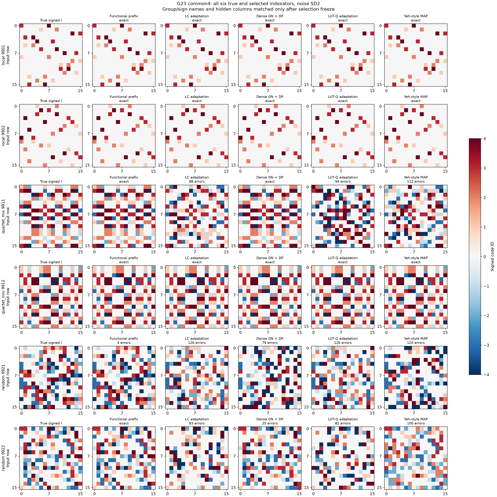
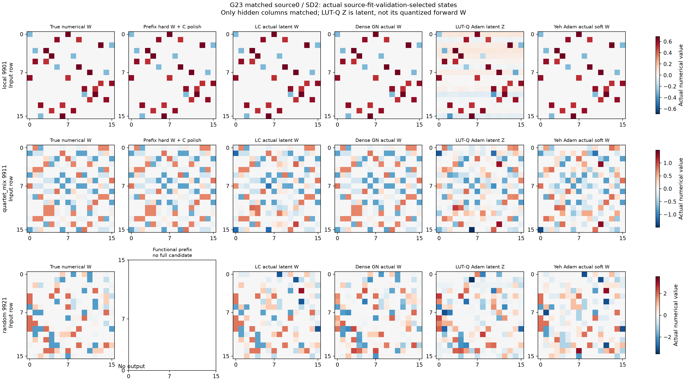
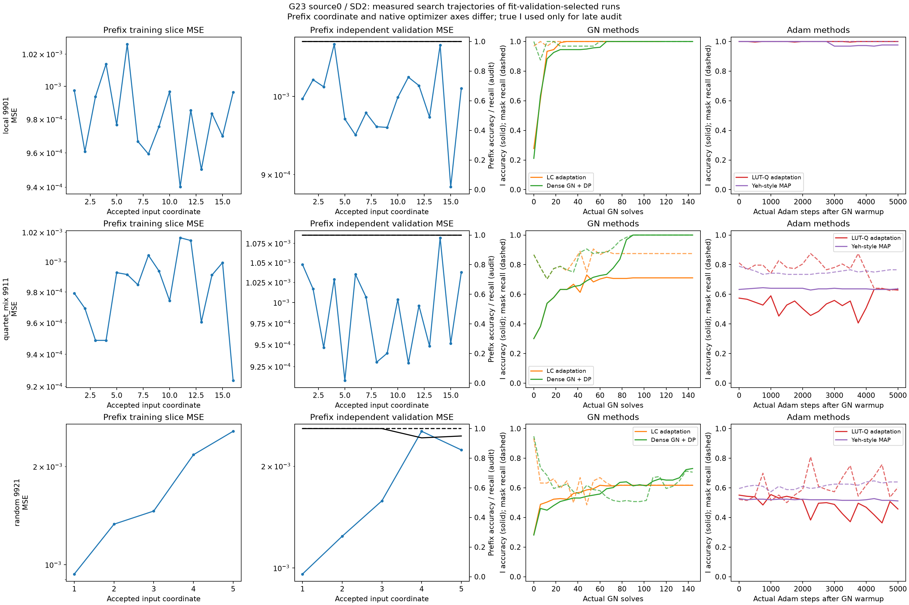
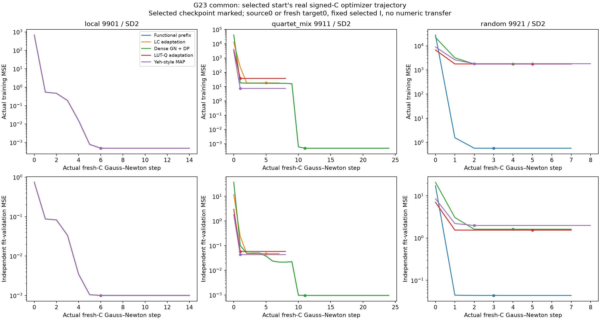

# G23: сравнение восстановления структуры

Основной критерий — точный signed индексатор: нули, группы шэринга и знаки, с точностью до глобального переименования групп/знаков и перестановки hidden columns. Входные строки не переставляются. Шесть новых независимых I, четыре source-C на I, два парных шумовых условия. Качество кодбука не подменяет критерий структуры.

| Шум | Выбор | Метод | Точная маска / 6 | Верные unsigned группы / 6 | Точный signed I / 6 | Истина в банке / 6 | Ошибка выбора при наличии истины | Нет кандидата |
|---|---|---|---|---|---|---|---|---|
| 0.2 | source1 | Functional prefix | 5/6 | 5/6 | 5/6 | 5/6 | 0 | 1 |
| 0.2 | source1 | LC adaptation | 2/6 | 1/6 | 1/6 | 1/6 | 0 | 0 |
| 0.2 | source1 | Dense GN + DP | 3/6 | 3/6 | 3/6 | 3/6 | 0 | 0 |
| 0.2 | source1 | LUT-Q adaptation | 1/6 | 1/6 | 1/6 | 1/6 | 0 | 0 |
| 0.2 | source1 | Yeh-style MAP | 2/6 | 1/6 | 1/6 | 1/6 | 0 | 0 |
| 0.2 | common4 | Functional prefix | 6/6 | 6/6 | 6/6 | 6/6 | 0 | 0 |
| 0.2 | common4 | LC adaptation | 3/6 | 3/6 | 3/6 | 3/6 | 0 | 0 |
| 0.2 | common4 | Dense GN + DP | 4/6 | 4/6 | 4/6 | 4/6 | 0 | 0 |
| 0.2 | common4 | LUT-Q adaptation | 2/6 | 2/6 | 2/6 | 2/6 | 0 | 0 |
| 0.2 | common4 | Yeh-style MAP | 2/6 | 2/6 | 2/6 | 2/6 | 0 | 0 |
| 2.0 | source1 | Functional prefix | 4/6 | 4/6 | 4/6 | 4/6 | 0 | 1 |
| 2.0 | source1 | LC adaptation | 2/6 | 1/6 | 1/6 | 1/6 | 0 | 0 |
| 2.0 | source1 | Dense GN + DP | 3/6 | 3/6 | 3/6 | 3/6 | 0 | 0 |
| 2.0 | source1 | LUT-Q adaptation | 1/6 | 1/6 | 1/6 | 1/6 | 0 | 0 |
| 2.0 | source1 | Yeh-style MAP | 1/6 | 1/6 | 1/6 | 1/6 | 0 | 0 |
| 2.0 | common4 | Functional prefix | 6/6 | 5/6 | 5/6 | 5/6 | 0 | 0 |
| 2.0 | common4 | LC adaptation | 3/6 | 3/6 | 3/6 | 3/6 | 0 | 0 |
| 2.0 | common4 | Dense GN + DP | 4/6 | 4/6 | 4/6 | 4/6 | 0 | 0 |
| 2.0 | common4 | LUT-Q adaptation | 3/6 | 3/6 | 3/6 | 3/6 | 0 | 0 |
| 2.0 | common4 | Yeh-style MAP | 3/6 | 3/6 | 3/6 | 3/6 | 0 | 0 |

До teacher-аудита заморожены все source-кандидаты, все численные fits до meta-Y и все выбранные I. Общая meta-selection обёртка одинакова для методов. LC/LUT-Q/Yeh-style — objective-level адаптации; dense GN имеет явный DP-readout. Прямой functional-prefix метод строит назначения из функциональных counts. Полные результаты по каждой геометрии и группам задач сохранены в CSV/JSON.

Точная маска допускает оптимальную перестановку hidden columns независимо от номеров групп. Unsigned I дополнительно проверяет равенство модулей весов с глобальным переименованием групп. Signed I также требует верных знаков с точностью до одного глобального переворота каждой группы. Поэтому точный signed I подразумевает точный unsigned I, а тот — точную маску. CSV отдельно содержит mask failures, sharing failures при верной маске и sign failures при верном unsigned I.

Пилот использует известные common bias/readout и активные запросы. Полная цена наблюдений — 275,196,674,048 labels на source-функцию/шум. Перенос на новые задачи проверяется отдельно и ещё не включён в эту таблицу. Эта публикация не является утверждением о завершении общей цели, конкурентном превосходстве или доказанном приоритете нового метода.
