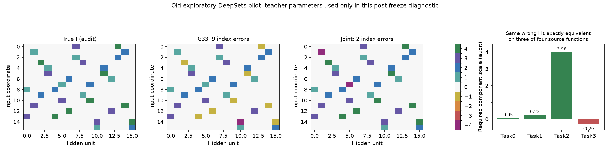

# G34: разведочный совместный поиск на старом фиксированном пилоте

Данные старого пилота, не независимая проверка. Наблюдений не добавлено. Новые модули blind_joint_bank.py/blind_joint_job.py; исходный вариант и его артефакты сохранены в joint_v1_snapshot внутри каждого fits/*_c1.

| Задача | Выбор | Ошибки I | Mask F1 | Meta MSE |
|---|---|---:|---:|---:|
| deepsets | joint_functional | 9/256 | 1.00 | 3.96e-02 |
| deepsets | joint_paired_geometry | 2/256 | 1.00 | 3.96e-02 |
| deepsets | joint_bic | 9/256 | 0.98 | 3.96e-02 |
| pattern_0110 | joint_functional | 0/88 | 1.00 | 4.06e-02 |
| pattern_0110 | joint_paired_geometry | 0/88 | 1.00 | 4.06e-02 |
| pattern_0110 | joint_bic | 0/88 | 1.00 | 4.06e-02 |
| general_random | joint_functional | 0/256 | 1.00 | 4.07e-02 |
| general_random | joint_paired_geometry | 0/256 | 1.00 | 4.07e-02 |
| general_random | joint_bic | 0/256 | 1.00 | 4.07e-02 |

Paired geometry уменьшил DeepSets-ошибку с9 до2 позиций; точного выбранного I всё ещё нет. BIC-контроль не исправил результат. На Pattern и общей синтетике выбран точный I.

Отдельный post-freeze аудит joint_identifiability_audit.json показал, что ошибочный DeepSets I с двумя неверными связями через код4 воспроизводит3/4 исходных функций точно после положительного масштабирования компонента. Максимальное различие1.18e-15 на4096 входах. Для четвёртой функции нужный масштаб отрицателен; конструкция перестаёт быть симметрией ReLU. Teacher использовался только этим аудитом, не выбором I.

Следующий контроль проверяет16 задач при том же суммарном числе исходных наблюдений. Его истина закрыта до заморозки всей новой серии. Ни один из этих пилотов не заменяет закрытую проверку.

