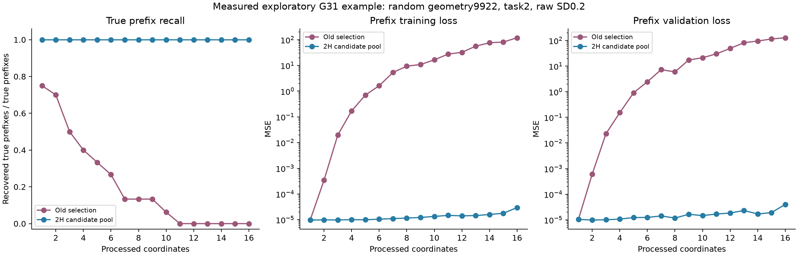

# G31: разработка поиска двух индексаторов

6 ноября2026. Этот каталог содержит открытые диагностические опыты. [Текущий метод](../../../METHOD_CURRENT.md), [независимая проверка и полный отчёт G32](../synchronized_two_layer_g32/REPORT.md).

## Потеря префиксов

На48отдельных поисках прежней G30-синты old впервые теряет истинный префикс в40случаях, обычно на первой/второй координате. Вклад слабого компонента может быть ниже прежнего допуска по общей MSE; это отличается от парного сравнения моделей на одних ответах.

|Отбор|Банков с истинным I1 приσ0.2, из6|Приσ2, из6|
|---|---:|---:|
|Прежняя минимальная поддержка с допуском|3|0|
|Минимальная validation-ошибка без прежнего допуска|6|1|
|Парный допуск|5|0|
|Сохранять H промежуточных атомов|6|1|
|Сохранять2H|6|1|
|Сохранять4H|6|0|

После одинакового общего численного отбора2H даёт6/6выбранныхI1 и1/6, старые префиксы3/6и0/6. Это просмотренные геометрии. Резерв2H выбран без отдельного выигрыша4H по числу восстановленных семейств.

[Протокол](protocol.json), [все поиски](pilot_summary.json), [первые потери](pilot_first_loss.json), [общий freeze](pilot_frozen.json), [структурный аудит](pilot_structure_audit.json).

## Компенсация и неизвестная голова

Контроль двух нейронов(c,c)/(c,−c),W2=(a,−a) имеет нулевой первый срез и ненулевую полную функцию. Истинный C1 задан только для диагностики, I1/I2 неизвестны. Old0/4,keep2 4/4 приσ0и0.2; затем неизвестный знаковый I2 восстанавливается. [Контроль](cancellation_control/evaluation.json). Малый кодбук W2 сам по себе не решает раннюю невидимость префикса.

## Новый разработочный набор и симметрии

confirmation/ содержит22случая:6новыхгеометрий с free/tied2/tied4головами и scalar/vectorвыходами плюс Pattern/DeepSets.4source-функции,2парныхшума,безотбраковкиC1. Для I1 с2H при умеренном шуме free6/6,tied2 5/6,tied4 5/6; при сильном6/6,3/6,3/6. Этот набор затем открыт для разработки головы и потому не является независимой проверкой окончательного варианта.

Native I2 ищется функциональными объединениями групп с неизвестным K2. Он сначала распадался на local/quartet/DeepSets. Фиксация осевого C1 не помогла; контроль истинных I1/C1 восстанавливал I2 во всех6геометриях каждого типа при умеренном шуме. Причина — разные задачи могли выбрать разные допустимые симметрии I1, поэтому позиции голов не были согласованы.

После совместного выбора систем координат и I2 оба индексатора умеренного режима точны5/6для tied2и5/6для tied4 — во всех случаях с уже правильным I1. Для свободной головы2/6получили ложные объединения. Дополнительные независимые gate-ответы убрали эти false-sharing, но пропустили один истинный tied4. Поэтому все варианты перенесены в отдельный G32 без дальнейшего HPO.

[Изначальный аудит](confirmation/structure_audit.json), [согласованный аудит](confirmation/joint_symmetry_audit.json), [осевой/oracle-контроль](confirmation/axis_anchor_ablation/evaluation.json), [синхронизированный поиск](confirmation/synchronized_head_ablation/evaluation.json), [независимый gate на разработочных геометриях](confirmation/head_gate/evaluation.json).

Все изменения после открытия набора зарегистрированы отдельно. Истинные структуры не подавались learner. Новые target-подгонки не запускались. Программных тестов нет; сохранены численные fits, сами дискретные матрицы и префиксы по шагам.
