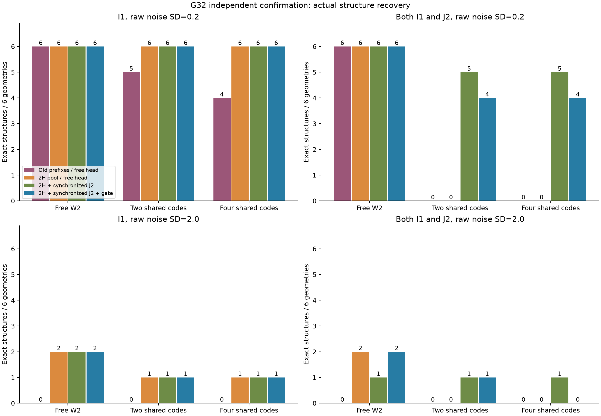
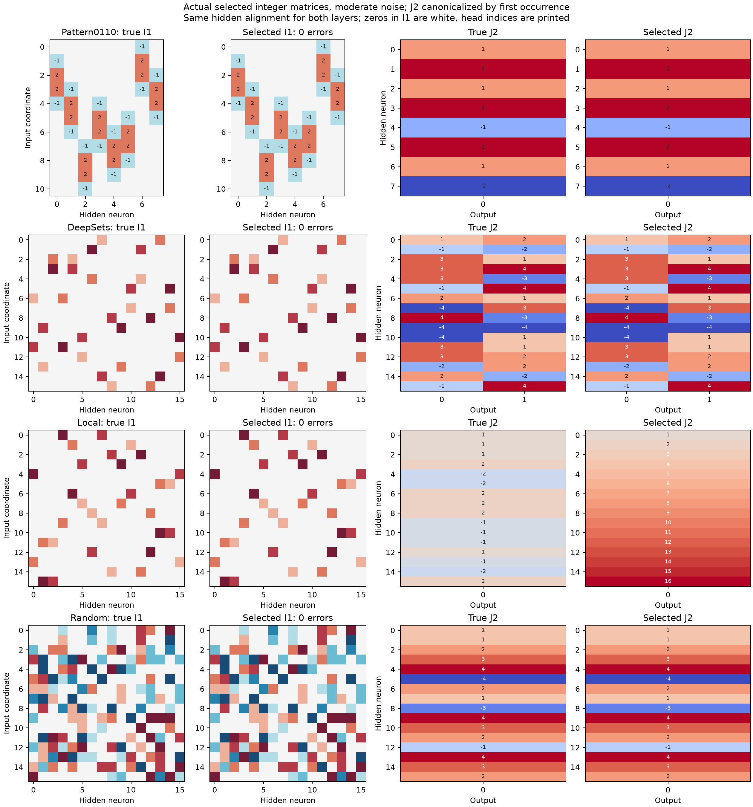
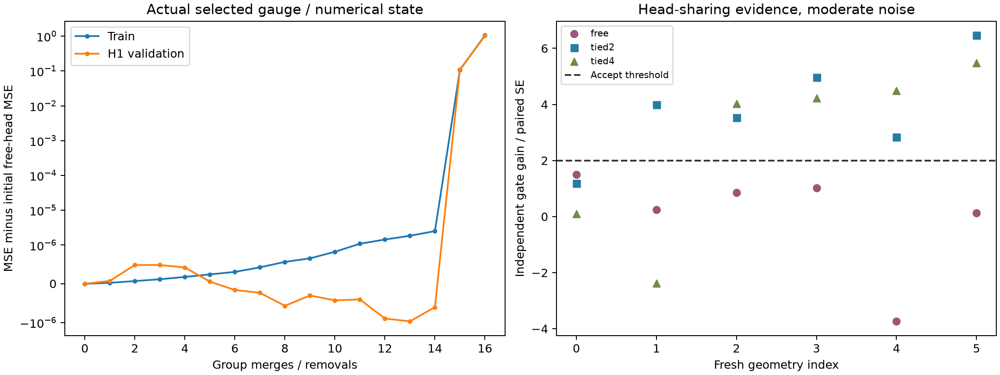
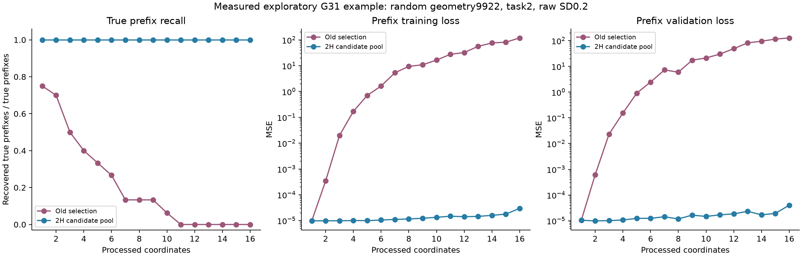

# Поиск двух индексаторов: диагностика G31 и независимый контроль G32

6 ноября 2026. Главная цель — правильные связи и группы равенства весов. Новые target-подгонки кодбуков не запускались.

**Метод полностью переписан в [METHOD_CURRENT.md](../../../METHOD_CURRENT.md): все определения, постановка с argmin, оба индексатора и кодбука, восемь шагов и псевдоалгоритм.** Исторические G29/G30 не перезаписывались.

## Причины нестабильности при малом шуме

**Ранняя необратимая потеря префиксов.** Старый алгоритм оставлял минимальную поддержку в пределах допуска по общей validation-MSE. На replay всех 48 source-поисков G30 первая потеря истинного префикса произошла в40; медиана — первая координата, при умеренном шуме — вторая. В9/16 умеренных и19/24 сильных первых потерь стоимость удаления отсутствующего атома из истинной поддержки меньше прежнего допуска. Это не объясняет все отказы, но локализует существенную часть проблемы. [Измерения](../guarded_two_layer_g31/pilot_first_loss.json).

При сравнении двух моделей на одних ответах квадрат шума сокращается. Допуск по колебаниям каждой MSE отдельно слишком груб для различения слабых компонентов. Новый поиск сохраняет резерв2H промежуточных атомов, H на последнем шаге; маленький вклад сам по себе больше не заставляет сразу удалить префикс.

**Знаковая компенсация W2.** Коэффициент раннего префикса — сумма выходных весов ещё не разделённых нейронов. Она может быть нулевой даже при точном шэринге. Контроль: два нейрона с весами(c,c)/(c,−c), головы a,−a; первый координатный срез нулевой, полная функция ненулевая. При заданном истинном C1 только для изоляции этой причины old дал0/4 точных I1 даже без шума, reserve2H —4/4. При умеренном шуме то же. I2 не задан и восстановлен в успешных случаях. [Контроль](../guarded_two_layer_g31/cancellation_control/evaluation.json). Округлять суммарные коэффициенты префиксов к отдельным значениям кодбука W2 неправильно.

**Несогласованные симметрии задач.** Один найденный I1 может допускать переименование кодов вместе с перестановкой скрытых каналов. Если разные задачи выбирают разные эквивалентные численные представления, одинаковые позиции W2 имеют разные роли. Общий шэринг головы тогда распадается. Допустимые преобразования теперь вычисляются из самого найденного I1; teacher-роли и перестановки не передаются.

Простая фиксация осевого C1 без согласования симметрий не помогла. При истинных I1/C1 и неизвестном I2 диагностический контроль G31 восстановил голову во всех шести геометриях каждого типа при умеренном шуме. После учёта симметрий медианная относительная ошибка W1 по осевым оценкам была0.000215, после свободной численной подгонки0.00263 при умеренном шуме. Первоначальное сравнение без per-task выравнивания давало искусственно огромные ошибки; оно сохранено только как диагноз несогласованной системы координат. [Численный контроль](../guarded_two_layer_g31/confirmation/numerical_drift_diagnosis.json).

## Как проверялась индексированная W2

I1 имеет размер D×H, I2 — H×O. Каждая позиция использует ноль или ровно один знаковый индекс, у каждого слоя свой численный кодбук каждой задачи. Истинные I1/I2/C1/C2, роли координат, число связей и K2 не сообщаются поиску. Свободная W2 остаётся допустимой: K2=H·O, один код на позицию.

Полный I1 получается прямым дискретным поиском, без заданной бинарной маски. Затем поиск I2 начинается с независимых весов и объединяет знаковые группы либо зануляет группу по функциональной LS-стоимости на нескольких задачах. Числа C2 подгоняются LS после каждого шага. K-means или кластеризация плотной W2 не используются.

H1 совместно выбирает I2, допустимые системы скрытых координат задач и одно из двух численных состояний C1: осевое либо после16шагов совместной подгонки. Для каждой гипотезы I1 новые независимые ответы сравнивают полученный шэринг со свободной головой **при тех же I1/C1**. Равенства принимаются при выигрыше больше двух эмпирических SE парной разности; иначе голова остаётся свободной. После этого отдельная meta выбирает общий I1.

## Что является независимой проверкой

G31 — разработочный этап: replay старых геометрий, затем новый набор, на котором исследовались симметрии и проверка головы. Его результаты не выдаются за независимое подтверждение всех последующих решений. [Отчёт G31](../guarded_two_layer_g31/REPORT.md).

G32 создан отдельно после фиксации варианта:6новых геометрий local/quartet_mix/random, по4source-функции. Скалярные и векторные выходы сбалансированы. Каждая геометрия имеет free/tied2/tied4 вариант W2. Добавлены новый численный случай фиксированного Pattern0110 и новый скрытый DeepSets, каждый со свободной/общей головой. Всего22случая×2парных шума=44условия. C1 не отбраковываются по малости или близости.

Шесть синтетических I1 отличаются от всех шести разработочных I1 G31 с учётом разрешённой канонизации; пересечений нет. Три головы одной геометрии не считаются тремя независимыми геометриями. Pattern остаётся одним фиксированным паттерном0110.

Дополнительный gate G32 зарегистрирован **до первого bootstrap learner**:4096новых Gaussian-входов/задачу, среднее64измерений, порог2парныеSE. После просмотра G32 ни он, ни алгоритм не настраивались.

## Итог G32 при умеренном шуме

Ячейка содержит **число точных I1 / число точных пар I1+I2**, каждый знаменатель равен6. Все отказы и ошибки учитываются. Для свободной головы правильный I2 означает отсутствие навязанных равенств.

|Метод|Свободная W2|Два кода W2|Четыре кода W2|
|---|---:|---:|---:|
|Старый отбор префиксов, свободная голова|6 · 6|5 · 0|4 · 0|
|Резерв2H, свободная голова|6 · 6|6 · 0|6 · 0|
|Резерв2H, I2 без согласования задач|6 · 6|6 · 3|6 · 2|
|Резерв2H, согласованные задачи и I2|6 · 6|6 · 5|6 · 5|
|Финальный вариант с независимым gate|**6 · 6**|**6 · 4**|**6 · 4**|

Первый индексатор найден в **18/18 случаев**, соответствующих6геометриям с3головами; старый отбор —15/18. Резерв2H уже даёт18/18 со свободной W2, без дополнительных gate-запросов. Поэтому улучшение I1 не объясняется только предположением о шэринге головы или дополнительными данными.

Принудительный K2=4 дал точный I1 только5/6 каждого типа и неверный I2 у всех свободных голов. Маленький кодбук W2 нельзя навязывать произвольной задаче.

## Сильный шум и дополнительные задачи

|Голова|Старый поиск: I1/оба|Резерв2H, свободная W2: I1/оба|Согласованный I2: I1/оба|Финальный gate: I1/оба|
|---|---:|---:|---:|---:|
|Свободная|0 · 0|2 · 2|2 · 1|2 · 2|
|Два кода|0 · 0|1 · 0|1 · 1|1 · 1|
|Четыре кода|0 · 0|1 · 0|1 · 1|1 · 0|

Знаменатели снова6. Сильный шум остаётся нерешённым: точный I1 только4/18. Успех умеренного режима не является гарантией для любого шума.

При умеренном шуме правильны оба индексатора в каждом из4дополнительных случаев Pattern/DeepSets со свободной/общей головой. У Pattern I1=11×8,K1=2; у DeepSets16×16,K1=4. DeepSets использует произвольный дискретный шэринг двух выходов, без заранее сообщённой pooled-головы. При сильном шуме оба случая Pattern точны; у DeepSets2/3ошибки I1 со свободной/общей головой, поэтому точного совместного восстановления нет.

В строке Local показана и неудача: I1 точен, правильная двухкодовая голова найдена, но gate её не принял и вернул16независимых групп. Цветовые шкалы слоёв независимы; номера групп напечатаны. [Все выбранные матрицы](confirmation/head_gate/aligned_indices.npz).

## Оставшиеся ошибки I2

Согласование повысило точность обеих структур до5/6 для двух- и четырёхкодовых голов; независимый gate снизил её до4/6. Это осторожный отказ от некоторых истинных равенств, а не доказанное улучшение exact-I2 на G32.

В new_0_tied2 правильный кандидат уже найден, но свежий выигрыш7.40e−7 приSE6.25e−7 меньше порога. В new_0_tied4 выигрыш5.05e−8 приSE4.92e−7. В new_1_tied2 поиск оставил4группы вместо2: функциональный выигрыш прошёл gate, но шэринг неполон. В new_1_tied4 оставил17вместо4, и gate вернул свободную голову.

Отдельный **post-freeze oracle-контроль только двух явно выбранных new_1 случаев** с истинными I1/C1 и неизвестным I2 восстановил правильные головы на тех же ответах. Оставшийся сбой связан с ограниченным согласованием/калибровкой численных состояний, а не доказанной невозможностью восстановления. Контроль не включён в primary и не использовался для нового HPO: [диагноз](confirmation/remaining_head_diagnosis.json).

Следовательно, индексировать W2 можно и полезно при наличии шэринга. Само это представление не устраняет ранние потери I1 и не гарантирует определение всех истинных равенств при конечном шумном наборе.

Слева — реальные train/H1-кривые для выбранных системы координат и состояния, с вычитанием ошибки исходной свободной головы; X — число объединений/занулений. Справа — парный выигрыш независимого gate, порог2. Польза по ошибке функции не доказывает exact-I2.

Это разработочный пример random9922/task2, а не новая независимая победа. Префиксы сохранены до teacher-аудита, recall измерен по ним после замораживания. Исторические отсутствующие метрики не выдумывались.

## Бюджет и границы общности

Learner не получает координатные роли, блоки, true-mask или teacher-перестановки. Допускаются свободная W2 и неизвестный K2. Но сохраняются ReLU, известные D/H/O/K1 и общий ненулевой hidden bias, активные вещественные запросы. Это не универсальный NAS любой MLP с неизвестными bias и не восстановление только по бинарным меткам.

Осевая точность соответствует среднему4,194,304измерений. Prefix:2048train/512validation на координату, среднее4096измерений. Поэтому сыройσ0.2/2 означает prefixSD0.003125/0.03125. Support/H0/H1/meta/gate используют среднее64измерений, SD0.025/0.25. Support4096,H0/H1по1024,meta2048,gate4096. Gaussian шум симулируется в распределении среднего, миллионы labels не сохраняются. Эффективность по числу oracle-запросов не доказана.

Резерв2H и жадные пути конечны, численная подгонка ограничена16GN-шагами, согласования —4096комбинациями. Глобальный оптимум не сертифицирован. Полная компенсация на всём пространстве делает параметры ненаблюдаемыми; при малых функциональных различиях шумной выборки может не хватить для точного I. Новых target-подгонок и бинарной классификации в этой серии нет: приоритет пользователя — индексатор.

## Воспроизводимость

[Протокол](confirmation/protocol.json), [gate-регистрация до learner](confirmation/head_gate/registration.json), [общий freeze до gate/teacher](confirmation/combined_source_frozen.json), [gate-предикторы](confirmation/head_gate/predictors_frozen.json), [итоговые решения](confirmation/head_gate/decisions_frozen.json), [структурный аудит](confirmation/head_gate/evaluation.json), [все варианты](summary.json), [CSV](structure_table.csv), [аудит хэшей](provenance_audit.json).

Аудит подтвердил692замороженных артефакта. Для I2 учитываются все совместимые глобальные симметрии I1, а не одно произвольно выбранное сопоставление столбцов. Исходные аудиты сохранены; согласованные метрики находятся в joint_symmetry_audit.json.

[Поточечный аудит представления](function_parity_audit.json) проверил352сохранённых предиктора на реальных meta-панелях: преобразование кодов и скрытых столбцов сохранило каждое предсказание, максимальная разность0. Сравнивалась сама функция, а не только её MSE.

Все процессы завершены. CPU использовался для осевых/префиксных/групповых поисков, GPU0–3 — для пакетной численной калибровки; GPU6/7 не использовались. Программных тестов нет. Минимальные проверки стиля, замороженных артефактов и изображений выполнены.
