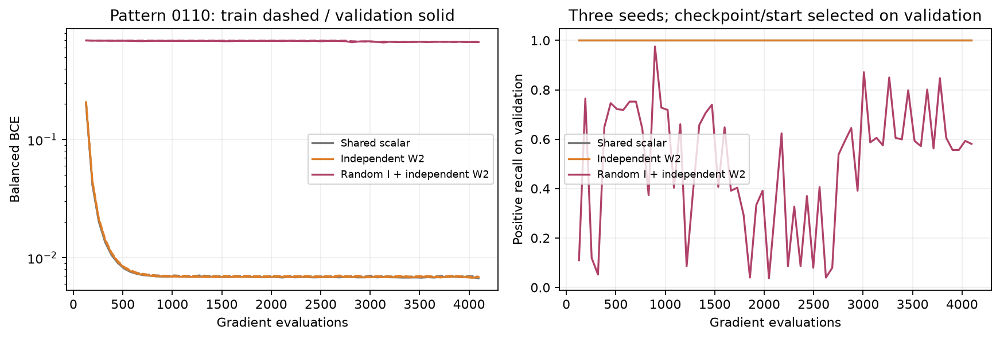
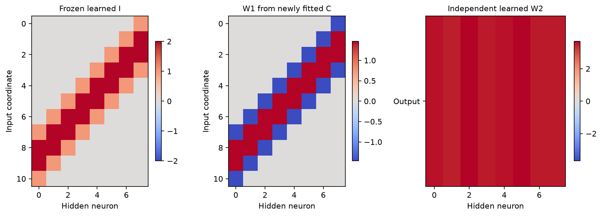
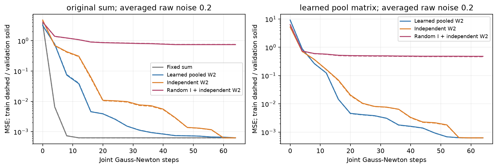
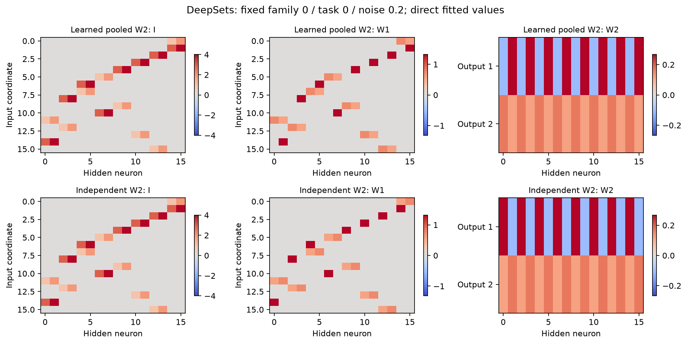

# Совместное обучение кодбука и W2 при найденном индексаторе

Совместное обучение C и полностью свободной W2 успешно при уже найденном I: Pattern0110 даёт100% всех2048строк для выбранной по validation модели в каждом из3seed. На DeepSets свободная голова решает32/32скалярных и32/32новых двухмерных функций в обоих условиях шума при пороге testNMSE<1e−4. Без шума meanNMSE~1.48e−25/1.38e−27; при усреднённом rawσ0.2~5.79e−6/6.09e−6. Общая матрица после pooling при этом шуме точнее:1.80e−6/1.53e−6, с сохранением архитектурной инвариантности.

Проверяется численная адаптация уже найденного и замороженного I. Поиск I при неизвестной W2 этим экспериментом не проверяется. Индексаторы взяты из G26/G27 без изменения; все C, W2 и состояния оптимизаторов инициализируются заново.

## Метод и протокол

Первый слой задаётся индексатором и удвоенным кодбуком:

$$
W_{1,dh}=\operatorname{sgn}(I_{dh})c_{|I_{dh}|},\qquad c_0=0.
$$

Pattern 0110: два числа C, общий обучаемый скрытый bias, выходной bias. Базовая голова — общий обучаемый скаляр (всего 5 параметров), свободная W2 — восемь независимых коэффициентов (12 параметров). Одинаковые 768 support / 256 validation / 512 test, ещё 512 резервных точек. Полный куб2048 оценивается дополнительно. Три независимых набора стартов,32старта на каждый из двух LR0.01/0.03,4096вычислений градиента Adam. По64шага для обеих ветвей C/-C входят в общий бюджет. Все численные параметры обновляются совместно, L2=0.001; head penalty усредняется по коэффициентам. Выбор checkpoint/start/LR только по validation BCE.

DeepSets: четыре прежние геометрии, восемь функций на геометрию. Исходная скалярная задача повторно использует support/validation G27. Дополнительные32новые векторные функции используют новые Gaussian C и новую знаковую матрицу2x2 после pooling двух локальных признаков; она повторяется по восьми точкам. Полностью свободная голова ученика имеет размер2x16. Этот teacher сохраняет инвариантность множества.

Головы: фиксированная сумма; общая обучаемая матрица после pooling; независимая W2 по всем16нейронам. Группы pooled-головы выводятся только из сигнатур столбцов найденного I, без teacher point-pairing. Random-I контроль сохраняет количества кодов/нулей, но перемешивает позиции. Полностью свободная W2 сама по себе не гарантирует симметрию множества.

В регрессии известный общий b=0.15 сохраняется. Неизвестный выходной сдвиг определяется наблюдаемым ответом в нуле:

$$
\widehat f_t(x)=\bar y_t(0)+\sum_h a_{t,h}\left([b+(W_{1,t}^{\mathsf T}x)_h]_+-[b]_+\right).
$$

Используются4096support/1024validation/8192test,64свежих знаковых старта. Одновременный damped Gauss-Newton по C и W2,64шага с backtracking; validation выбирает checkpoint/start. Это совместная оптимизация, без поочерёдного фиксирования C/W2. Для половины стартов W2 инициализируется одинаковыми коэффициентами, для половины — независимыми случайными. Никакие истинные C/W2 не инициализируют learner. Шум raw0/0.2 усреднён по64ответам: SD среднего0/0.025. Опорный ответ в нуле использует262144повтора. Gaussian-средние симулируются аналитически, как в G27.

Все численные предсказатели фиксируются до первого нового test/permutation-аудита. NMSE = MSE / средняя по выходам дисперсия чистых test-ответов. Перестановочная ошибка — RMS разброса выходов для16перестановок каждого из64новых множеств, делённая на test SD. Контроль исследует обучение при верном найденном I и не сравнивает весь вычислительный бюджет конкурентов.

## Pattern 0110

| Голова | Test BA, среднее | Худший seed | BCE | Полных успехов среди стартов |
|---|---:|---:|---:|---:|
|Shared scalar|100.00%|100.00%|0.00677|172/192|
|Independent W2|100.00%|100.00%|0.00683|172/192|
|Random I + independent W2|52.36%|49.21%|0.68301|0/192|

## DeepSets

| Задача | Raw noise | Голова | Средняя NMSE | Худшая NMSE | NMSE<1e-4 | Перестановочный RMS/SD |
|---|---:|---|---:|---:|---:|---:|
|original_sum|0.0|Fixed sum|9.309e-31|1.400e-29|32/32|2.810e-16|
|original_sum|0.0|Learned pooled W2|6.431e-10|2.058e-08|32/32|2.599e-16|
|original_sum|0.0|Independent W2|1.484e-25|4.722e-24|32/32|6.818e-14|
|original_sum|0.0|Random I + independent W2|6.644e-01|1.514e+00|0/32|5.090e-01|
|original_sum|0.2|Fixed sum|1.982e-06|1.244e-05|32/32|2.732e-16|
|original_sum|0.2|Learned pooled W2|1.799e-06|1.169e-05|32/32|2.666e-16|
|original_sum|0.2|Independent W2|5.794e-06|2.607e-05|32/32|1.723e-03|
|original_sum|0.2|Random I + independent W2|6.607e-01|1.510e+00|0/32|5.092e-01|
|learned_pool_matrix|0.0|Learned pooled W2|6.942e-29|3.847e-28|32/32|4.227e-16|
|learned_pool_matrix|0.0|Independent W2|1.380e-27|1.573e-26|32/32|1.573e-15|
|learned_pool_matrix|0.0|Random I + independent W2|4.359e-01|1.377e+00|0/32|4.126e-01|
|learned_pool_matrix|0.2|Learned pooled W2|1.526e-06|6.762e-06|32/32|4.138e-16|
|learned_pool_matrix|0.2|Independent W2|6.087e-06|2.267e-05|32/32|1.828e-03|
|learned_pool_matrix|0.2|Random I + independent W2|4.364e-01|1.369e+00|0/32|4.095e-01|

## Граница результата

172/192численных стартов Pattern с каждой из двух голов решают полный куб2048,89.58%. Поэтому100% после выбора по validation не означает сходимость каждого старта. Random-I со свободной W2 даёт testBA52.36% и0/192полных успехов. На DeepSets случайный I со свободной W2 даёт meanNMSE0.66в скалярной задаче и0.44в векторной при rawσ0.2: численная свобода головы не заменяет найденную структуру.

Свободная W2 после noisy-fit даёт перестановочный RMS/SD~0.00172в скалярной задаче и~0.00183в векторной. Pooled-голова остаётся инвариантной до округления~1e−16. Почти точный fit функции на конечных данных не заменяет архитектурную гарантию симметрии.

Допускается совместно обучать C и W2 после фиксации I. Включение свободной W2 в численную фазу не обосновывает сохранение старого prefix-count поиска при неизвестном readout teacher. Подсчёт нейронов и положительные осевые суммы первоначального extractor по-прежнему имеют ограничения. Для DeepSets shared pooled-голова сохраняет архитектурную инвариантность; independent-голова может нарушать её при шуме/неполной оптимизации. Изображения, неизвестные индивидуальные hidden-bias и новый поиск I здесь не проверялись.

Источники: protocol.json, data_frozen.json, cohort_frozen.json, summary.json, pattern_metrics.csv, sets_metrics.csv, code_snapshot/. Старые G26/G27 не изменялись. Тяжёлые checkpoints не создавались.
