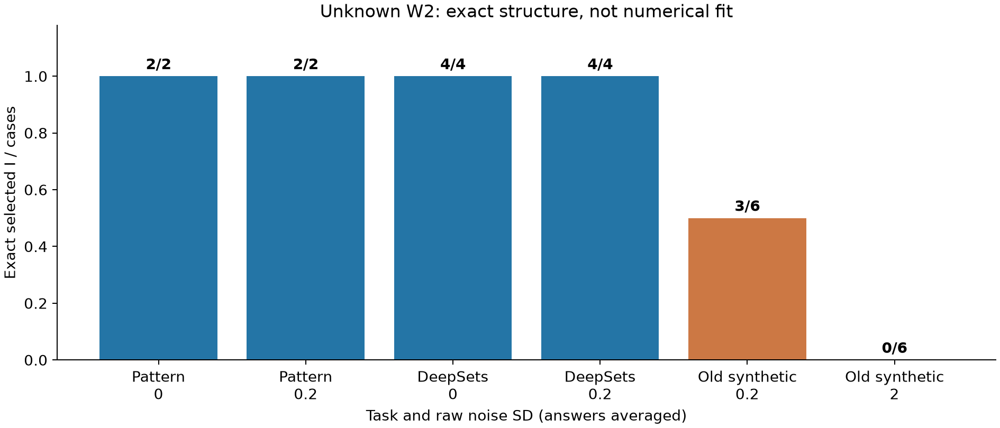
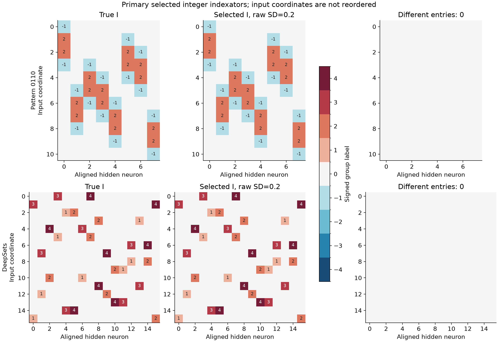
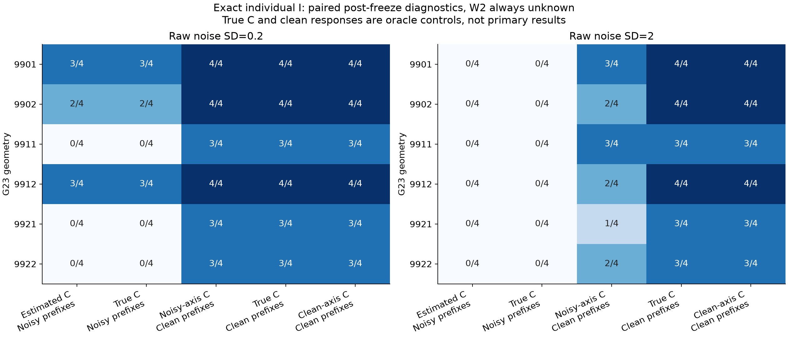
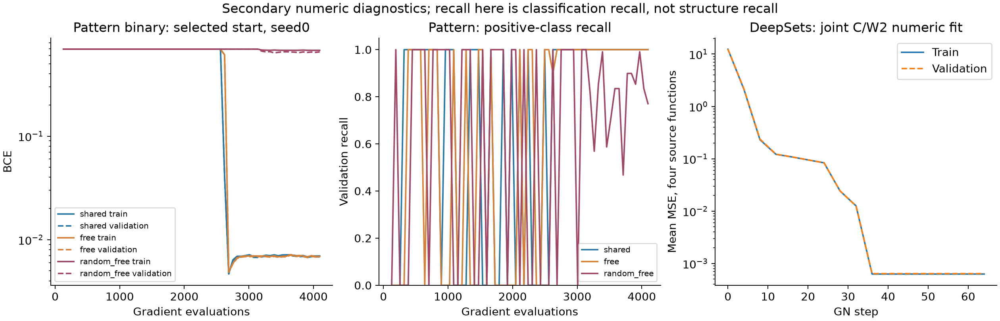

# Поиск индексатора при неизвестной обучаемой W2: G29–G30

6 ноября 2026. Основная цель — восстановить индексатор: нули, группы равенства и знаки. Качество численного кодбука и ошибка функции — вспомогательные проверки. Маленькая ошибка функции при неправильном индексаторе успехом не считается.

## Постановка и определения

Вход имеет D координат, скрытый слой — H ReLU-нейронов, выход — O координат. Число независимых чисел кодбука K известно. На T исходных задачах ищем одну общую структуру первого слоя, разрешая каждой задаче собственный кодбук и собственную произвольную выходную матрицу. В опыте T=4.

Индексатор и его численная реализация определяются так:

$$
\begin{aligned}
\mathcal A_K&=\{0,1,\ldots,K,-1,\ldots,-K\},\\
I&\in\mathcal A_K^{D\times H},\qquad C_t\in\mathbb R^K,\\
v_{C_t}(0)&=0,\qquad v_{C_t}(a)=\operatorname{sgn}(a)c_{t,|a|}\quad(a\ne0),\\
(W_t)_{dh}&=v_{C_t}(I_{dh}).
\end{aligned}
$$

Нулевой индекс отключает связь. Равные положительные индексы используют одно число; отрицательный индекс использует то же число с обратным знаком. Поэтому удвоенный кодбук содержит 2K+1 значений, но только K независимых чисел. Для Pattern K=2, для DeepSets и прежней синты K=4.

Обозначим через A выходные коэффициенты, транспонированные относительно обычной записи W2: размер A равен H×O. После измерения выхода в нуле модель записывается в центрированном виде:

$$
\begin{aligned}
\rho(u)&=\max(u,0),\\
\Phi_{I,C_t}(x)_h
&=H^{-1/2}\left[\rho\left(b+\sum_{d=1}^D x_dv_{C_t}(I_{dh})\right)-\rho(b)\right],\\
f_t(x)&=f_t(0)+\Phi_{I,C_t}(x)A_t.
\end{aligned}
$$

Известны D, H, K, O, ReLU и общий ненулевой hidden bias b. Неизвестны I, все C и все A. Число активных связей, роли координат и перестановки нейронов алгоритму не сообщаются. Доступны активные запросы вещественного выхода функции; это существенно больше информации, чем фиксированный набор бинарных меток.

Желаемая задача поиска общей структуры:

$$
\begin{aligned}
\widehat I&\in\operatorname*{arg\,min}_{I\in\mathcal A_K^{D\times H}}
\frac1T\sum_{t=1}^T
\mathcal L_{V_t}\bigl(I,\widehat C_t(I),\widehat A_t(I)\bigr),\\
\bigl(\widehat C_t(I),\widehat A_t(I)\bigr)
&\in\operatorname*{arg\,min}_{C,A}\mathcal L_{S_t}(I,C,A),\\
\mathcal L_U(I,C,A)
&=\frac1{|U|O}\sum_{(x,y)\in U}
\left\|\Phi_{I,C}(x)A-\bigl(y-\widehat f_t(0)\bigr)\right\|_2^2.
\end{aligned}
$$

Реализация приближённо решает внутреннюю задачу из нескольких стартов и минимизирует внешний критерий по построенному конечному банку. Глобальная оптимальность по всем индексаторам не доказана.

Правильность I проверяется после фиксации всего выбора. Допустимы перестановка скрытых нейронов, общее переименование групп и общий переворот знака каждой группы с соответствующим переворотом её кодов. Переставлять входные координаты при аудите нельзя. Exact-I означает ноль отличающихся позиций после лучшего такого выравнивания. Дополнительно измеряются ошибки по позициям и F1 бинарной маски после того же выравнивания. Четыре использованные группы сами по себе ещё не означают правильный шэринг.

## Метод: восемь шагов

Это новый weighted-prefix вариант прежнего поиска. При известной одинаковой выходной сумме можно восстанавливать целые количества нейронных шаблонов. Здесь амплитуды неизвестны, могут иметь разные знаки и быть векторными, поэтому вместо целых количеств используется функциональный отбор шаблонов со свободным линейным readout. Это не неизменённый прежний integer-count алгоритм.

**1. Измеряем якорь и координатные срезы.** Для каждой исходной задачи наблюдаем выход в нуле и отдельно подписанные кривые по каждой координате:

$$
g_{t,d}(s)=f_t(se_d)-f_t(0).
$$

Используются положительные и отрицательные аргументы. Складывать их в единственную чётную кривую нельзя: при неизвестных знаковых выходных весах её компоненты могут взаимно уничтожиться.

**2. Получаем предварительные модули кодов.** Для положительных модулей u строим 2K осевых атомов:

$$
\begin{aligned}
D_u(s,a)&=\rho\bigl(b+s\,v_u(a)\bigr)-\rho(b),\qquad a\in\{\pm1,\ldots,\pm K\},\\
\widehat u_t&\approx\operatorname*{arg\,min}_{u>0}\min_{B_t}
\left\|D_uB_t-Y_t^{\mathrm{axis}}\right\|_F^2.
\end{aligned}
$$

При фиксированных модулях подписанные амплитуды по всем координатам и выходам вычисляются LS. Модули оптимизируются нелинейным least squares по логарифмам из семи стартов; старт выбирается на отдельной промежуточной осевой сетке. Настоящие коды не подставляются в основной алгоритм. Сортировка модулей — только временное имя групп; задачи могут получить разную нумерацию.

**3. Строим дискретные продолжения префиксов.** Заранее случайно выбираем порядок входных координат. На шаге j каждая сохранённая последовательность длины j−1 продолжается всеми символами из алфавита. Дубликаты удаляются. Полностью нулевой родитель сохраняется отдельно на каждом шаге: нейрон может впервые включиться на поздней координате.

Для кандидата p соответствующий столбец наблюдаемого словаря равен:

$$
\Phi_{j,t}(x,p)=H^{-1/2}\left[
\rho\left(b+\sum_{q=1}^j x_{d_q}v_{\widehat u_t}(p_q)\right)-\rho(b)
\right].
$$

Остальные координаты входа обнулены. Полностью нулевой атом не включается в LS, поскольку он тождественно нулевой. Неизвестный readout автоматически суммирует коэффициенты нейронов, совпадающих на текущем префиксе.

**4. Выбираем префиксы по изменению функции.** Для конечного словаря хотелось бы решить:

$$
\widehat S_j\in\operatorname*{arg\,min}_{|S|\le H}\min_B
\frac1{NO}\left\|\Phi_{j,t,S}B-Y_{j,t}\right\|_F^2.
$$

В основном запуске используется приближение backward deletion. Сначала обучается произвольный подписанный readout на полном словаре. Для матрицы Грама и LS-коэффициентов стоимость удаления одного атома с оптимальной перестройкой остальных равна:

$$
\begin{aligned}
G&=\Phi^\top\Phi/N,\qquad B=G^{-1}\Phi^\top Y/N,\\
\Delta_j&=\frac{\|B_{j,:}\|_2^2}{O\,(G^{-1})_{jj}}.
\end{aligned}
$$

Удаляется атом с наименьшей стоимостью, затем обратная матрица и коэффициенты обновляются через дополнение Шура. Это точное изменение LS-ошибки данного удаления, но последовательность удалений остаётся жадной. Полный словарь в primary должен иметь достаточный численный ранг; иначе траектория явно отказывается продолжать поиск.

Для всех вложенных поддержек размером не больше H считается ошибка на отдельных prefix-validation запросах. Выбирается самая маленькая поддержка в пределах допуска от лучшей ошибки:

$$
\epsilon_j=2\frac{\sigma^2}{R_{\mathrm{prefix}}}
\sqrt{\frac2{N_{\mathrm{val}}O}}
+10^{-12}\max\bigl(\operatorname{Var}(Y_{\mathrm{val}}),1\bigr).
$$

Выбранная поддержка заново обучает readout обычным LS. Её последовательности становятся родителями следующего шага. После D шагов полные дискретные столбцы непосредственно образуют I; недостающие до H столбцы заполняются нулями. Кластеризация плотной матрицы и argmax мягких весов отсутствуют.

**5. Собираем предварительный банк по исходным задачам.** Поиск независимо выполняется для четырёх функций с одним общим неизвестным I. Полные индексаторы канонизируются с учётом разрешённых переименований и перестановок скрытого слоя, затем удаляются дубликаты. Истинного I на этом этапе нет у learner.

**6. Калибруем только численные параметры и повторяем поиск.** Для каждого кандидата заново совместно обучаются C и произвольная A на всех четырёх source-задачах. Используются 64 подписанных старта, 64 шага damped Gauss–Newton с backtracking и отдельным выбором checkpoint/start по H0. Лучший общий I по среднему H0 даёт уточнённые коды каждой задачи. С этими кодами повторяем дискретный поиск из пустого префикса на новой независимой prefix-панели. Readout снова свободно обучается на каждом шаге. Структура предварительного банка не фиксируется навсегда; прежний I автоматически в конечный банк не добавляется.

**7. Выбираем общий I.** Кандидаты повторного поиска канонизируются, снова получают свежие совместные C/A fit с выбором по H1. После фиксации всех численных предикторов независимые meta-ответы выбирают один общий индексатор:

$$
\widehat I\in\operatorname*{arg\,min}_{I\in\mathcal B_{\mathrm{repeat}}}
\frac1T\sum_{t=1}^T\mathcal L_{M_t}(I,\widehat C_t,\widehat A_t).
$$

**8. Замораживаем I и проверяем его отдельно от чисел.** Сначала весь source-cohort фиксируется в файлах с хэшами. Затем открывается teacher-аудит структуры. Перенос, когда он нужен, фиксирует I и обучает новые C/A с новых случайных стартов на новых функциях. Source-кодбуки, головы и состояния оптимизатора не переносятся.

```text
INPUT: four output-query functions; D,H,K,O, nonzero b; fixed query budgets
for each source task t:
    observe f_t(0), signed axis train and validation curves
    u_t <- variable-projection fit of K magnitudes (7 starts)
    I_t <- PREFIX_SEARCH(u_t, first prefix panels, freely fitted readout)
B0 <- canonical unique complete I_t
for I in B0:
    fit fresh C_t,A_t on source support; choose starts/checkpoints by H0
I0 <- candidate with smallest mean H0 error
for each source task t:
    I'_t <- PREFIX_SEARCH(calibrated C_t of I0, new prefix panels)
B1 <- canonical unique complete I'_t
for I in B1:
    fit fresh C_t,A_t; choose starts/checkpoints by independent H1
freeze all candidate predictors
I_hat <- argmin over B1 of mean independent meta error
freeze the entire source cohort
audit I_hat modulo global code gauge and hidden-neuron permutation
OPTIONAL: fix I_hat; fit all numerical parameters afresh on new tasks

PREFIX_SEARCH(C, panels):
    parents <- {empty prefix}
    for coordinate in fixed random order:
        candidates <- all distinct one-symbol extensions of parents
        make centered ReLU dictionary; omit identically-zero atom
        if full dictionary lacks numerical rank: record refusal; return
        backward-delete atoms by exact profiled LS loss increase
        among nested supports of size <=H, select by held-out prefix error
        parents <- selected prefixes UNION {all-zero prefix}
    return integer matrix of selected full prefixes, padded to H columns
```

## Основной результат: действительно ли найден индексатор

|Серия|Сырой шум σ|Точный выбранный I|Точная бинарная маска|Ошибки I, всего|
|---|---:|---:|---:|---:|
|Pattern 0110|0|2/2|2/2|0|
|Pattern 0110|0.2|2/2|2/2|0|
|Синтетический DeepSets|0|4/4|4/4|0|
|Синтетический DeepSets|0.2|4/4|4/4|0|
|Прежняя синта G23 с новой неизвестной W2|0.2|3/6|4/6|327|
|Прежняя синта G23 с новой неизвестной W2|2|0/6|0/6|778|

Pattern — два независимых численных/source-query случая **одной геометрии** 0110, не два разных паттерна. DeepSets — четыре новые скрытые перестановки геометрии. Знаменатель считает финальные выбранные I, а не старты оптимизатора и не четыре функции каждой геометрии.



Pattern имеет размер 11×8, 32 ненулевые связи и две независимые группы. DeepSets имеет размер 16×16, 32 связи и четыре группы. Во всех выбранных G29 индексаторах ошибочных позиций нет. На картинке показано по одному случаю при умеренном шуме; полные выбранные матрицы доступны в [aligned_indices.npz](aligned_indices.npz).



## Что именно проверено и сколько информации использовано

У Pattern скрыты восемь скользящих детекторов четырёхбитного 0110; порядок скрытых столбцов перемешан, у teacher произвольная знаковая голова из восьми коэффициентов. У DeepSets восемь двумерных точек и два общих ReLU-канала; роли координат и столбцы скрыты. Teacher использует неизвестную знаковую матрицу 2×2 после pooling; learner разрешена более общая свободная матрица 2×16. Первый пилот G29 отбирает source-коды с различимыми модулями: зазор не меньше 0.08 у Pattern и 0.10 у DeepSets, минимум 0.15 у DeepSets. Это облегчение постановки раскрыто, а не объявлено свойством произвольного кодбука.

Каждая осевая обучающая сетка содержит 257 положительных узлов между 0.001 и 128, их отрицательные значения и ноль; осевая validation находится между обучающими узлами. Каждый ответ эквивалентен среднему 4,194,304 независимых шумных измерений. На один шаг префикса есть 2048 train и 512 validation точек, среднее 4096 измерений на точку. Масштабы активных запросов заранее заданы: 0.05, 0.2, 0.8, 3.2, 12.8, 51.2. Повторный поиск получает новую панель.

При σ=0.2 эффективное стандартное отклонение осевого ответа равно примерно 0.0000977, префиксного — 0.003125. Source численная подгонка использует 4096 точек, H0/H1 по 1024, meta 2048; ответы усреднены по 64 измерениям. Усреднение Gaussian шума симулируется непосредственно в распределении среднего: миллионы повторных ответов не хранятся. Это демонстрация восстановления при высокой точности запросов, не доказательство эффективности по числу oracle-обращений.

Повторить проверку без разделения модулей помогают ровно шесть прежних синтетических индексаторов и исходные source-C из G23, без отбраковки кодов. Они рассмотрены в [отчёте G30](../unknown_readout_synthetic_g30/REPORT.md). Там новая знаковая W2 меняет семейство функций, поэтому прежнюю таблицу конкурентов нельзя механически считать сравнением на текущем протоколе.

## Где ломается структура на прежней синте

У всех девяти неудачных условий G30 правильного I нет ни в предварительном, ни в повторном банке. Это измерено после фиксации выбора: [диагностика банков](../unknown_readout_synthetic_g30/bank_diagnosis.json). Следовательно, дальнейшая настройка выбора по meta или численного target-кодбука не исправит эти конкретные банки.

Отдельная факторная диагностика оставила W2 неизвестной и использовала те же запросы и порядок координат. Менялись только предварительный C и наличие шума в префиксных ответах. Истинный C и чистые ответы — oracle-контроли после primary-freeze, не часть основного метода.

|Условие bootstrap-поиска|Точных отдельных I при σ=0.2, из 24|Банков с истинным I, из 6|Точных отдельных I при σ=2, из 24|Банков с истинным I, из 6|
|---|---:|---:|---:|---:|
|Оценённый C, шумные префиксы|8|3|0|0|
|Истинный C, шумные префиксы|8|3|0|0|
|Прежний оценённый C, чистые префиксы|21|6|13|6|
|Истинный C, чистые префиксы|21|6|21|6|
|C оценён по чистым осям, чистые префиксы|21|6|21|6|

Здесь «истинный I есть в банке» слабее, чем «финальный I выбран правильно»: общий отбор на чистом контроле заново не запускался. Три оставшихся individual отказа при чистых данных вызваны rank-check полного словаря: геометрии 9911/task3 на шаге7, 9921/task0 на шаге8, 9922/task3 на шаге5. Наличие истинного I у других source-функций позволяет собрать банк во всех шести геометриях.



Эта диагностика показывает, что точный кодбук сам по себе не устраняет наблюдаемый сбой. Критичен шум в функциональном отборе префиксов. При свободной знаковой W2 близкие атомы и почти компенсирующиеся коэффициенты делают раннюю поддержку неустойчивой; ошибочно удалённый родитель уже не может породить правильные полные столбцы. Это объяснение механизма жадного поиска, а не доказательство статистической невозможности восстановить I при данном бюджете.

Проверена одна целевая поправка — ridge-подгонка W2 с тремя заранее зарегистрированными масштабами:

$$
\min_B\frac1N\|\Phi B-Y\|_F^2+\lambda\|B\|_F^2,
\qquad
\lambda=m\frac{\sigma^2}{R_{\mathrm{prefix}}N},\quad m\in\{0.1,1,10\}.
$$

Она заменяет обратную матрицу на регуляризованную, сохраняет жадный отбор и прежнюю validation. Все шесть геометрий и оба шума включены; source-выборы primary не изменялись. Точных individual I при умеренном шуме получилось 8/24, 9/24 и 6/24 соответственно; при сильном — 0/24 во всех случаях. Банки с истинным I остались 3/6 и 0/6. Улучшение одного individual старта не решило задачу восстановления новой геометрии. [Регистрация](../unknown_readout_synthetic_g30/ridge_ablation/registration.json), [все результаты](../unknown_readout_synthetic_g30/diagnosis_table.csv).

Следующее обоснованное направление — сохранять несколько статистически неразличимых поддержек вместо единственного раннего выбора и проверять их следующими координатами или дополнительными запросами. Это предложение для следующего этапа, не выполненный результат. Ещё один вариант — совместный отбор префиксов по нескольким функциям с явным согласованием имён кодов между задачами. Бесконечная доводка target-кодбуков здесь не является приоритетом.

## Вторичный контроль: новые числа при фиксированном найденном I

Эти запуски были уже завершены; они показывают пригодность найденного I, но не заменяют структурную метрику. Для каждого случая G29 сгенерировано восемь новых C и W2. Все численные параметры обучаются с нуля из 64 стартов; support/validation/test имеют 4096/1024/8192 точек. Ни одна source-голова или source-C не перенесены. Oracle-I совпадает с найденным I с точностью до допустимой канонизации, поэтому для них использовалась одна и та же численная задача без искусственного разброса стартов.

|Задача|Новых функций|Сырой target σ|Средняя test NMSE найденного I|Худшая NMSE|Средняя NMSE random-I|
|---|---:|---:|---:|---:|---:|
|Pattern, вещественный выход|16|0|9.07e−31|7.10e−30|0.838|
|Pattern, вещественный выход|16|0.2|2.67e−5|7.94e−5|0.838|
|DeepSets, два выхода|32|0|2.47e−26|7.75e−25|0.390|
|DeepSets, два выхода|32|0.2|7.92e−6|3.15e−5|0.391|

Это одни и те же новые функции при парных уровнях шума; складывать знаменатели между условиями нельзя. В шумном target-fit усреднение по 64 измерениям. У DeepSets свободная W2 при шуме может немного нарушать перестановочную симметрию, даже когда первый индексатор точен: шэринг выходной головы текущий алгоритм не извлекает.

Затем на исходных бинарных метках 0110 обучены свежие кодбук, bias и выходные параметры. Выбор по validation дал 100% на отложенной части и на всех 2048 бинарных входах для всех трёх seed как с общей скалярной, так и с независимой головой. В обоих случаях 171/192 отдельных стартов решают весь куб; random-I с независимой головой — 0/192, средняя balanced accuracy на всём кубе 56.6%. Независимость всей проверки относится к test-части; весь куб включает и обучающие точки.



На этих кривых recall — полнота положительного класса, а не восстановление структуры. Pattern-процедура включает две последовательные знаковые ветки и переинициализацию оптимизатора, поэтому ось считает суммарные gradient evaluations; это не одна непрерывная Adam-траектория. Численные кривые и итоговый I показаны раздельно; отсутствующий исторический per-step structure-recall не выдумывался. Новые target-fit для неудачных G30 индексаторов не запускались после уточнения приоритета пользователя.

## Границы вывода и воспроизводимость

Получен положительный полный поиск первого индексатора при неизвестной свободной W2 на ограниченных Pattern/DeepSets пилотах. Перенос без разделения модулей на прежнюю шумную синту остаётся нерешённым. Метод использует известный общий ненулевой bias и активные вещественные запросы, поэтому результат нельзя переносить на произвольную MLP с неизвестными hidden bias или на NAS только по бинарной разметке. Ранние точные компенсации readout могут полностью скрыть префикс; одна финальная функция также не всегда единственным образом задаёт teacher-I.

[Протокол G29](protocol.json), [G30](../unknown_readout_synthetic_g30/protocol.json), [source freeze](source_frozen.json), [source audit](structure_audit.json), [target cohort freeze](target/cohort_frozen.json), [target audit](target/evaluation.json), [машинная сводка](summary.json), [таблица всех source-случаев](structure_table.csv).

[Итоговый аудит хэшей](provenance_audit.json) подтвердил 155 замороженных артефактов: код и snapshots, source-данные/учителя, численные fits, выбранные I, target-fits и контрольные регистрации. Source-I зафиксированы до структурного аудита, target-cohort — до открытия test. Небольшой рефакторинг closure-helper генератора target до численного fit записан в target/data_frozen.json; сгенерированные массивы не менялись.

Осевая и префиксная часть использовала CPU. Только пакетные численные подгонки C/W2 работали на GPU0–3; GPU6/7 не использовались. Все научные запуски завершены. Программные тесты не создавались и не запускались.
