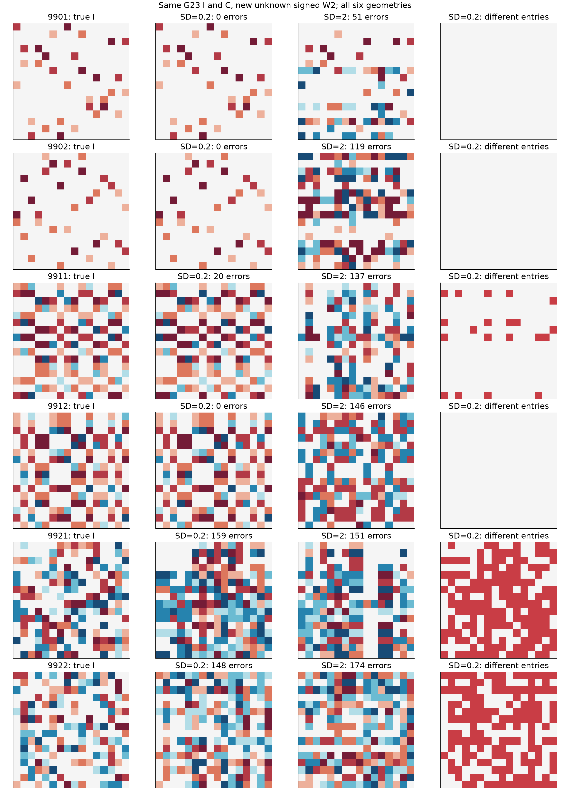
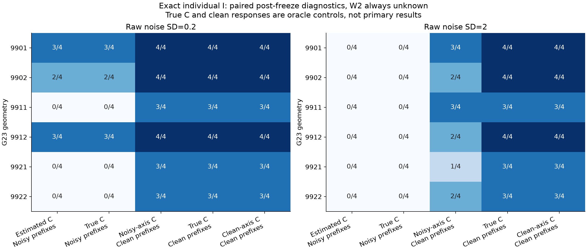

# G30: прежняя синта с неизвестной W2 — структурный результат

6 ноября 2026. Полное описание определений, метода и псевдоалгоритма находится в [общем отчёте G29–G30](../unknown_readout_g29/REPORT.md). Главная метрика — exact-I, а не численная ошибка функции.

Использованы ровно шесть индексаторов и четыре исходных кодбука каждого из сравнения G23: два local, два quartet_mix и два random. Учтено прежнее масштабирование quartet_mix. Новые случайные знаковые коэффициенты W2 по всем 16 нейронам неизвестны learner и обучаются свободно. Вход/скрытый слой 16×16, K=4 независимых кода, общий известный bias 0.15, скалярный выход. Коды не отбраковывались по близости или малости. Это расширение семейства функций; прежние результаты конкурентов с известным readout не являются равнобюджетным сравнением с G30.

Осевая сетка содержит 1025 положительных узлов от 0.001 до 1024 и их отражения; numerical range кодов 1e−4..16 объявлен до аудита новых результатов. Осевая точность соответствует усреднению 4,194,304 измерений, префиксная — 4096. Поэтому при сыром σ=0.2/2 эффективное prefix SD равно 0.003125/0.03125. Остальные бюджеты и алгоритм отбора такие же, как в G29. Имеются два независимых прохода prefix-поиска с численной калибровкой между ними.

|Семейство|Геометрия|Ошибки I из 256, σ=0.2|Mask F1|Ошибки I, σ=2|Mask F1|
|---|---|---:|---:|---:|---:|
|9901|local|0|1.000|51|0.553|
|9902|local|0|1.000|119|0.369|
|9911|quartet_mix|20|1.000|137|0.656|
|9912|quartet_mix|0|1.000|146|0.742|
|9921|random|159|0.735|151|0.725|
|9922|random|148|0.660|174|0.677|
|**Итого точных I**||**3/6**||**0/6**||

При умеренном шуме у 9911 найдена ровно правильная бинарная маска, но неверный шэринг в 20 позициях. Это не успешный индексатор. У всех выбранных моделей используются четыре группы — число групп также не заменяет проверку самих равенств.

Первые три столбца — истинный I, выбранный при σ=0.2 и выбранный при σ=2; четвёртый отмечает ошибки умеренно шумного I. Цвета кодов те же, что в [Pattern/DeepSets хитмапах](../unknown_readout_g29/figures/pattern_deepsets_indices.png): отрицательные группы синие, положительные красные, ноль светлый. Входные строки не переставлялись; скрытые столбцы и имена кодов выровнены только для teacher-аудита.

## Диагностика места отказа

Правильный I отсутствует в обоих банках каждого неудачного primary-условия. Это не ошибка выбора неправильного кандидата при наличии правильного: [аудит банков](bank_diagnosis.json).

При неизменной неизвестной W2 после primary-freeze выполнены парные контроли всех 6×4 source-функций. Подстановка истинного C при шумных префиксах оставляет 8/24 точных individual I и 3/6 банков при умеренном шуме, 0/24 и 0/6 при сильном. Очистка только префиксных ответов с сохранением прежних оценок C даёт 21/24 и 6/6 при умеренном, 13/24 и 6/6 при сильном. Оценка C по чистым осевым ответам и чистые префиксы дают 21/24 и 6/6. Наличие I в банке не означает, что проведён дополнительный финальный выбор по чистым данным: такой запуск не выполнялся.

Три отказа при истинном C и чистых префиксах имеют явную причину rank_deficient_dictionary: 9911/task3 на шаге7, 9921/task0 на шаге8, 9922/task3 на шаге5. Это консервативный отказ полного словаря, а не установленная невозможность различить правильную малую поддержку. Другие задачи тех же геометрий восстанавливают I.

Гипотеза о неустойчивом LS-readout проверена отдельной ridge-абляцией. Коэффициент регуляризации равен variance/N с множителями 0.1,1,10, выбранными до запуска этой абляции. На умеренном шуме exact-individual равен 8/24,9/24,6/24; на сильном 0/24 для всех трёх. Правильный I есть в банке тех же 3/6 и 0/6 геометрий. Следовательно, эта простая регуляризация не исправила наблюдаемый провал.

Подтверждённый диагноз: на текущих шумных запросах поддержку теряет префиксный поиск; только улучшить численный кодбук недостаточно. Вероятное слабое место — необратимый выбор одной ранней поддержки среди почти неразличимых функциональных объяснений. Сохранение нескольких поддержек и дополнительные различающие запросы требуют отдельного исследования. Основной алгоритм и primary-результаты после аудита не менялись.

Пользователь уточнил приоритет: получать правильный I, численный кодбук вторичен. Поэтому новая серия target-подгонок на этих неудачных структурах не запускалась. Свежий перенос уже проверен для точных Pattern/DeepSets индексаторов G29 и приведён отдельно в общем отчёте.

[Протокол](protocol.json), [source freeze](source_frozen.json), [структурный аудит](structure_audit.json), [выбранные I](aligned_indices.npz), [факторная регистрация](diagnosis/registration.json), [ridge-регистрация](ridge_ablation/registration.json), [контроли CSV](diagnosis_table.csv), [машинная сводка](summary.json). Все исполнения завершены; программные тесты не запускались.
