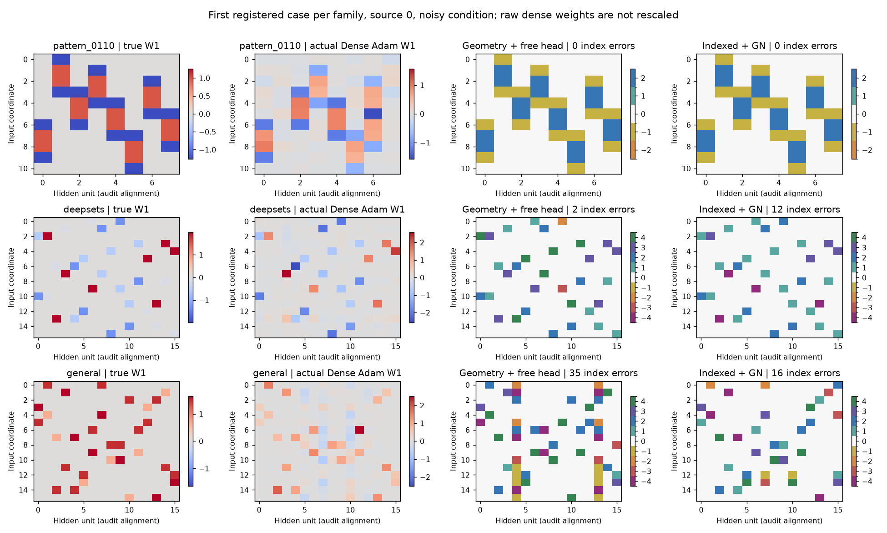
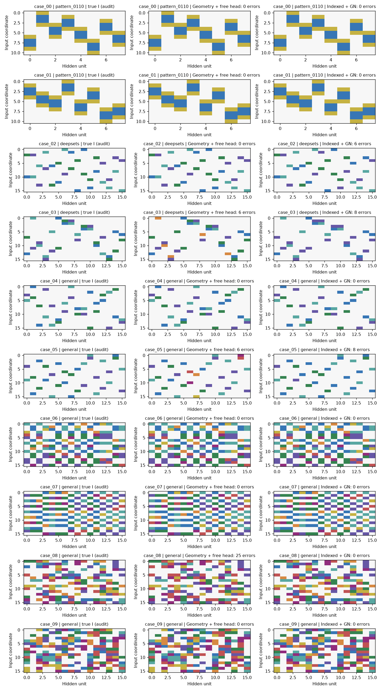
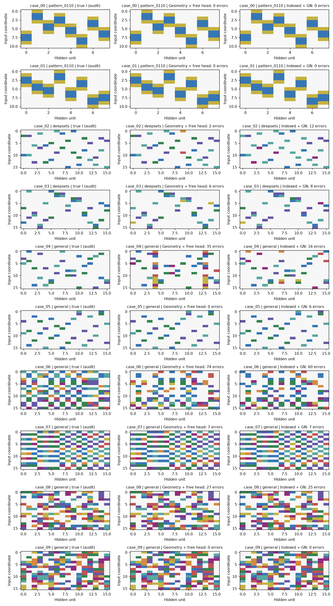
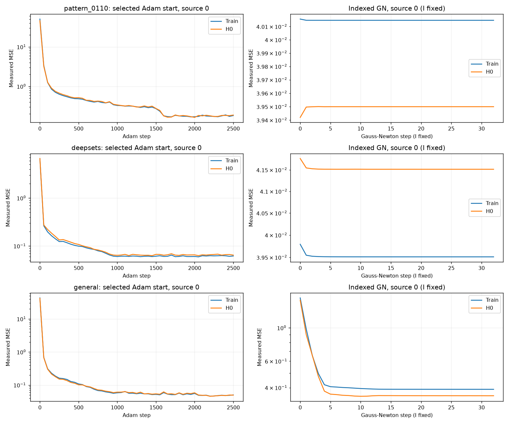
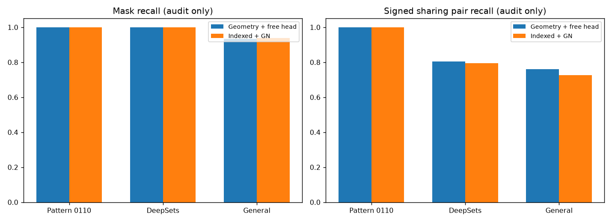

# G33: поиск I в W1 без истинных численных параметров

7 ноября 2026. W2 свободная. Истинные b, C, шум, маски, роли входов и seed не передаются алгоритму. Предыдущий вариант с известными общим b и дисперсией сохранён в [описании G32](../../../METHOD_G32_KNOWN_PRIORS.md); его результаты не являются проверкой этой постановки.

## Определения

Известны D входов, H скрытых ReLU-нейронов, O выходов, K независимых чисел кодбука и принадлежность наблюдений T задачам с общим неизвестным индексатором. Предполагаются один скрытый слой, ReLU, фиксированный нулевой код и знаковые пары кодов. Это архитектурные предположения, а не вывод из произвольного датасета.

$$
\begin{aligned}
\mathcal A_K&=\{0,\pm1,\ldots,\pm K\},\qquad I\in\mathcal A_K^{D\times H},\\
v_C(0)&=0,\qquad v_C(j)=\operatorname{sgn}(j)c_{|j|},\\
(W_t(I,C_t))_{dh}&=v_{C_t}(I_{dh}),\qquad C_t\in\mathbb R^K.
\end{aligned}
$$

I общий для всех задач; C свой у каждой. Индексы k и −k используют одно независимое число. Кроме C каждая задача имеет собственные H сдвигов b, свободную голову A размером H×O и O выходных сдвигов d. Шэринг этих параметров не предполагается. В записи со входами-строками A соответствует W2 с обычным транспонированием соглашения.

$$
\begin{aligned}
\rho(u)&=\max(u,0),\\
F_t(x;I,\theta_t)&=\rho(xW_t(I,C_t)+b_t)A_t/\sqrt H+d_t,\\
\theta_t&=(C_t,b_t,A_t,d_t).
\end{aligned}
$$

Истинный выход в нуле не запрашивается и не вычитается; свободный d обучается по обычным наблюдениям. Видим только пары x,y; скрытые активации и производные исходной функции недоступны.

Для каждой задачи заранее отделены S (обучение чисел), H0 (численные настройки/checkpoint), M (выбор общего I), Q (окончательная оценка).

## Постановка

$$
\begin{aligned}
\mathcal L_{U_t}(I,\theta_t)
&=\frac{1}{|U_t|O}\sum_{(x,y)\in U_t}
\left\|F_t(x;I,\theta_t)-y\right\|_2^2,\\
\widehat\theta_t(I)&\in\operatorname*{arg\,min}_{\theta_t}
\mathcal L_{S_t}(I,\theta_t),\\
\widehat I&\in\operatorname*{arg\,min}_{I\in\mathcal A_K^{D\times H}}
\frac1T\sum_t\mathcal L_{M_t}\bigl(I,\widehat\theta_t(I)\bigr).
\end{aligned}
$$

В реализации полное пространство I заменяется конечным банком B; внутренний минимум — несколькими стартами с выбором по H0. Финальный argmin по M остаётся функциональным. Истинный I не выбирает кандидата, старт или checkpoint.

## Восемь шагов

**1. Обучить собственные плотные модели.** Для каждой задачи независимо обучаем W,b,A,d: 12 стартов Adam, по четыре с lr 0.003/0.01/0.03, 2500 шагов, minibatch512. Нормировка выхода вычисляется только по S и затем обращается в параметрах головы. Каждые50 шагов измеряем train/H0 MSE. H0 выбирает checkpoint каждого старта и четыре лучших старта.

**2. Уточнить модели и искать пропущенные нейроны.** Четыре модели уточняем32 шагами damped Gauss–Newton по собственному якобиану на S. Принимаем шаг с уменьшением train MSE, checkpoint выбирает H0. Затем два раунда: по профилированной train LS выбираем слабополезные нейроны, обучаем32 варианта замены на остатке за300 шагов и совместно уточняем сеть. Замену принимаем при парном выигрыше на H0 больше двух эмпирических SE и малого численного предела. Это эвристика с повторным выбором на H0, а не формальный статистический тест.

**3. Оценить направления и неопределённость по своим остаткам.**

$$
\begin{aligned}
r_{t,h}&=\widetilde W_{t,:,h}/\|\widetilde W_{t,:,h}\|_2,\qquad
\beta_{t,h}=\widetilde b_{t,h}/\|\widetilde W_{t,:,h}\|_2,\\
\widehat\sigma_t^2&=\|Y-\widetilde F_t(X)\|_F^2/(NO-r_J),\\
\widehat\Sigma_t&=\widehat\sigma_t^2(J_t^\top J_t)^+.
\end{aligned}
$$

N=|S|, J — якобиан собственной модели, rJ — его эмпирический ранг. Знаменатель ограничен снизу единицей, собственные числа ниже1e−10 от максимального отсекаются. Переносим ковариацию на нормированные направления; u_h — максимальная покоординатная стандартная погрешность столбца. Если модель пропустила нейрон, остаток содержит ошибку модели: это приближённая оценка, не известная истинная дисперсия.

**4. Предложить дискретные индексаторы с неизвестными масштабами.** У ReLU положительная однородность: умножение столбца W и его b на s>0 с делением строки A на s сохраняет функцию. Поэтому необработанные веса разных нейронов нельзя кластеризовать напрямую.

Гипотезы нулей строим при порогах max(3u,0.002) и max(5u,0.002); обе поступают в банк. Постоянный предел — настройка метода, не диапазон teacher. Для активных позиций решаем попеременным присваиванием и линейным LS:

$$
\min_{\substack{z_e\in\{1,\ldots,K\}\\a\in\mathbb R^K,\ q\in\mathbb R^H}}
\sum_{e=(d,h)}
\left(\log|r_{t,dh}|-a_{z_e}+q_h\right)^2.
$$

Фиксируем один масштаб, чередуем ближайший лог-код и LS по a,q. Знак I берём из собственного направления, модуль — из группы, нули — из гипотезы. Инициализации: квантили, ordered1D k-means внутри столбцов и случайные наблюдаемые лог-модули; минимум24 старта. Это метод с этапом кластеризации: его нельзя называть DARTS или методом без кластеризации. Полные I всех T задач объединяем и удаляем дубли по глобальному знаковому переименованию кодов/перестановке скрытых столбцов. Истинные окна Pattern, пары DeepSets и блоки не используются.

**5. Подготовить численные старты каждого I на всех задачах.** Перебираем знаки/перестановки собственных оценок кодов, сопоставляем направления Hungarian, калибруем C и положительные масштабы робастным LS. Якоря выбираем из компонент графа «код—нейрон» самого кандидата и собственных погрешностей. Начальный b получается из beta и масштабов; все H сдвигов затем свободны. H0 выбирает два старта.

При фиксированных I,C,b свободную голову и d профилируем линейно по S:

$$
\begin{aligned}
\Phi_t&=\rho(X_tW(I,C_t)+b_t)/\sqrt H,\\
(\widehat A_t,\widehat d_t)&\in\operatorname*{arg\,min}_{A,d}
\|\Phi_t A+\mathbf1d-Y_t\|_F^2.
\end{aligned}
$$

Малое демпфирование1e−12 определяется собственной диагональю Gram; истинный шум не нужен. Сохраняем начальный геометрический вариант.

**6. Адаптировать C,b,A,d.** Делаем32 совместных шага GN; свободная голова заново подгоняется на каждом шаге и пробе линии поиска. Выбираем checkpoint по H0. Для устойчивости gauge RMS(C)=1 одновременно масштабирует b и A с сохранением функции; истинную норму кодбука не сообщает. Gauge не устраняет все возможные симметрии несвязных структур.

Дополнительный пилот с перебором активных сторон ReLU/знаков компонент графа улучшил численную подгонку, но не дал точный выбранный I DeepSets. В основную независимую серию он не включён.

**7. Выбрать общий I по M.** Отдельно для геометрического и численно уточнённого вариантов:

$$
\widehat I\in\operatorname*{arg\,min}_{I\in\mathcal B}
\frac1T\sum_t\mathcal L_{M_t}(I,\widehat\theta_t(I)).
$$

Не выбираем вариант по teacher. «Истинный I был в банке» — диагностическая метрика только после фиксации. Отчёт сохраняет оба варианта отдельно.

**8. Заморозить и проверить структуру.** До открытия teacher фиксируем все выбранные I, параметры и тестовые предсказания. Потом считаем точное совпадение, ошибки индексов, F1/recall маски и знаковых отношений шэринга пар. Разрешены глобальные переименования/инверсии кодов и перестановки скрытых столбцов, перестановки входов запрещены. У плотного Adam нет I; ему не приписываем дискретное восстановление через незаявленную кластеризацию.

Новая серия проверяет извлечение общего I на четырёх source-задачах. Отдельной target-адаптации и изображений здесь нет. Для переноса I следовало бы фиксировать, а C,b,A,d обучать заново.

## Псевдоалгоритм

    INPUT: D,H,O,K; T fixed datasets sharing unknown I; ReLU architecture
    split each task into S, H0, M, Q before learning
    for task t:
        fit 12 dense starts on S; choose checkpoints by H0
        polish top 4; run two residual-neuron revival rounds
        estimate directions, biases, uncertainty from OWN model/residuals
        propose masks with 3u and 5u thresholds
        alternate discrete group assignment and column-scale fitting
        save complete signed integer I candidates
    B <- canonical unique union across tasks
    for I in B:
        for task t:
            initialize C,b from observed geometry; fit FREE A,d on S
            choose two starts by H0; retain geometric variant
            jointly refine C,b,A,d; profile A,d at every step/proposal
            retain H0-selected checkpoint
    for each variant:
        I_hat <- argmin average independent M error over B
    freeze ALL selected models and test predictions
    open teacher ONLY for final structural/functional audit

## Протокол и ограничения

Основная серия использует16384 train,2048 H0,4096 meta и8192 test на задачу, по одному исходному ответу на x, без повторного усреднения/активных запросов во время обучения. Четыре задачи дают90112 наблюдений для поиска и32768 для оценки. S/H0 используют выбранные масштабы Gaussian-входа0.5,1,2,4; M/Q — стандартные Gaussian. Это экспериментальный дизайн входов, не проверка произвольного распределения.

Поиск конечный. Пропущенные нейроны, слабые коды, неверные ReLU-ориентации и неоднозначные масштабы могут разрушать банк. Малая MSE не доказывает правильность I. Известный ненулевой общий b в старом методе устранял часть положительной масштабной симметрии; его удаление меняет идентифицируемость, а не только сложность оптимизации.

Универсальной гарантии без дополнительных условий быть не может. Например, три независимых координатных ReLU-нейрона с положительными кодами допускают I=diag(1,1,2) и I'=diag(1,2,2) при K=2. Положительные масштабы каждого нейрона, b и строки свободной A можно изменить так, чтобы функции совпали, а группировки различались. Несколько задач с собственными положительными кодами не устраняют этот контрпример. Точное восстановление произвольного teacher-I требует условий наблюдаемости или дополнительного соглашения о gauge.

Результаты и все неудачи: [отчёт G33](#независимая-проверка). Разведочный высокоточный активный контроль стоил порядка10^11–10^12 эквивалентных ответов/source и не считается практическим результатом фиксированной выборки.

## Независимая проверка

Алгоритм и девять его исходников зафиксированы до основной серии. Одна программа без информации о семействе запускается на десяти анонимных случаях с четырьмя source-задачами каждый и двумя парными условиями шума. Два случая Pattern, два DeepSets и шесть общих геометрий. У Pattern одна схема0110 с двумя наборами численных параметров. Условия шума парные, их нельзя считать новыми независимыми структурами. Бюджеты выбраны на старых пилотах. Истинные параметры основной серии открыты только после сохранения всех выбранных моделей и предсказаний Q. Перенастройки по этому аудиту не было.

Pattern использует вещественную ReLU-функцию счётчика 0110; итоговая бинарная классификация отдельно в новой серии не проверялась. DeepSets действительно суммирует общую двухканальную ReLU-функцию восьми точек; роли точек переставлены и скрыты от learner. Общая синтетика содержит local, quartet_mix, random; у части задач b независим по нейронам. Свободная выходная голова учится во всех семействах. Значение sigma ниже раскрыто только аудитору.

| Данные | sigma | Точный I: геометрия | Точный I: +GN | Истинный I в банке | Ошибки +GN | Mask F1 +GN | Sharing F1 +GN |
|---|---:|---:|---:|---:|---:|---:|---:|
| Pattern 0110 | 0.00 | 2/2 | 2/2 | 2/2 | 0/176 | 100.00% | 100.00% |
| Pattern 0110 | 0.20 | 2/2 | 2/2 | 2/2 | 0/176 | 100.00% | 100.00% |
| DeepSets | 0.00 | 1/2 | 0/2 | 2/2 | 14/512 | 100.00% | 75.50% |
| DeepSets | 0.20 | 0/2 | 0/2 | 0/2 | 20/512 | 100.00% | 67.71% |
| General | 0.00 | 4/6 | 5/6 | 6/6 | 8/1536 | 100.00% | 95.90% |
| General | 0.20 | 2/6 | 1/6 | 2/6 | 114/1536 | 95.12% | 73.11% |

Sharing F1 сравнивает пары активных позиций, которые используют один код, с проверкой относительного знака. Нулевой фон не раздувает эту метрику. Ошибки индексов считаются после разрешённых глобальных симметрий; средние F1 равновесны по случаям.

| Данные | sigma | Dense Adam MSE | Dense +GN+revival MSE | Geometry MSE | Indexed +GN MSE |
|---|---:|---:|---:|---:|---:|
| Pattern 0110 | 0.00 | 1.02e-02 | 2.97e-30 | 3.83e-24 | 3.81e-24 |
| Pattern 0110 | 0.20 | 1.09e-02 | 3.22e-05 | 1.74e-05 | 1.60e-05 |
| DeepSets | 0.00 | 3.26e-03 | 6.61e-04 | 2.91e-02 | 2.06e-04 |
| DeepSets | 0.20 | 5.17e-03 | 9.01e-04 | 3.14e-02 | 1.03e-03 |
| General | 0.00 | 1.19e-03 | 3.03e-05 | 1.16e-02 | 1.86e-05 |
| General | 0.20 | 2.28e-03 | 2.23e-04 | 2.98e-02 | 1.11e-02 |

MSE измеряется на закрытом чистом ответе Q после фиксации предсказаний; шумные test MSE и NMSE также сохранены в CSV. Это средние по случаям, задачам, примерам и выходам, а не выбор лучшего source или test-старта. Dense Adam не выдаёт дискретного I; структурный успех ему не приписывается.

## Диагностика выбранных решений

Численно уточнённый вариант выбрал точный I в 10/20 случаях. Из 10 структурных неудач в 6 истинного I не было в банке; в 4 он был, но функциональный выбор предпочёл другой I. Первый случай требует улучшения извлечения/банка, второй может быть связан с численным минимумом, конечным шумом или функциональной неидентифицируемостью. Эти причины нельзя различить по одной MSE; универсальная причина без отдельного контроля не утверждается.

| Случай | Данные | sigma | Ошибки geometry | Ошибки +GN | I в банке | Чистая MSE +GN |
|---|---|---:|---:|---:|---:|---:|
| case_00 | Pattern 0110 | 0.00 | 0 | 0 | да | 3.63e-24 |
| case_00 | Pattern 0110 | 0.20 | 0 | 0 | да | 1.11e-05 |
| case_01 | Pattern 0110 | 0.00 | 0 | 0 | да | 3.99e-24 |
| case_01 | Pattern 0110 | 0.20 | 0 | 0 | да | 2.08e-05 |
| case_02 | DeepSets | 0.00 | 0 | 6 | да | 3.93e-04 |
| case_02 | DeepSets | 0.20 | 2 | 12 | нет | 7.68e-05 |
| case_03 | DeepSets | 0.00 | 6 | 8 | да | 1.83e-05 |
| case_03 | DeepSets | 0.20 | 6 | 8 | нет | 1.99e-03 |
| case_04 | General | 0.00 | 0 | 0 | да | 2.52e-08 |
| case_04 | General | 0.20 | 35 | 16 | нет | 2.18e-02 |
| case_05 | General | 0.00 | 6 | 8 | да | 9.82e-05 |
| case_05 | General | 0.20 | 0 | 6 | да | 2.59e-05 |
| case_06 | General | 0.00 | 0 | 0 | да | 4.96e-15 |
| case_06 | General | 0.20 | 74 | 60 | нет | 2.25e-02 |
| case_07 | General | 0.00 | 0 | 0 | да | 1.07e-16 |
| case_07 | General | 0.20 | 7 | 7 | нет | 2.34e-03 |
| case_08 | General | 0.00 | 25 | 0 | да | 5.49e-23 |
| case_08 | General | 0.20 | 27 | 25 | нет | 1.97e-02 |
| case_09 | General | 0.00 | 0 | 0 | да | 1.32e-05 |
| case_09 | General | 0.20 | 0 | 0 | да | 2.50e-05 |

Малая MSE при неверном I не считается структурным успехом. Результат не доказывает глобальную оптимальность и не является сравнением с неизменёнными авторскими реализациями LUT-Q/LC. Предыдущие результаты с известным b имеют иной интерфейс данных и бюджет, поэтому прямое сравнение процентов было бы неверным.

## Хитмапы, кривые и исходные числа

Показан первый зарегистрированный случай каждого семейства, source0, шумное условие. Плотные веса — реальные обученные веса, только столбцы сопоставлены для просмотра; они не масштабированы до teacher. У каждой матрицы весов своя цветовая шкала. Категориальные матрицы согласованы только разрешёнными симметриями.

Loss показан по реально измеренным шагам. На этапе GN индексатор фиксирован, поэтому изменение recall во время численной подгонки не рисуется.

- [Полная таблица CSV](evaluation/comparison.csv), [сводная CSV](evaluation/summary.csv).
- [Выбранные индексаторы JSON](evaluation/selected_indices.json), [NPZ](evaluation/selected_indices.npz).
- [Заморозка предсказаний](evaluation/predictions_frozen.json), [результаты JSON](evaluation/results.json).
- [Фактическая версия исходников](method_frozen.json), квитанции реальных чтений — receipts/.

Основная серия не использует повторные измерения. Высокоточный активный pilot03 восстановил три пилотных I, но потребовал порядка10^11–10^12 эквивалентных ответов/source. Экономный активный контроль терял гиперплоскости. Пилот ориентаций улучшил численную подгонку DeepSets, но оставил9/256 ошибок выбранного I; это отрицательный пилот, а не подтверждение основной серии.
