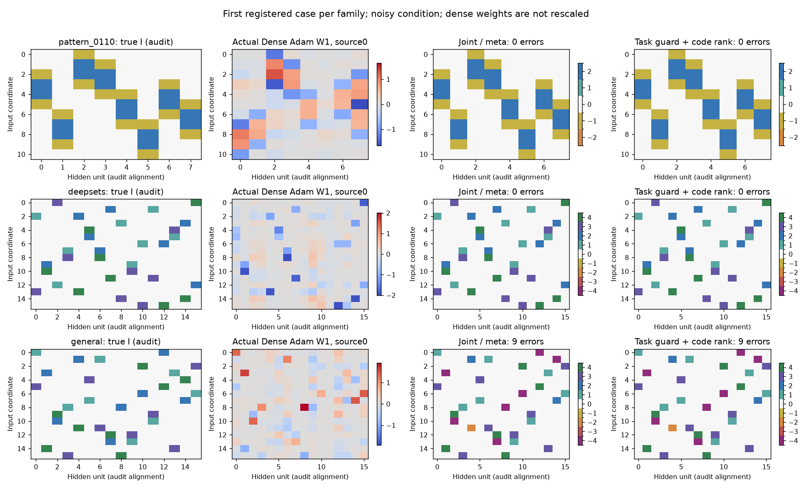
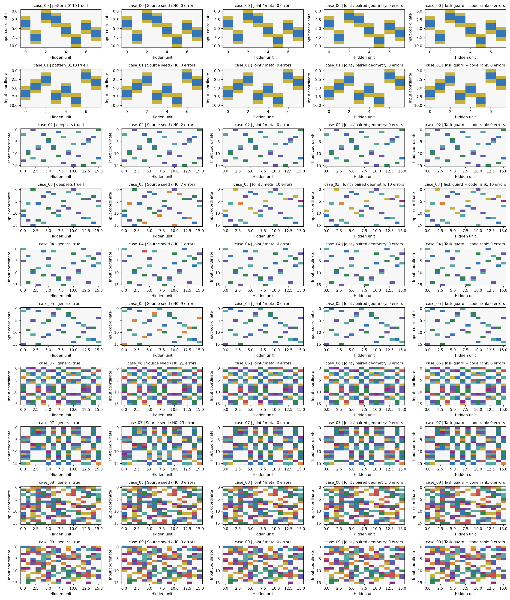
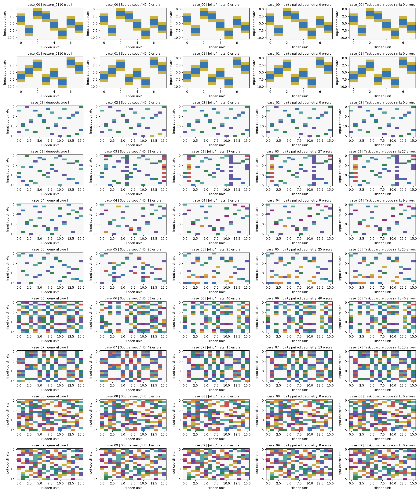
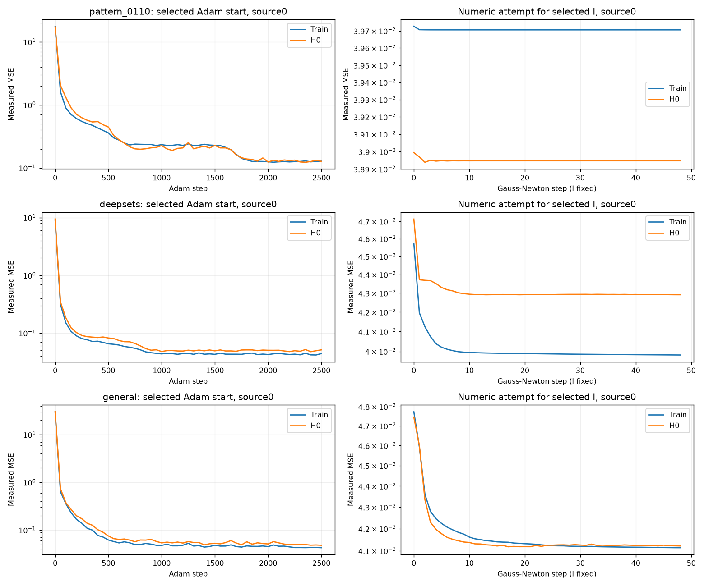
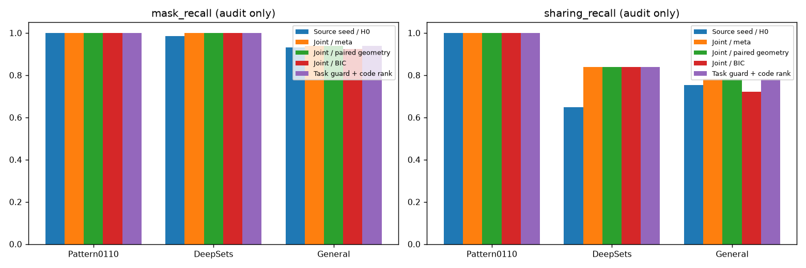

# G34: совместное извлечение индексатора без истинных численных параметров

Экспериментальный вариант, зарегистрированный 7 ноября2026 и проверенный закрытой серией20 запусков. Точный I получен в14/20 случаях; полное восстановление ещё не решено. Во всех шести отказах правильный I отсутствовал в банке. W2 свободная, структура ищется только в W1. Истинные b, кодбуки, шум, роли координат и маски не входят в обучение.

## Определения и задача

Известны размеры D,H,O, число независимых кодов K и принадлежность примеров source-задачам. Предполагаются один скрытый слой ReLU, общий индексатор и фиксированный нулевой код со знаковыми парами. Эти архитектурные предположения раскрываются явно.

$$
\begin{aligned}
I&\in\{0,\pm1,\ldots,\pm K\}^{D\times H},\\
v_C(0)&=0,\qquad v_C(j)=\operatorname{sgn}(j)c_{|j|},\\
(W_t)_{dh}&=v_{C_t}(I_{dh}),\\
F_t(x;I,\theta_t)&=\rho(xW_t+b_t)A_t/\sqrt H+d_t,\\
\theta_t&=(C_t,b_t,A_t,d_t).
\end{aligned}
$$

Для каждой задачи свободны C из K чисел, все H сдвигов b, голова A размера H×O и выходной сдвиг d. Истинный f(0) не запрашивается. Переносятся равенства и нули I, а не численные значения параметров. S обучает числа; H0 выбирает численные старты/checkpoint; M выбирает структуру; Q используется после фиксации предикторов.

$$
\begin{aligned}
\mathcal L_{U_t}(I,\theta_t)&=
\frac1{|U_t|O}\sum_{(x,y)\in U_t}\|F_t(x;I,\theta_t)-y\|_2^2,\\
\widehat\theta_t(I)&\in\operatorname*{arg\,min}_{\theta_t}
\mathcal L_{S_t}(I,\theta_t),\\
\widehat I&\in\operatorname*{arg\,min}_{I}
\frac1T\sum_t\mathcal L_{M_t}(I,\widehat\theta_t(I)).
\end{aligned}
$$

Алгоритм приближает эту задачу конечным банком и несколькими численными стартами. Малая MSE и правильная маска сами по себе не доказывают правильный шэринг.

## Почему недостаточно независимой кластеризации

Свободные b и A допускают положительное масштабирование каждого связного компонента кодов и нейронов. Плотная сеть также имеет отдельную масштабную симметрию каждого нейрона. Прямая кластеризация чисел разных нейронов не учитывает эту неоднозначность.

В старом DeepSets-пилоте отдельно построен ошибочный I с двумя неверными присваиваниями, который на трёх из четырёх source-функций даёт точно тот же выход после положительного масштабирования компонента, b и свободной головы. Максимальное различие на4096 случайных входах было1.18e−15. Это post-freeze аудит, не доступ алгоритма к teacher. На четвёртой задаче нужное масштабирование отрицательно и уже не является симметрией ReLU. Следовательно, разнообразие source-задач может быть необходимо для различения структур; пример не доказывает невозможность восстановления каждого конкретного I.

## 1. Собственные численные модели

Для каждого t обучаем12 плотных MLP-стартов: lr0.003/0.01/0.03,2500 minibatch-шагов. Нормировка выхода вычисляется только по S. Каждые50 шагов сохраняем train/H0 MSE; H0 выбирает checkpoint и четыре лучших старта. Затем32 шага Gauss–Newton и два раунда восстановления слабополезного нейрона на собственном остатке. Все сдвиги обучаются; истинного bias в модели нет.

Из выбранной плотной модели получаем нормированные направления r и смещения beta. Неопределённость направлений u вычисляется по собственному якобиану и дисперсии собственного остатка с поправкой на ранг. Истинная дисперсия не подставляется. При ошибке модели эта ковариация может быть неточной.

## 2. Начальные общие структуры

Каждая задача предлагает полные I попеременным присваиванием модулей кодов и неизвестных масштабов столбцов. Четыре информативных source выбираются по H0 MSE, делённой на наблюдаемую дисперсию ответа; из каждой берутся два первых кандидата. Имена кодов и скрытых столбцов канонизируются.

Для этих начальных I на всех задачах подбираются собственные C,b и свободные A,d из оценённых плоскостей. Перестановки и знаки C перебираются, H0 выбирает старт. Это дешёвая калибровка, а не полный старый банк с32GN для каждого независимого кандидата.

## 3. Согласовать скрытые столбцы задач

Четыре начальных I с лучшей средней H0-ошибкой служат опорами. Для каждого t Hungarian сопоставляет собственные столбцы с опорой. Стоимость — разность собственных бинарных support-гипотез плюс0.25 от расстояния направлений с разрешением обеих ориентаций гиперплоскости. Входные координаты не переставляются.

Маски получают из собственного u: порог max(3u,0.002). Рассматриваются маска опоры и позиции, поддержанные хотя бы1,2,3 source-задачами. Здесь нет истинного числа активных связей и известных окон или пар входов.

## 4. Совместно уточнить группы

Обозначим сопоставленные направления через R. Нужны одни и те же I, но отдельные численные C и масштабы для разных задач:

$$
v_{C_t}(I_{dh})\approx s_{th}R_{tdh}.
$$

На этапе предложения гиперплоскостей s разрешены знаковыми: это оставляет неопределённую активную сторону ReLU. При фиксированном I кодбуки и масштабы оцениваются взвешенным линейным LS. В каждой компоненте графа «код—нейрон» один масштаб фиксируется единицей по собственной оценке погрешности. Три перевзвешивания учитывают найденный масштаб.

Дискретные присваивания уточняются одновременно по всем задачам. Для каждого активного e=(d,h) рассматриваются все j=±1…±K. Стоимость использует робастную функцию:

$$
\begin{aligned}
a_{te}(j)&=
\frac{s_{th}R_{tdh}-v_{C_t}(j)}
{\max(u_{th},0.0003)\max(|s_{th}|,0.01)},\\
\ell(a)&=4\log(1+a^2/4),\\
I_e&\leftarrow\operatorname*{arg\,min}_{j}
\frac1T\sum_t\ell(a_{te}(j)).
\end{aligned}
$$

LS и дискретные присваивания чередуются до40 раз. Используются исходная опора и до двух собственных кандидатов каждой задачи; если стартов меньше16, добавляются случайные. Поэтому16 — минимум, а при T=16 возможны33 исходных старта. Пустые кодовые группы заполняются из групп с несколькими позициями. Это эвристический поиск: линейный шаг служит суррогатом и не является доказанным точным решением общего робастного минимума.

Для каждой reference-задачи знаки s задают физическую ориентацию столбцов кандидата. В банк поступают эти полноценные целочисленные I после канонизации. Произвольные инверсии скрытых нейронов не считаются эквивалентными ReLU-функциями; их допустимость проверяется дальнейшей функциональной подгонкой.

Итоговая робастная оценка учитывает расхождение R с нормированными численными весами. Она только ранжирует предложения; окончательный выбор основного метода использует выходы функции.

## 5. Адаптировать числа

Для первых32 новых предложений по робастной оценке обучаем четыре численных старта на каждой задаче. Инициализация использует собственные направления/beta, совместные оценки C, перебор знаков компонент и собственные source-оценки. Затем48 шагов GN. На каждом шаге и пробе линии поиска свободные A,d переподгоняются LS на S. H0 выбирает старт и checkpoint.

Старые начальные состояния сохраняются, если по H0 они лучше новой подгонки. RMS(C)=1 — только gauge: b и A одновременно меняются с сохранением функции; истинная норма C не сообщается.

## 6. Выбрать I

Основной заранее зарегистрированный вариант Joint/meta:

$$
\widehat I=\operatorname*{arg\,min}_{I\in\mathcal B}
\frac1T\sum_t\mathcal L_{M_t}(I,\widehat\theta_t(I)).
$$

Контроли сохраняются отдельно, их нельзя подменять основным методом после teacher-аудита:

- Joint/paired geometry: среди кандидатов в пределах двух эмпирических SE парной разности от лучшего M выбирает минимальную собственную робастную геометрическую оценку. Это эвристика, не одновременная доверительная гарантия.
- Joint/BIC: профильный Gaussian-критерий по train-остаткам, без известной дисперсии. Номинальное число непрерывных параметров уменьшается на число компонент масштабной симметрии. Это приближение для потенциально сингулярной ReLU-модели, не доказанный точный marginal likelihood.
- Source seed/H0: начальный общий кандидат с лучшей H0-ошибкой до совместного уточнения.
- Обычный Dense Adam и Dense+GN+revival: сравнение функции и реальных весов. Дискретного I у этих моделей нет.

## 7. Фиксация и аудит

Сначала фиксируются все выбранные модели всего набора и предсказания на Q без чтения Q-меток. Только затем открываются истинные I и чистые Q-ответы. Реальные обучающие процессы работают под файловым ObservationBoundary, запрещающим teacher, чужие задачи, test и преждевременный meta.

Метрики: полностью точный I, число неверных позиций, F1/recall маски и знаковых отношений шэринга пар. Разрешены глобальные переименования/инверсии кодов и перестановки скрытых столбцов; входные координаты фиксированы. Отдельно проверяется наличие истинного I во всём банке и в численно подогнанном бюджете.

## 8. Данные, стоимость и область вывода

В новой серии16 source-задач по4096 train,512 H0,1024 meta и2048 test. Суммарно это те же65536 train,8192 H0,16384 meta и32768 test наблюдений на case, что у прежних4 задач. Каждый ответ получен один раз. Изменение T сопровождается изменением алгоритма предложения, поэтому эта серия сама по себе не изолирует причинный эффект T.

Все10 анонимных case и оба условия шума сохраняются. У Pattern одна схема0110 и два набора чисел; DeepSets содержит восемь переставленных точек и общий двухканальный ReLU; общая синтетика включает local/quartet_mix/random. Learner этих ролей не получает. Часть teacher имеет неодинаковые b по нейронам; learner всегда обучает все H независимо.

Входы S/H0 имеют заранее выбранные масштабы0.5,1,2,4, а M/Q — стандартные Gaussian. Это раскрытая постановка эксперимента, не гарантия для любого распределения. Универсальная идентифицируемость произвольного I при свободных b,A не предполагается.

CPU строят банки; GPU2/3 получают пакетную численную подгонку готовых кандидатов. GPU6/7 не используются. На новой target-задаче I следовало бы фиксировать и заново обучать C,b,A,d; отдельный target-перенос и бинарная классификация в этой серии не проверяются.

## Дополнительный вариант: проверка каждой задачи и различимость кодов

Этот критерий создан на старом пилоте до открытия истины новой серии. Он не меняет уже обученные численные параметры. Исходный Joint/meta и все прежние контроли остаются отдельно в таблице.

Первый вариант, который только поощрял разнообразие кодбуков, восстановил DeepSets, но испортил Pattern. Поэтому в итоговом контроле сначала требуется функциональная пригодность каждого кандидата на каждой задаче. Сравниваем с собственной Dense+GN+revival, выбранной по H0:

$$
\begin{aligned}
\delta_{I,t,n}&=\frac1O\left(
\|F_t(x_n;I,\widehat\theta_t)-y_n\|_2^2
-\|\widetilde F_t(x_n)-y_n\|_2^2
\right),\\
\overline\delta_{I,t}&=\frac1{|M_t|}\sum_n\delta_{I,t,n},\qquad
e_{I,t}=\frac{\operatorname{std}_n(\delta_{I,t,n})}{\sqrt{|M_t|}},\\
z_T&=\Phi_{\mathrm N}^{-1}(1-0.05/T).
\end{aligned}
$$

Допускаем I только при delta_bar ≤ zT·e на всех задачах с малым численным пределом. Дисперсия шума не сообщается: используются парные наблюдаемые ошибки. Нормальное приближение и повторное сравнение многих моделей не дают формальной общей гарантии уровня ошибки.

Затем оставляем средние meta-ошибки в пределах двух эмпирических SE от лучшей. Здесь SE вычисляется по T task-level разностям, поскольку ищется структура для разных функций, а не только средняя ошибка на новых точках уже фиксированных функций.

Внутри этого множества предпочитаем использование всех K кодов и отсутствие искусственной линейной зависимости между их профилями по задачам. Важно учесть gauge: сравнивать необработанные численные C из разных представлений неправильно.

Пусть компоненты графа «код—нейрон» обозначены m. Для каждой задачи можно умножить коды компоненты и соответствующие b на положительное a_tm, а строки A разделить на a_tm. Функция не меняется. После этих преобразований нормируем каждую строку кодбуков по RMS, а столбцы — по их среднеквадратичному размеру. Получаем матрицу Z размера T×K и её нормированный нецентрированный Gram:

$$
\begin{aligned}
B_{tk}(a)&=a_{t,m(k)}(C_t)_k,\qquad a_{tm}>0,\\
R_{tk}(a)&=\frac{B_{tk}(a)}
{\sqrt{K^{-1}\sum_jB_{tj}(a)^2}},\\
Z_{tk}(a)&=\frac{R_{tk}(a)}
{\sqrt{T^{-1}\sum_sR_{sk}(a)^2}},\\
G_I(a)&=T^{-1}Z(a)^\top Z(a),\\
J(I)&=\max_{a>0}\log\det(G_I(a)+10^{-8}\mathrm{Id}).
\end{aligned}
$$

Оптимизация gauge использует L-BFGS-B из трёх собственных стартов, до80 итераций; глобальность этого вспомогательного максимума не гарантируется. Это не требование статистической независимости кодов: проверяется их линейная различимость после устранения функциональных масштабных симметрий.

Среди функционально допустимых I выбираем лексикографически большее число используемых кодов, затем большее J. При пустом допустимом множестве возвращаем обычный функциональный выбор и явно записываем fallback. Это дополнительное предпочтение невырожденных кодовых профилей; если реальные задачи дают сильно зависимые коды, оно может быть неверным. Истинные C, b, noise и роли координат критерию не передаются.

На старом пилоте вариант с функциональным ограничением выбрал точный I на Pattern, DeepSets и общей синтетике. Это разведочные данные. В новой закрытой серии дополнительный критерий не изменил выбранные I:14/20 точных, как у Joint/meta; оставшиеся отказы связаны с отсутствием правильного I в банке. Реализация и момент фиксации записаны в rank_registered.json.

## Псевдоалгоритм

    INPUT: D,H,O,K; fixed S,H0,M,Q for T related tasks
    for task t:
        fit dense MLP starts; choose by H0; refine/revive neurons
        estimate own directions, biases, uncertainty
        propose signed I with unknown column scales
    seeds <- canonical candidates from four informative own source models
    calibrate each seed on all tasks using own geometry and free heads
    for four H0-ranked anchor seeds:
        align own hidden planes across tasks
        consider data-derived support consensus masks
        jointly alternate signed group assignments and task-specific C/scales
        emit physical indexators for reference orientations
    fit four numerical starts for32 ranked proposals; choose by H0
    retain better source-seed states as fallbacks
    I_hat <- argmin average independent M loss
    record controls separately
    freeze ALL models and test predictions
    open teacher only for final structure/function audit

## Итоги закрытой проверки

| Данные | sigma | Метод | Точный I | Ошибки I | Mask F1 | Sharing F1 | Чистая MSE |
|---|---:|---|---:|---:|---:|---:|---:|
| pattern_0110 | 0.00 | Dense Adam | — | — | — | — | 2.09e-02 |
| pattern_0110 | 0.00 | Dense + GN + revival | — | — | — | — | 1.18e-03 |
| pattern_0110 | 0.00 | Source seed / H0 | 2/2 | 0/176 | 100.00% | 100.00% | 3.46e-03 |
| pattern_0110 | 0.00 | Joint / meta | 2/2 | 0/176 | 100.00% | 100.00% | 3.96e-24 |
| pattern_0110 | 0.00 | Joint / paired geometry | 2/2 | 0/176 | 100.00% | 100.00% | 3.96e-24 |
| pattern_0110 | 0.00 | Joint / BIC | 2/2 | 0/176 | 100.00% | 100.00% | 3.96e-24 |
| pattern_0110 | 0.00 | Task guard + code rank | 2/2 | 0/176 | 100.00% | 100.00% | 3.96e-24 |
| pattern_0110 | 0.20 | Dense Adam | — | — | — | — | 1.99e-02 |
| pattern_0110 | 0.20 | Dense + GN + revival | — | — | — | — | 4.92e-03 |
| pattern_0110 | 0.20 | Source seed / H0 | 2/2 | 0/176 | 100.00% | 100.00% | 1.42e-02 |
| pattern_0110 | 0.20 | Joint / meta | 2/2 | 0/176 | 100.00% | 100.00% | 8.29e-05 |
| pattern_0110 | 0.20 | Joint / paired geometry | 2/2 | 0/176 | 100.00% | 100.00% | 8.29e-05 |
| pattern_0110 | 0.20 | Joint / BIC | 2/2 | 0/176 | 100.00% | 100.00% | 8.29e-05 |
| pattern_0110 | 0.20 | Task guard + code rank | 2/2 | 0/176 | 100.00% | 100.00% | 8.29e-05 |
| deepsets | 0.00 | Dense Adam | — | — | — | — | 6.98e-03 |
| deepsets | 0.00 | Dense + GN + revival | — | — | — | — | 1.69e-03 |
| deepsets | 0.00 | Source seed / H0 | 0/2 | 9/512 | 100.00% | 82.32% | 1.59e-02 |
| deepsets | 0.00 | Joint / meta | 1/2 | 10/512 | 100.00% | 82.38% | 1.44e-03 |
| deepsets | 0.00 | Joint / paired geometry | 1/2 | 10/512 | 100.00% | 82.38% | 1.44e-03 |
| deepsets | 0.00 | Joint / BIC | 1/2 | 3/512 | 100.00% | 91.63% | 3.15e-03 |
| deepsets | 0.00 | Task guard + code rank | 1/2 | 10/512 | 100.00% | 82.38% | 1.44e-03 |
| deepsets | 0.20 | Dense Adam | — | — | — | — | 8.34e-03 |
| deepsets | 0.20 | Dense + GN + revival | — | — | — | — | 2.71e-03 |
| deepsets | 0.20 | Source seed / H0 | 0/2 | 41/512 | 86.90% | 44.16% | 4.92e-02 |
| deepsets | 0.20 | Joint / meta | 1/2 | 27/512 | 88.10% | 63.24% | 7.94e-03 |
| deepsets | 0.20 | Joint / paired geometry | 1/2 | 27/512 | 88.10% | 63.24% | 7.94e-03 |
| deepsets | 0.20 | Joint / BIC | 1/2 | 27/512 | 88.10% | 63.24% | 7.94e-03 |
| deepsets | 0.20 | Task guard + code rank | 1/2 | 27/512 | 88.10% | 63.24% | 7.94e-03 |
| general | 0.00 | Dense Adam | — | — | — | — | 1.96e-03 |
| general | 0.00 | Dense + GN + revival | — | — | — | — | 1.43e-04 |
| general | 0.00 | Source seed / H0 | 2/6 | 54/1536 | 100.00% | 87.05% | 1.26e-02 |
| general | 0.00 | Joint / meta | 6/6 | 0/1536 | 100.00% | 100.00% | 6.14e-04 |
| general | 0.00 | Joint / paired geometry | 6/6 | 0/1536 | 100.00% | 100.00% | 6.14e-04 |
| general | 0.00 | Joint / BIC | 6/6 | 0/1536 | 100.00% | 100.00% | 6.14e-04 |
| general | 0.00 | Task guard + code rank | 6/6 | 0/1536 | 100.00% | 100.00% | 6.14e-04 |
| general | 0.20 | Dense Adam | — | — | — | — | 3.37e-03 |
| general | 0.20 | Dense + GN + revival | — | — | — | — | 1.12e-03 |
| general | 0.20 | Source seed / H0 | 1/6 | 134/1536 | 92.79% | 69.74% | 5.31e-02 |
| general | 0.20 | Joint / meta | 2/6 | 87/1536 | 93.23% | 74.61% | 2.20e-02 |
| general | 0.20 | Joint / paired geometry | 2/6 | 87/1536 | 93.23% | 74.61% | 2.20e-02 |
| general | 0.20 | Joint / BIC | 2/6 | 98/1536 | 92.64% | 69.14% | 2.38e-02 |
| general | 0.20 | Task guard + code rank | 2/6 | 87/1536 | 93.23% | 74.61% | 2.20e-02 |

Основной заранее выбранный вариант Joint/meta: 14/20 точных I. Отказы: 6 — нет в полном банке, 0 — не попал в численный бюджет, 0 — есть среди подогнанных, выбран другой. Контроли не заменяют основной метод после просмотра истины.

Дополнительный Task guard + code rank: 14/20 точных I. В этой закрытой серии он выбрал те же индексаторы, что Joint/meta, во всех20 случаях: успех старого трёхзадачного пилота не превратился в дополнительный выигрыш здесь. Когда правильный I присутствовал среди численно подогнанных, основной выбор был правильным; оставшиеся отказы относятся к построению банка.

| Неудачный случай | sigma | Ошибки I | Истинный I в полном банке |
|---|---:|---:|---|
| case_03 | 0.00 | 10 | нет |
| case_03 | 0.20 | 27 | нет |
| case_04 | 0.20 | 9 | нет |
| case_05 | 0.20 | 25 | нет |
| case_06 | 0.20 | 40 | нет |
| case_07 | 0.20 | 13 | нет |

Два Pattern-case имеют одну схему0110 с разными числами. Парные условия шума не являются новыми геометриями. Полная структура проверяется отдельно от MSE и маски. Dense Adam не выдаёт дискретного индексатора. Наблюдения teacher и истинный шум доступны только этому аудиту после фиксации всех предсказаний. Бинарная классификация, изображения и target-перенос отдельно в этой серии не проверялись.

На правых кривых показана реально измеренная численная попытка для выбранного I; если исходное состояние было лучше по H0, оно могло быть сохранено вместо этой попытки.

[Полная CSV](evaluation/comparison.csv), [сводная CSV](evaluation/summary.csv), [матрицы JSON](evaluation/selected_indices.json), [NPZ](evaluation/selected_indices.npz), [заморозка предсказаний](evaluation/predictions_frozen.json), [регистрация метода](joint_registered.json).
