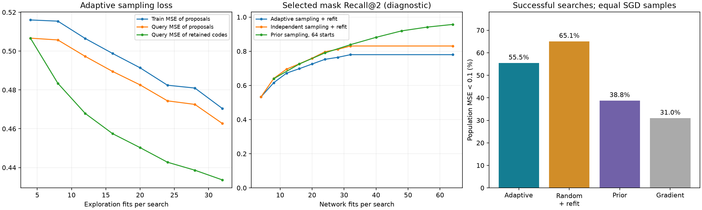

# Поиск z адаптивным сэмплированием

VAE заморожен. Четыре кода из N(0, I), восемь раундов. После первого
раунда каждый рестарт предлагает z + sigma * epsilon, epsilon ~ N(0, I).
Радиус геометрически убывает от 1.0 до 0.25. С вероятностью 0.25 вместо
локального предложения берётся новый сэмпл prior. Код принимается при
невозрастании query MSE после 1024 шагов SGD весов; равенство допускает
движение внутри области одной маски. Градиентов по z или VAE нет.

Всего 32 обучения кандидатов, затем 32 независимых старта весов на лучшей
маске, выбранной отдельной эмпирической selection-выборкой. Бюджет всех
методов — 64 × 1024 × 64 = 4 194 304 обработанных обучающих примера.
Данные, начальные четыре кода, четыре инициализации весов и финальные
32 инициализации совпадают с парным random_z-контролем. Популяционная MSE
и правильная маска используются только для измерений.

Проверены новые функции 301/302, четыре прежние структурные test-пары,
три сохранённых VAE seed и 16 поисков на контекст. Гиперпараметры заданы
до оценки; отдельная validation-диагностика сохранена. Контроли переиспользованы
из завершённого latent_search_v1 без повторного обучения. Это не новый
слепой структурный holdout. Временные затраты параллельных запусков могут
зависеть от загрузки сервера; равенство FLOPs не заявляется.

| Метод | Успехи | Доля | MSE выбранного | Recall@2 |
|---|---:|---:|---:|---:|
| Adaptive sampling + refit | 213/384 | 55.47% | 0.16381 | 0.780 |
| Independent sampling + refit | 250/384 | 65.10% | 0.13950 | 0.831 |
| Prior sampling, 64 starts | 149/384 | 38.80% | 0.19134 | 0.957 |
| Gradient z + refit | 119/384 | 30.99% | 0.22976 | 0.650 |

## Интерпретация

В этом фиксированном протоколе лучший результат дал независимый поиск
32 кодов с последующими 32 стартами весов на выбранной маске: 65.10%.
Адаптивное сэмплирование получило 55.47%, градиентное — 30.99%.
Это сравнение конкретных алгоритмов и настроек на данном семействе задач.

Полезно разделять нахождение структуры и обучение её весов. Среди исходных
64 независимых кандидатов правильная маска присутствовала в 379/384 поисков
(98.70%), но хорошее решение найдено только в 149/384 (38.80%). Двухэтапный
независимый поиск увидел правильную маску в 326/384 поисков (84.90%),
выбрал её в 254 и достиг хорошего решения в 250. Распределение бюджета
между разнообразием масок и повторными стартами их весов существенно.

Градиенты z были конечными и ненулевыми; среднее перемещение кода после
семи обновлений составило 1.63. Градиентный поиск рассмотрел в среднем
6.49 разных масок за 32 обучения, независимое сэмплирование — 14.86,
адаптивное — 11.71. Это диагностическое объяснение различий покрытия;
оно само по себе не устанавливает единственную причину разницы качества.
Числа диагностики — в ../latent_search_v1/diagnostics.json.

Настройки и хеши — plan.json, исходники — source/, подробные контексты —
records.json, локальные коды и маски — runs/latent_sampling_v1.
Контроли подробно описаны в ../latent_search_v1/REPORT.md.
