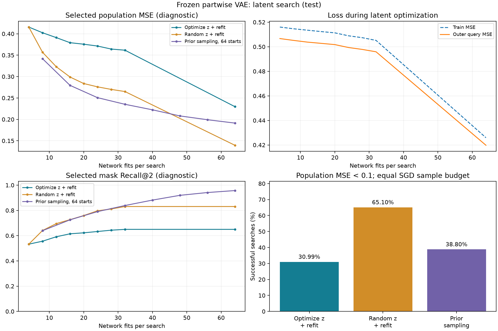

# Замороженный VAE: градиентный поиск латентного кода

Оценка: **test**. Использованы три сохранённых partwise VAE исходного
sine-эксперимента; encoder и decoder не обучаются. На новой задаче
обучаются код z и веса отдельной синусоидальной сети.

## Постановка и протокол

Данные, сеть и порог успеха совпадают с sine v1. Оптимизируется обычная
эмпирическая MSE предсказаний. Маска во всех прямых проходах бинарная,
содержит ровно две из 16 связей. Для производной используется straight-through
оценка с последовательной RelaxedTopK: это приближённый градиент дискретного
выбора. Градиент проходит через все 1024 шага обучения весов; аналитические
производные каждого SGD-обновления дифференцируются PyTorch.

Четыре кода z из нормального prior, восемь раундов обучения кандидатов,
семь обновлений z алгоритмом Adam (lr 0.1, температура 1.0). На каждом раунде
веса сети обучаются заново из фиксированной для данного рестарта инициализации.
Градиент считается по отдельной query-выборке из 4096 примеров. Независимая
выборка из 4096 примеров выбирает лучшую маску среди всех раундов. Затем
выбранная маска получает ещё 32 независимых старта весов. Выбирается лучший
кандидат из всех 64 обучений по эмпирической ошибке selection-выборки.

Контроль random_z имеет те же четыре начальные точки весов и данные,
но вместо градиентного обновления z сэмплирует новые коды; финальные
32 старта весов у обоих методов одинаковы. Контроль prior_sampling
использует 64 независимых кода и инициализации весов без дообучения z.

У всех методов 64 обучения по 1024 шага и batch 64: **4 194 304 обработанных
обучающих примера на поиск**. Обратный проход гиперградиента требует
дополнительных вычислений; равенство FLOPs или времени не заявляется.
Query/selection-оценки также считаются отдельно. Общий IID-поток обучающих
минибатчей повторяется между внешними раундами и методами; query и selection
независимы от него. Популяционная MSE и правильная поддержка используются
только при измерении результатов и диагностического Recall@2.

Параметры зафиксированы до оценки; validation используется для диагностики.
Итоговые функции 301/302 новые, четыре структурных test-пары уже изучались
в исходном v1. Это подтверждение на новых функциях и стартах, а не новый
слепой структурный holdout. Все три seed сохранены отдельно.

## Результаты

| Метод | Успехи | Доля | MSE выбранного | Recall@2 | Время, с |
|---|---:|---:|---:|---:|---:|
| Optimize z + refit | 119/384 | 30.99% | 0.22976 | 0.650 | 394.4 |
| Random z + refit | 250/384 | 65.10% | 0.13950 | 0.831 | 155.7 |
| Prior sampling, 64 starts | 149/384 | 38.80% | 0.19134 | 0.957 | 136.7 |

Средняя норма градиента z: 0.145749.
Доля кодов с ненулевым градиентом:
100.00%.
VAE заморожен: True.

В summary.json находятся агрегаты и результаты по seed, в records.json —
все контексты и истории внешних раундов. plan.json фиксирует настройки,
SHA исходных checkpoint и снимка реализации. Полные маски, коды и ошибки
кандидатов сохранены локально в `/home/udeneev-av/InductionBiasResearch/sine_mask_vae/runs/latent_search_v1`. Исходный v1 не изменён.
