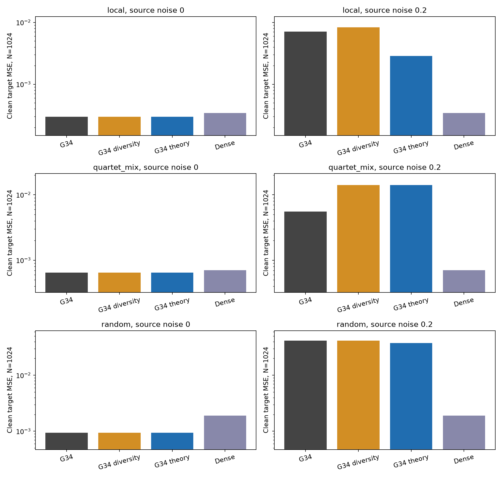
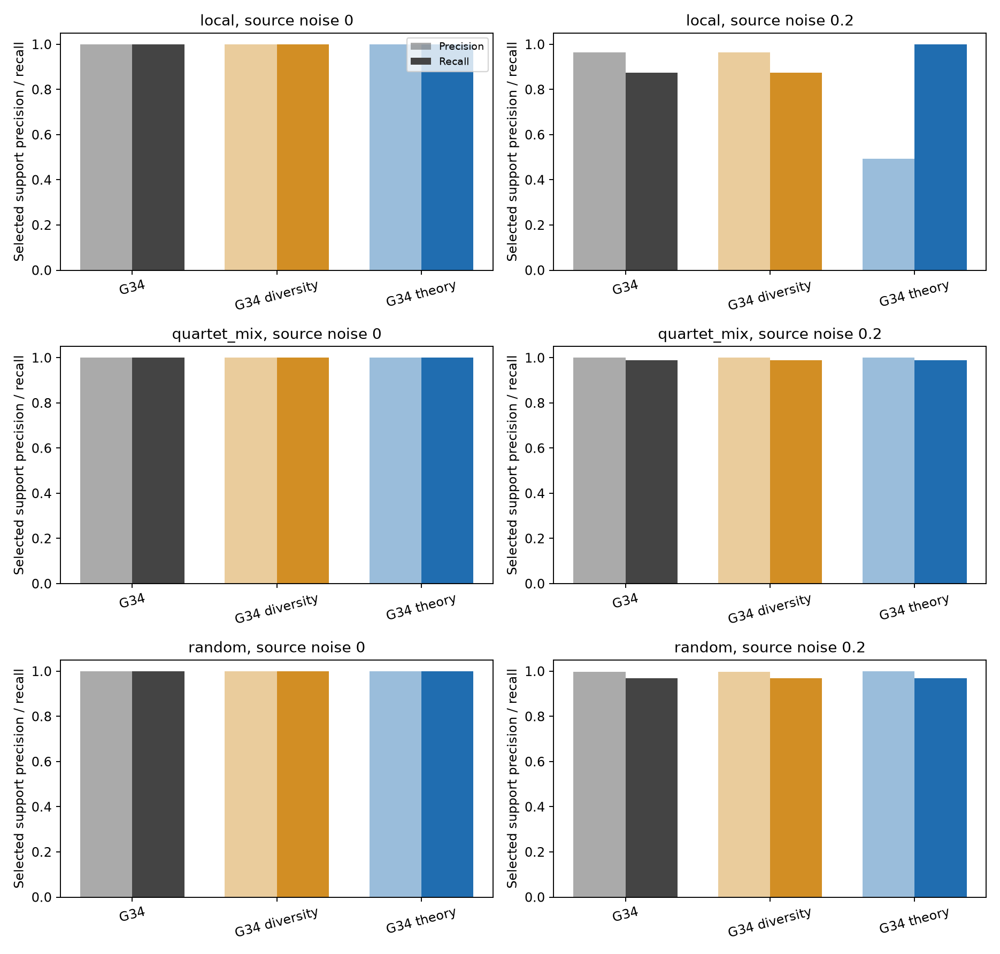
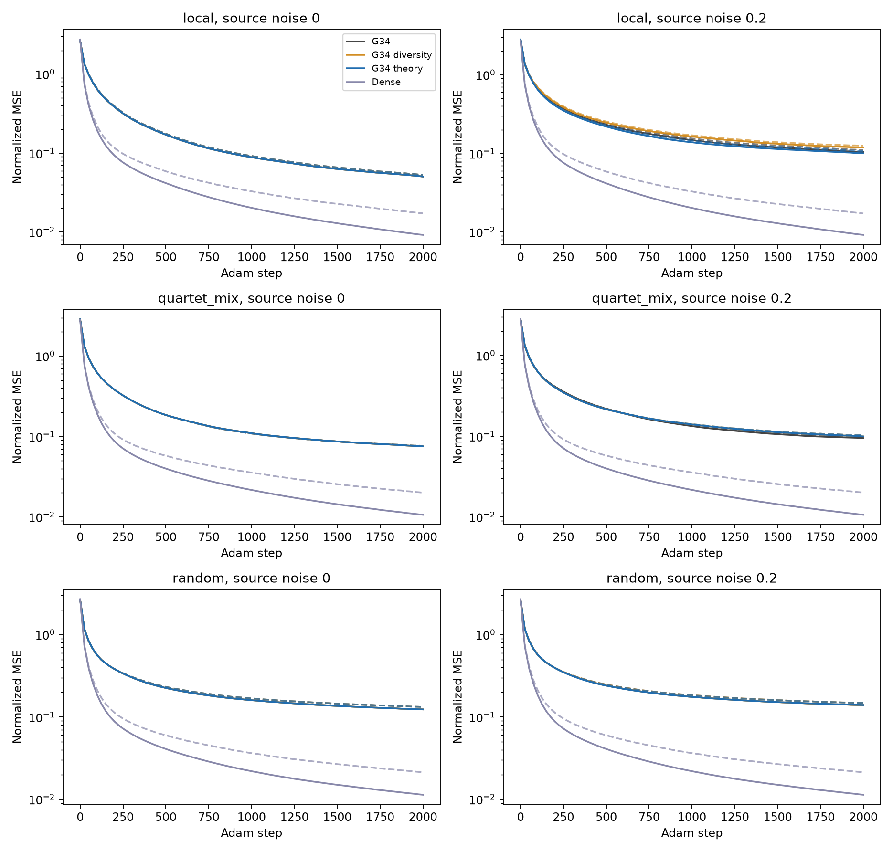
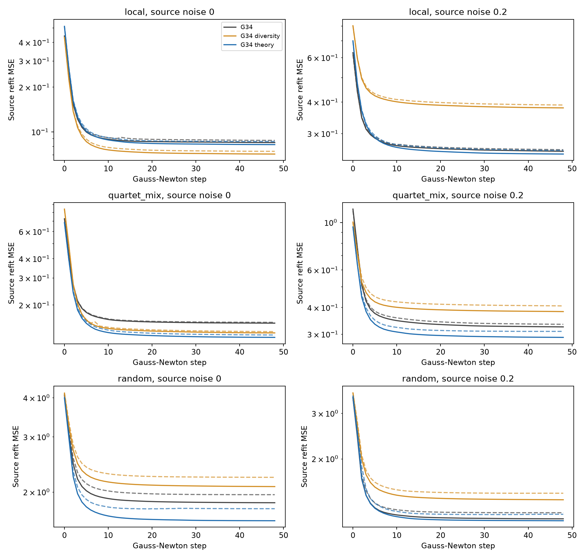
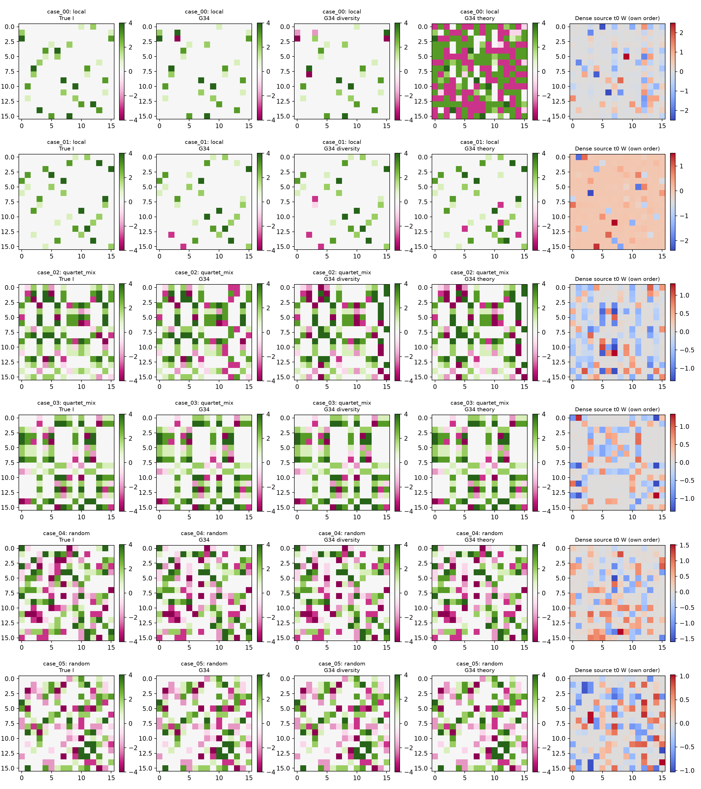

# G34 на более сложной общей синтетике

> Архивировано 8 ноября 2026. Исходники завершённых веток перенесены в archive/experiments/, сырые results/ удалены; [предсказания, протоколы и границы восстановления](../../2026-11-08/README.md) описаны отдельно. Пути к raw-данным и команды в тексте относятся к исходному запуску.

8 ноября 2026 года. Расширение проверки теоретических предложений.

## Вывод

**Универсального улучшения G34 на общей синтетике не получилось.** При
source noise0.2 новая ветвь снижает target MSE1024 на59.66% у local и9.96%
у random, но повышает её на154.41% у quartet_mix. Без шума выбранные
индексаторы и результаты переноса совпадают с исходным G34 во всех шести
семействах. Метод после этой проверки не менялся и как общая замена не принят.

Это свежая серия seed27110864019, по два разных страта каждого варианта,
16 source и8 новых target-функций на семейство. Все12 baseline,
36 variant-stage и42 target-прогона завершены без failures. До открытия
истины/ответов зафиксированы42 prediction-файла и1478 файлов протокола,
входов, моделей и receipts; нарушений границы доступа0.

Точное восстановление I без шума —6/6 у обоих методов; с шумом —2/6
у обоих. Эти числа совпали с историческим general-результатом G34, но
получены в новом запуске с новым seed и новыми численными задачами.
Улучшение MSE здесь не означает улучшение точного восстановления структуры.

При N1024 и noisy sources Dense лучше новой ветви на всех трёх вариантах.
При малых target-выборках структурный prior полезен: при N64/256 новая
ветвь лучше Dense в среднем по каждому варианту, включая quartet_mix.
Численные значения ниже относятся к source noise0.2.

| Вариант | Theory N64 | Dense N64 | Theory N256 | Dense N256 |
|---|---:|---:|---:|---:|
| local | 0.0089505 | 0.15189 | 0.0045134 | 0.038191 |
| quartet_mix | 0.10270 | 0.26725 | 0.016815 | 0.070352 |
| random | 0.11917 | 0.87920 | 0.045289 | 0.17649 |

Это наблюдаемая зависимость от размера target-выборки при фиксированном
численном алгоритме, не доказательство меньшей sample complexity для
произвольных функций. Source/search новой ветви дороже исходного примерно
на7.6–14.6% в зависимости от условия; ускорение target-адаптации не установлено.

## Что дали новые предложения

В четырёх из12 условий изменился выбранный I; все изменения относятся
к noisy sources. Пометки происхождения выбранных кандидатов:6 original,
3 anchor,2 log_positive,1 relations. Это описание выбранных записей банка,
не причинная абляция компонентов.

**Local: обе репликации улучшили перенос.** Case_00:0.0064192→0.0043410,
снижение32.37%; case_01:0.0078001→0.0013957, снижение82.11%.
Но первый выигрыш получен с log-кандидатом на223 активных позициях при32
истинных. После выравнивания у него199 неверных signed-позиций.
Размеры групп в исходной нумерации:11/16/8/188. У группы188 позиций
медианный относительный модуль target-кода равен8.56e-4, диапазон по восьми
задачам1.33e-4–4.15e-2. Это слабая численная компонента, не точное обнуление.
Бинарная маска такого I плохо описывает фактический вклад весов.

**Правильный local-I появился, но не прошёл лимит refit.** В case_01/c1
истинного I нет в исходном pool, а новые relations его создают. Поэтому
noisy coverage полного pool возрастает2/6→3/6. Однако coverage refit-банка
остаётся2/6, и exact recovery тоже2/6.

Правильная запись8174 имеет девятый score среди386 relations-кандидатов.
В её группе одного space-key30 разных записей relations; правильная —
девятая. Эвристика diverse_ids берёт первые два варианта этой группы:
8546 и8550. Правильная запись не подгоняется. Это конкретное ограничение
жёсткого выделения двух кандидатов одному пространству. Из наличия
правильного I в pool пока нельзя заключать, что его численная подгонка
и итоговый функциональный selector обязательно победили бы.

**Quartet_mix: потерян уже известный хороший кандидат.** В case_02/c1
current-I присутствует в полном theory pool, но отсутствует в новом
refit-банке. Его source meta MSE0.0593028 лучше0.0693018 у выбранного
новой ветвью кандидата. Target MSE ухудшается0.0098383→0.0269018.
У diversity и theory выбран один и тот же худший I из original-ветви:
это потеря из-за отбора ограниченного банка, а не установленный вред
новых log/relations-кандидатов. Истинного I в полном pool здесь нет
у обоих методов. Второй quartet_mix-case не изменился.

**Random: небольшое улучшение маски.** В case_04/c1 MSE снижается
0.0816482→0.0733286. У current-I132 связи:131 истинная и одна ложная;
у theory-I131 связь, все истинные. Девять истинных связей пропущены
в обоих вариантах. После audit alignment группы и знаки на сохранившихся
позициях корректны. Второй random-case не изменился. Это улучшение
приближённого I, без нового exact recovery.

## Что подтверждено относительно теории

У всех шести истинных структур связны все четыре графа повторяющихся пар
W(j), идеальная матрица контрастов имеет нужный ранг:2 у local/quartet_mix
и3 у random. Во всех семействах четыре teacher-знаковых профиля различны
с точностью до глобальной инверсии. Следовательно, проверенные идеальные
условия дают условную идентифицируемость групп при правильной опоре и
согласованных нейронах; это не гарантия всего процесса G34.

Практическая точность исходных направлений достаточной границы не достигает:
даже при истинной маске и teacher-выравнивании oracle-диагностика нарушает
projector-bound во всех12 условиях. Спектральная ошибка контрастов выше
достаточного шумового порога в5.19–69.13 раза. Полные значения — в таблице
ниже. Граница консервативна: clean G34 всё равно получил6/6 exact I.
Нарушение достаточной границы не доказывает невозможность восстановления.

Успех практического алгоритма нельзя объяснять прямым применением этой
теоремы к измеренным dense-решениям. Полезное дальнейшее направление —
робастные гарантии, допускающие отдельные плохие source-направления, и
более точная оценка различимости внутри одного пространства контрастов.

## Следующие изменения, которые имеет смысл проверять отдельно

1. **Сохранять победителя исходного G34 вместе с его численными состояниями.**
   Общие исходные anchors этого не гарантируют: выбранный после joint-refit
   кандидат может отсутствовать среди них. Если расширить новый банк парой
   «исходный I, исходные source-параметры», минимум того же source meta loss
   не возрастёт:

   $$
   \min_{(I,\theta)\in\mathcal B_{\mathrm{new}}\cup
   \{(I_{\mathrm{old}},\widehat\theta_{\mathrm{old}})\}}
   L_M(I,\theta)
   \le L_M(I_{\mathrm{old}},\widehat\theta_{\mathrm{old}}).
   $$

   Это детерминированная гарантия для измеренного source-критерия,
   не для ошибки на новых функциях. Она закрывает выявленную потерю
   исходного победителя в quartet_mix. В текущую подтверждающую серию
   это правило после просмотра результатов не добавлялось.

2. **Выделять refit-бюджет с учётом остаточной неоднозначности.** Ограничение
   двумя вариантами одного пространства может удалить правильный I даже
   при высоком общем ранге его score. Нужны отдельная проверка ориентаций
   и функциональный отбор внутри таких групп; простое увеличение числа
   разных пространств уже дало отрицательный контроль diversity.

3. **Оценивать структуру по свежей численной адаптации на отложенных
   source-функциях.** Такая проверка ближе к задаче переноса, чем ошибка
   состояний, уже подогнанных при построении банка. Её следует подтвердить
   на новой серии, сохраняя baseline-кандидата. Новых обучений или
   пост-query настройки по текущим target-ответам не выполнялось.

## Что представляет собой датасет

Шесть семейств сетей 16→16 ReLU→1/2 с четырьмя независимыми числами кодбука первого слоя. В каждом семействе один общий signed-индексатор I; коды, hidden biases, свободные выходные веса и offsets меняются между 16 source-задачами и восемью новыми target-функциями.

- **local**: восемь повторяющихся блоков 2×2; входы и hidden-нейроны переставлены.
- **quartet_mix**: две четвёрки двухмерных точек, полные блоки связей внутри каждой четвёрки, диагональные блоки противоположного знака.
- **random**: независимая вероятность связи 0.55; случайные коды и знаки.

Варианты local и DeepSets могут иметь одну геометрию первого слоя, но здесь выходные веса каждого нейрона свободны и не повторяют pooled-голову. Это существенное отличие генератора функций. Во второй репликации каждого варианта дополнительно свободны истинные hidden biases.

| Вариант | Case | Выходов | Teacher hidden bias | Source задач | Target функций |
|---|---|---:|---|---:|---:|
| local | case_00 | 1 | common | 16 | 8 |
| local | case_01 | 2 | independent | 16 | 8 |
| quartet_mix | case_02 | 1 | common | 16 | 8 |
| quartet_mix | case_03 | 2 | independent | 16 | 8 |
| random | case_04 | 1 | common | 16 | 8 |
| random | case_05 | 2 | independent | 16 | 8 |

Learner знает только D/H/K/O и наблюдения, не получает вариант, маску, роли входов, teacher-параметры и дисперсию шума. Один ответ на пример. True I и query-ответы открыты только после общего freeze.

## Основное качество переноса

Clean target MSE1024 после Adam+GN, selection256, query2048. В каждой ячейке среднее по двум указанным стратам, по восемь функций в каждом. Source noise 0/.2; targets общие для обоих условий. Положительный процент означает снижение MSE.

| Вариант | Source σ | G34 | Diversity | Theory | Dense | Снижение MSE Theory |
|---|---:|---:|---:|---:|---:|---:|
| local | 0 | 0.00029796 | 0.00029796 | 0.00029796 | 0.0003436 | +0.00% |
| local | 0.2 | 0.0071097 | 0.0082958 | 0.0028684 | 0.0003436 | +59.66% |
| quartet_mix | 0 | 0.00064396 | 0.00064396 | 0.00064396 | 0.00070625 | +0.00% |
| quartet_mix | 0.2 | 0.0055256 | 0.014057 | 0.014057 | 0.00070625 | -154.41% |
| random | 0 | 0.00094498 | 0.00094498 | 0.00094498 | 0.0018968 | +0.00% |
| random | 0.2 | 0.041769 | 0.041769 | 0.037609 | 0.0018968 | +9.96% |

Масштабы выходов различаются: общий raw-MSE по трём вариантам не используется для вывода о победителе. При MSE G34 ниже1e-12 относительный процент не приводится.

## Парные результаты по каждому семейству

| Вариант | Case | σ | G34 MSE | Theory MSE | Снижение | Победы/равенства/поражения |
|---|---|---:|---:|---:|---:|---:|
| local | case_00 | 0 | 2.3542e-05 | 2.3542e-05 | +0.00% | 0/8/0 |
| local | case_01 | 0 | 0.00057239 | 0.00057239 | +0.00% | 0/8/0 |
| local | case_00 | 0.2 | 0.0064192 | 0.004341 | +32.37% | 6/0/2 |
| local | case_01 | 0.2 | 0.0078001 | 0.0013957 | +82.11% | 7/0/1 |
| quartet_mix | case_02 | 0 | 7.5135e-05 | 7.5135e-05 | +0.00% | 0/8/0 |
| quartet_mix | case_03 | 0 | 0.0012128 | 0.0012128 | +0.00% | 0/8/0 |
| quartet_mix | case_02 | 0.2 | 0.0098383 | 0.026902 | -173.44% | 1/0/7 |
| quartet_mix | case_03 | 0.2 | 0.0012128 | 0.0012128 | +0.00% | 0/8/0 |
| random | case_04 | 0 | 2.9191e-10 | 2.9191e-10 | +0.00% | 0/8/0 |
| random | case_05 | 0 | 0.00189 | 0.00189 | +0.00% | 0/8/0 |
| random | case_04 | 0.2 | 0.081648 | 0.073329 | +10.19% | 6/0/2 |
| random | case_05 | 0.2 | 0.00189 | 0.00189 | +0.00% | 0/8/0 |

Равенство означает абсолютную разность не больше1e-12. Восемь target-задач разделяют извлечённый I и не являются восемью независимыми структурными подтверждениями. Два страта различаются размером выхода и bias-моделью; выделить причинный эффект каждого изменения по ним нельзя.

## Меньшие выборки и нормированная ошибка

| Вариант | σ | N | G34 MSE | Theory MSE | G34 NMSE | Theory NMSE |
|---|---:|---:|---:|---:|---:|---:|
| local | 0 | 64 | 0.0065487 | 0.0065487 | 0.014035 | 0.014035 |
| local | 0 | 256 | 0.00057522 | 0.00057522 | 0.0023703 | 0.0023703 |
| local | 0 | 1024 | 0.00029796 | 0.00029796 | 0.00033629 | 0.00033629 |
| local | 0.2 | 64 | 0.020764 | 0.0089505 | 0.061869 | 0.029356 |
| local | 0.2 | 256 | 0.009865 | 0.0045134 | 0.032301 | 0.022691 |
| local | 0.2 | 1024 | 0.0071097 | 0.0028684 | 0.026586 | 0.0098129 |
| quartet_mix | 0 | 64 | 0.058596 | 0.058596 | 0.10299 | 0.10299 |
| quartet_mix | 0 | 256 | 0.00071603 | 0.00071603 | 0.0013198 | 0.0013198 |
| quartet_mix | 0 | 1024 | 0.00064396 | 0.00064396 | 0.00046778 | 0.00046778 |
| quartet_mix | 0.2 | 64 | 0.087655 | 0.1027 | 0.13816 | 0.15284 |
| quartet_mix | 0.2 | 256 | 0.0058439 | 0.016815 | 0.0068441 | 0.01909 |
| quartet_mix | 0.2 | 1024 | 0.0055256 | 0.014057 | 0.0062514 | 0.015806 |
| random | 0 | 64 | 0.32963 | 0.32963 | 0.073242 | 0.073242 |
| random | 0 | 256 | 0.0018606 | 0.0018606 | 0.00027038 | 0.00027038 |
| random | 0 | 1024 | 0.00094498 | 0.00094498 | 0.00013732 | 0.00013732 |
| random | 0.2 | 64 | 0.1348 | 0.11917 | 0.066798 | 0.078421 |
| random | 0.2 | 256 | 0.056977 | 0.045289 | 0.025816 | 0.021261 |
| random | 0.2 | 1024 | 0.041769 | 0.037609 | 0.01987 | 0.017984 |

NMSE делит MSE каждой задачи на дисперсию её query-ответов, затем усредняется по задачам. Adam-only результаты также сохранены в CSV; основной критерий — Adam+GN.

## Структура и покрытие банка

| Вариант | σ | Метод | Exact I | True I в pool | True I в refit | Ошибок позиций | Mask P/R | Sharing ARI |
|---|---:|---|---:|---:|---:|---:|---:|---:|
| local | 0 | G34 | 2/2 | 2/2 | 2/2 | 0 | 100.00% / 100.00% | 1.0000 |
| local | 0 | G34 diversity | 2/2 | 2/2 | 2/2 | 0 | 100.00% / 100.00% | 1.0000 |
| local | 0 | G34 theory | 2/2 | 2/2 | 2/2 | 0 | 100.00% / 100.00% | 1.0000 |
| local | 0.2 | G34 | 0/2 | 0/2 | 0/2 | 16 | 96.43% / 87.50% | 0.7908 |
| local | 0.2 | G34 diversity | 0/2 | 0/2 | 0/2 | 23 | 96.43% / 87.50% | 0.6362 |
| local | 0.2 | G34 theory | 0/2 | 1/2 | 0/2 | 206 | 49.28% / 100.00% | 0.8034 |
| quartet_mix | 0 | G34 | 2/2 | 2/2 | 2/2 | 0 | 100.00% / 100.00% | 1.0000 |
| quartet_mix | 0 | G34 diversity | 2/2 | 2/2 | 2/2 | 0 | 100.00% / 100.00% | 1.0000 |
| quartet_mix | 0 | G34 theory | 2/2 | 2/2 | 2/2 | 0 | 100.00% / 100.00% | 1.0000 |
| quartet_mix | 0.2 | G34 | 1/2 | 1/2 | 1/2 | 16 | 100.00% / 98.83% | 0.8647 |
| quartet_mix | 0.2 | G34 diversity | 1/2 | 1/2 | 1/2 | 28 | 100.00% / 98.83% | 0.8647 |
| quartet_mix | 0.2 | G34 theory | 1/2 | 1/2 | 1/2 | 28 | 100.00% / 98.83% | 0.8647 |
| random | 0 | G34 | 2/2 | 2/2 | 2/2 | 0 | 100.00% / 100.00% | 1.0000 |
| random | 0 | G34 diversity | 2/2 | 2/2 | 2/2 | 0 | 100.00% / 100.00% | 1.0000 |
| random | 0 | G34 theory | 2/2 | 2/2 | 2/2 | 0 | 100.00% / 100.00% | 1.0000 |
| random | 0.2 | G34 | 1/2 | 1/2 | 1/2 | 10 | 99.62% / 96.79% | 1.0000 |
| random | 0.2 | G34 diversity | 1/2 | 1/2 | 1/2 | 10 | 99.62% / 96.79% | 1.0000 |
| random | 0.2 | G34 theory | 1/2 | 1/2 | 1/2 | 9 | 100.00% / 96.79% | 1.0000 |

Sharing ARI считается на общих ненулевых позициях, не оценивает знаки и пропущенные связи. Exact I учитывает нули, группы и относительные знаки с допустимыми глобальными gauge/hidden-перестановками. Pool и refit — разные бюджеты, истинный I открывается только при аудите.

## Проверка достаточных условий из теории

Это post-freeze диагностика с истинной маской и выравниванием dense-нейронов к teacher. Используются истинный ранг и только истинные активные позиции. Learner этих подсказок не получает; измерение не заменяет проверку всего алгоритма.

По матрице логарифмических контрастов собственных dense-решений строится пространство истинного ранга. δP — операторная ошибка его проектора. Используются консервативные достаточные границы из теории; n_max — максимальное число появлений одного кода, Z — идеальные контрасты 16 teacher-задач.

$$
\begin{aligned}
\delta_P &= \|\widehat P-P\|_2 < \frac{1}{8\sqrt{n_{\max}}},\\
\varepsilon &= \|\widehat Z-Z\|_2 < \frac{\sigma_r(Z)}{16\sqrt{n_{\max}}}.
\end{aligned}
$$

Последний столбец — измеренная спектральная ошибка, делённая на достаточный шумовой порог.

| Вариант | Case | σ | Ранг | Все W(j) связны | δP | Порог δP | Ошибка / шумовой порог |
|---|---|---:|---:|---|---:|---:|---:|
| local | case_00 | 0 | 2 | да | 0.06809 | 0.04419 | 12.88 |
| local | case_00 | 0.2 | 2 | да | 0.5117 | 0.04419 | 38.24 |
| local | case_01 | 0 | 2 | да | 0.07747 | 0.04419 | 5.189 |
| local | case_01 | 0.2 | 2 | да | 0.2286 | 0.04419 | 15.68 |
| quartet_mix | case_02 | 0 | 2 | да | 0.223 | 0.0221 | 41.9 |
| quartet_mix | case_02 | 0.2 | 2 | да | 0.5216 | 0.0221 | 69.13 |
| quartet_mix | case_03 | 0 | 2 | да | 0.1141 | 0.0221 | 23.17 |
| quartet_mix | case_03 | 0.2 | 2 | да | 0.2661 | 0.0221 | 54.64 |
| random | case_04 | 0 | 3 | да | 0.2313 | 0.02028 | 58.94 |
| random | case_04 | 0.2 | 3 | да | 0.4549 | 0.02028 | 66.3 |
| random | case_05 | 0 | 3 | да | 0.03663 | 0.01976 | 22.61 |
| random | case_05 | 0.2 | 3 | да | 0.2762 | 0.01976 | 48.25 |

Граф W(j) соединяет нейроны, содержащие код j и ещё один общий код. Его связность относится к восстановлению unsigned-групп при правильной маске и известных размерах. Знаковые профили и остальные показатели сохранены отдельно. Логарифмы ограничены снизу на1e-12 только в диагностике. Неисполнение достаточной границы не доказывает невозможность восстановления.

[Полная таблица условий](../../../artifacts/g34_general_2026-11-08/theory_conditions.csv).

## Кривые и стоимость

Target train/selection усредняются по всем18 Adam starts и задачам; selection пунктиром. Ось X — шаги, GN входит в итоговые метрики.

Source refit-кривые усредняют все подгоняемые предложения и старты; это не loss только выбранного I.

| Вариант | σ | Метод | Source/search с | Target с, все бюджеты/8 задач | Peak CUDA MiB |
|---|---:|---|---:|---:|---:|
| local | 0 | G34 | 523.90 | 106.10 | 136.57 |
| local | 0 | G34 diversity | 573.08 | 108.09 | 136.57 |
| local | 0 | G34 theory | 563.58 | 106.19 | 136.57 |
| local | 0.2 | G34 | 523.44 | 108.37 | 136.57 |
| local | 0.2 | G34 diversity | 576.82 | 109.23 | 136.57 |
| local | 0.2 | G34 theory | 576.47 | 104.72 | 136.57 |
| quartet_mix | 0 | G34 | 536.90 | 108.48 | 136.57 |
| quartet_mix | 0 | G34 diversity | 613.30 | 107.25 | 136.57 |
| quartet_mix | 0 | G34 theory | 613.82 | 105.65 | 136.57 |
| quartet_mix | 0.2 | G34 | 563.26 | 106.11 | 136.57 |
| quartet_mix | 0.2 | G34 diversity | 640.75 | 109.34 | 136.57 |
| quartet_mix | 0.2 | G34 theory | 645.74 | 107.38 | 136.57 |
| random | 0 | G34 | 364.43 | 106.89 | 136.57 |
| random | 0 | G34 diversity | 370.06 | 107.12 | 136.57 |
| random | 0 | G34 theory | 394.16 | 108.16 | 136.57 |
| random | 0.2 | G34 | 630.80 | 108.69 | 136.57 |
| random | 0.2 | G34 diversity | 705.04 | 106.33 | 136.57 |
| random | 0.2 | G34 theory | 713.92 | 107.15 | 136.57 |

Равен лимит32 новых refit, а не wall time. Source/search включает общие dense fits и исходный pool; новые варианты дополнительно оплачивают полный theory pool. Для diversity это верхний учёт общей стадии, не отдельный standalone-профиль. Target время — packed throughput с profiler overhead. Torch FLOPs в сырых metrics неполны и исключают NumPy/SciPy. Development на новом наборе не выполнялся.

## Индексаторы и настоящие dense-веса

Все шесть noisy-семейств. Выбранные I выровнены к истине только для отображения после freeze. Dense W — реальные веса source t0 в собственном порядке нейронов.

## Границы вывода и воспроизведение

Конфигурация bank.py/variant.py буквально совпадает с предыдущей регистрацией Pattern/DeepSets. Пороги и квоты после известных результатов той проверки не менялись. Старые и новые данные не объединяются в независимое подтверждение. Теоретические error bounds не сертифицированы; жадные proposals не дают полного покрытия. Причинные эффекты relations/log/sign ветвей отдельно не изолированы.

[Первый отчёт](G34_THEORY_EXPERIMENT_REPORT_2026-11-08.md), [теория](../../../paper/theory/IDENTIFIABILITY_AND_BANK_DESIGN_2026-11-07.md), [протокол](../../../artifacts/g34_general_2026-11-08/protocol.md), [регистрация](../../../artifacts/g34_general_2026-11-08/method_registration.json), [freeze](../../../artifacts/g34_general_2026-11-08/frozen_results.json).

Таблицы: [transfer](../../../artifacts/g34_general_2026-11-08/transfer.csv), [recovery](../../../artifacts/g34_general_2026-11-08/recovery.csv), [costs](../../../artifacts/g34_general_2026-11-08/costs.csv). Компактная папка содержит evidence и рисунки; полный prediction-аудит требует локального каталога /home/udeneev-av/InductionBiasResearch/experiments/g34_theory_v1/results/20261108_general.
