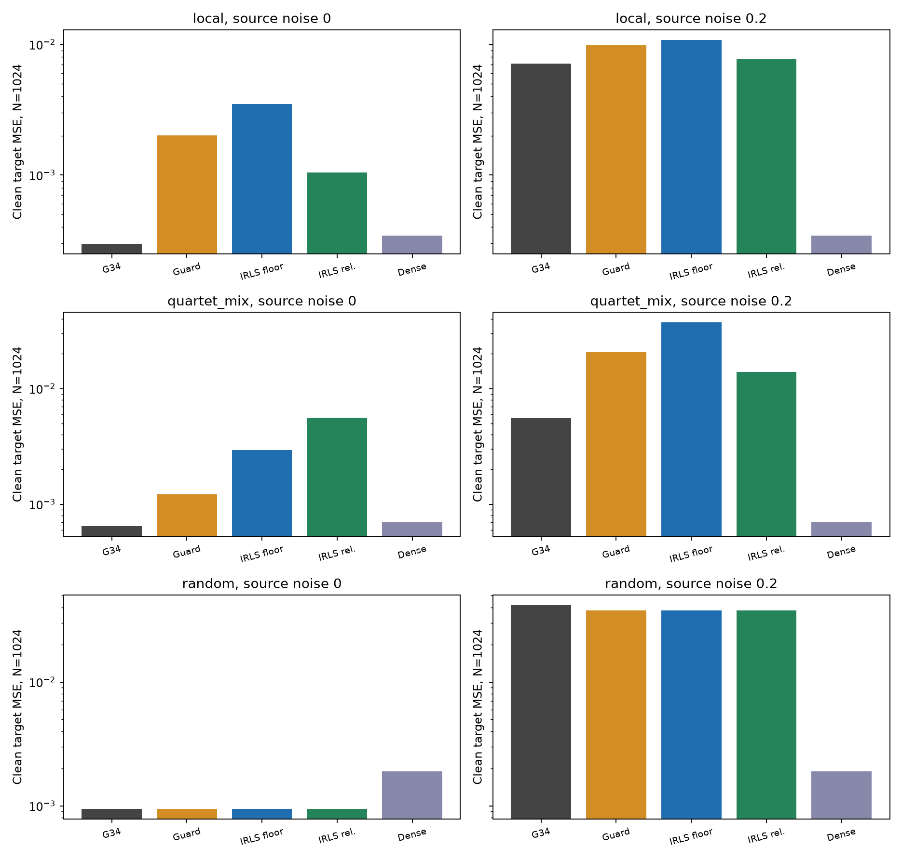
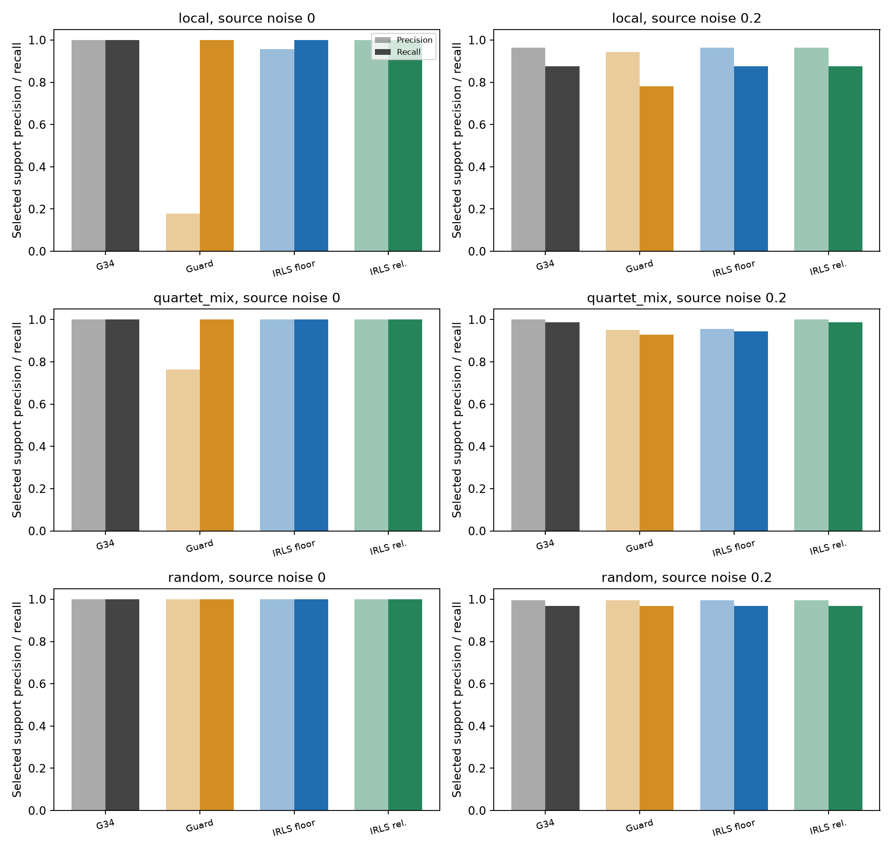
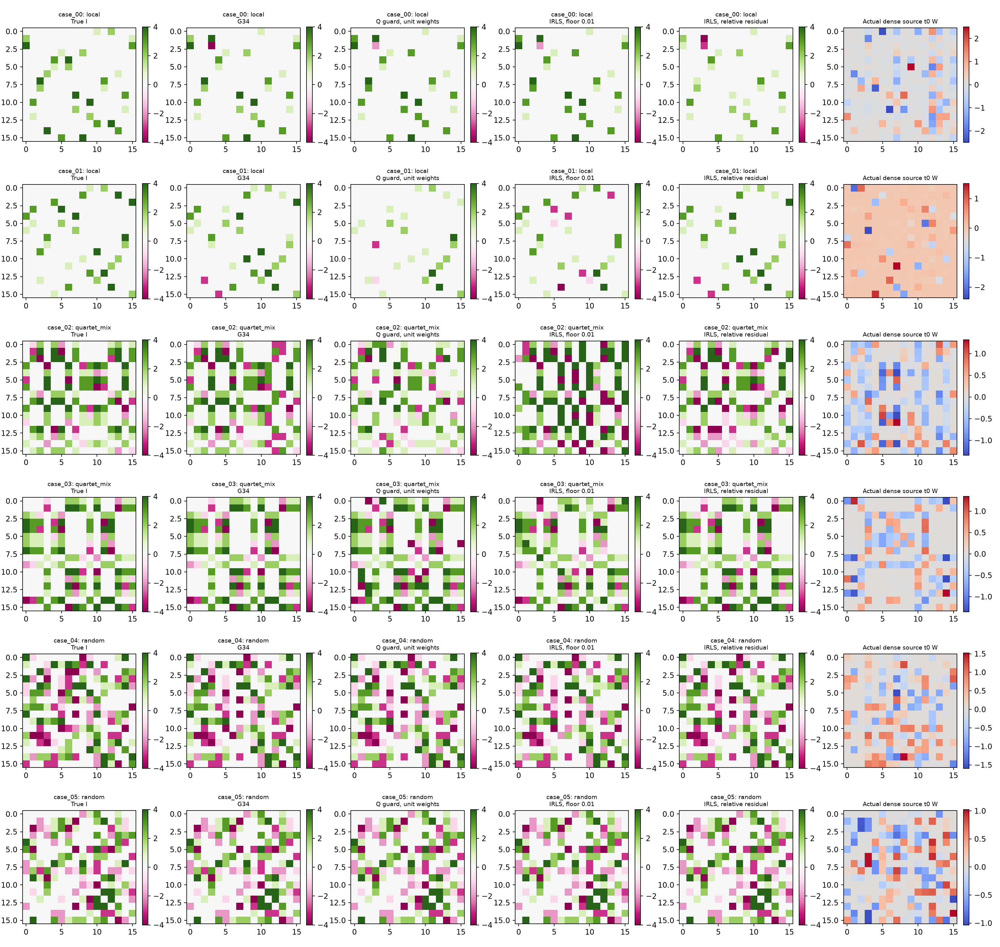
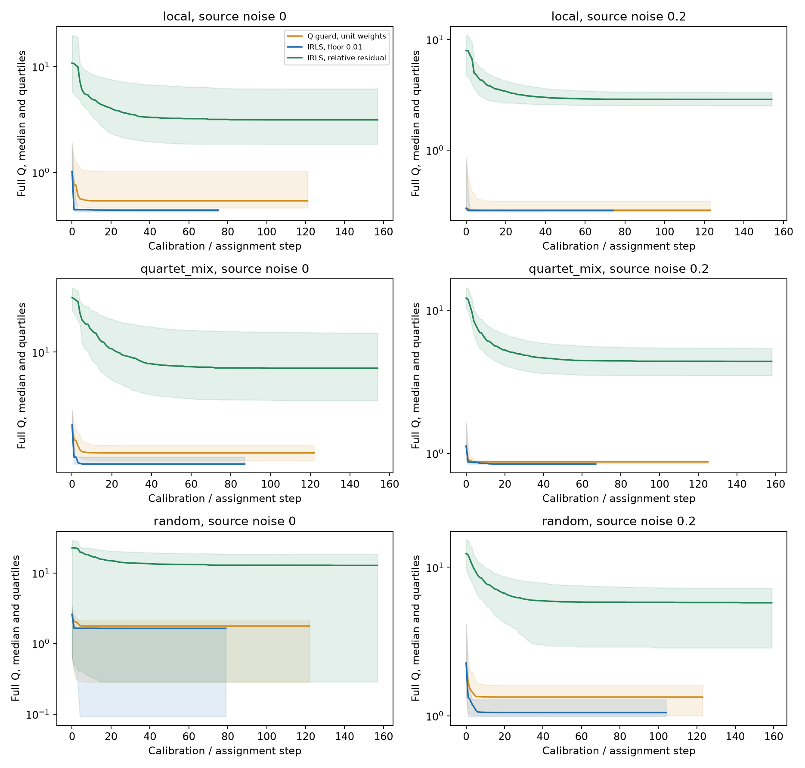
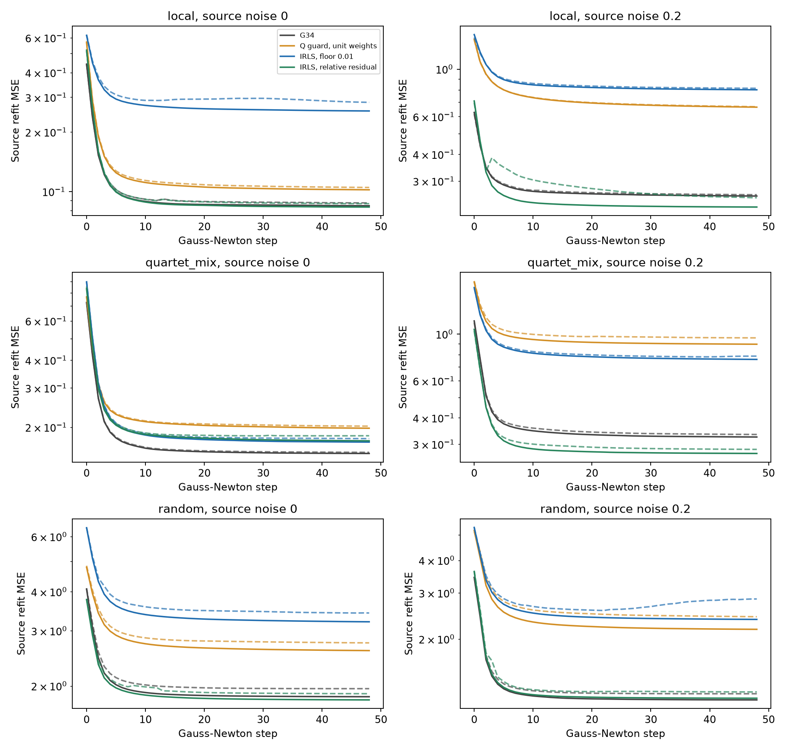
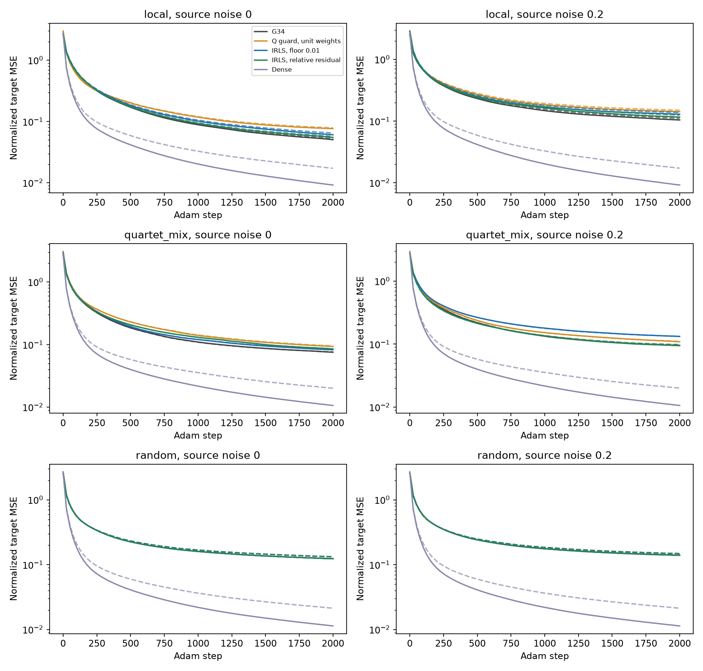

# Согласованная робастная калибровка G34

> Архивировано 8 ноября 2026. Исходники завершённых веток перенесены в archive/experiments/, сырые results/ удалены; [предсказания, протоколы и границы восстановления](../../2026-11-08/README.md) описаны отдельно. Пути к raw-данным и команды в тексте относятся к исходному запуску.

8 ноября 2026. Парная ретроспективная абляция на общей синтетике.

Проверка завершена: все 36 source- и 36 target-заданий выполнены без ошибок.
В качестве готовой замены G34 эти варианты не подтверждены. При N=1024
IRLS-floor увеличил target MSE на local и quartet_mix в обоих шумовых
режимах; на clean random результат совпал, на noisy random MSE снизилась
на 9.12%. Relative также ухудшил четыре local/quartet_mix группы и дал
те же два результата на random. Exact I без шума: current 6/6,
IRLS-floor 2/6, relative 3/6; с source noise 0.2: 2/6, 1/6 и 2/6.
Более низкий геометрический Q не обеспечил лучшего переноса.

## Что именно проверили

В предыдущей серии предложений G34 IRLS использовался только во вспомогательном log-space шаге. В этой изолированной экспериментальной ветви заменён численный шаг основного геометрического блока G34; сам штраф сохранён:

$$
\begin{aligned}
\rho_4(r)&=4\log(1+r^2/4),\\
\omega(r)&=(1+r^2/4)^{-1}.
\end{aligned}
$$

В линейных подзадачах строки умножаются на квадратный корень робастного веса, делённый на текущий discrepancy scale. Такие Cauchy-веса соответствуют [определению GTSAM](https://gtsam.org/doxygen/a05247.html). При изменении масштабов предложения принимаются по полному Q; при отклонении frozen-scale направления применяется Jacobian полного нормированного остатка.

Guard и IRLS-floor различаются только дополнительными весами. Relative меняет также нормировку и допустимую область масштабов:

$$
\begin{aligned}
\sigma_{\tau,h}&=\max(u_{\tau,h},0.0003),\\
r^{\mathrm{floor}}_{\tau,dh}
&=\frac{w_{dh}-a_{\tau,h}R_{\tau,dh}}
{\sigma_{\tau,h}\max(|a_{\tau,h}|,0.01)},\\
r^{\mathrm{rel}}_{\tau,dh}
&=\frac{w_{dh}-a_{\tau,h}R_{\tau,dh}}
{\sigma_{\tau,h}|a_{\tau,h}|},
\qquad |a_{\tau,h}|\geq10^{-6}.
\end{aligned}
$$

Relative сохраняет остаток исходного ranking G34 на своей допустимой области. Сравнение с ним не выделяет отдельно влияние omega: меняются также нормировка и область.

## Обнаруженная вырожденность нормировки

У цели с полом 0.01 есть явный способ подавить вклад почти всех нейронов. В каждой компоненте оставляем anchor scale равным единице, устремляем остальные масштабы к нулю, а кодбук — к нулю ещё быстрее. Тогда остатки всех не-anchor нейронов стремятся к нулю для произвольного I. Строгого запрета точных нулей недостаточно.

Это подтвердилось в численных состояниях. Для geometry-rank1 кандидата case_00_c0:

| Вариант | Его Q | Исходный ranking на том же состоянии | Доля масштабов ниже 0.01 | Минимальный модуль масштаба | Медианная норма кодбука |
|---|---:|---:|---:|---:|---:|
| Guard | 0.2410 | 5.0771 | 50.00% | 6.94e-16 | 0.5000 |
| IRLS-floor | 0.4258 | 17.2632 | 93.75% | 1.38e-19 | 3.84e-9 |
| IRLS-relative | 1.6132 | 1.6132 | 2.34% | 0.00155 | 1.5373 |

Исходный ranking пересчитан на том же состоянии каждой строки. Сравнивать абсолютные значения двух разных нормировок как одну цель нельзя. Это калибровочные кодбуки геометрической стадии, а не итоговые параметры функционального refit.

По первым по Q кандидатам всех 12 условий доля масштабов ниже 0.01 составляет в среднем 65.40% для guard, 62.76% для IRLS-floor и 0.26% для relative. Все 55 воспроизведённых состояний дали точно сохранённые Q. Полные значения — в calibration_states.csv.

Таким образом, согласование всех стадий с прежним assignment-полом требует осторожности: оно позволяет ранжировать высоко состояния, почти обнулившие значительную часть сравнений. Это конкретный дефект выбранной нормировки; он не доказывает, что именно он объясняет каждую перемену target-качества.

## Теоретические результаты

- Для фиксированных discrepancy scales IRLS даёт MM-шаг через касательную к логарифму квадрата остатка. При зависящих от калибровки знаменателях невозрастание одного Q обеспечивается принятием шага по полной цели.
- Требование «каждый код используется хотя бы раз» допускает точное assignment через выбор различных представителей кодов прямоугольным Hungarian-решением. Эвристическое пересоздание пустых групп не требуется.
- В логарифмах ненулевых модулей, при фиксированных I и знаках, матрица полного IRLS–GN шага является взвешенным лапласианом графа «коды — нейроны». Робастные веса сохраняют формальный ранг при положительных рёберных весах, но могут ослабить связи и ухудшить обусловленность.

Это условные локальные результаты и описание известных численных конструкций в нашей задаче. Они не доказывают правильность найденного I или глобальную оптимальность. Доказательства и отдельно обозначенные непроверенные продолжения — в SOLVER_NOTES.md.

## Качество на новых функциях

Clean query MSE после Adam+GN: 1024 support-примера, 256 отдельных selection-примеров, 2048 query-примеров. В каждой строке две структуры × восемь новых функций. Δ = (IRLS/G34 − 1) × 100%; отрицательное значение означает улучшение. В колонке Δ ниже используется дополнительный relative-вариант; результаты исходной IRLS-ветви с полом также показаны отдельно.

| Геометрия | Source σ | G34 | Guard | IRLS floor | IRLS relative | Dense | Δ relative |
|---|---:|---:|---:|---:|---:|---:|---:|
| local | 0 | 0.0002979642 | 0.002007583 | 0.00348574 | 0.001049746 | 0.0003436007 | +252.31% |
| local | 0.2 | 0.007109674 | 0.009868131 | 0.0108194 | 0.007674921 | 0.0003436007 | +7.95% |
| quartet_mix | 0 | 0.0006439644 | 0.001220699 | 0.002929848 | 0.005618066 | 0.0007062501 | +772.42% |
| quartet_mix | 0.2 | 0.005525553 | 0.02060332 | 0.03726285 | 0.01394832 | 0.0007062501 | +152.43% |
| random | 0 | 0.0009449829 | 0.0009449829 | 0.0009449829 | 0.0009449829 | 0.001896806 | +0.00% |
| random | 0.2 | 0.04176906 | 0.03795909 | 0.03795909 | 0.03795909 | 0.001896806 | -9.12% |

Две структуры на геометрию не дают надёжной оценки разброса по популяции структур. Восемь функций с одним I не являются восемью независимыми структурами. Старые результаты этого набора были известны до опыта; это не fresh confirmation.

## Меньшие бюджеты адаптации

Те же query-метрики после Adam+GN, при N=64/256. Все numerical selection-примеры дополнительные к N.

| Геометрия | σ | N | G34 | IRLS floor | IRLS relative | Dense |
|---|---:|---:|---:|---:|---:|---:|
| local | 0 | 64 | 0.00654874 | 0.01178901 | 0.008273636 | 0.1518924 |
| local | 0 | 256 | 0.0005752222 | 0.003983146 | 0.001637839 | 0.03819088 |
| local | 0.2 | 64 | 0.02076357 | 0.05810118 | 0.02101705 | 0.1518924 |
| local | 0.2 | 256 | 0.009865042 | 0.01540568 | 0.01036333 | 0.03819088 |
| quartet_mix | 0 | 64 | 0.05859623 | 0.02814484 | 0.0270617 | 0.267255 |
| quartet_mix | 0 | 256 | 0.0007160346 | 0.009635717 | 0.006037371 | 0.07035226 |
| quartet_mix | 0.2 | 64 | 0.08765516 | 0.1469497 | 0.09040601 | 0.267255 |
| quartet_mix | 0.2 | 256 | 0.00584392 | 0.0407419 | 0.01503514 | 0.07035226 |
| random | 0 | 64 | 0.3296251 | 0.3296251 | 0.3296251 | 0.8791958 |
| random | 0 | 256 | 0.001860593 | 0.001860593 | 0.001860593 | 0.1764923 |
| random | 0.2 | 64 | 0.1347953 | 0.1438045 | 0.1438045 | 0.8791958 |
| random | 0.2 | 256 | 0.05697722 | 0.044661 | 0.044661 | 0.1764923 |

## Отдельные структуры и восстановление I

| Case | σ | MSE G34 | MSE guard | MSE IRLS floor | MSE IRLS relative | Ошибки I: G34 / guard / floor / relative |
|---|---:|---:|---:|---:|---:|---|
| case_00 (local) | 0 | 2.354155e-05 | 0.002436326 | 0.0002614826 | 2.354155e-05 | 0 / 190 / 2 / 0 |
| case_00 (local) | 0.2 | 0.006419208 | 0.006622152 | 0.006622152 | 0.007549701 | 8 / 13 / 13 / 13 |
| case_01 (local) | 0 | 0.0005723868 | 0.001578839 | 0.006709996 | 0.00207595 | 0 / 130 / 11 / 9 |
| case_01 (local) | 0.2 | 0.00780014 | 0.01311411 | 0.01501666 | 0.00780014 | 8 / 15 / 16 / 8 |
| case_02 (quartet_mix) | 0 | 7.513469e-05 | 0.002428117 | 0.001909609 | 0.01106262 | 0 / 30 / 4 / 36 |
| case_02 (quartet_mix) | 0.2 | 0.009838313 | 0.03994212 | 0.06928143 | 0.02668385 | 16 / 45 / 75 / 25 |
| case_03 (quartet_mix) | 0 | 0.001212794 | 1.328208e-05 | 0.003950087 | 0.0001735144 | 0 / 147 / 22 / 8 |
| case_03 (quartet_mix) | 0.2 | 0.001212794 | 0.001264511 | 0.005244279 | 0.001212794 | 0 / 11 / 15 / 0 |
| case_04 (random) | 0 | 2.919102e-10 | 2.919102e-10 | 2.919102e-10 | 2.919102e-10 | 0 / 0 / 0 / 0 |
| case_04 (random) | 0.2 | 0.08164815 | 0.07402821 | 0.07402821 | 0.07402821 | 10 / 10 / 10 / 10 |
| case_05 (random) | 0 | 0.001889965 | 0.001889965 | 0.001889965 | 0.001889965 | 0 / 0 / 0 / 0 |
| case_05 (random) | 0.2 | 0.001889965 | 0.001889965 | 0.001889965 | 0.001889965 | 0 / 0 / 0 / 0 |

Ошибки I измерены после оптимального переименования кодов, смены их знаков и перестановки hidden-нейронов. Низкая функциональная ошибка не означает точное восстановление I.

| Source σ | Метод | Exact I | True I в proposal pool | True I в доступном банке | True I реально отправлен в refit |
|---:|---|---:|---:|---:|---:|
| 0 | G34 | 6/6 | 6/6 | 6/6 | 6/6 |
| 0 | Q guard, unit weights | 2/6 | 2/6 | 2/6 | 1/6 |
| 0 | IRLS, floor 0.01 | 2/6 | 2/6 | 2/6 | 2/6 |
| 0 | IRLS, relative residual | 3/6 | 6/6 | 3/6 | 3/6 |
| 0.2 | G34 | 2/6 | 2/6 | 2/6 | 2/6 |
| 0.2 | Q guard, unit weights | 1/6 | 1/6 | 1/6 | 1/6 |
| 0.2 | IRLS, floor 0.01 | 1/6 | 1/6 | 1/6 | 1/6 |
| 0.2 | IRLS, relative residual | 2/6 | 2/6 | 2/6 | 2/6 |

Доступный банк включает исходные seed-состояния. Наличие true I в нём не означает, что этот I вошёл в первые 32 новых refit-слота. В recovery.csv также сохранена его фактическая source meta-ошибка.

## Фактическая оптимизация полного Q

| Метод | Запусков | Шагов Q | Увеличений Q > 1e-10 | Линейных решений | Принятых полных GN fallback |
|---|---:|---:|---:|---:|---:|
| Q guard, unit weights | 5544 | 81389 | 0 | 2060078 | 49911 |
| IRLS, floor 0.01 | 5544 | 110945 | 0 | 2171736 | 29255 |
| IRLS, relative residual | 5544 | 479772 | 0 | 11691741 | 3012708 |

Число линейных решений учитывает итерации после общей исходной WLS-инициализации. Шаги Q относятся к принятым или сохранённым состояниям; отклонённые backtracking-предложения в эту траекторию не входят.

Кривые ниже — медиана и квартильный диапазон действительного Q по всем стартам. После остановки кривая продолжается последним значением только для агрегирования, дополнительные шаги не считаются. Это не train/query loss функции. Relative использует другой знаменатель: абсолютные уровни его Q и Q с полом не следует сравнивать как одну и ту же целевую функцию.

## Стоимость

| Геометрия | σ | Geometry G34, s | Geometry guard, s | IRLS floor, s | IRLS relative, s | Полная source-стоимость relative/G34 |
|---|---:|---:|---:|---:|---:|---:|
| local | 0 | 216.7 | 460.3 | 432.2 | 1560.8 | 3.55× |
| local | 0.2 | 238.7 | 409.5 | 422.1 | 1612.7 | 3.69× |
| quartet_mix | 0 | 229.5 | 436.0 | 484.0 | 1729.8 | 3.82× |
| quartet_mix | 0.2 | 252.1 | 382.1 | 399.6 | 1780.6 | 3.72× |
| random | 0 | 59.9 | 122.6 | 107.0 | 332.1 | 1.76× |
| random | 0.2 | 287.9 | 527.0 | 409.0 | 1652.7 | 3.16× |

Это измеренное wall time, не полный FLOP-счётчик. Geometry использует NumPy/SciPy на CPU. Общая стоимость включает ранее обученные dense-источники и seeds; их фактически не переобучали. Функциональный refit имеет прежний бюджет, но численный projection solver и остановка отличаются от исходного G34.

Сплошные кривые — train, пунктир — отдельная numerical selection. Source-кривые усредняют refit-кандидаты и старты; target-кривые усредняют Adam-старты до GN. Они отличаются от loss выбранного лучшего запуска; таблица качества использует выбранные Adam+GN состояния.

## Протокол и файлы

Данные: local/quartet_mix/random, D=H=16, K=4, O=1/2; по две структуры. Local содержит повторяющиеся блоки 2×2; quartet_mix смешивает четвёрки двухмерных точек; random имеет плотность 0.55. Выходные веса нейронов свободны; во второй структуре каждой геометрии свободны и hidden biases. Один общий I, разные численные параметры у 16 source и 8 target-функций.

Source: 4096 train, 512 numerical selection, 1024 meta. Те же 4 anchors, 4 support masks и source-derived starts. Refit первых 32 кандидатов: 4 старта × 48 GN. Source meta выбирает I. На target переносится только I: 18 свежих Adam-стартов × 2000 шагов, 4 GN-старта × 48 шагов, N=64/256/1024, дополнительная numerical selection N/4. Все числа свежие.

Контроль current использует сохранённые исходные результаты; guard/IRLS/relative рассчитаны заново. Исходные две ветви после запуска не менялись. Relative добавлен отдельным amendment после теоретического анализа пола, до любого нового target-fit или scoring; первые source-результаты уже были доступны. В середине расчёта пользователь разрешил все карты: изменены только ресурсы 6→8 GPU, один job на карту, что записано в resource_amendment.json.

Исходный G34 core и рукопись не менялись. В диспетчер fleet.py добавлен явный список GPU и подхват процессов из данного плана; его default остаётся GPU0–5. Software tests не создавались и не запускались.

Глобальный freeze: 54 файлов предсказаний, из них 36 новых; 90 access receipts, нарушений 0. Новые selected I и предсказания зафиксированы до нового scoring.

Подробные численные результаты для всех бюджетов: [transfer.csv](../../../artifacts/g34_robust_2026-11-08/transfer.csv); [recovery.csv](../../../artifacts/g34_robust_2026-11-08/recovery.csv); [geometry.csv](../../../artifacts/g34_robust_2026-11-08/geometry.csv); [парные запуски Q](../../../artifacts/g34_robust_2026-11-08/paired_geometry.csv); [состояния калибровки](../../../artifacts/g34_robust_2026-11-08/calibration_states.csv); [costs.csv](../../../artifacts/g34_robust_2026-11-08/costs.csv).

Формулы и условия гарантий: [SOLVER_NOTES.md](../../experiments/g34_robust_v1/SOLVER_NOTES.md). Предварительно зафиксированный [протокол](../../../artifacts/g34_robust_2026-11-08/PROTOCOL.md).
