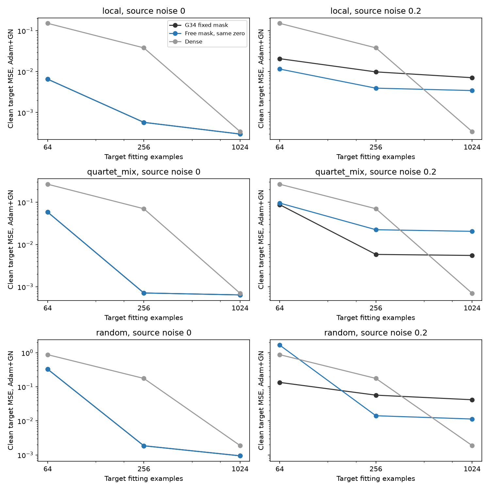
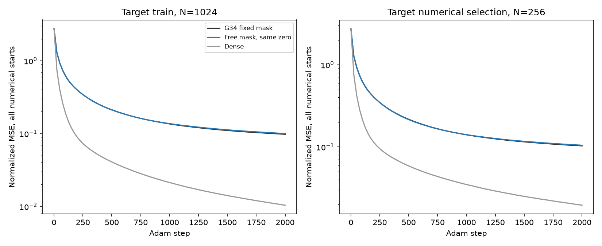
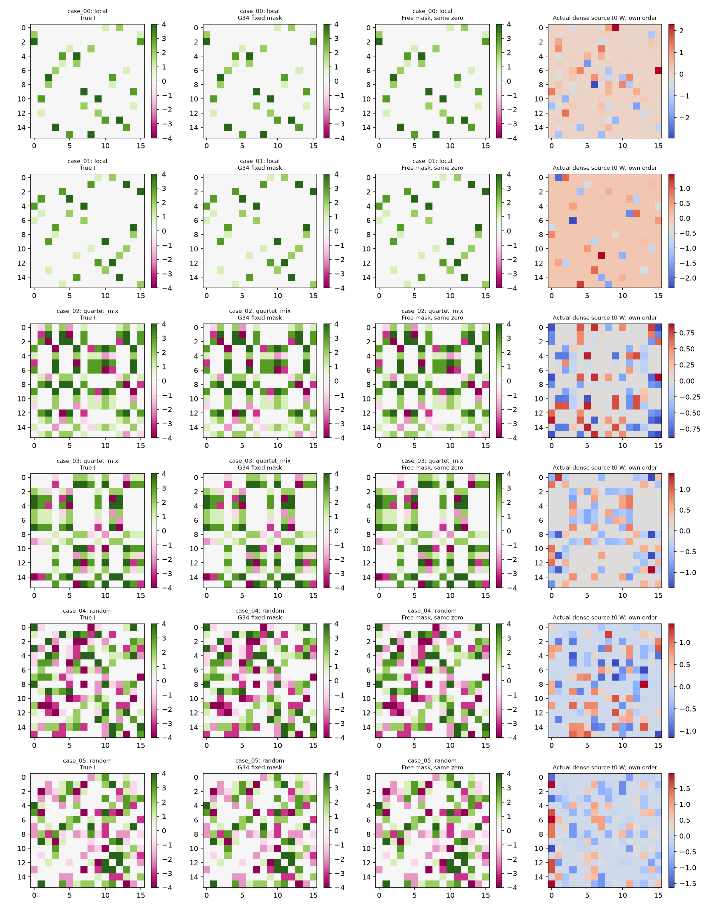
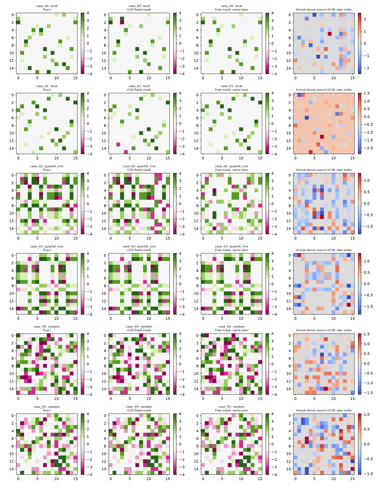

# Нужна ли G34 фиксированная бинарная support-маска

> Архивировано 8 ноября 2026. Исходники завершённых веток перенесены в archive/experiments/, сырые results/ удалены; [предсказания, протоколы и границы восстановления](../../2026-11-08/README.md) описаны отдельно. Пути к raw-данным и команды в тексте относятся к исходному запуску.

8 ноября 2026. Нулевой символ сохранён в обоих сравниваемых вариантах.

## Вывод

**Жёстко фиксировать бинарную маску внутри joint projection не обязательно
для успешного поиска структуры.** При сохранённом нулевом символе свободный
assignment нашёл те же 6/6 точных индексаторов без source noise и улучшил
несколько шумных случаев. Но простая замена всех fixed-mask запусков на free
не даёт устойчивого выигрыша: есть существенная регрессия quartet_mix
и отдельный тяжёлый провал адаптации при N=64.

Это аргумент за маску как полезную инициализацию/вариант кандидата,
а не за обязательный жёсткий запрет менять нулевые позиции.
Полностью отказаться от всех threshold-based инициализаторов этот опыт
не позволяет: они сохранены в обеих ветвях. Основной G34 не заменён.

## Главные результаты

- Без source noise выбранные I и target MSE совпали у двух
  методов на всех шести структурах и всех трёх N. Точный I и точная маска:
  6/6 в обоих случаях.
- При source noise 0.2 и N=1024 средняя target MSE снизилась на **51.48%**
  для local и на **72.80%** для random, но выросла на **271.75%**
  для quartet_mix, то есть стала в 3.72 раза больше.
- На шумных источниках точный signed I: **2/6 → 3/6**;
  точная бинарная маска: **2/6 → 4/6**. Средний recall при этом снизился
  с 94.37% до 93.36% из-за одного сильного провала — рост числа точных масок
  не означает равномерного улучшения.
- Все выбранные free-индексаторы присутствуют в новом proposal pool.
  Из шести шумных случаев только один совпадает с исходным anchor;
  два улучшенных случая ниже выбрали новые проекции.
- На 5544 геометрических стартах конечный support изменился в **90.06%**.
  Это действительно поиск с подвижными нулевыми позициями.

## Что исправилось и что сломалось

В noisy local case_01 исходная маска оставляла 30 связей из истинных 32,
а выбранный I содержал восемь signed-entry ошибок. Free восстановил все
32 связи и весь индексатор точно. Истинного I не было в fixed-mask pool;
в свободном pool он появился на пятом месте и прошёл refit. Target MSE
при N1024 снизилась с 0.00780014 до 0.000572387. Здесь возможность вернуть
связи действительно помогла; одним более точным fit кодбука при старой
фиксированной маске этого сделать нельзя.

В noisy random case_04 fixed-mask результат имел десять signed-entry
ошибок и 132 активных позиции при истинных 140. Free восстановил support
точно и оставил две signed-entry ошибки. Target MSE при N1024 снизилась
с 0.0816481 до 0.0208311. Поэтому точная маска ещё не равна точному шэрингу.

В noisy quartet_mix case_02 free, наоборот, выбрал 102 активные связи
при истинных 128; mask recall упал с 97.66% до 78.91%, а число signed-entry
ошибок выросло с 16 до 36. Target MSE при N1024 выросла с 0.00983831
до 0.0398697. В free pool есть 63 индексатора с правильной бинарной маской,
но первый из них имеет геометрический rank **127**: среди 32 кандидатов,
запрошенных для дополнительного joint refit, правильной маски нет. Полностью правильного
signed I в pool нет. Значит, проблема здесь включает ранжирование и
покрытие конечного refit-банка, а не невозможность свободного assignment
вообще предложить правильный support.

На малом target N=64 есть отдельная нестабильность: noisy random MSE
в среднем 1.67680 против 0.134795 у G34. Сильнее всего повлияла одна
новая функция case_04/task_6 с MSE 25.4760. Нельзя рекомендовать free
по одной только удачной оценке при N1024. При N256 noisy random уже
лучше: 0.0141755 против 0.0569772.

## Практический смысл

Предварительная маска сокращает пространство поиска и не даёт части
слабых связей исчезнуть при неудачном совместном fitting. Одновременно
она запрещает вернуть ошибочно вырезанные связи. В этих данных видны
обе стороны: local исправился при снятии запрета, quartet_mix стал хуже.

Разумное продолжение — сохранять кандидатов исходного fixed-mask G34
и добавлять свободные назначения нулевого символа, сравнивая их по
source structure-selection данным. Это **предложение следующего опыта**,
не проверенный здесь гибрид и не новая подтверждённая замена метода.
Нельзя выбирать между вариантами по уже открытой target query.

Численные затраты после общих source seeds в среднем: 440.8 с для
current и 482.5 с для free; геометрическая часть 214.1 и 272.3 с.
Это наблюдаемые времена с профилированием, не отдельный hardware benchmark.

## Теоретический результат

Отдельная M восстанавливается из нулей I. Для фиксированных центров и
положительных scales достаточно включить нулевой центр в общий assignment.
В THEORY_NOTES.md доказано условное margin-утверждение: если разрыв
робастных стоимостей больше удвоенной ошибки их оценки, восстанавливаются
и нули, и ненулевые группы без заданной маски. Для Cauchy используется
ограничение модуля производной величиной sqrt(ν).

Это условие одного assignment-блока, не гарантия сходимости совместного
поиска. Близкий литературный пример с фиксированным нулевым центром
и изменяемым membership — [Ullrich et al., ICLR 2017, §4.1–4.3](https://arxiv.org/pdf/1702.04008).
Новый опыт не является воспроизведением их метода.

Проверка завершена: 12 source и 12 новых target заданий, 30 уникальных
зафиксированных prediction files с учётом старых G34/Dense; 42 access
receipts, нарушений доступа нет. Результаты новых target не использовались
для настройки. Полная методика и таблицы следуют ниже.

## Точная абляция

| | Исходный G34 | Free mask |
|---|---|---|
| Свободные знаковые коды | Четыре | Те же четыре |
| Фиксированный нулевой символ | Сохранён | Сохранён |
| Нулевые позиции внутри joint projection | Заданы фиксированной M | Выбираются совместно с группами |
| Символы на позиции | Только ноль либо только ±1,…,±4 согласно M | 0, ±1,…,±4 на каждой позиции |
| Штраф, WLS, anchors, source descriptors, refit | Исходные | Те же |

В free бинарная маска используется для начального состояния, затем не ограничивает обновления. Нули могут появляться и исчезать. Threshold-based alignment, исходные source anchors и четыре варианта инициализации сохранены. Проверяется необходимость фиксировать support в цикле, а не возможность удалить из всей процедуры любые пороговые инициализаторы.

Оба банка сохраняют исходные anchors. Поэтому отдельно проверяется, выбрана новая проекция или унаследованная структура. Dense — только готовый контекстный контроль. Варианты удаления нулевого символа исключены по уточнению пользователя до новых target запусков.

## Перенос на новые функции

Clean query MSE после Adam+GN: N=1024 fitting, 256 отдельных numerical-selection, 2048 query примеров. Каждая строка — две структуры × восемь новых функций. Все численные параметры свежие; переносится только I. Плюс в Δ означает ухудшение относительно G34.

| Геометрия | Source σ | G34 fixed mask | Free mask | Δ MSE | Dense |
|---|---:|---:|---:|---:|---:|
| local | 0 | 0.000297964 | 0.000297964 | +0.00% | 0.000343601 |
| local | 0.2 | 0.00710967 | 0.0034496 | -51.48% | 0.000343601 |
| quartet_mix | 0 | 0.000643964 | 0.000643964 | +0.00% | 0.00070625 |
| quartet_mix | 0.2 | 0.00552555 | 0.0205412 | +271.75% | 0.00070625 |
| random | 0 | 0.000944983 | 0.000944983 | +0.00% | 0.00189681 |
| random | 0.2 | 0.0417691 | 0.0113605 | -72.80% | 0.00189681 |

| N | Геометрия | Source σ | G34 fixed mask | Free mask | Dense |
|---:|---|---:|---:|---:|---:|
| 64 | local | 0 | 0.00654874 | 0.00654874 | 0.151892 |
| 64 | local | 0.2 | 0.0207636 | 0.0115761 | 0.151892 |
| 64 | quartet_mix | 0 | 0.0585962 | 0.0585962 | 0.267255 |
| 64 | quartet_mix | 0.2 | 0.0876552 | 0.0957609 | 0.267255 |
| 64 | random | 0 | 0.329625 | 0.329625 | 0.879196 |
| 64 | random | 0.2 | 0.134795 | 1.6768 | 0.879196 |
| 256 | local | 0 | 0.000575222 | 0.000575222 | 0.0381909 |
| 256 | local | 0.2 | 0.00986504 | 0.00394621 | 0.0381909 |
| 256 | quartet_mix | 0 | 0.000716035 | 0.000716035 | 0.0703523 |
| 256 | quartet_mix | 0.2 | 0.00584392 | 0.0224456 | 0.0703523 |
| 256 | random | 0 | 0.00186059 | 0.00186059 | 0.176492 |
| 256 | random | 0.2 | 0.0569772 | 0.0141755 | 0.176492 |

## Восстановление структуры

Mask metrics допускают лучшую перестановку hidden units; exact signed I дополнительно допускает знаки/перестановки кодов. Для маски и полного I выравнивания оптимизируются отдельно.

| Source σ | Метод | Exact I | Exact mask | Precision | Recall | True I в proposals | True I запрошен в refit | Выбран исходный anchor |
|---:|---|---:|---:|---:|---:|---:|---:|---:|
| 0 | G34 fixed mask | 6/6 | 6/6 | 100.00% | 100.00% | 6/6 | 6/6 | 2/6 |
| 0 | Free mask, same zero | 6/6 | 6/6 | 100.00% | 100.00% | 6/6 | 6/6 | 2/6 |
| 0.2 | G34 fixed mask | 2/6 | 2/6 | 98.68% | 94.37% | 2/6 | 2/6 | 2/6 |
| 0.2 | Free mask, same zero | 3/6 | 4/6 | 98.65% | 93.36% | 3/6 | 3/6 | 1/6 |

Полная разбивка по структурам, наличие истинной маски в банке, ARI шэринга, размеры proposal pool и принадлежность выбранного I новым proposals сохранены в recovery.csv.

## Действительно ли свободный цикл меняет маску

| Геометрия | Source σ | Запусков с изменённой конечной маской | Начальных связей | Конечных связей | Событий смены нуля |
|---|---:|---:|---:|---:|---:|
| local | 0 | 81.53% | 92.3 | 33.1 | 104.9 |
| local | 0.2 | 98.58% | 108.3 | 56.4 | 625.6 |
| quartet_mix | 0 | 82.58% | 185.1 | 129.7 | 121.7 |
| quartet_mix | 0.2 | 98.86% | 166.3 | 124.9 | 661.6 |
| random | 0 | 54.55% | 176.1 | 130.9 | 291.0 |
| random | 0.2 | 97.63% | 160.1 | 122.3 | 477.4 |

Значения усреднены по всем геометрическим стартам, не только победителю.

## Стоимость и численная сходимость

Данные, рестарты и шаги совпадают: до32 source refits×4×48GN; target18Adam×2000+4GN×48, N64/256/1024. Время измерено с операторным профилированием; отдельный hardware benchmark не повторялся. First-layer координат4 у обоих структурных вариантов и256 у Dense; сырые численные координаты не равны числу степеней свободы после gauges.

| Метод | Среднее extraction после seeds | Среднее target время, три N | Среднее target TFLOPs |
|---|---:|---:|---:|
| G34 fixed mask | 440.8 с | 107.4 с | 0.138 |
| Free mask, same zero | 482.5 с | 107.3 с | 0.138 |
| Dense | 0.0 с | 111.1 с | 1.286 |

Кривые усредняют все Adam-рестарты, восемь функций и условия; это train/numerical-selection, не query-loss на каждом шаге. Итоговые независимые query-ошибки после GN показаны выше.

## Индексаторы и реальные плотные веса

Индексаторы выровнены только для аудита. Последняя колонка — настоящие плотные source-веса в собственном порядке нейронов.

## Теория и ограничения

При фиксированных числах можно добавить ноль в обычное categorical assignment и выбирать его по тому же робастному cost. Хранить M отдельно не требуется: она определяется нулевыми символами I. Пространство со свободными нулевыми назначениями содержит все фиксированные маски; его глобальный минимум одного критерия не хуже. Это не гарантия конечной чередующейся процедуры G34.

Доказательства и разбор порогов: [THEORY_NOTES.md](../../../artifacts/g34_support_2026-11-08/THEORY_NOTES.md).

Ретроспективный известный cohort: две local структуры с2×2 блоками (32связи), две quartet_mix с четырёхмерными группами (128связей), две random с плотностью генерации0.55. D=H16,O1/2; во второй структуре каждой семьи независимые hidden biases; readout независим между задачами. Source noise0/.2; target query чистые. Это не свежая confirmation и не реальные данные. Две структуры на семейство ограничивают общность выводов.

Learner не открывал teacher, source test или target query responses. Все новые I и predictions глобально зафиксированы перед scoring; source/target receipts проверены. Ядро G34 и рукопись не менялись; software tests не запускались.

## Артефакты

- [Активный протокол](../../../artifacts/g34_support_2026-11-08/ACTIVE_PROTOCOL.md), [уточнение объёма](../../../artifacts/g34_support_2026-11-08/scope_amendment.json), [фиксация](../../../artifacts/g34_support_2026-11-08/frozen_results.json).
- [Target MSE](../../../artifacts/g34_support_2026-11-08/transfer.csv), [структура](../../../artifacts/g34_support_2026-11-08/recovery.csv), [изменения масок](../../../artifacts/g34_support_2026-11-08/geometry.csv), [стоимость](../../../artifacts/g34_support_2026-11-08/costs.csv).
- [Сводка](../../../artifacts/g34_support_2026-11-08/summary.json), [матрицы](../../../artifacts/g34_support_2026-11-08/index_audit.json).
- Raw: /home/udeneev-av/InductionBiasResearch/experiments/g34_support_v1/results/20261108. Код: /home/udeneev-av/InductionBiasResearch/experiments/g34_support_v1.

Для повторения использовать zero-preserving entrypoint experiments.g34_support_v1.resume: --phase setup с новой --base и --reference, затем --phase complete с той же --base. Исходная расширенная run.complete заменена этим entrypoint после уточнения пользователя. Отдельные фазы report: freeze, score, render.
