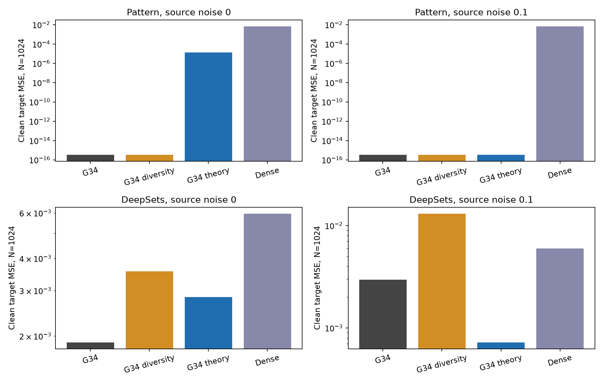
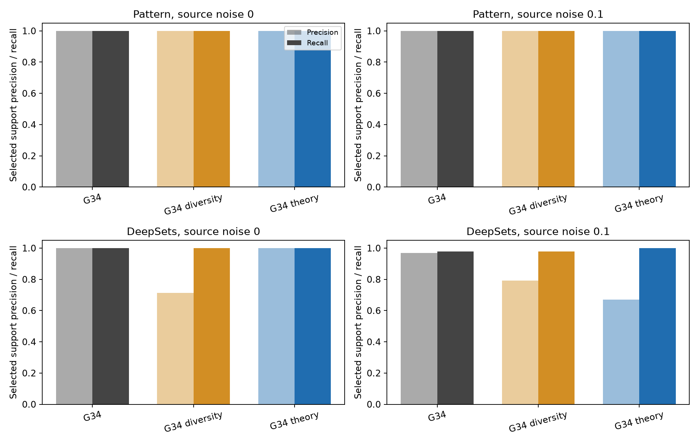
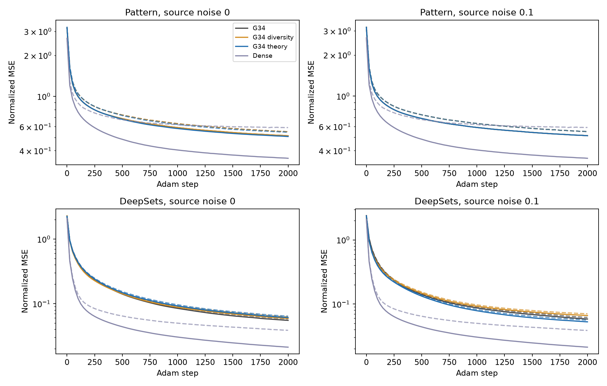
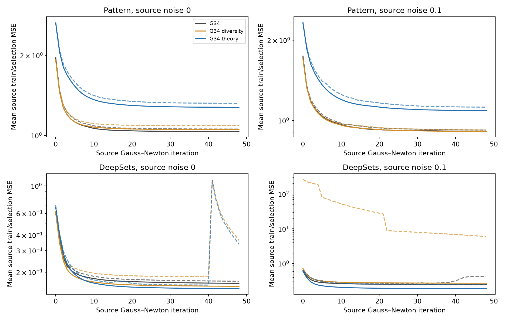
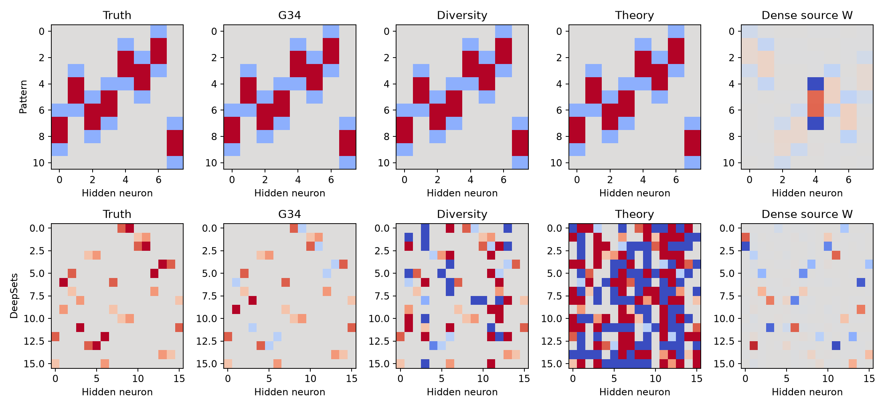

# Проверка улучшения G34 на основе теории

> Архивировано 8 ноября 2026. Исходники завершённых веток перенесены в archive/experiments/, сырые results/ удалены; [предсказания, протоколы и границы восстановления](../../2026-11-08/README.md) описаны отдельно. Пути к raw-данным и команды в тексте относятся к исходному запуску.

8 ноября 2026 года.

## Вывод

**Новые предложения дали заметный выигрыш на noisy DeepSets, но универсального улучшения G34 не получилось.** При source noise 0.1 средняя target MSE снизилась с 0.002961 до 0.000725, на **75.52%**. На clean DeepSets она выросла с 0.001892 до 0.002835, на **49.83%**. В clean Pattern возникла одна регрессия: средняя MSE стала 0.00001386 вместо величины около машинного нуля. Исходный G34 сохранён; новая ветвь не принята как его общая замена.

На noisy DeepSets средняя MSE улучшилась во всех трёх репликациях, но величина выигрыша неоднородна: **0.73%, 96.44% и 5.67%**. Основной вклад даёт case_04. Среди его восьми target-задач улучшение есть на всех восьми. Во всех 24 noisy DeepSets задачах вместе — 12 улучшений, 9 практически равных результатов и 3 ухудшения; равенство определялось абсолютной разницей MSE не больше 1e-12.

При меньших support выигрыш noisy DeepSets тоже положителен: **17.77%** при 64 и **57.59%** при 256. В clean-условиях при support 64 DeepSets новая ветвь имеет MSE 2.09 против 0.0489 у G34. Этот отрицательный результат сохранён.

Улучшение оплачивается дополнительным поиском. Для noisy DeepSets средняя source/search стоимость выросла с 549.01 до 633.97 с на репликацию, примерно на **15.47%**. Лимит численного refit оставался 32, дополнительные CPU proposals учитываются. Ускорение target-адаптации здесь не установлено.

## Что показывает диагностика

**Само разнообразие банка не обеспечило выигрыш.** Контроль diversity, использующий только исходные proposals, оказался хуже G34 на DeepSets. В case_04/noise 0.1 основное улучшение принесла структура из ветви отношений модулей. По отдельности причинный вклад log-калибровки, знаков и support-гипотез этим совместным вариантом не измерен.

**Качество улучшилось без exact recovery.** На DeepSets выбранный I не совпал с порождающим ни в одной из трёх репликаций при обоих noise. На noisy DeepSets истинный I присутствовал в refit-банке в 1/3 исходных и 2/3 новых случаев. В case_04, давшем наибольший выигрыш, true I отсутствовал даже в полном новом pool. Но выбранный кандидат правильно воспроизводит все 32 истинные signed-позиции после аудиторского выравнивания и содержит ещё 6 связей. Это более полезное приближение структуры, а не её точное восстановление.

**Большая маска может численно выключаться кодбуком.** В case_03/noise 0.1 новая log-ветвь выбрала 190 связей. Один код занимает 158 позиций; после target-подгонки его модуль относительно максимального кода меньше 1e-6 на 5/8 задач, медиана отношения около 7.1e-10. Поэтому mask recall 100% здесь нельзя трактовать как качественное восстановление связей. Precision маски всего 16.84%. Для применения устойчивой логарифмической теории одного ненулевого индекса недостаточно: нужен также запас модулей до нуля. Это target-диагностика; граница ошибки source-дескриптора ею не проверялась.

**Source-критерий пока не измеряет свежую адаптацию.** Для clean Pattern case_01 правильный I был в новом refit-банке. Его фактическая source meta MSE составила 0.001416; кандидат с одной неверной signed-позицией получил 0.000328 и был выбран, но на новых задачах оказался хуже. В clean DeepSets case_05 выбранный кандидат имел source MSE 0.000561, правильный I — 0.001458; target MSE нового выбора стала 0.00378 против 0.000951 у исходного G34. На clean synthetic правильный I по построению допускает нулевую ошибку: положительная source-ошибка его сохранённой численной подгонки показывает вклад ограниченного solver.

Следующий содержательный шаг — отбирать структуры по **свежей численной адаптации на source-задачах, не участвовавших в построении банка**, сохраняя исходный кандидат среди альтернатив. Одного увеличения разнообразия либо наличия true I в банке недостаточно. Такое изменение потребует новой подтверждающей серии; после открытия текущих query-ответов алгоритм не перенастраивался.

Протокол ниже охватывает две synthetic семьи, по три независимые source/numerical репликации. Результат не переносится автоматически на Omniglot, MNIST или произвольные графы.

Проверка на новых synthetic-семействах; параметры метода зафиксированы после source-only development и до confirmation selection/target scoring. Переносится только индексатор, все числа на targets обучаются заново.

## Качество на новых задачах

Основная метрика — clean MSE после Adam+GN при support1024 и numerical selection256. В каждой ячейке три независимые source/numerical репликации текущего генератора, по восемь target-задач; noise относится только к source observations. Для двух source-noise условий используются одни и те же targets.

| Семья | Source noise | G34 | Diversity | Theory | Dense | Изменение Theory |
|---|---:|---:|---:|---:|---:|---:|
| Pattern | 0 | 3.27e-16 | 3.27e-16 | 1.39e-05 | 0.00689 | — |
| Pattern | 0.1 | 3.27e-16 | 3.27e-16 | 3.27e-16 | 0.00689 | — |
| DeepSets | 0 | 0.00189 | 0.00357 | 0.00284 | 0.00596 | -49.83% |
| DeepSets | 0.1 | 0.00296 | 0.0131 | 0.000725 | 0.00596 | +75.52% |

## Дополнительные размеры support

Вторичные метрики после того же Adam+GN; primary endpoint остаётся N1024.

| Семья | Source noise | Support | G34 | Theory | Изменение Theory |
|---|---:|---:|---:|---:|---:|
| Pattern | 0 | 64 | 0.00677 | 0.00816 | -20.47% |
| Pattern | 0 | 256 | 4.56e-16 | 3.27e-05 | — |
| Pattern | 0.1 | 64 | 0.00677 | 0.00677 | +0.00% |
| Pattern | 0.1 | 256 | 4.56e-16 | 4.56e-16 | — |
| DeepSets | 0 | 64 | 0.0489 | 2.09 | -4175.35% |
| DeepSets | 0 | 256 | 0.00251 | 0.00327 | -30.26% |
| DeepSets | 0.1 | 64 | 0.013 | 0.0107 | +17.77% |
| DeepSets | 0.1 | 256 | 0.00454 | 0.00193 | +57.59% |

Положительный процент означает снижение MSE. Общая средняя по двум семьям не используется для выбора победителя: масштабы выходов различаются.
При исходной MSE ниже 1e-12 относительное изменение не приводится: около машинного нуля оно неинформативно. Абсолютные MSE сохранены.

## Парное сравнение по независимым семействам

| Семья | Case | Noise | G34 | Theory | Изменение | Победы/равенства/поражения по задачам |
|---|---|---:|---:|---:|---:|---:|
| Pattern | case_00 | 0 | 3.47e-16 | 3.47e-16 | — | 0/8/0 |
| Pattern | case_01 | 0 | 2.75e-16 | 4.16e-05 | — | 0/0/8 |
| Pattern | case_02 | 0 | 3.57e-16 | 3.57e-16 | — | 0/8/0 |
| Pattern | case_00 | 0.1 | 3.47e-16 | 3.47e-16 | — | 0/8/0 |
| Pattern | case_01 | 0.1 | 2.75e-16 | 2.75e-16 | — | 0/8/0 |
| Pattern | case_02 | 0.1 | 3.57e-16 | 3.57e-16 | — | 0/8/0 |
| DeepSets | case_03 | 0 | 0.00363 | 0.00363 | +0.00% | 0/8/0 |
| DeepSets | case_04 | 0 | 0.0011 | 0.0011 | +0.00% | 0/8/0 |
| DeepSets | case_05 | 0 | 0.000951 | 0.00378 | -297.43% | 0/3/5 |
| DeepSets | case_03 | 0.1 | 0.00119 | 0.00118 | +0.73% | 1/4/3 |
| DeepSets | case_04 | 0.1 | 0.0069 | 0.000246 | +96.44% | 8/0/0 |
| DeepSets | case_05 | 0.1 | 0.000796 | 0.00075 | +5.67% | 3/5/0 |

Три репликации текущего генератора не покрывают произвольные графы. Восемь задач внутри семейства разделяют извлечённую структуру; они не используются как восемь независимых подтверждений её восстановления.

## Восстановление и покрытие

| Семья | Noise | Метод | Exact выбранного I | True I в refit-банке | Precision маски | Recall маски |
|---|---:|---|---:|---:|---:|---:|
| Pattern | 0 | G34 | 3/3 | 3/3 | 100.00% | 100.00% |
| Pattern | 0 | G34 diversity | 3/3 | 3/3 | 100.00% | 100.00% |
| Pattern | 0 | G34 theory | 2/3 | 3/3 | 100.00% | 100.00% |
| Pattern | 0.1 | G34 | 3/3 | 3/3 | 100.00% | 100.00% |
| Pattern | 0.1 | G34 diversity | 3/3 | 3/3 | 100.00% | 100.00% |
| Pattern | 0.1 | G34 theory | 3/3 | 3/3 | 100.00% | 100.00% |
| DeepSets | 0 | G34 | 0/3 | 3/3 | 100.00% | 100.00% |
| DeepSets | 0 | G34 diversity | 0/3 | 2/3 | 71.39% | 100.00% |
| DeepSets | 0 | G34 theory | 0/3 | 3/3 | 100.00% | 100.00% |
| DeepSets | 0.1 | G34 | 0/3 | 1/3 | 96.97% | 97.92% |
| DeepSets | 0.1 | G34 diversity | 0/3 | 0/3 | 79.10% | 97.92% |
| DeepSets | 0.1 | G34 theory | 0/3 | 2/3 | 67.02% | 100.00% |

True I открыт только после freeze предсказаний. Его наличие в банке и выбор по source loss — отдельные показатели; exact recovery не гарантирует наилучшую численную адаптацию.

## Обучение и стоимость

Train/selection curves ниже — измеренные значения, усреднённые по всем18 Adam starts и задачам, а не loss только итогового выбранного старта. Ось X — шаги; selection показана пунктиром. GN входит в итоговое качество.

Source refit-кривые усредняют все кандидаты и старты. Они показывают фактические численные итерации; это не loss только выбранной структуры.

| Семья | Noise | Метод | Source/search с | Target с, все бюджеты/8 задач | Peak CUDA MiB |
|---|---:|---|---:|---:|---:|
| Pattern | 0 | G34 | 130.03 | 108.34 | 45.16 |
| Pattern | 0 | G34 diversity | 127.03 | 106.96 | 45.16 |
| Pattern | 0 | G34 theory | 134.35 | 105.79 | 45.16 |
| Pattern | 0.1 | G34 | 138.45 | 106.38 | 45.16 |
| Pattern | 0.1 | G34 diversity | 141.54 | 108.15 | 45.16 |
| Pattern | 0.1 | G34 theory | 147.71 | 105.85 | 45.16 |
| DeepSets | 0 | G34 | 562.28 | 107.15 | 136.57 |
| DeepSets | 0 | G34 diversity | 653.64 | 105.44 | 136.57 |
| DeepSets | 0 | G34 theory | 650.25 | 107.41 | 136.57 |
| DeepSets | 0.1 | G34 | 549.01 | 105.49 | 136.57 |
| DeepSets | 0.1 | G34 diversity | 633.39 | 103.60 | 136.57 |
| DeepSets | 0.1 | G34 theory | 633.97 | 105.89 | 136.57 |

Source/search включает общий dense solver, anchors и исходный pool. Для новых вариантов включена полная измеренная стоимость нового pool; diversity использует только его исходную часть, поэтому это верхний учёт общей стадии, а не отдельный профиль standalone diversity. Бюджет одинаков по32 новым refit, но wall time не уравнен. Target seconds относятся к packed throughput и включают profiler overhead.

Разработка использовала готовые source fits предыдущего benchmark. Её новые расходы сохранены отдельно в development/metrics, включая повтор построения proposals после оптимизации вычисления пространств. Эти development-расходы не включены в среднюю стоимость одного confirmation-семейства в таблице.

## Что реализовано и ограничения

Основание изменений — [теоретический отчёт](../../../paper/theory/IDENTIFIABILITY_AND_BANK_DESIGN_2026-11-07.md): условие повторяющихся пар, положительные масштабы ReLU, знаковое разнообразие и сохранение остаточной неоднозначности банка.

Для первого семейства каждого вида показаны noisy-source структуры после аудита. Индексаторы выровнены к истине только для отображения; Dense W — настоящие веса первого source, в исходном порядке нейронов.

- Повторяющиеся пары логарифмических отношений соединяют локальные группы; противоречащие локальному разбиению объединения запрещены.
- Дополнительная калибровка логарифмов допускает только положительные масштабы; знаковые профили дают отдельные предложения.
- Support-гипотезы используют подтверждение несколькими source-задачами. Разные знаковые продолжения внутри одного пространства сохраняются.
- Пороги и uncertainty являются proposal-эвристиками; достаточные теоретические границы ошибок не сертифицированы.
- Ветвь отношений строит ограниченное число жадных продолжений частичных групп. Полного перебора, требуемого общей гарантией покрытия, нет.
- Поиск по длинным циклам и разделителям графа остаётся дальнейшим шагом.
- Omniglot и MNIST в эту проверку не входят. Из результата нельзя заключать об улучшении G34 на произвольных реальных данных.

CSV с полной точностью: [transfer](../../../artifacts/g34_theory_2026-11-08/transfer.csv), [recovery](../../../artifacts/g34_theory_2026-11-08/recovery.csv), [costs](../../../artifacts/g34_theory_2026-11-08/costs.csv). [Протокол](/home/udeneev-av/InductionBiasResearch/experiments/g34_theory_v1/results/20261108/PROTOCOL.md), [регистрация метода](/home/udeneev-av/InductionBiasResearch/experiments/g34_theory_v1/results/20261108/confirmation/theory_registration.json), [freeze](/home/udeneev-av/InductionBiasResearch/experiments/g34_theory_v1/results/20261108/report/frozen_results.json).
