# Перенос структуры нейросети между задачами

**Итоговый отчёт на 3 ноября 2026 года.** Метод изложен в обозначениях текущей [статьи](../../../paper/sections/preliminary.tex). Pattern и Dynamic Signal используют завершённые серии 1 ноября; рисунки весов и сводные графики собраны заново из сохранённых результатов. Синусоидальная задача заново запущена 3 ноября с текущим авторегрессионным генератором; проверены отбор случайных масок, зашумление и гиперпараметры; AR сопоставлен с восстановленным NF/VAE на одном банке.

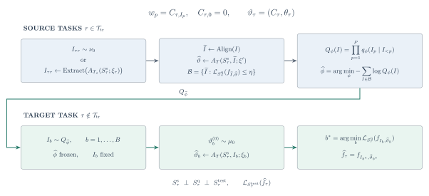

[TeX схемы](assets/2026-11-03/method.tex) · [SVG](assets/2026-11-03/method.svg) · [PDF](assets/2026-11-03/method.pdf).

## 1. Метод

### Что переносим

Для семейства задач фиксируем архитектуру сети. Структуру её весов задаём **индексатором**: целочисленным массивом, который определяет отсутствующие связи и группы связей с общим обучаемым коэффициентом. Числа в кодбуке зависят от задачи:

$$
\begin{aligned}
I&\in\{0,\ldots,K\}^{P},\\
w_p&=C_{\tau,I_p},\qquad C_{\tau,0}=0,\\
\vartheta_\tau&=(C_\tau,\theta_\tau),\qquad
f_\tau=f_{I,C_\tau,\theta_\tau}.
\end{aligned}
$$

Одинаковые положительные индексы означают один общий коэффициент; ноль фиксирует вес в нуле. Остальные параметры сети, например смещения и выходной слой, входят в отдельный численный вектор. Маска связности — частный случай: каждой активной связи назначается собственный коэффициент. Переименование кодов вместе с кодбуком и согласованная перестановка скрытых нейронов не меняют функцию сети.

Между задачами переносится распределение структур. На целевой задаче **все численные параметры и состояние их оптимизатора создаются заново**. Индексатор остаётся фиксированным на протяжении одной попытки обучения.

### Как получаем обучающие данные для генератора

Сначала собираем решения исходных задач. Есть два используемых в опытах пути. В Pattern и Dynamic Signal обучаем плотные сети, разреживаем их и извлекаем группы общих коэффициентов. После объединения весов проверяем структуру новым обучением кодбука: хорошее исходное решение само по себе ещё не гарантирует, что извлечённый индексатор полезен. В синусоидальном опыте исходные маски сразу выбираются случайно, численные веса обучаются SGD, а маски отбираются по порогу ошибки на независимых примерах. Мягкий порог допускает и частичные решения.

Перед обучением генератора согласуем эквивалентные записи структур. Для MLP это перестановки скрытых нейронов и названий кодов; для двух различимых выходов sine сохраняем порядок выходов. Отбор использует качество предсказания исходных задач. Истинная структура синтетического учителя нужна только для последующей диагностики восстановления.

Таким образом, обучение генератора получает банк дискретных индексаторов, прошедших проверку численным обучением. Уровень ошибки, бюджет поиска и ограничения класса структур заданы протоколом каждого опыта. Это существенно: случайный сбор не означает отсутствия предположений об архитектуре или допустимом числе связей.

### Как обучаем и используем текущую модель

Текущая модель — авторегрессионный MADE. Она предсказывает индекс каждой позиции по уже известному префиксу. Базовое обучение максимизирует вероятность индексаторов банка:

$$
\begin{aligned}
Q_\phi(I)&=\prod_{p=1}^{P}q_\phi(I_p\mid I_{<p}),\\
\widehat\phi&=\arg\min_\phi
\left[-\frac{1}{|\mathcal B_{\mathrm{tr}}|}
\sum_{I\in\mathcal B_{\mathrm{tr}}}\sum_{p=1}^{P}
\log q_\phi(I_p\mid I_{<p})\right].
\end{aligned}
$$

В базовом варианте состояние генератора выбирается по отложенным исходным структурам. В синусоидальной проверке (§3) чужой выход в префиксе зашумляется, а checkpoint выбирается по качеству решателя на отдельных калибровочных задачах. Температура декодирования и численные настройки решателя выбираются на калибровочных задачах, после чего замораживаются. При положительной температуре очередной индекс выбирается случайно из softmax; нулевая температура означает последовательный выбор максимума:

$$
q_{\phi,T_{\mathrm{dec}}}(I_p=k\mid I_{<p})
=\operatorname{softmax}\!\left(\frac{\ell_\phi(I_{<p})}{T_{\mathrm{dec}}}\right)_k,
\qquad T_{\mathrm{dec}}>0.
$$

На новой задаче генератор предлагает структуры. Каждая получает независимую инициализацию кодбука и обычное обучение по support. По query выбираются кандидат и, если это предусмотрено протоколом, момент остановки. Итоговая метрика считается на независимом test либо по точной ожидаемой ошибке, когда она аналитически доступна:

$$
\begin{aligned}
I_b&\sim Q_{\widehat\phi,T_{\mathrm{dec}}},\qquad
\vartheta_b^{(0)}\sim\mu_0,\\
\widehat\vartheta_b&=A_T(S_\tau^{\mathrm s},I_b;\vartheta_b^{(0)}),\\
b^*&=\arg\min_b\mathcal L_{S_\tau^{\mathrm q}}
\bigl(f_{I_b,\widehat\vartheta_b}\bigr).
\end{aligned}
$$

Здесь есть два отдельных источника неудачи: генератор может не предложить полезный индексатор, а численный оптимизатор может не найти хорошее решение даже с правильной структурой. Поэтому в каждом опыте нужен oracle с правильным индексатором и новым обучением чисел. Стоимость исходного банка учитывается отдельно от бюджета решения новой задачи.

## 2. Pattern: восстановление повторяющегося локального фильтра

### Задача и точное решение

На входе 11 битов; требуется определить, встречается ли заданный четырёхбитовый шаблон хотя бы в одном из восьми окон. Между задачами меняется шаблон. Например, строка `11001010110` содержит `0010` в позициях 3–6.

Ученик — сеть 11 → 8 ReLU → 1. При кодировании битов числами −1 и +1 точное решение реализуется одним четырёхэлементным фильтром, сдвигающимся по входу. Для шаблона с коэффициентами фильтра ниже получаем:

$$
\begin{aligned}
p_r&=2\,\mathrm{pattern}_r-1,\qquad r=1,\ldots,4,\\
h_j(x)&=\operatorname{ReLU}\!\left(\sum_{r=1}^{4}p_r x_{j+r-1}-3\right),
\qquad j=1,\ldots,8,\\
\widehat y(x)&=\mathbf1\!\left\{2\sum_{j=1}^{8}h_j(x)-1>0\right\}.
\end{aligned}
$$

Каждый скрытый нейрон отвечает за одно окно. Правильный индексатор содержит 32 активные связи из 88 и четыре общих коэффициента. Их значения меняются между шаблонами, расположение групп сохраняется.

### Банк и протокол

Генератор обучался на 12 исходных шаблонах. Исходный банк получен из 1536 решений через разреживание и извлечение индексаторов; после проверки свежего кодбука осталось 187 обучающих, 24 validation и 26 audit-записей. Подготовка заранее задаёт четыре связи на скрытый нейрон и четыре группы по восемь связей. Конкретные окна не передаются извлекателю как правильные ответы.

MADE имеет 88 категориальных позиций, пять вариантов индекса и два скрытых слоя ширины 256. В рассматриваемом этапе его веса уже заморожены. По четырём исходным шаблонам выбрана температура 0.1; переобучения генератора или нового сбора банка здесь не было. После такой калибровки 7873 из 8192 диагностических предложений совпали с правильной структурой с учётом симметрий — **96.11%**, против 4 из 8192 при температуре 1.

Целевые шаблоны: `0010`, `0100`, `1011`, `1101`. На каждый — 768 support-примеров, 256 query и 512 test, 32 старта по 4096 шагов. Кодбуки обучаются Adam с шагом 0.1; плотные Adam и SGD — с шагами 0.01 и 0.3 соответственно. Старты и checkpoints выбираются только по query BCE. Train BCE сбалансирована по классам, query/test BCE обычная.

В структурной модели обучаются четыре кода, одно общее скрытое смещение, один общий выходной вес и выходное смещение — семь чисел. В плотной сети смещения и выходные веса независимы, всего 105 чисел. Поэтому это сравнение полных параметризаций; оно не изолирует только sharing первого слоя.

### Веса после согласования нейронов

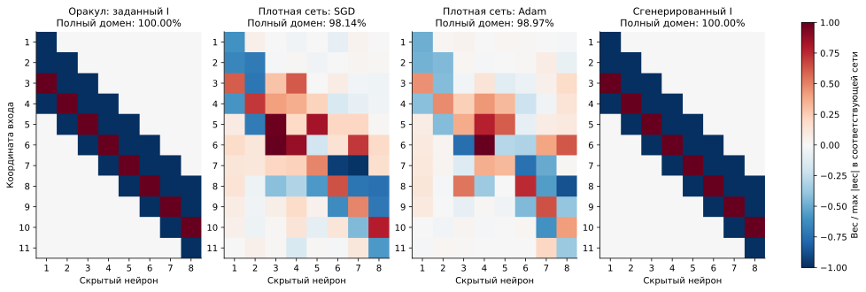

**Рисунок 1.** Первый заранее фиксированный шаблон `0010`; для каждого метода взят лучший по query старт. В колонке «оракул» показаны обученные веса сети с заданным правильным индексатором. В последней колонке структура предложена AR, а числа обучены заново. Цвет показывает подписанный вес, делённый на максимальный модуль веса соответствующей сети. Такая нормировка сравнивает расположение и относительные значения связей, а не абсолютный масштаб между сетями. Плотные веса не разреживались и не пороговались ради изображения.

Скрытые нейроны сопоставлены аналитическим окнам венгерским алгоритмом по косинусному сходству входящих весов и смещения. Вместе со столбцами первого слоя переставлены скрытые смещения и выходные веса. Знаки нейронов не менялись. Проверка на всём домене из 2048 входов дала максимальное изменение выхода 2.84e−14. [Сравнение до и после выравнивания](assets/2026-11-03/pattern_alignment.svg) и [исходные матрицы](assets/2026-11-03/pattern_heatmap_data.npz) сохранены отдельно.

После выравнивания у плотных сетей видна приблизительная локальность, но остаются лишние связи и неодинаковые фильтры. У структурной модели воспроизводится повторяющаяся полоса оракула. Отдельная карта индексов позволяет проверить именно равенства коэффициентов, которые нельзя надёжно вывести только из цвета близких численных весов:

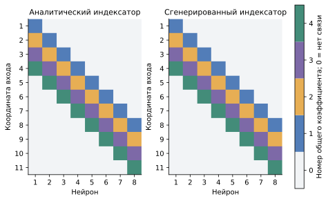

**Рисунок 2.** Ноль означает отсутствие связи; четыре цвета — четыре независимо обучаемых общих коэффициента. Названия кодов согласованы после обучения. Для показанного решения индексаторы совпадают полностью.

### Качество на четырёх задачах

| Метод | Test accuracy, % | Все 2048 входов, % | Безошибочных стартов | Полностью решённых задач |
|---|---:|---:|---:|---:|
| Оракул: правильный индексатор | 100.00 | 100.00 | 62/128 | 4/4 |
| Плотный SGD | 96.09 | 97.42 | 0/128 | 0/4 |
| Плотный Adam | 96.97 | 98.16 | 0/128 | 0/4 |
| **AR, температура 0.1** | **100.00** | **100.00** | **59/128** | **4/4** |
| Независимые частоты, температура 0.25 | 100.00 | 100.00 | 9/128 | 4/4 |
| Один извлечённый индексатор | 100.00 | 100.00 | 62/128 | 4/4 |
| AR, температура 1 | 87.35 | 87.71 | 0/128 | 0/4 |

Проценты в первых двух столбцах усредняют четыре выбранные модели. Полный домен включает обучающие входы и служит проверкой точности решения всей конечной задачи; независимый test показан отдельно. 128 стартов не являются 128 независимыми задачами.

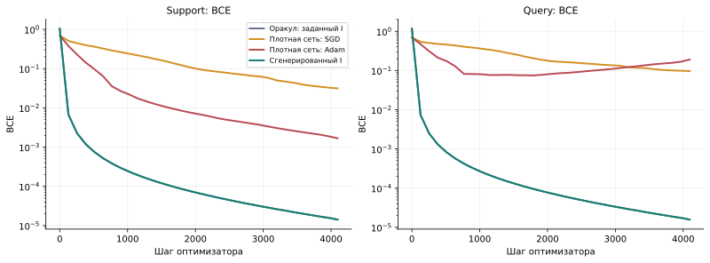

**Рисунок 3.** Средние траектории четырёх выбранных по query стартов; по горизонтали — шаг оптимизатора. Изображены полные истории этих стартов, тогда как таблица использует их выбранные checkpoints. На оси BCE логарифмический масштаб.

Pattern показывает, что извлечённая структура доступна обученному генератору и даёт точное решение после нового обучения чисел. Этот результат относится к переносу одного общего индексатора. Частотный контроль и готовый индексатор достигают того же качества, поэтому необходимости сложных условных зависимостей в AR здесь не установлено. Кроме того, целевые шаблоны уже использовались при разработке: это завершённая отладочная серия, не новая независимая проверка.

## 3. Синусоидальная задача: случайный банк и текущий AR

### Задача и конкурирующие минимумы

На входе восемь независимых стандартных гауссовых координат. Есть два различимых выхода. Учитель складывает слабую низкочастотную и сильную высокочастотную синусоиды вдоль одной координаты для каждого выхода; у ученика на выход приходится только один sine-нейрон с обучаемой амплитудой:

$$
\begin{aligned}
x&\sim\mathcal N(0,I_8),\\
y_j(x)&=\alpha_j\sin(\ell_jx_{r_j})+\sin(h_jx_{r_j}),\\
f_j(x)&=\gamma_j\sin(w_j^\top x),\qquad j\in\{1,2\},\\
\ell_j&\in[0.65,0.75],\quad h_j\in[3.8,4.2],
\quad\alpha_j\in[0.35,0.45],\\
r_1&\in\{1,2,3,4\},\qquad r_2\in\{5,6,7,8\}.
\end{aligned}
$$

В плотной модели 16 входных весов и две амплитуды. Правильная маска оставляет по одной входной связи на выход: обучаются четыре числа. В этом опыте активные веса не объединяются между собой, поэтому индексатор задаёт только связность.

Низкая частота создаёт плохой локальный минимум. Хорошее решение воспроизводит сильную высокую частоту; остающаяся слабая компонента даёт малую ненулевую ошибку. Для одной из исходных функций ранее численно найдены стационарные точки со средней MSE **4.99e−1** и **4.88e−2**. Минимальные собственные значения полных гессианов положительны: **1.30e−2** и **4.90e−1**; нормы градиента — **7.96e−9** и **2.61e−10**. Это подтверждает локальную геометрию конкретного примера, но не означает, что каждая неудачная попытка SGD или Adam закончилась именно в этой стационарной точке.

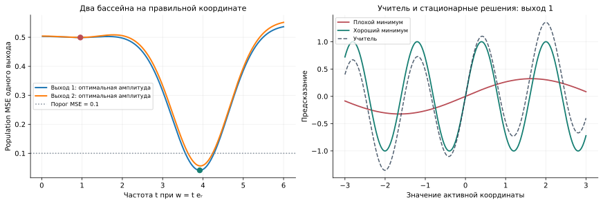

**Рисунок 4.** Слева — аналитическая ошибка каждого выхода при движении вдоль его правильной координаты и оптимальной амплитуде. Справа — учитель и два сохранённых стационарных решения первого выхода. Рисунок относится к исходной функции `a0_b0_f0`; это иллюстрация геометрии, а не выбор успешного целевого запуска.

Для гауссова входа ожидаемая MSE вычисляется без конечного тестового сэмпла через тождество:

$$
\begin{aligned}
K(u,v)&=\mathbb E\bigl[\sin(u^\top x)\sin(v^\top x)\bigr]\\
&=\frac12\left(e^{-\|u-v\|^2/2}-e^{-\|u+v\|^2/2}\right),\\
\mathcal R&=\frac12\sum_{j=1}^{2}\Bigl[
\gamma_j^2K(w_j,w_j)
-2\gamma_j\bigl(\alpha_jK(w_j,\ell_je_{r_j})+K(w_j,h_je_{r_j})\bigr)\\
&\hspace{30mm}+\alpha_j^2K(\ell_je_{r_j},\ell_je_{r_j})
+K(h_je_{r_j},h_je_{r_j})
+2\alpha_jK(\ell_je_{r_j},h_je_{r_j})\Bigr].
\end{aligned}
$$

**Успех — population MSE меньше 0.1.** Точная формула используется только для итогового измерения. Выбор банка, настроек и целевого кандидата опирается на эмпирическую query MSE. Глобальность найденного хорошего минимума не доказана; в отчёте утверждается достижение этого порога качества.

### Случайный банк и потерянный механизм композиции

На 16 исходных задачах собрано **262144** попытки. Маски равномерно выбирались среди **120 вариантов двух из 16 связей**, без IMP и знания правильных координат. Числа обучались SGD с нуля. Query-фильтр **0.1** оставил **244** карточки: 192 train, 52 validation, **8** разных масок. Все новые AR и NF/VAE ниже обучены на этом одном строгом банке.

Обычный AR хорошо выучил полные маски, включая зависимость между выходами: train-NLL 0.12873 почти совпадает с энтропией банка 0.128724 на токен. Дальнейшее обучение улучшало source-validation, но ухудшало перенос новых сочетаний. В прежнем успешном **partwise NF+VAE** каждый выход восстанавливался при зашумлённой чужой половине latent. При переходе к обычному AR этот механизм композиции был потерян.

Проверили три вида композиции/шума, ширину, learning rate, weight decay, длительность и температуру. Всего — **26 конфигураций × 3 seed**, пять checkpoint-ов. Выбор по query MSE отдельных calibration-функций зафиксирован до создания целевых функций.

Выбранный AR восстанавливает каждый выход при **полной замене чужого столбца** во время обучения. Используются равные суммарные веса исходных задач, width=128, 1000 шагов AdamW с lr=0.001, weight decay=0. При генерации **T=1**, дополнительного зашумления нет. Разделение на два выхода известно из архитектуры; координаты учителя не предоставляются. Это явное предположение метода. Активные коэффициенты независимы и обучаются заново:

$$
M_p\in\{0,1\},\qquad I_p=pM_p,\qquad p=1,\ldots,16.
$$

### Результаты на новых функциях

В каждом условии выполнено **384 поиска**: восемь функций новых пар и 16 функций знакомых пар, по три prior-seed. Каждый поиск расходует **4194304 обучающих примера**. Исходная схема — 32 предложения и 32 свежих refit, по 1024 шага; калибровка нового AR выбрала **64 предложения с независимыми стартами + 64 refit одной маски, по 512 шагов**, SGD 0.05, масштаб 2. Плотные методы имеют 64 независимых старта по 1024 шага и собственную калибровку. Отбор использует query; успех — аналитическая population MSE < 0.1.

| Метод | Новые сочетания: успех, % | Знакомые: успех, % |
|---|---:|---:|
| Прежний строгий AR, T=2 | 1.04 | 85.16 |
| Прежний строгий AR, T=6 | 27.86 | 69.53 |
| Прежний мягкий AR, порог 0.35, T=1 | 32.29 | 28.39 |
| Новый AR с шумом чужого выхода, исходный решатель | 70.31 | 66.15 |
| **Новый AR с шумом чужого выхода, настроенный решатель** | **85.16** | **88.54** |
| Обычный NF+VAE, настроенный решатель | 30.99 | 91.93 |
| Partwise NF+VAE, настроенный решатель | 86.20 | 89.06 |
| Произведение частей строгого банка, исходный решатель | 69.79 | 67.71 |
| Плотный SGD | 3.12 | 2.60 |
| Плотный Adam | 83.85 | 72.40 |
| Оракул: правильная маска + SGD | 100.00 | 100.00 |

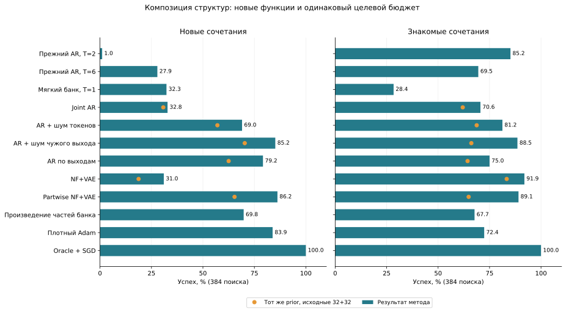

**Рисунок 5.** Все строки оценены на одних новых функциях. Оранжевые точки показывают выбранные priors с исходным решателем, отделяя эффект генератора от настройки численного бюджета. При одной только настройке обычного joint AR успех на новых сочетаниях составляет 32.81%; шум токенов даёт 69.01%, раздельные AR по выходам — 79.17%.

### Что удалось исправить

Новый AR достиг уровня восстановленного partwise NF+VAE. Сам генератор поднял успех на новых сочетаниях до **70.31%**, перераспределение того же бюджета — до **85.16%**. Все **327** успешных новых решений используют маски, отсутствующие в строгом train-банке. Это композиция найденных частей; численные веса исходных решений не переносятся.

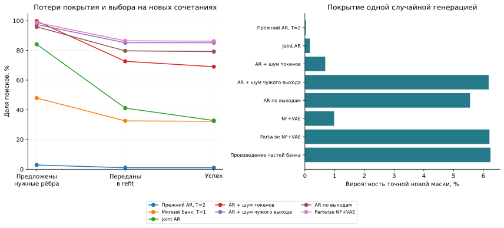

**Рисунок 6.** Справа изолировано качество генерации: средняя вероятность точной новой маски при одном сэмпле — **6.18%** у шумного AR и **6.21%** у partwise NF+VAE против **0.0336%** у прежнего AR с T=2. Слева — полный поиск при одинаковом численном бюджете, с 32 либо 64 предложениями: проверяется наличие нужных связей, включая более широкие маски. Новый AR предлагает точную маску в 374/384 поисках, но часть полезных предложений теряется при выборе для refit.

На новых сочетаниях разность с Adam **+1.30 п.п.**, 95% bootstrap по четырём парам **[−11.46; 20.57]**: превосходство не установлено. При одинаковом исходном решателе шумный AR и простое произведение частей также близки: **70.31% и 69.79%**. Значит, подтверждена польза композиции и настройки поиска; отдельное преимущество обученной авторегрессии над этим простым контролем не показано.

[Подробный разбор](../worknotes/SINE_AR_REPAIR_2026-11-03.md) содержит все настройки, кривые обучения, коллапс VAE при слишком сильном KL и диагностику его encoder. Банк стоил 4096 целевых бюджетов; новая проверка — 78 обучений prior и 116704 калибровочных поиска. Это один банк, ранее исследованное структурное разбиение и новые функции; офлайн-цена в целевые бюджеты не входит. [Предыдущая проверка фильтра и температуры](../worknotes/SINE_AR_FILTER_DIAGNOSIS_2026-11-03.md) сохранена отдельно.

## 4. Dynamic Signal Distribution: локальность и sharing

### Постановка из статьи 2024 года

В работе Aakash Lahoti, Stefani Karp, Ezra Winston, Aarti Singh и Yuanzhi Li *Role of Locality and Weight Sharing in Image-Based Tasks: A Sample Complexity Separation between CNNs, LCNs, and FCNs*, ICLR 2024, введено синтетическое распределение Dynamic Signal Distribution. Сигнал расположен в случайном блоке входа, его знак задаёт метку, а все координаты зашумлены. Положение сигнала меняется от примера к примеру. Авторы используют эту конструкцию для изучения роли локальности и общих весов. [Первичная статья, §4.1](https://proceedings.iclr.cc/paper_files/paper/2024/file/71b17f00017da0d73823ccf7fbce2d4f-Paper-Conference.pdf).

Наш опыт — собственная адаптация этого распределения к переносу между задачами и скрытой перестановке входов. Это синтетические данные; численные результаты ниже получены нашей реализацией, а не взяты из статьи.

Для одной задачи фиксируется единичный восьмимерный вектор сигнала. Между задачами вектор меняется. Каждый пример содержит 16 блоков по восемь координат; только один блок получает сигнал:

$$
\begin{aligned}
c_\tau&\in\mathbb R^8,\qquad\|c_\tau\|_2=1,\\
y&\sim\operatorname{Unif}\{-1,+1\},\qquad
b\sim\operatorname{Unif}\{1,\ldots,16\},\\
u_g&=\varepsilon_g+\mathbf1\{g=b\}\,yc_\tau,
\qquad\varepsilon_g\sim\mathcal N(0,\sigma^2I_8),\\
x&=\Pi(u_1,\ldots,u_{16}).
\end{aligned}
$$

Перестановка общая внутри одного банка и его целевых задач. В пяти повторах она новая. Решатель видит 128 перемешанных координат, поэтому соседство в наблюдаемом векторе не раскрывает истинные блоки.

Блоки зависят от конкретного входа: после обратной перестановки получаем

$$
u_g(x)=(\Pi^{-1}x)_{8(g-1)+1:8g}.
$$

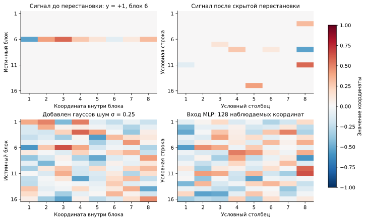

**Рисунок 7.** Иллюстративный положительный пример с сигналом первой целевой задачи первого банка и новым шумом, seed 20261103. Верхний ряд показывает средний сигнал, нижний — сигнал с шумом. Справа наблюдаемый вектор условно развёрнут в прямоугольник 16 × 8; его строки не являются истинными блоками. Истинная перестановка использована только для этой иллюстрации.

При известных блоках и сигнале байесовский классификатор сравнивает две смеси гауссиан:

$$
\Lambda(x)=
\log\sum_{g=1}^{16}\exp\!\left(\frac{c_\tau^\top u_g(x)}{\sigma^2}\right)
-\log\sum_{g=1}^{16}\exp\!\left(-\frac{c_\tau^\top u_g(x)}{\sigma^2}\right).
$$

Это логарифм отношения правдоподобий положительного и отрицательного классов; сумма учитывает все возможные положения сигнала. Положительный знак означает предсказание метки плюс. Шум создаёт ненулевую ошибку даже у оптимального классификатора. Наш oracle в таблице — другая величина: MLP с правильным индексатором и заново обученными числами; это архитектурный ориентир, а не точное байесовское решение.

### Как индексатор задаёт решатель

**В основном методе индексатор генерирует авторегрессионный MADE**, обученный на структурах, извлечённых из исходных сетей. Затем на новой задаче заново обучаются кодбук и остальные численные параметры. Аналитический индексатор ниже объясняет подходящую структуру и используется в отдельном сравнении oracle и при диагностике восстановления; в AR-решатель он не передаётся.

Ученик — MLP 128 → 32 ReLU → 1. Индексатор определяет, какие входы видит каждый скрытый нейрон и какие связи используют общий коэффициент. В структуре оракула каждому истинному блоку соответствуют два нейрона. Пусть позиция координаты номер r блока g в перемешанном входе обозначена p(g,r). Тогда ненулевые элементы индексатора задаются так:

$$
\begin{aligned}
I_{p(g,r),\,2g-1}&=r, & I_{p(g,r),\,2g}&=8+r,
\qquad g=1,\ldots,16,\quad r=1,\ldots,8,\\
W_{ph}&=C_{\tau,I_{ph}}, & C_{\tau,0}&=0.
\end{aligned}
$$

Все остальные индексы равны нулю. Поэтому первый нейрон каждого блока использует один и тот же восьмимерный фильтр из кодов 1–8, второй — фильтр из кодов 9–16. Например, первая координата любого блока подключается к его первому нейрону с коэффициентом из кода 1, ко второму — из кода 9; к нейронам других блоков она не подключена. Общие фильтры обучаются на примерах со всеми возможными положениями сигнала. Обозначая два обучаемых фильтра через v с номерами 1 и 2, получаем:

$$
\begin{aligned}
v_\tau^{(k)}&=(C_{\tau,8(k-1)+1},\ldots,C_{\tau,8k}),
\qquad k\in\{1,2\},\\
h_{g,k}(x)&=\operatorname{ReLU}\!\left((v_\tau^{(k)})^\top u_g(x)+\beta_{g,k}\right),\\
f_\tau(x)&=\sum_{g=1}^{16}\sum_{k=1}^{2}a_{g,k}h_{g,k}(x)+\beta_0.
\end{aligned}
$$

Положительный выход предсказывает метку плюс, отрицательный — минус. **Индексатор сам не задаёт ответ:** после его фиксации на примерах новой задачи обучаются 16 чисел кодбука, 32 скрытых смещения, 32 выходных веса и одно выходное смещение. Это **81 численный параметр**. Индексатор имеет размер 128 × 32 и 256 активных связей; плотная модель содержит 4161 параметр, та же маска без sharing — 321.

Почему выбраны два нейрона на блок, видно из конкретного решения, которое эта структура допускает. Возьмём первый фильтр равным сигналу, второй — его отрицанию, оба скрытых смещения — минус положительный порог t, выходные веса пары — плюс и минус единица, а выходное смещение — ноль:

$$
\begin{aligned}
s_g(x)&=c_\tau^\top u_g(x),\qquad 0<t<1,\\
h_{g,+}(x)&=\operatorname{ReLU}(s_g(x)-t),\\
h_{g,-}(x)&=\operatorname{ReLU}(-s_g(x)-t),\\
F_t(x)&=\sum_{g=1}^{16}\bigl[h_{g,+}(x)-h_{g,-}(x)\bigr].
\end{aligned}
$$

Первый нейрон реагирует на достаточно сильное сходство с положительным сигналом, второй — с отрицательным. Если модуль проекции не превосходит порог, оба молчат: слабые шумовые отклики не попадают в сумму. Без шума проекция активного блока равна метке, остальные равны нулю, поэтому выход равен метке, умноженной на 1 − t: классификация точна. С шумом это пороговый решатель, который может ошибаться. При нулевом пороге разность двух ReLU равна самой проекции: сеть превращается в линейную сумму проекций всех блоков и теряет подавление слабых шумовых откликов. Такая двухсторонняя пороговая функция используется и в [исходной статье, §4.2, формула (3)](https://proceedings.iclr.cc/paper_files/paper/2024/file/71b17f00017da0d73823ccf7fbce2d4f-Paper-Conference.pdf).

Эта конструкция объясняет, как два нейрона могут решать задачу. **В нашем обучении фильтры независимы:** индексатор не навязывает их противоположность, не содержит истинный сигнал и не фиксирует смещения или выходные веса. Численный оптимизатор должен найти полезные значения. Пороговый решатель выше входит в класс допустимых сетей, но не совпадает в общем случае с байесовской формулой.

**Два нейрона — заранее выбранный бюджет для детектирования обоих знаков, а не найденное генератором оптимальное число.** Можно задать десять нейронов на блок: получится 160 скрытых нейронов и десять общих восьмимерных фильтров, допускающих больше направлений и порогов. Это более широкий класс моделей; сравнение его качества и затрат требует отдельного опыта. В текущей серии такое сравнение не проводилось, поэтому результаты не доказывают превосходство двух нейронов над десятью или минимальность этой архитектуры для классификации.

### Как находим структуру

**Описанное ниже извлечение банка — собственная специализированная эвристика этого опыта.** В [статье Lahoti et al., §4.2](https://proceedings.iclr.cc/paper_files/paper/2024/file/71b17f00017da0d73823ccf7fbce2d4f-Paper-Conference.pdf) локальные подключения LCN и общие веса CNN заданы архитектурой заранее. Авторы не получают их нашей процедурой разреживания, кластеризации и повторного обучения кодбука. Извлечение банка из исходных решений и последующая авторегрессионная генерация индексаторов относятся к нашей адаптации.

В каждом повторе используем 12 исходных задач: восемь для извлечения, две для validation и две для контроля. Обучаем по четыре плотные сети, затем постепенно оставляем 256 связей первого слоя. Состав групп восстанавливаем по совместному появлению входов в скрытых нейронах; роли координат внутри групп — по изменению вкладов входа между исходными задачами:

$$
\begin{aligned}
A_{pq}&=\sum_{n,h}\mathbf1\{W^{(n)}_{ph}\ne0\}
\mathbf1\{W^{(n)}_{qh}\ne0\},\qquad p\ne q,\\
v_{pt}&=\frac14\sum_{s=1}^{4}\sum_hW^{(t,s)}_{ph}a^{(t,s)}_h.
\end{aligned}
$$

Кластеризация этих статистик предлагает принадлежность входов к 16 группам и 8 общим ролям. Затем извлекатель **вручную задаёт тип связей и sharing**: каждый вход подключается ровно к двум нейронам своей группы, а входы с одинаковой ролью во всех группах получают одинаковую пару кодов весов. Таким образом, заранее заданы не только числа 16, 8 и 2, но и семейство локальных подключений с двумя общими наборами коэффициентов. Алгоритм восстанавливает расположение групп и ролей внутри этого семейства без истинной перестановки; размеры групп и наличие каждой роли в каждой группе строго не обеспечиваются.

Для каждого кандидата заново обучается кодбук; сохраняются до двух лучших индексаторов на задачу с query BCE меньше 0.65. Такой отбор по качеству на исходных задачах допустим для построения банка и сам по себе не использует аналитический индексатор. Однако он не устраняет структурное предположение, уже встроенное в создание кандидатов.

Банк выбирается по отложенным исходным задачам; MADE учится на категориальных индексаторах из 4096 позиций. Каждый из пяти банков содержит 24 записи и только 3–8 уникальных структур. Это небольшой набор вариантов одной общей организации входов, а не большая библиотека различных архитектур.

**Этот опыт не проверяет получение полезного банка из сырых данных и решателей без знания устройства задачи.** Он проверяет перенос структуры внутри заранее выбранного семейства, соответствующего локальности и sharing в DSD. Авторегрессия обучается на полученном банке; результаты не показывают, что она сама обнаружила необходимость блоков, двух фильтров или общих весов. Для основной исследовательской цели нужен отдельный извлекатель: общий поиск разреженности и равенств весов, выбор сложности и кандидатов по исходным validation-данным, без заданных блоков, ролей и схемы повторения фильтров. Аналитический индексатор при этом остаётся только сравнением и средством последующего анализа.

После уточнения цели отдельно выполнен поиск из случайных масок и индексаторов, без извлечения структуры из весов градиентных решателей. Его протокол и отрицательный результат приведены в разделе 7.

### Сравнение на новых задачах

Основное условие: шум 0.25, 2048 support-примеров, 1024 query и 16 384 test на задачу. В каждом из пяти независимо собранных банков — 16 новых целевых задач, всего 80. Каждому методу доступны восемь стартов по 4096 обновлений с batch 128. Настройки перенесены из независимой калибровки и заморожены до создания целевых данных; query выбирает старт и checkpoint.

| Метод | Что обучается на новой задаче | Численных параметров | Test accuracy, % | SD между банками, п.п. | Test BCE |
|---|---|---:|---:|---:|---:|
| Плотный SGD | Все веса с нуля | 4161 | 82.95 | 0.11 | 0.38 |
| Плотный Adam | Все веса с нуля | 4161 | 82.63 | 0.08 | 0.39 |
| Извлечённая маска без sharing | Каждая активная связь независимо | 321 | 91.92 | 0.38 | 0.22 |
| Та же опорная маска с индексатором | Общие коды + смещения и выход | 81 | 96.49 | 0.32 | 0.10 |
| **AR-индексатор** | **Новые общие коды + смещения и выход** | **81** | **96.53** | **0.25** | **0.10** |
| Независимые частоты | Новые общие коды + смещения и выход | 81 | 96.54 | 0.27 | — |
| Оракул: правильный индексатор | Новые общие коды + смещения и выход | 81 | 96.81 | 0.08 | 0.09 |

Средние и SD посчитаны по пяти средним значениям банков. Увеличение бюджета плотных методов до 16 384 шагов не закрыло разрыв: Adam — 82.63%, SGD — 82.92%.

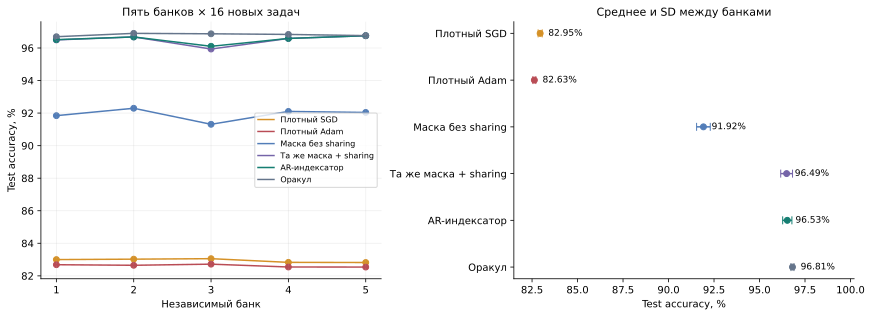

**Рисунок 8.** Слева — отдельные банки, справа — среднее и межбанковое SD. Два контроля с одной опорной маской отличаются наличием общих коэффициентов; они выделяют вклад sharing. AR может выдавать другие варианты индексатора, поэтому его сравнение с маской проверяет всю процедуру переноса.

AR превосходит маску без sharing в среднем на **4.61 п.п.**; разница положительна на всех 80 задачах. Описательный иерархический bootstrap, пересэмплирующий сначала банки, затем задачи, даёт 95% интервал **[4.40; 4.81] п.п.** Независимых банков пять: 80 задач не следует считать 80 независимыми обучениями генератора. Пара с неизменной опорной маской показывает близкий выигрыш от sharing — **4.57 п.п.**

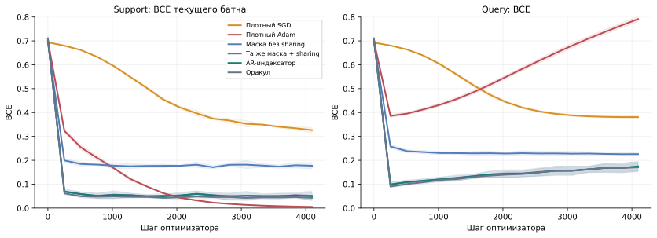

**Рисунок 9.** По одному выбранному по query старту каждой из 80 задач; линии — средние, полосы — SD пяти средних банков. Слева loss текущего обучающего батча, справа всей query-выборки. Таблица использует лучшие query-checkpoints, график показывает полные траектории до 4096 шагов.

Кривые уточняют причину разрыва. Плотный Adam продолжает уменьшать обучающую ошибку, но query BCE растёт: в этом опыте проблема не сводится к неспособности оптимизатора уменьшить train loss. Маска уже существенно улучшает обобщение; дополнительные равенства весов дают следующий выигрыш. AR, независимые частоты и один общий индексатор почти совпадают. Эти результаты поддерживают пользу переноса структуры и sharing, но не отдельное преимущество авторегрессионной генерации.

## 5. Границы выводов и воспроизводимость

Pattern и Dynamic Signal подтверждают пользу переноса общей структуры при новом обучении чисел. В Dynamic Signal это результат при сильном заранее заданном предположении о локальных подключениях и sharing, а не подтверждение обнаружения этой организации из сырых данных и решателей. В синусоидальной задаче зашумление чужого выхода восстанавливает композицию AR до уровня partwise NF+VAE; дополнительный эффект даёт распределение численного бюджета. Преимущества обученного AR над простым произведением частей при одном решателе не установлено. Во всех трёх задачах один индексатор, частоты или выбор целой структуры из банка необходимы для оценки вклада именно генератора.

Все сравнения относятся к конкретным семействам задач, размерам данных, инициализациям и бюджетам. Достижение заданной ошибки не означает доказательства глобального минимума. Равный целевой бюджет не включает создание исходного банка и обучение генератора; равные шаги и предъявления примеров также не означают равные FLOPs.

Отдельный [контроль 3 ноября](../worknotes/BASIN_RELEASE_CONTROL_2026-11-03.md) на другой sine-параметризации показывает, почему необходимо отделять структуру от численного оптимизатора: преимущество настроенного обучения при фиксированном индексаторе над плотным обучением из тех же весов исчезает в контроле с одинаковым обычным SGD. Поэтому результаты этого отчёта не формулируются как универсальная польза фиксации равенств для любого градиентного метода.

| Материал | Источник |
|---|---|
| Определения метода | [Текущий Preliminary статьи](../../../paper/sections/preliminary.tex) |
| Pattern: веса, индексаторы и все старты | [Сохранённый запуск](../../experiments/pattern/runs/autoregressive_debug_20261101_v1); [оракул](../../experiments/pattern/runs/autoregressive_20261101_v2/oracle.summary.npz) |
| Синусы: отбор банка и температура AR | [Протокол и код](../../experiments/sine_ar_current_v1/README.md), [итоговые числа](../../experiments/sine_ar_current_v1/results/diagnosis_20261103/summary.json), [таблица](../../experiments/sine_ar_current_v1/results/diagnosis_20261103/comparison.csv), [рисунки и источники](../worknotes/assets/2026-11-03/sine_ar_diagnosis/README.md), [исходный запуск](../../experiments/sine_ar_current_v1/results/run_20261103) |
| Синусы: композиция AR и NF/VAE | [Протокол и код](../../experiments/sine_ar_repair_v1/README.md), [итоговые числа](../../experiments/sine_ar_repair_v1/results/run_20261103/summary.json), [сравнение](../worknotes/assets/2026-11-03/sine_ar_repair/comparison.csv), [подробный разбор](../worknotes/SINE_AR_REPAIR_2026-11-03.md) |
| Синусы: историческая серия VAE | [Сохранённая сводка](assets/2026-11-03/sine_summary.json), [Git-ревизия и SHA](assets/2026-11-03/sine_summary_origin.json) |
| Dynamic Signal: пять банков | [Агрегаты](../../experiments/dynamic_signal_v1/results/bank_repeats/summary.json), [таблица по банкам](../../experiments/dynamic_signal_v1/results/bank_repeats/comparison.csv) |
| Pattern, Dynamic Signal и исторические синусы: числа и кривые | [JSON](assets/2026-11-03/report_data.json), [CSV](assets/2026-11-03/learning_curves.csv) |
| Построение рисунков | [Python](assets/2026-11-03/build_figures.py), [источники и SHA-256](assets/2026-11-03/sources.json) |

SVG имеют растровые PNG-копии рядом с ними. Графики Pattern и Dynamic Signal построены из индивидуальных результатов и сохранённых историй; таблицы не пересчитывались новым обучением. Исторические итоги VAE сохранены как отдельная серия и не смешиваются с новым AR-запуском. Тесты не создавались и не запускались.

## 6. Dynamic Signal: аналитический и полученные индексаторы

На рисунках ниже показаны целочисленные индексаторы первого слоя: 128 строк соответствуют входам, 32 столбца — скрытым нейронам. Цвет обозначает номер общего обучаемого коэффициента; белый цвет означает отсутствие связи. Одинаковый цвет в разных блоках показывает sharing, а не совпадение близких численных весов после обучения.

Если расположить входы по истинным блокам и координатам внутри них, аналитический индексатор состоит из 16 одинаковых прямоугольных блоков вдоль диагонали. Вне этих блоков стоят нули:

$$
\begin{aligned}
B&=\begin{pmatrix}
1&9\\
2&10\\
\vdots&\vdots\\
8&16
\end{pmatrix},\\
I_{\mathrm{grouped}}&=\operatorname{blockdiag}
\!\left(\underbrace{B,\ldots,B}_{16\text{ блоков}}\right),\\
I_{\mathrm{observed}}&=\Pi I_{\mathrm{grouped}}.
\end{aligned}
$$

Каждый столбец малого блока задаёт один восьмимерный фильтр. Повторение номеров 1–16 во всех блоках означает, что фильтры общие. Перестановка перемещает строки этой матрицы в наблюдаемый порядок входов, сохраняя связи и равенства коэффициентов.

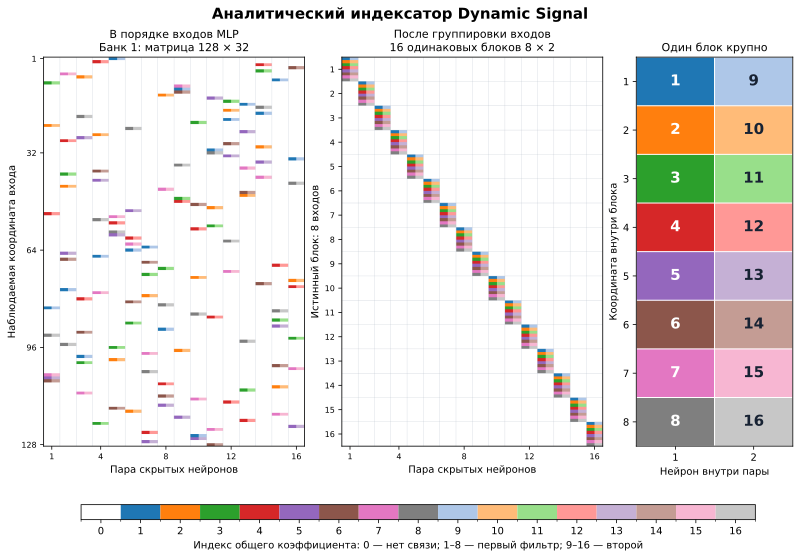

**Рисунок 10.** Слева — аналитически правильный индексатор в наблюдаемом порядке входов первого банка. В центре — тот же индексатор после группировки строк по истинным блокам. Справа увеличен один повторяющийся блок: коды 1–8 задают первый фильтр, 9–16 — второй. Порядок в центре общий для всех пяти банков после отмены их разных скрытых перестановок.

Для сравнения с аналитической структурой берём сохранённые индексаторы двух методов: опорный индексатор исходного банка (consensus) и предложенный AR. **Основной метод на рисунке — AR; consensus показан как отдельный контроль без авторегрессионной генерации.** На каждой целевой задаче используется тот же старт с минимальной query BCE, что и в основном отчёте. Затем согласуем перестановки пар скрытых нейронов и названия общих кодов, а входы располагаем в истинном порядке. Истинная структура нужна только для этого сравнения после обучения.

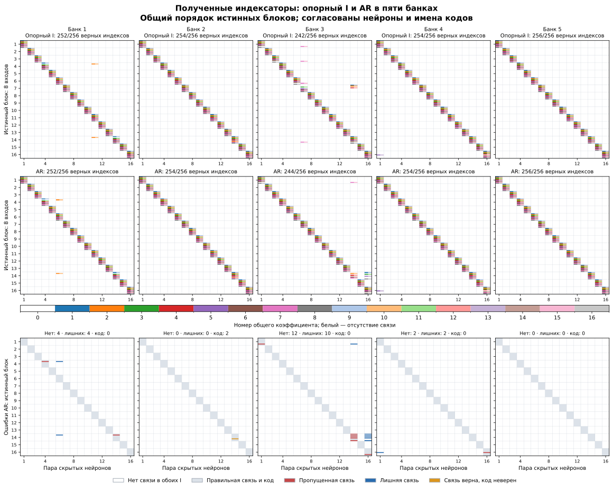

**Рисунок 11.** Столбцы — пять независимых банков. Верхний ряд показывает опорный индексатор, средний — AR, нижний — ошибки AR относительно аналитического индексатора с рисунка 10. Показана первая целевая задача каждого банка; после согласования во всех 16 задачах одного банка выбран один и тот же индексатор для каждого из двух методов. Это не выбор наиболее удачного примера. В заголовках верхних рядов указано число правильных кодов на 256 ожидаемых активных позициях; лишние связи учитываются отдельно в нижнем ряду. Серый цвет означает правильную связь и код, красный — пропущенную связь, синий — лишнюю, оранжевый — правильную связь с неверным кодом.

В пятом банке AR полностью совпадает с аналитическим индексатором. Во втором все связи на месте, но в двух позициях неверно назначен общий коэффициент. В первом, третьем и четвёртом банках есть ошибки связности. В частности, в третьем банке AR содержит 254 активные связи: 12 ожидаемых связей пропущено, 10 лишних добавлено. Поэтому близкое качество классификации не означает полного восстановления аналитической структуры.

Сохранены [исходные и согласованные матрицы всех 160 выбранных решений](assets/2026-11-03/dsd_indexators_data.npz), [число ошибок связности и кодов по задачам](assets/2026-11-03/dsd_indexators_recovery.csv), [источники и SHA-256](assets/2026-11-03/dsd_indexators_sources.json) и [скрипт построения](../../experiments/dynamic_signal_v1/indexator_figures.py). Рисунки построены из завершённых запусков без нового обучения.

## 7. Случайный поиск структуры без подсказок решателя

Здесь проверяется исходная цель: получить полезный банк, не задавая устройство задачи и не ориентируя структурные предложения на веса плотных градиентных решений. Начальные маски и индексаторы случайны. Случайные мутации меняют связи и группы равенств весов; внешний поиск видит только предсказательную ошибку. Adam обучает численные коэффициенты внутри фиксированного кандидата. Число блоков, роли координат, пары фильтров и аналитический индексатор в поиске отсутствуют.

В общей MLP 128 → 64 → 1 две популяции по 64 кандидата прошли 64 поколения после начальной популяции. Оценено **7183 уникальные структуры** на восьми исходных задачах. Ещё две исходные задачи выбрали настройки и банк из 32 масок; варианты с общими коэффициентами оказались слабее. После замораживания банка и генератора созданы 16 новых задач. На каждой — 2048 support-примеров, восемь стартов по 4096 обновлений, выбор по query и независимый test. Числа обучаются заново у всех методов.

| Метод | Test accuracy, % |
|---|---:|
| Плотный Adam | **82.52** |
| Свежая случайная маска той же сложности | 81.48 |
| Выбор структуры из найденного банка | 81.42 |
| Одна найденная маска | 81.40 |
| MADE, выбран checkpoint на шаге 0 | 81.17 |

**Полезная переносимая структура в этом бюджете не обнаружена.** Улучшение ошибки на исходных задачах не перенеслось на новые. У банка 32 разных маски, но медианное попарное различие — лишь 19,5 позиции из 8192. Validation выбрала начальный checkpoint MADE, задающий независимые частоты; обучение авторегрессионных зависимостей ухудшало validation NLL. Поэтому этот результат также не подтверждает пользу авторегрессии.

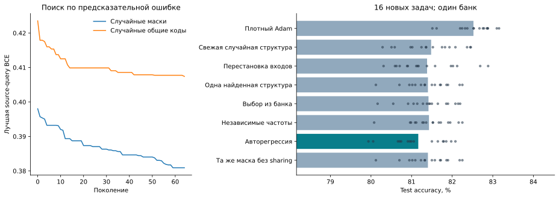

**Рисунок 12.** Слева — снижение исходной ошибки во время поиска. Справа — качество на новых задачах; точки обозначают задачи. AR на графике — ветка с выбранным начальным checkpoint, фактически независимым частотным распределением. Это один банк, а не 16 независимых повторов его построения.

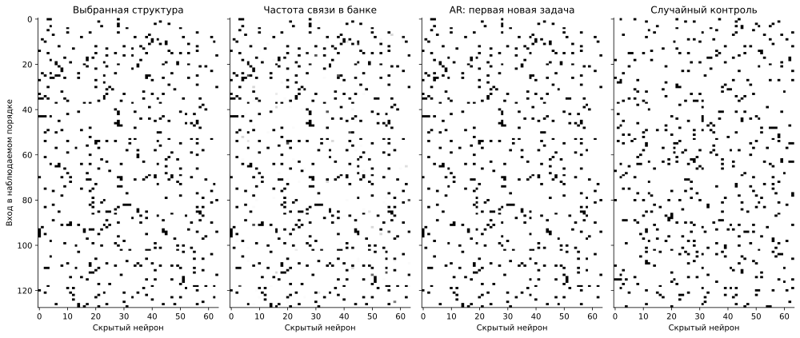

**Рисунок 13.** Выбранная маска, частоты связей в банке, предложение генератора и случайный контроль. Входы показаны в наблюдаемом порядке. Для целевых методов взята первая задача без отбора по виду картинки. Чёрный цвет означает наличие связи; все активные веса выбранной масочной модели независимы.

Это не доказательство невозможности обнаружения структуры: исследован один конечный поиск. Его стоимость на исходных задачах существенно превышает стоимость одного численного обучения. [Полный протокол, ограничения и результаты](RANDOM_STRUCTURE_SEARCH_2026-11-03.md), [код](../../experiments/random_structure_search_v1/README.md), [банк и целевые индексаторы](../../experiments/random_structure_search_v1/results/search_20261103/manifest.json).
