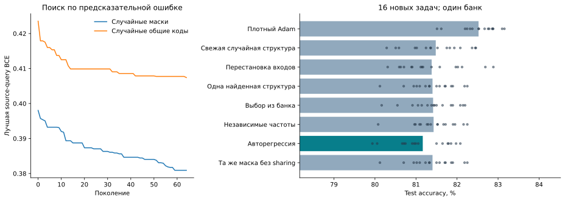
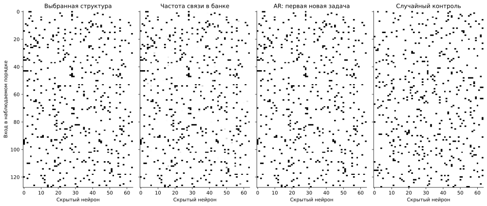

# Случайный поиск структуры без подсказок решателя — 3 ноября 2026

Проверяется получение полезного банка из случайных масок и индексаторов.
Начальная структура и мутации не используют веса, градиенты, группы входов,
роли координат, число фильтров или аналитическое решение. Градиентный метод
обучает только численные коэффициенты внутри предложенной структуры.

**В этом бюджете полезная переносимая структура не обнаружена.** Плотный
Adam получил 82,52% на новых задачах, свежие случайные структуры той же
сложности — 81,48%, выбор из найденного банка — 81,42%. Снижение ошибки
в ходе исходного поиска не дало преимущества при переносе.

## Протокол и происхождение банка

Две популяции по 64 кандидата проходят 64 поколения после начальной
популяции. Случайно меняются связи и группы равенств весов; отбор видит
только query BCE после нового обучения чисел. Всего оценено **7183**
уникальных структур на восьми исходных задачах. Каждая оценка использует
1024 обновления Adam на задачу. Блоки и общие фильтры не конструируются.

Общие предположения процедуры — ReLU MLP с 64 скрытыми нейронами,
конечные диапазоны сложности и выбранные операторы поиска. Поэтому здесь
нет знания устройства конкретной задачи, но нет и утверждения об
отсутствии любых индуктивных предположений.

Две отдельные исходные задачи выбирают структуру, численные настройки и
температуру генерации. Выбраны **маски с независимыми активными весами**; банк содержит
**32 записи с разными структурами**.
В одной выбранной структуре 475 активных связей из 8192.
MADE обучается на этом банке. Его validation отделяет кандидатов,
но родственные потомки эволюционного поиска могут находиться в обеих частях.

Разнообразие невелико: попарно маски отличаются в 1–90 позициях из 8192,
медиана — 19,5 позиции. Validation выбрала **checkpoint на шаге 0**:
его NLL 0,007231, после 500 шагов — 0,009901. Выходные веса MADE в этом
checkpoint нулевые, а смещения задают частоты токенов. Поэтому выбранная
модель фактически является независимым частотным распределением:
обученные авторегрессионные зависимости в итоговом генераторе отсутствуют.

До создания 16 новых целевых задач зафиксированы SHA-256 банка,
генератора, настроек и исходного кода. На каждой новой задаче все числа
обучаются с нуля: 2048 support-примеров, восемь стартов по 4096 обновлений,
1024 query-примера и 16 384 независимых test-примера. Query выбирает старт
и checkpoint; test не выбирает структуру или настройки.

## Результат на новых задачах

| Метод | Test accuracy, % | Test BCE | Численных параметров, среднее |
|---|---:|---:|---:|
| Плотный Adam | 82.52 | 0.3917 | 8321 |
| Свежая случайная структура | 81.48 | 0.4135 | 604 |
| Перестановка входов | 81.38 | 0.4165 | 604 |
| Одна найденная структура | 81.40 | 0.4129 | 604 |
| Выбор из банка | 81.42 | 0.4140 | 605 |
| Независимые частоты | 81.43 | 0.4131 | 605 |
| MADE, выбран шаг 0 | 81.17 | 0.4171 | 604 |
| Та же маска без sharing | 81.40 | 0.4129 | 604 |

AR отличается от плотного Adam на **-1.36 п.п.**, а от свежих
случайных структур той же сложности — на **-0.32 п.п.**
Разница с отдельно запущенными независимыми частотами отражает разные
случайные предложения: обеим процедурам выбрана температура 0,5, и их
распределения в данном запуске совпадают. Надпись AR на графиках обозначает
ветку эксперимента, а не свидетельство обучения зависимостей.
Случайный контроль сохраняет число связей и частоты кодов выбранной
структуры. Перестановка входов сохраняет её топологию и sharing,
но меняет соответствие наблюдаемым координатам.

Слева показана ошибка, по которой шёл поиск; её снижение не является
независимым подтверждением. Справа — окончательный test на новых задачах.
Точки обозначают отдельные задачи. Это **один исходный банк**: 16 задач
не заменяют независимые повторы создания банка.

## Полученные структуры

Входы показаны в наблюдаемом порядке, без перестановки по истинным блокам.
Чёрный цвет обозначает связь, серый на второй панели — её частоту в банке.
Для AR и случайного контроля показана первая целевая задача, без выбора
по качеству картинки. Полные индексаторы всех выбранных решений сохранены.
График показывает подключения; для масочной популяции каждый активный вес
независим, и одинаковый чёрный цвет не означает равенства коэффициентов.

## Ограничения и воспроизведение

Это ограниченный случайный поиск в большом пространстве. Его неудача не
доказывает невозможность обнаружения структуры другими процедурами или
при большем бюджете. Цель получить полезный банк без подсказок о структуре
задачи остаётся нерешённой; прежние результаты с заданным шаблоном DSD
не могут заменить это подтверждение.
Целевой численный бюджет уравнен. Поиск банка и обучение AR требуют
дополнительных исходных вычислений, не включённых в бюджет плотного контроля.

Предыдущее извлечение из весов остановлено после уточнения пользователя и
не используется для предложений этого опыта. Результаты специализированного
извлечения DSD с заданными блоками также не являются результатами этого поиска.

[Код и порядок запуска](../../experiments/random_structure_search_v1/README.md),
[полные численные итоги](../../experiments/random_structure_search_v1/results/search_20261103/target/summary.json),
[построчные результаты](../../experiments/random_structure_search_v1/results/search_20261103/target/comparison.csv),
[банк](../../experiments/random_structure_search_v1/results/search_20261103/selection/bank.summary.npz),
[индексаторы целевых решений](../../experiments/random_structure_search_v1/results/search_20261103/target/selected_indexators.summary.npz),
[замороженные входы](../../experiments/random_structure_search_v1/results/search_20261103/frozen.json).
