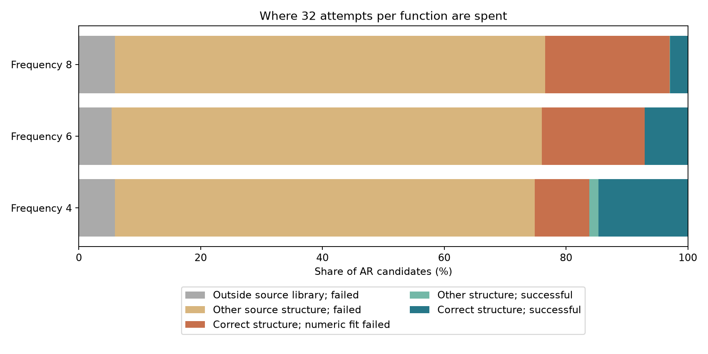

# Что именно не находит генератор индексаторов

Продолжение: [проверка раннего выбора на новых задачах](BASIN_ROUTING_RESULTS_2026-11-02.md)
и [признак задачи с сильными контролями](INDEXATOR_TASK_CUE_RESULTS_2026-11-02.md).

2 ноября 2026. Диагностика сохранённых запусков из
[основного отчёта](BASIN_STRUCTURE_TRANSFER_RESULTS_2026-11-02.md).
Нового обучения, изменения параметров генератора и подбора настроек
по итоговым задачам не было. Воспроизводимый разбор:
[код](../../experiments/basin_structure_transfer_v1/diagnose_failures.py),
[числа](../../experiments/basin_structure_transfer_v1/results/failure_diagnosis_v1/diagnosis.json),
[каждая задача](../../experiments/basin_structure_transfer_v1/results/failure_diagnosis_v1/tasks.csv).

**Ни одна из четырёх знакомых структур не потеряна.** Генератор почти
равномерно предлагает их все. В каждом неудачном поиске правильный I
уже присутствовал. Основная проблема — распределение попыток между
структурами и вероятность успешного обучения нового C. Дополнительно
обнаружен конкретный дефект сэмплирования первого индекса.

## Генератор выучил все четыре структуры

Вычислена вероятность каждого библиотечного разбиения непосредственно
из AR-модели, с суммированием по всем шести перестановкам имён кодов.
Это вероятность модели, а не частота в небольшой выборке предложений.

| Генератор | Масса четырёх знакомых I | Масса каждого I | Масса вне банка |
|---|---:|---:|---:|
| Seed 1 | 94,363% | 23,587–23,595% | 5,637% |
| Seed 2 | 94,010% | 23,497–23,509% | 5,990% |
| Seed 3 | 94,101% | 23,522–23,529% | 5,899% |

Признаков потери одной из мод здесь нет. Генератор безусловный: его
вызов получает количество предложений и температуру, но не примеры
новой задачи. Поэтому он не может предпочесть подходящий этой задаче I.
При четырёх равновероятных целевых семьях даже идеальное безусловное
воспроизведение банка даёт правильную структуру лишь в четверти попыток.

Сейчас на подходящий I приходится в среднем 7,52–7,55 из 32 попыток.
Идеальный равномерный банк дал бы 8. Oracle отдаёт подходящему I все 32.
Это объясняет, почему oracle существенно сильнее обоих способов
предлагать структуры и почему небольшое улучшение точности генерации
само по себе не закрывает разрыв.

## Почти все лишние структуры начинаются с неправильного первого символа

В обучающем банке имена кодов канонизированы по первому появлению.
Следовательно, первый символ всегда 0. В сэмплере он всё равно выбирается
из softmax по трём классам. Его вероятность равняться 0 — только
94,05–94,40%; остальная масса уходит на 1 и 2.

Из 9216 AR-предложений для знакомых задач трёх режимов:

- 536 лежат вне банка;
- у 532 из этих 536 первый сырой символ не равен 0;
- 527 отличаются от ближайшего библиотечного разбиения одной позицией;
- в 524 случаях эта единственная позиция — первая.

Таким образом, генератор хорошо усвоил зависимости остальных позиций,
но оставил неопределённость там, где представление заведомо требует 0.
У первой позиции нет контекста: её распределение задаётся выходным
смещением MADE. Конечное обучение softmax не делает вероятность
неверного класса строго нулевой.

Если задать первый символ равным 0 **до генерации остальных**, вероятность
получить библиотечную структуру по условному распределению этой же
замороженной модели составляет **99,953–99,966%**. Это точный расчёт
вероятностей модели; полноценный поиск с этим изменением ещё не запускался.
Эквивалентен отбор только предложений с первым сырым символом 0.
Перенумеровать готовый индексатор недостаточно: это сохраняет уже
испорченное разбиение, а не восстанавливает его.

## Где теряется хороший результат после правильного I

Во всех 32 знакомых задачах каждого режима каждый генератор предложил
хотя бы один правильный I. В неудачных поисках режима 8 было от 3 до 14
правильных предложений, но соответствующие кодбуки не обучились успешно.

| Частота | Правильных AR-предложений | Успешных обучений C на них | Доля успеха | Oracle: успешных попыток |
|---|---:|---:|---:|---:|
| ≈4 | 725 | 450 | 62,1% | 656/1024 = 64,1% |
| ≈6 | 736 | 217 | 29,5% | 316/1024 = 30,9% |
| ≈8 | 717 | 89 | 12,4% | 122/1024 = 11,9% |

AR-столбцы объединяют три генератора на тех же 32 задачах, по 32 попытки.
Это описательные доли, а не 96 независимых новых задач. Близость к oracle
показывает, что после получения правильного I трудность численного
обучения остаётся сопоставимой. Сам I задаёт равенства весов, но не
направление внутри трёхмерного подпространства и не нужный масштаб чисел.

Проверены две другие возможные причины. Среди сохранённых checkpointов
query не пропустила ни одной успешной численной попытки; среди попыток
итоговый отбор также не отбросил хороший результат в пользу плохого.
Аналитическая оптимизация одной выходной амплитуды при сохранённых
лучших неудачных весах не спасает ни одной попытки с правильным I.
Следовательно, не найдены именно хорошие входные веса, то есть C.

### Численные неудачи различаются между режимами

При частоте 6 неудачные обучения C с Adam, шагом 0,3 и начальной нормой 6
обычно заканчиваются с намного большей нормой весов. По трём генераторам
медианы конечной нормы — 17,0–18,4; медианы модуля амплитуды — 0,083–0,091.
Это высокочастотные направления, далёкие от нужного: медиана расстояния
до весов сильной компоненты цели, с учётом смены знака, — 14,4–15,9.
Ни одна из 519 неудачных правильных попыток не проходит прежний строгий
критерий близости к плохому низкочастотному минимуму.

При частоте 8 выбран тот же Adam с шагом 0,3, но начальной нормой 2.
В неудачах медиана конечной нормы — 1,06–1,14, модуля амплитуды —
0,21–0,25, расстояния до сильной высокочастотной компоненты — около 7,6.
Здесь веса остаются в области малых частот. Только 11 из 628 неудачных
правильных попыток проходят строгий критерий близости к плохому минимуму.

Это описания конечных точек. Они не доказывают, что конкретная настройка
Adam является причиной всех неудач, и не означают сходимость каждой
траектории к стационарной точке. Диагноз «все кодбуки застряли в одном
плохом локальном минимуме» был бы неверным. Сильные плотные контроли
и численное обучение внутри правильного I имеют разные картины неудач.

## Данные задачи уже позволяют направить поиск

В сохранённых траекториях можно остановиться на шаге 256 и выбрать
структуру кандидата с минимальной query-MSE. Это использует обычные
входы и ответы; истинный I нужен только для оценки правильности выбора.

| Частота | Правильный I после 256 шагов: три AR | Выбор из банка |
|---|---|---:|
| ≈4 | 31/32, 32/32, 32/32 | 32/32 |
| ≈6 | 26/32, 27/32, 25/32 | 28/32 |
| ≈8 | 30/32, 30/32, 29/32 | 32/32 |

В режиме 8 этот ранний выбор правилен даже в 13/13, 13/14 и 11/12
поисках соответствующих AR, которые позже останутся неудачными.
То есть во многих случаях определить нужную схему уже удаётся,
но текущий алгоритм продолжает тратить попытки на другие схемы.

Это ретроспективная диагностика, не результат обученного энкодера и не
проверка нового адаптивного метода. Разумный следующий опыт при прежнем
бюджете: 32 предложения по 256 шагов, выбор I по query, затем 28 новых
кодбуков по 2048 шагов для выбранного I. Итого те же 65536 обновлений.
Все C во второй фазе снова случайные; ни генерации, ни переноса C нет.
Такой опыт стоит проверять на новых итоговых задачах после фиксации
протокола, включая цену ошибочного раннего выбора. Сначала он отделит
пользу распределения бюджета от необходимости учить отдельный энкодер.

## Почему чужая структура — отдельный случай

Для пятой, не встречавшейся при обучении структуры вероятность модели
составляет примерно 7e−30–1,5e−29. Её генератор действительно не предлагает.
Это не объяснение неудач на знакомых I, а другой предел переноса.

Для каждой структуры вычислена нижняя граница ошибки любого предиктора,
который видит только проекции входа на её группы. На незнакомых задачах
лучший из четырёх библиотечных I имеет такую границу 0,49–0,56 во всех
трёх режимах, при критерии успеха 0,1. Поэтому перестановка попыток
между знакомыми I эти задачи не решит. В режимах 6/8 также все 96 пар
«знакомая задача — другая библиотечная структура» в каждом режиме имеют
границу выше 0,1. Единичные успехи с неточным I там относятся к
предложениям вне четырёх библиотечных схем.

Граница следует из Gaussian-условного ожидания. Если v разложен на
проекцию на подпространство I и ортогональную часть с квадратом нормы r²,
то после усреднения по невидимому направлению каждая sine-компонента
частоты k умножается на exp(−k²r²/2). Разность энергии цели и энергии
этого условного среднего равна минимальной MSE среди всех функций
доступной проекции. Для правильного I она численно равна нулю с
погрешностью менее 2,5e−9.

## Что из диагностики не следует

Нельзя приписать весь разрыв с retrieval несовершенству AR. Вероятности
правильного предложения близки: около 0,235 против 0,25. На одной
библиотеке и небольшом числе задач остаётся разброс случайных численных
попыток; превосходство retrieval в этих запусках не измеряет чистый
каузальный эффект ошибки генератора.

Совпадающий seed тоже не делает каждую AR-попытку точной копией oracle.
При одинаковом сыром I начальные числа отличаются не более чем на
1,3e−6 в AR-сопоставлениях, но при Adam исходы отдельных траекторий
расходятся: 118 из 736 совпадающих структур в режиме 6 и 58 из 717 в
режиме 8 различаются по успеху. Поэтому сохранённые oracle-исходы не
использованы как точный контрфактический повтор AR.

Главные проверенные причины потерь: неоправданно случайный первый
символ, отсутствие зависимости предложений от новой задачи и низкая
вероятность обучить C даже при правильной структуре. Последние две
причины дают существенно больший резерв, чем оставшиеся ошибки
воспроизведения четырёх изученных разбиений.
