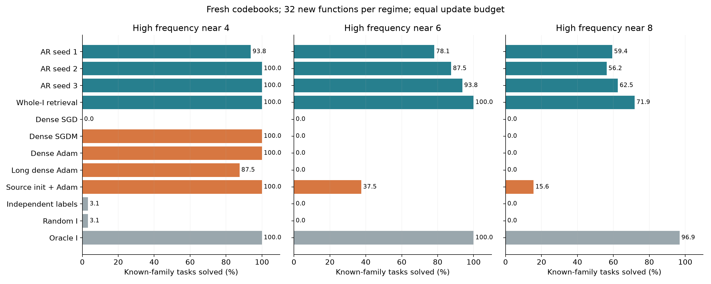
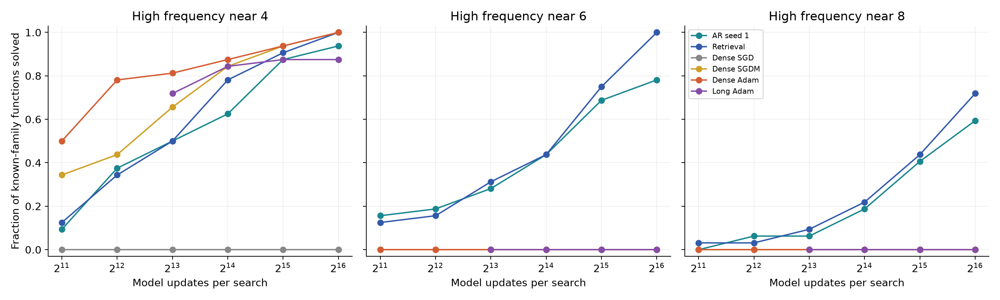
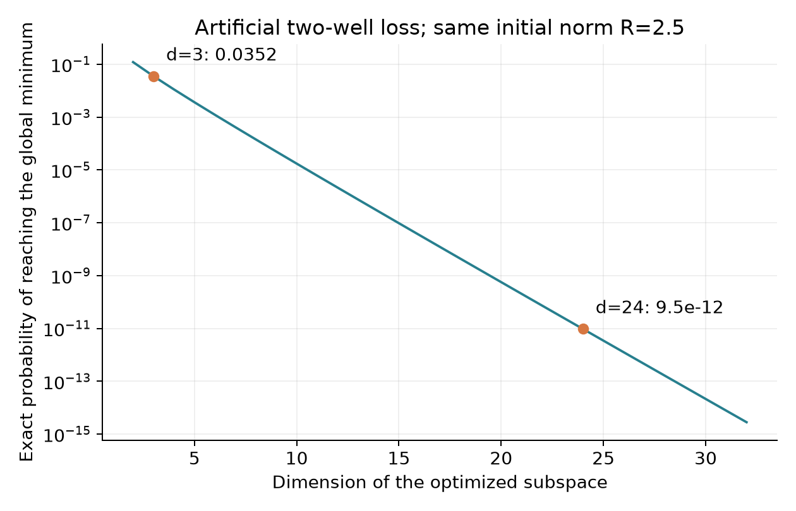

# Перенос индексаторов через оптимизационные ловушки

2 ноября 2026. [Код и протокол](../../experiments/basin_structure_transfer_v1/README.md),
[проверка теории](theory/BASIN_TRANSFER_THEORY_AUDIT_2026-11-02.md),
[все машинные результаты](../../experiments/basin_structure_transfer_v1/results/frequency_comparison.json).

Последующие проверки:
[информативная плотная инициализация](INDEXATOR_TASK_CUE_RESULTS_2026-11-02.md)
и [одинаковые старты с контролем обычного SGD](BASIN_RELEASE_CONTROL_2026-11-03.md).
Они уточняют границы приведённого ниже сравнения.

**На двух более сложных sine-семействах генератор изученных индексаторов
помог найти хорошие решения при полностью новом обучении кодбуков.
Настроенные плотные SGD, SGDM и Adam не решили ни одной из 32 новых
функций каждого семейства.** При меньшей частоте плотные SGDM и Adam
решают все задачи: преимущество зависит от режима. Прямой перенос
целого индексатора надёжнее обученного AR во всех трёх режимах.

Это контролируемый результат об оптимизации при конечном бюджете.
Он не устанавливает превосходство над всеми градиентными алгоритмами
и не распространяется автоматически на ReLU/tanh-MLP.

## Что именно обучалось

Сеть ученика имеет 24 Gaussian-входа, один sine-нейрон и одну обучаемую
выходную амплитуду. Индексатор связывает 24 входных веса в 3 группы.
Все связи активны, все три численных значения обучаются. Плотный
конкурент свободно обучает те же 24 веса и выходную амплитуду.

Из четырёх разных индексаторов строятся исходные семьи. В каждой —
шесть одночастотных функций с независимо меняющимися значениями весов
и частотой 0,65–0,85. По четыре плотных старта Adam на функцию,
2048 шагов по 256 свежих примеров. Лучший старт выбирается по отдельной
query; scalar k-means с известным числом групп извлекает равенства.
Перенумерация по первому появлению убирает симметрию имён кодов.
**Восстановлены все 24 исходных индексатора.** Банк содержит четыре
уникальные структуры. Истинные назначения не использовались в извлечении.

Три MADE ширины 128 обучены с разными seed по 3000 шагов. Генератор
получает только индексаторы: четыре исходные функции на семью для
обучения, две другие — для выбора состояния. Перед целевым этапом
все параметры генераторов заморожены. Каждый предложенный I получает
свежие случайные значения кодбука и амплитуды; исходные числа основной
метод не использует.

Целевая функция содержит две конкурирующие частоты вдоль одного
направления. Это направление имеет знакомую схему равенств, но новые
численные значения:

$$
\begin{aligned}
x&\sim\mathcal N(0,I_{24}),\qquad \|v_\tau\|=1,\\
y_\tau(x)&=a_\tau\sin(\ell_\tau v_\tau^\top x)
                  +\sin(h_\tau v_\tau^\top x),\\
f_{w,b}(x)&=b\sin(w^\top x),\qquad w_p=C_{I_p},\\
\ell_\tau&\in[0.65,0.75],\qquad a_\tau\in[0.35,0.45].
\end{aligned}
$$

Высокая частота лежит около 4, 6 или 8, с отклонением до 0,2.
Один нейрон не воспроизводит обе компоненты точно. Низкая частота
может дать плохой локальный минимум, высокая — существенно лучшее
решение. Глобальность хорошего sine-минимума здесь не утверждается.

## Протокол и контроли

Каждый режим содержит 32 новые функции четырёх знакомых структур,
по восемь на структуру, и восемь функций пятой, незнакомой структуры.
Это одна библиотека структур; три генератора оцениваются на одних и
тех же функциях. Три seed не превращают 32 функции в 96 независимых задач.

На поиск выделены 32 попытки по 2048 шагов. Длинный dense-контроль
получает 8 попыток по 8192 шага: также 65536 обновлений отдельных моделей.
Каждое обновление использует 128 свежих примеров. В пределах задачи
попытки разделяют поток minibatch; их начальные числа независимы.
Query из 4096 других примеров выбирает checkpoints и итоговую попытку.
Истинная ожидаемая MSE вычисляется точным Gaussian-интегралом и служит
только итоговой метрикой и геометрической диагностикой. Успех — MSE < 0,1.

Нормированные координаты групп устраняют множитель размера группы в GD.
Начальные веса имеют точно заданную норму независимо от числа параметров.
Для всех методов использована одна сетка радиусов: 0,5/1/2/4 в первом
режиме, дополнительно 6/8 в двух следующих. **Выбранные радиусы могут
различаться между методами.** Например, при частоте 6 кодбук выбрал
радиус 6, dense Adam — 1; оба получили право выбирать из всей сетки.

Каждый численный метод отдельно выбирал шаг из 0,003/0,01/0,03/0,1/0,3
и радиус на восьми независимых калибровочных функциях. Для кодбука
выбирался также SGD, SGDM или Adam; настройка использовала retrieval
и свежие числа. Для dense каждый оптимизатор представлен отдельно.
В сложных режимах ни одна из 30 настроек каждого плотного оптимизатора
не дала успешного калибровочного старта: по 0/3840. Следовательно,
нулевой итог не объясняется выбором единственной заведомо плохой настройки.
Это всё ещё конечная сетка, а не поиск всех возможных оптимизаторов.

Температура AR выбрана равной 1 на исходной калибровке частоты 4 и затем
сохранена. Сравниваются AR, целый I из банка, независимые частоты меток,
случайное сбалансированное разбиение и oracle-I. Последний получает
только правильное разбиение и заново обучает все числа.

Отдельный численный baseline использует исходные плотные векторы весов,
масштабирует их до выбранной нормы и дообучает Adam; выходная амплитуда
у него также стартует заново. В режиме 4 проверено плотное обучение из
точно тех же AR-инициализаций с немедленным освобождением всех равенств.
Различие исходных весов этого контроля и AR не превышает 3,2e−8.

Режимы 6 и 8 объявлены после завершения режима 4, когда выяснилось,
что SGDM/Adam его решают. Их протокол зафиксирован до новых итоговых
функций; для обоих заново выполнена калибровка. Все три режима
публикуются. Это последовательное исследование с отдельными новыми
итоговыми задачами, не единый заранее заявленный набор трёх опытов.

## Результаты

Число решённых новых функций знакомых структур из 32:

| Метод | Частота ≈4 | Частота ≈6 | Частота ≈8 |
|---|---:|---:|---:|
| AR, seed 1 | 30 | 25 | 19 |
| AR, seed 2 | 32 | 28 | 18 |
| AR, seed 3 | 32 | 30 | 20 |
| Целый I из банка | 32 | 32 | 23 |
| Независимые метки | 1 | 0 | 0 |
| Случайный I | 1 | 0 | 0 |
| Oracle I, свежий C | 32 | 32 | 31 |
| Плотный SGD | 0 | 0 | 0 |
| Плотный SGDM | 32 | 0 | 0 |
| Плотный Adam | 32 | 0 | 0 |
| Длинный плотный Adam | 28 | 0 | 0 |
| Исходные численные веса + Adam | 32 | 12 | 5 |

В режиме 4 дополнительно: длинный SGDM решил 25/32, длинный SGD — 0/32,
плотный SGDM из AR-инициализации — 32/32. У длинного поиска меньше
независимых стартов при том же числе обновлений; ухудшение не означает,
что увеличение длительности отдельного запуска всегда вредит.

При частотах 6 и 8 средняя MSE выбранного плотного решения около 0,5.
Для AR она составляет 0,080–0,152 и 0,221–0,249 соответственно; retrieval
даёт 0,0509 и 0,1783. В этих средних учтены все неудачи. Хорошие решения
обычно имеют MSE порядка 0,04–0,07, обусловленную второй частотой цели.

На неизвестной структуре AR и retrieval не решили ни одной из восьми
функций во всех режимах. Oracle решил 8/8 в каждом. Плотные SGDM/Adam
решили 8/8 при частоте 4, но 0/8 при частотах 6 и 8. Перенос полезен,
когда изученное распределение содержит подходящую структуру.

## Почему одного правильного предложения недостаточно

Последующий [разбор причин неудач](BASIN_GENERATOR_FAILURE_DIAGNOSIS_2026-11-02.md)
проверяет вероятности каждой структуры, дефект первого символа,
неудачные численные траектории и возможность раннего выбора I по query.

AR возвращает точный библиотечный I примерно в 93–95% предложений.
Нужный данной функции I встречается в 22–25%. Во всех трёх режимах
каждая из 32 знакомых функций получила хотя бы один правильный I
у каждого генератора. Оставшиеся неудачи нельзя объяснить только
отсутствием правильной структуры.

При частоте 6 после правильного предложения успешны 217 из 736 новых
численных обучений трёх генераторов; при частоте 8 — 89 из 717.
Oracle с 32 правильными предложениями на функцию имеет соответственно
316/1024 и 122/1024 успешных попыток. Условная вероятность хорошего
обучения кодбука снижается с усложнением задачи, несмотря на правильный I.
Это подтверждает необходимость учитывать и покрытие генератора,
и успешность нового обучения чисел.

Иногда хороший результат достигается при другом I: в режиме 4 таких
попыток несколько десятков, в сложных режимах — единичные. Подпространства
могут пересекаться, а почти совпадающие значения кодов позволяют хорошее
приближение с иным разбиением. Точное восстановление I и решение функции
измеряются отдельно.

## Действительно ли это плохие локальные минимумы

Численная проверка минимизирует MSE по амплитуде аналитически и ищет
нули производной оставшейся одномерной функции в ограничивающих
интервалах. Затем вычисляет градиент и полный гессиан по 25 параметрам.
Так проверяется устойчивость ко всем направлениям, а не только к
движению вдоль истинного вектора.

| Диагностика | Частота ≈4 | Частота ≈6 | Частота ≈8 |
|---|---:|---:|---:|
| Подтверждённые плохие минимумы, из 40 | 39 | 40 | 40 |
| Наименьшее собственное число их гессианов | 0,0218 | 0,0175 | 0,0193 |
| Наименьшее собственное число хороших гессианов | 0,9704 | 1,0000 | 1,0000 |
| SGD: конечные неудачи рядом с плохим минимумом, из 1024 | 989 | 986 | 1018 |
| SGDM: то же, из 1024 | 0 | 988 | 1017 |

Нормы градиентов доведённых стационарных точек меньше 3,6e−15.
В сложных режимах плохой риск практически 0,5; хорошие значения ниже 0,07.
Для близости конечного запуска требуются одновременно расстояние по
весам и амплитуде меньше 0,2 и норма полного population-градиента меньше
0,02, с учётом общей смены знака веса и амплитуды. Это описательный
порог близости, не формальная сертификация всей траектории.

У Adam этот строгий порог проходит лишь 161/1024 конечных точек при
частоте 6 и 234/1024 при частоте 8. Поэтому все его неудачи нельзя
называть сходимостью к плохому минимуму. У длинного Adam рядом с ним
находятся 224/256 и 200/256 конечных точек соответственно.

Первоначальная свободная доводка LBFGS в одной задаче режима 4 пришла
к хорошему минимуму вместо предполагаемого плохого. Это обнаружено
по значению риска; процедура заменена поиском корней в интервалах.
Для этой задачи плохой низкочастотный минимум не подтверждён.
Численные обучения и итоговые результаты методов не изменялись.

## Отдельная строгая проверка узкого глобального минимума

Для искусственной функции из двух квадратичных ветвей в
[теоретической записке](theory/BASIN_TRANSFER_THEORY_AUDIT_2026-11-02.md)
глобальный минимум известен точно. При **одинаковой норме старта 2,5**
вероятность успеха непрерывного спуска равна:

- 0,035225 в правильном трёхмерном подпространстве;
- 9,50e−12 в полном пространстве размерности 24.

В 100000 случайных направлениях получили 3463 и 0 пересечений хорошей
области. Дискретный GD с шагом 0,1 и 2048 обновлениями дал те же количества.
Ноль наблюдённых попаданий не доказывает нулевую вероятность; малое
значение 9,50e−12 получено аналитически. Здесь правильное подпространство
задано для проверки геометрии, а не выучено генератором.

## Границы вывода и воспроизводимость

Результат показывает, что **перенос изученных равенств весов с новым
обучением всех чисел может помочь попасть в хорошие решения**, которые
проверенные плотные методы редко находят при заданном бюджете. Он не
показывает преимущество AR перед хранением четырёх целых схем. Не доказаны
обучаемость генератора в общем случае, глобальность хорошего sine-решения
или аналогичный эффект на общей ReLU/tanh-сети.

Источники здесь простые и решены почти точно. Число групп известно,
библиотека одна, а результаты условны на её четыре структуры. Нужны
отдельные проверки извлечения из неполных решений и более богатых
библиотек. Численный source-transfer — полезный конкурент, но не полный
набор методов предобучения и метаобучения.

Равенство онлайн-бюджетов относится к обновлениям и обработанным
моделью примерам, не к FLOPs или времени. Один пакет из 40 задач и
32 попыток обычно обучался несколько секунд на V100; длинный dense
пакет — около 15 секунд из-за большей последовательной длины.
В `timing.json` записано только численное обучение, без генерации,
исходного банка, prior и калибровки. Полной оценки окупаемости нет.

Все вычисления обучения выполнены на свободных V100; другие процессы
не затрагивались. Основной код, банки, prior и настройки прошли проверку
хешей до и после итоговых запусков. Перед форматированием кода сохранён
точный [снимок использованных исходников](../../experiments/basin_structure_transfer_v1/results/code_snapshot/manifest.json).
После форматирования проведена минимальная проверка Python; повторного
обучения и модульных тестов не было. Статья и Git-публикация не менялись.
