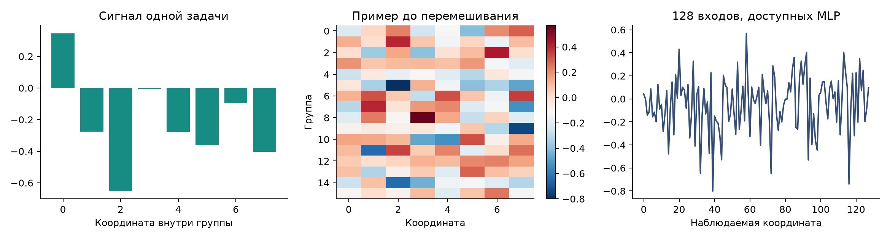
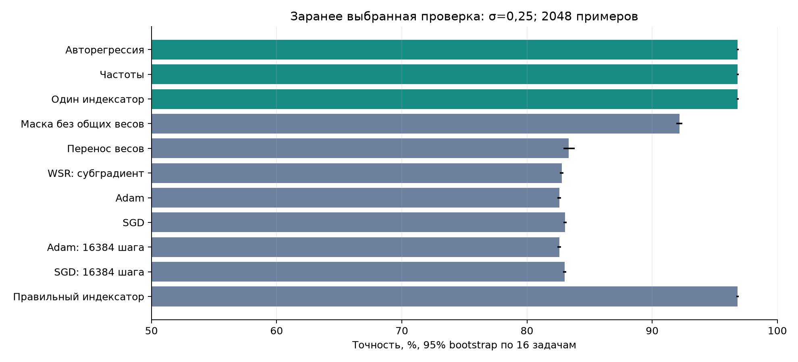
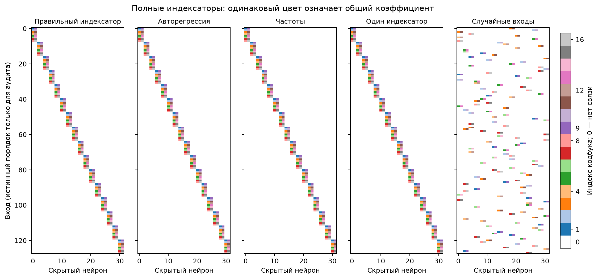
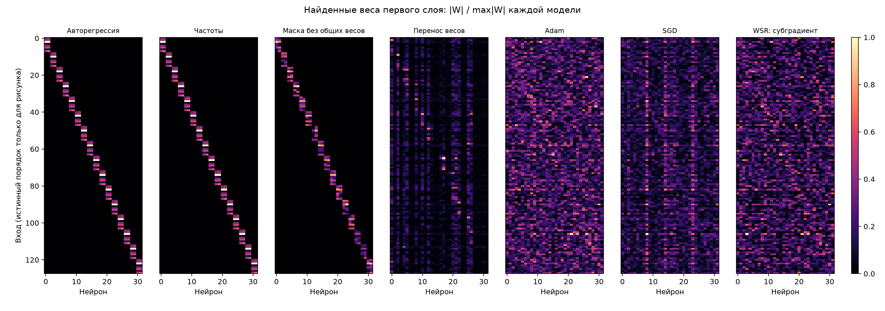
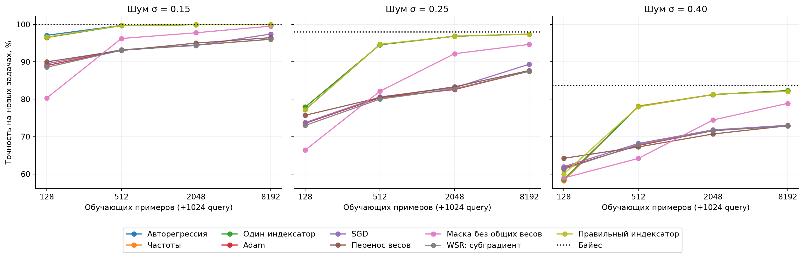
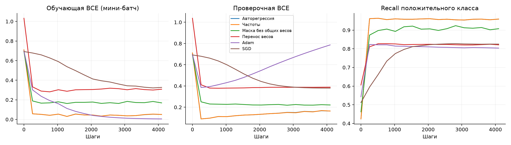

# Перенос структуры между задачами: поиск сигнала в неизвестной группе входов

Из обученных MLP удалось восстановить общий индексатор и перенести его на новые задачи. В основной независимой проверке получили **96,84% точности против 92,17% у той же маски без общих весов и 82,60% у плотного Adam**. Отдельного преимущества авторегрессии перед простыми частотами здесь нет.

[Повтор на пяти новых банках](DYNAMIC_SIGNAL_FIVE_BANKS_2026-11-01.md): средняя точность AR — 96,53%, маски без общих весов — 91,92%; преимущество сохранилось во всех пяти повторах. Новые банки восстанавливаются с отдельными ошибками, поэтому полное восстановление ниже относится к первоначальной серии.

## Какую задачу решаем

На вход MLP подаются 128 чисел. Они образуют 16 групп по восемь координат, но порядок координат заранее перемешан. В одном случайном блоке находится полезный сигнал; остальные содержат только шум. Нужно определить знак сигнала.

Для одной задачи выбирается единичный вектор из восьми чисел. Он одинаков для всех примеров этой задачи и меняется при переходе к следующей задаче. Для каждого примера независимо выбираются знак, активная группа и гауссовский шум:

$$
\begin{aligned}
c&\in\mathbb R^8,\quad \|c\|_2=1,\\
y&\sim\operatorname{Unif}\{-1,+1\},\quad b\sim\operatorname{Unif}\{1,\ldots,16\},\\
u_g&=\varepsilon_g+\mathbf1\{g=b\}\,yc,\quad
\varepsilon_g\sim\mathcal N(0,\sigma^2I_8),\\
x&=\Pi\,(u_1,\ldots,u_{16}).
\end{aligned}
$$

Перестановка координат общая для всех задач. Алгоритмы извлечения получают обученные исходные сети, но не перестановку, номера групп или истинный вектор сигнала. Проверяем три уровня шума: 0,15; 0,25; 0,40.

На рисунке показаны сигнал, положительный пример до перемешивания и те же 128 координат в порядке, доступном MLP. Истинный порядок используется только для объяснения.

Например, для сигнала с первыми координатами 0,6 и −0,8 активная группа при положительной метке получает прибавку (0,6; −0,8; 0; …; 0), а при отрицательной — (−0,6; 0,8; 0; …; 0). Положение активной группы меняется от примера к примеру.

## Аналитический ориентир

Если известны группы и сигнал, оптимальное решение сравнивает правдоподобия двух знаков. После сокращения общих множителей получаем логарифм отношения вероятностей:

$$
L(x)=\log\sum_{g=1}^{16}\exp\!\left(\frac{c^\top u_g}{\sigma^2}\right)
-\log\sum_{g=1}^{16}\exp\!\left(-\frac{c^\top u_g}{\sigma^2}\right).
$$

Ответ положительный при положительном значении этой величины. Это эталон Байеса; он использует скрытые параметры только для оценки достижимой точности. Из-за шума даже он иногда ошибается.

Ученик — MLP с 128 входами, 32 скрытыми ReLU-нейронами и одним выходом. При правильном индексаторе каждая группа подключена к двум нейронам. Первые восемь коэффициентов кодбука используются первым нейроном каждой группы, вторые восемь — вторым:

$$
\begin{aligned}
W_{ph}&=C_{I_{ph}},\quad C_0=0,\\
f(x)&=a^\top\operatorname{ReLU}(W^\top x+\beta)+\beta_0.
\end{aligned}
$$

Положительный выход MLP означает метку плюс. Индексатор — матрица 128 × 32 целых чисел от 0 до 16. Ноль означает отсутствие связи, остальные индексы указывают, какое из 16 обучаемых чисел взять. Смещения и выходные веса не объединяются. Поэтому после фиксации индексатора учим 81 число, а в плотной сети — 4161. Модель с правильным индексатором даёт ориентир для данной MLP; она не равна точному решению Байеса.

## Что собираем и как извлекаем структуру

Используем 12 исходных задач с разными сигналами: восемь для извлечения и обучения генератора, две для его проверки и две для дополнительного контроля. Для каждой сначала обучаем четыре плотные сети, затем постепенно оставляем 256 связей первого слоя и дообучаем веса.

Исходные сети обучаем Adam с подобранными настройками. Первый вариант сопоставляет столбцы разреженных матриц между сетями и объединяет похожие профили весов в общие коэффициенты. После этого заново обучает кодбук. Именно качество после объединения определяет, сохраняем ли индексатор в банк.

При шуме 0,25 после разреживания исходные сети давали 89,0% на query, а после объединения весов — 78,8%. Падение возникало на этапе извлечения и переобучения кодбука, поэтому его нужно было проверить отдельно. Поэтому проверяем второй вариант: извлекать отношения, которые не меняются при перестановке скрытых нейронов. Частота совместного появления входов в одном нейроне помогает найти группы. Изменение суммарного вклада входа между исходными задачами помогает сопоставить координаты внутри групп:

$$
\begin{aligned}
A_{pq}&=\sum_{n,h}\mathbf1\{W^{(n)}_{ph}\ne0\}
\mathbf1\{W^{(n)}_{qh}\ne0\},\quad p\ne q,\\
v_{pt}&=\frac14\sum_{s=1}^4\sum_h W^{(t,s)}_{ph}a^{(t,s)}_h.
\end{aligned}
$$

Первая матрица имеет размер 128 × 128. Вторая даёт каждому входу профиль из восьми чисел — по одному на обучающую исходную задачу. Спектральная кластеризация первой матрицы предлагает группы входов. Кластеризация нормированных профилей второй матрицы предлагает восемь общих позиций. Числа групп, позиций и фильтров заданы заранее; это дополнительное ограничение класса структур. Их состав восстанавливается из весов. Сырые входные данные и истинное разбиение в этой процедуре не используются.

Повторяем построение на 16 выборках исходных сетей с возвращением. Каждый предложенный индексатор проверяем, обучая кодбук на исходных задачах с четырьмя вариантами шага обучения Adam. Сохраняем до двух лучших индексаторов на задачу с проверочной BCE меньше 0,65. Таким образом, в банк попадают проверенные, хотя не обязательно точные решения.

По одинаковым отложенным исходным задачам при всех трёх уровнях шума выбираем один банк. Выиграл банк, собранный при шуме 0,25: средняя проверочная BCE — 0,150 против 0,331 и 0,325 у остальных. Этот один банк используем при всех целевых шумах. В нём 24 отобранных индексатора, но только три различных.

По банку учим авторегрессивное распределение 4096 индексов: каждая позиция предсказывается по предыдущим. Обучение максимизирует вероятность исходных индексаторов:

$$
p_\theta(I)=\prod_{t=1}^{4096}p_\theta(I_t\mid I_{<t}).
$$
 На новой задаче генератор заморожен: он предлагает индексатор, а градиентный метод обучает только кодбук, смещения и выходной слой.

## С чем сравниваем

Все параметры выбираем на четырёх отдельных калибровочных задачах, без использования целевого теста.

- **Adam и SGD:** обучают всю плотную MLP с нуля; подбираем шаг, регуляризацию, масштаб начальных весов и момент SGD (0 или 0,9).
- **WSR, субградиентный вариант:** добавляет штраф за различия весов и отдельно подбираемый L1. Используем [целевую функцию авторского метода](https://proceedings.mlr.press/v238/shakerinava24a.html) для первого слоя и смещений; это самостоятельная реализация субградиента, а не воспроизведение проксимального алгоритма статьи.
- **Линейная модель:** один слой 128→1, всего 129 чисел; проверяем, можно ли обойтись без локальных нелинейных признаков.
- **Перенос весов:** начинаем с сетей исходного банка и дообучаем все веса; это проверка пользы исходных задач без извлечения индексатора.
- **Маска без общих весов:** используем ту же извлечённую структуру связей, но обучаем 256 независимых весов первого слоя — всего 321 число со смещениями и выходом.
- **Индексатор по частотам:** независимо выбираем индекс каждой позиции по исходному банку; проверка необходимости авторегрессивных зависимостей.
- **Общий извлечённый индексатор:** используем один вариант, выбранный по исходным задачам; проверка необходимости генерации нескольких структур.
- **Случайная структура:** перемешиваем входы извлечённого индексатора, сохраняя число связей и повторений коэффициентов.
- **Правильный индексатор:** отдельный диагностический ориентир с известным разбиением; не результат извлечения.

Для окончательной проверки берём 16 новых задач после завершения подбора параметров. Первые восемь целевых задач использовали при диагностике и считаем разработочными. Параметры калибруем отдельно для каждого точного объёма данных; добавляем регуляризацию кодбука и расширяем диапазоны шагов плотных оптимизаторов.

На каждой из 16 новых задач даём методу восемь запусков по 4096 шагов с batch128. Веса обучаются на 128, 512, 2048 или 8192 примерах. Дополнительно у всех есть 1024 проверочных примера для выбора запуска и момента остановки. Поэтому полный доступный объём размеченных данных — указанное число плюс 1024, а не только обучающая выборка. Итог измеряем на независимых 16 384 примерах каждой задачи.

Дополнительно даём Adam и SGD по 16 384 шага на бюджетах 2048 и 8192 примеров: в четыре раза больше основного метода. Для этого отдельно подбираем соседние шаги, регуляризацию и постоянное либо косинусное расписание.

Стоимость исходных задач и обучения генератора не входит в бюджет решения новой задачи. [Число запусков и повторных предъявлений примеров сохранено отдельно](../../experiments/dynamic_signal_v1/results/v2/cost_summary.json). Равное число шагов также не означает равные FLOPs, поскольку число параметров различается.

Основной показатель зафиксировали до создания новых целевых данных: шум 0,25 и 2048 обучающих примеров. По калибровке выбрали один структурный способ и самого сильного конкурента, включая маску без общих весов и плотные методы с четырёхкратным бюджетом. Выбраны авторегрессия и маска без общих весов. Авторегрессия и фиксированный индексатор на калибровке дали одинаковую BCE, поэтому это не свидетельство преимущества авторегрессии. Доверительный интервал разницы считаем парным bootstrap по 16 новым задачам; остальные условия — дополнительные результаты.

## Результаты независимой проверки

При шуме 0,25 и 2048 обучающих примерах получено:

| Метод | Точность, % ↑ | Тестовая BCE ↓ |
| :--- | ---: | ---: |
| Авторегрессия | 96.84 | 0.0884 |
| Независимые частоты | 96.84 | 0.0885 |
| Один извлечённый индексатор | 96.84 | 0.0884 |
| Та же маска, независимые веса | 92.17 | 0.2104 |
| Перенос исходных весов | 83.32 | 0.3748 |
| Плотный Adam | 82.60 | 0.3865 |
| Плотный SGD | 83.06 | 0.3785 |
| WSR, субградиент | 82.78 | 0.3831 |
| Adam, 16 384 шага | 82.60 | 0.3865 |
| SGD, 16 384 шага | 83.01 | 0.3785 |
| Линейная модель | 82.76 | 0.3826 |
| Случайное назначение входов | 75.82 | 0.4973 |
| Правильный индексатор задан | 96.83 | 0.0883 |

BCE — средняя бинарная кросс-энтропия. Байесовский классификатор на этих же тестовых примерах дал **97,99%**; он использует истинный сигнал и служит только ориентиром.

**Основной выигрыш над маской без общих весов — 4,67 процентного пункта**, парный 95% bootstrap-интервал **[4,43; 4,91]**. Выигрыш положителен на каждой из 16 задач. Это проверка пользы повторений коэффициентов сверх уже найденных связей. По сравнению с плотным Adam выигрыш составляет 14,24 п.п.; увеличение бюджета плотных методов в четыре раза его не устранило.

Проверка самого индексатора тоже успешна: в основной серии у AR, частот и фиксированного варианта восстановлены все 256 связей и все назначения общих коэффициентов на каждой из 16 задач, с точностью до перестановки групп и названий кодов. Истинный индексатор используется для этой проверки только после обучения.

Одинаковый цвет означает один обучаемый коэффициент, белый — отсутствие связи. Для наглядности строки и группы столбцов переставлены в истинный порядок; это только оформление рисунка.

Здесь показан модуль каждого веса относительно максимума своей модели. Плотные методы не задают целочисленного индексатора, поэтому для них изображены сами веса.

Полное сравнение по шуму и объёму данных:

| Шум | Примеров для обучения | AR, % | Adam, % | SGD, % | Маска без общих весов, % | Перенос весов, % | SGD, 16 384 шага, % |
| ---: | ---: | ---: | ---: | ---: | ---: | ---: | ---: |
| 0.15 | 128 | 97.09 | 89.01 | 89.46 | 80.31 | 89.98 | — |
| 0.15 | 512 | 99.74 | 93.09 | 93.23 | 96.23 | 93.04 | — |
| 0.15 | 2048 | 99.93 | 94.48 | 94.36 | 97.77 | 95.00 | 94.47 |
| 0.15 | 8192 | 99.95 | 96.04 | 97.42 | 99.53 | 96.46 | 97.38 |
| 0.25 | 128 | 77.20 | 73.57 | 73.74 | 66.41 | 75.71 | — |
| 0.25 | 512 | 94.64 | 80.40 | 80.62 | 82.12 | 80.44 | — |
| 0.25 | 2048 | 96.84 | 82.60 | 83.06 | 92.17 | 83.32 | 83.01 |
| 0.25 | 8192 | 97.40 | 87.49 | 89.35 | 94.66 | 87.67 | 90.32 |
| 0.40 | 128 | 58.32 | 61.62 | 61.95 | 58.93 | 64.20 | — |
| 0.40 | 512 | 78.05 | 67.63 | 68.16 | 64.17 | 67.24 | — |
| 0.40 | 2048 | 81.26 | 71.59 | 71.80 | 74.45 | 70.70 | 71.77 |
| 0.40 | 8192 | 82.29 | 72.90 | 73.02 | 78.89 | 72.90 | 72.94 |

У всех дополнительно 1024 query-примера. В таблице показаны средние по одним и тем же 16 новым задачам. [Полная таблица всех методов, BCE, recall и интервалов](../../experiments/dynamic_signal_v1/results/v2/comparison.csv).

При 512 и более обучающих примерах перенос структуры помогает на всех трёх уровнях шума. Но при шуме 0,40 и 128 примерах AR проигрывает переносу весов: 58,32% против 64,20%. Даже заданный правильный индексатор даёт в этом режиме 60,01%. Здесь остаётся проблема обучения численных параметров в выбранном протоколе; это не доказательство невозможности подобрать лучший способ их обучения.

Кривые основной серии показывают, что Adam снижает обучающую ошибку почти до нуля, тогда как проверочная ошибка растёт. Поэтому наблюдаемое преимущество связано с переносом структуры и обобщением на новые примеры; одной лишь нехваткой шагов его объяснить не получается. На графике показаны полные траектории выбранных запусков, а итоговые веса берутся в момент лучшей query-ошибки.

## Что показали и что остаётся открытым

Из весов исходных MLP получилось извлечь **связи и повторения коэффициентов**, после чего новый кодбук обучается заметно лучше настроенных плотных моделей и сильного контроля с той же маской. Простое дообучение исходных весов не воспроизводит этот результат.

Авторегрессия, частоты и один извлечённый индексатор дают практически одинаковое качество. Здесь достаточно перенести одну общую структуру; необходимость сложного генератора и создание новых сочетаний этот опыт не подтверждает. В банке только три разных индексатора.

Извлекатель заранее знает числа групп, ролей и фильтров. Состав групп и назначения кодов восстановлены из весов, но полностью свободный от этих предположений вариант не проверялся. Также использованы одна скрытая перестановка и один выбранный исходный банк: 16 новых задач различаются сигналами, а не устройством групп.

Банк не бесплатный: использовали 12 исходных сигналов при трёх шумах, по 16 384 обучающих и 1024 query-примера на каждый вариант. Его сбор, подбор параметров и обучение генератора не включены в целевые 4096 шагов. Равное число целевых шагов не означает равных общих FLOPs или полного числа размеченных примеров.

Постановка вдохновлена [Dynamic Signal Distribution, Lahoti et al., ICLR 2024](https://proceedings.iclr.cc/paper_files/paper/2024/hash/71b17f00017da0d73823ccf7fbce2d4f-Abstract-Conference.html). Это собственная адаптация; её результаты не являются доказательством фундаментальной несостоятельности SGD/Adam.

[Код и команды воспроизведения](../../experiments/dynamic_signal_v1/README.md), [зафиксированный протокол](../../experiments/dynamic_signal_v1/protocol_confirmation.json), [выбор методов до создания целевого набора](../../experiments/dynamic_signal_v1/results/v2/primary_selection.json), [числовые результаты основного сравнения](../../experiments/dynamic_signal_v1/results/v2/summary.json), [проверка восстановленных индексаторов](../../experiments/dynamic_signal_v1/results/v2/indexator_recovery.csv).
