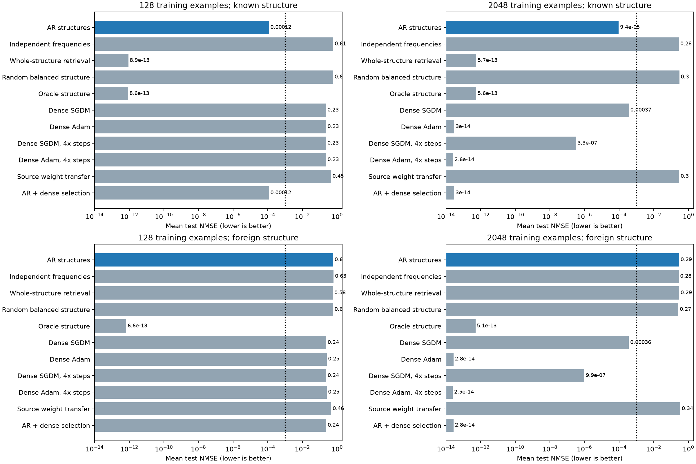
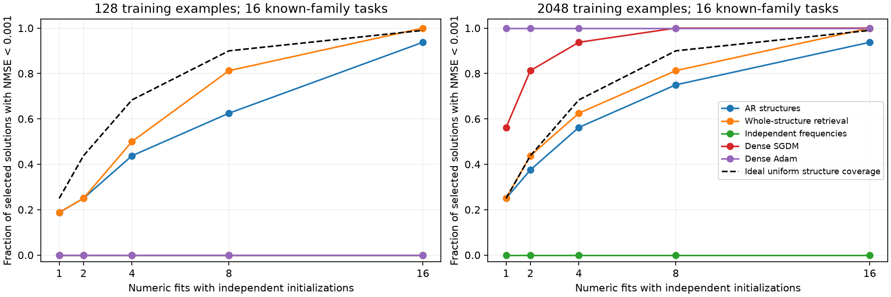
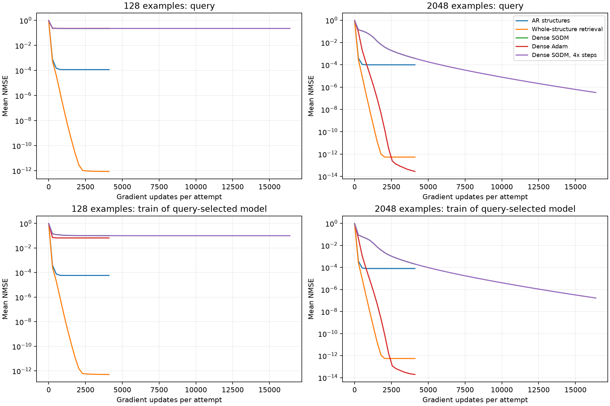

# Перенос изученных структур с новым обучением кодбуков

2 ноября 2026. [Теория](theory/GENERATIVE_STRUCTURE_TRANSFER_THEORY_2026-11-02.md),
[код и протокол](../../experiments/generative_structure_transfer_v1/README.md),
[машинные результаты](../../experiments/generative_structure_transfer_v1/results/pilot_v1/summary.csv).

**При 128 обучающих примерах генератор структур решил 15 из 16 новых
функций известных семей, плотные SGDM и Adam — 0 из 16. При 2048 примерах
плотный Adam решил все функции практически точно.** Перенос целого
индексатора из банка оказался надёжнее AR и решил 16 из 16 в обоих
режимах. Поэтому пилот поддерживает пользу переноса изученной структуры
при малом объёме целевых данных, но не превосходство авторегрессии над
прямым хранением схем и не общую трудность этих функций для градиентов.

Генератор обучался **только выдавать индексаторы**. На целевом этапе его
параметры заморожены; каждое предложение получало свежий случайный кодбук,
обучаемый SGDM. Индексатор в ходе этой попытки оставался неизменным.
Ни исходные численные значения, ни состояние их оптимизатора основной
метод не переносил. Дообучение исходных весов проверялось отдельно как
конкурирующий метод.

## Задачи и эталон

Во всех методах одна MLP: 32 входа, 16 tanh-нейронов, фиксированные
нулевые смещения и фиксированный выход с коэффициентами 1/4. Её 512
весовых позиций распределены по 32 группам. В пределах группы все веса
используют одно обучаемое число. Индексатор задаёт, какие именно позиции
связаны, без пространственных блоков или известной геометрии входов.

$$
\begin{aligned}
x&\sim\mathcal N(0,I_{32}),\\
W^{(\tau)}_{ih}&=C^{(\tau)}_{I^{(j)}_{ih}},\\
y_\tau(x)&=\frac14\sum_{h=1}^{16}
\tanh\!\left(\sum_{i=1}^{32}W^{(\tau)}_{ih}x_i\right).
\end{aligned}
$$

Есть четыре разные схемы, каждая задаёт семью функций с различными
численными параметрами. На этапе создания данных параметры учителей
независимы между функциями и распределены равномерно от −1 до 1. Это
устройство синтетического семейства; решатель эти числа не получает.
Нумерация 0–31 в коде обозначает 32 обучаемых значения: отключённые
связи в этом пилоте не используются.

Истинный индексатор и истинные числа дают точную функцию. Oracle-контроль
знает только индексатор и заново обучает числа по тем же данным, что и
остальные методы. Это отделяет способность численного обучения решить
задачу от способности генератора предложить нужную структуру.

Например, две функции одной семьи могут иметь совершенно разные значения
всех 32 коэффициентов. Решатель получает новые ответы, выбирает структуру
из изученного распределения и обучает новые числа. В четвёртой целевой
функции первой семьи AR не предложил точную схему ни в одной из 16 попыток:
выбранная приближённая структура дала NMSE 0,00188 при 128 примерах.
Это единственная неуспешная по установленному порогу функция известной семьи.

## Исходный банк и обучение генератора

Для каждой схемы обучили шесть исходных функций, по четыре плотных
старта: всего 96 численных исходных обучений. На функцию — 8192 примера
для градиентов, 2048 для проверки, 8192 шага Adam с minibatch 256.
Квантизация весов и согласование нейронов извлекли общий индексатор
каждой семьи; последующая диагностика показала 512/512 правильных
назначений во всех четырёх семьях.

Принадлежность **исходных** задач к семье известна при подготовке банка.
Внутри семьи нейроны и номера кодов согласуются с решением одной из
обучающих функций. Генератор получает общий набор индексаторов без
меток семей. Принадлежность целевой задачи к семье ему не сообщается.
Известны архитектура и бюджет 32 кодов; истинное расположение групп
не используется в извлечении или обучении генератора.

В обучение MADE поступили 16 индексаторов: по лучшему численному
решению четырёх функций каждой семьи. Ещё восемь индексаторов других
исходных функций использовались для выбора состояния генератора.
После согласования в банке четыре уникальные структуры. MADE с шириной
256 обучался 3000 шагов; лучшая validation NLL на позицию — 0,00580.
Входом и выходом этого обучения служат категориальные индексаторы.

Первая версия подготовки ошибочно согласовывала все разные семьи
с одним общим образцом. Неоднозначное сопоставление создало 13 различных
кодировок вместо четырёх; validation NLL ухудшалась. Это исправлено до
калибровки и до появления целевых задач. Исходные численные обучения
не повторялись; неудачная подготовка и приор сохранены отдельно в
`results/pilot_v1/development_global_alignment/`.

## Независимая калибровка и целевая проверка

На восьми новых калибровочных функциях выбраны шаги численного обучения
из пяти значений, два масштаба случайной инициализации и температура
генерации из 0,1/0,3/1. Для кодбуков выбран SGDM с шагом 0,1 и начальным
стандартным отклонением 0,1; для AR — температура 0,1. Плотные методы
и их длинные варианты выбирали собственные настройки. Перенос исходных
весов выбирал также между SGDM и Adam. После этого настройки и входы
зафиксированы хешами; на целевых данных ничего не подбиралось.

Целевой набор содержит 16 новых функций четырёх известных семей и
четыре функции пятой, незнакомой схемы. Для каждой сравниваются 16
попыток по 4096 шагов. Длинные плотные контроли получают 16384 шага.
SGDM в этих целевых запусках использует всю обучающую выборку за шаг,
то есть это full-batch GD с моментом 0,9.

Проверены 128 и 2048 примеров для градиентов. Дополнительно во всех
методах используются 256 query-примеров для выбора состояния и попытки;
ещё 8192 примера отложены для test. Полный доступный обучению бюджет
составляет 384 или 2304 метки. Малая выборка вложена в большую; функции,
query и test в двух режимах совпадают. Это парное сравнение, а не два
независимых набора задач.

Ошибка — MSE, делённая на дисперсию ответов соответствующей тестовой
функции. Успех заранее определён как test-NMSE < 0,001. Нормировка для
оптимизации и выбора использует только дисперсию обучающих ответов.

## Результат на известных структурах

| Метод | NMSE, 128 примеров | Успехи | NMSE, 2048 примеров | Успехи |
| --- | ---: | ---: | ---: | ---: |
| AR → свежий кодбук | 0,000118 | 15/16 | 0,0000942 | 15/16 |
| Целый индексатор из банка → свежий кодбук | 8,86e−13 | 16/16 | 5,67e−13 | 16/16 |
| Независимые частоты назначений | 0,606 | 0/16 | 0,284 | 0/16 |
| Случайный индексатор с теми же размерами групп | 0,598 | 0/16 | 0,302 | 0/16 |
| Истинный индексатор → свежий кодбук | 8,60e−13 | 16/16 | 5,63e−13 | 16/16 |
| Плотный SGDM | 0,230 | 0/16 | 0,000370 | 16/16 |
| Плотный Adam | 0,233 | 0/16 | 2,99e−14 | 16/16 |
| Плотный SGDM, вчетверо больше шагов | 0,230 | 0/16 | 3,27e−7 | 16/16 |
| Плотный Adam, вчетверо больше шагов | 0,233 | 0/16 | 2,62e−14 | 16/16 |
| Дообучение численных весов источника | 0,451 | 0/16 | 0,296 | 0/16 |

Пятнадцать успешных AR-решений имеют ошибку порядка 10⁻¹². Среднюю
ошибку AR почти целиком определяет одна задача без точного индексатора
среди предложений. Эта задача принадлежит первой семье; остальные три
семьи получили 4/4 успеха каждая, первая — 3/4.

При малой выборке дополнительные шаги не устранили разрыв плотных
методов. При большей выборке Adam нашёл точные решения и без переноса
структуры. Это наблюдение согласуется со статистической пользой
ограничений; оно не доказывает, что плотная оптимизация не может найти
нужные решения при достаточных данных.

## Покрытие структур и обучение кодбука

В 256 AR-предложениях для известных семей 196 точно совпали с одной
из четырёх изученных схем с точностью до перестановок нейронов и кодов.
Это 76,6% допустимых целых схем. Для независимых частот и случайного
назначения таких совпадений не было; у переноса целого индексатора — 100%.

При этом нужной **конкретной задаче** оказалась 54 из 256 AR-структур,
то есть 21,1%. При 128 примерах 48 из этих 54 попыток обучили кодбук до
порога успеха; при 2048 — все 54. Таким образом, даже правильный
индексатор не гарантировал успех каждого отдельного численного старта.
Но во всех 15 задачах с точным индексатором среди предложений нашёлся
успешный старт. Единственная оставшаяся задача не получила точной схемы.

Генератор покрывал семьи неравномерно: 31/69/61/35 точных предложений
для первой/второй/третьей/четвёртой схем соответственно. Поэтому средняя
NLL или общий процент допустимых структур недостаточны для оценки
надёжности решателя. Нужно контролировать покрытие каждой семьи и успех
нового численного обучения внутри неё.

Пунктир — ориентир идеального равномерного выбора одной из четырёх
схем при безошибочном численном обучении. Это не предсказание для
обученного AR: его массы неравномерны, часть предложений неточна,
а численный успех при малой выборке зависит от старта. Все остальные
кривые получены из префиксов тех же 16 попыток без дополнительного обучения.

На графике в каждый момент выбирается лучший уже просмотренный
checkpoint/старт по query. Нижний ряд показывает train-ошибку именно
этого решения. Полные кривые отдельных попыток, включая дополнительный
recall знака ответа, сохранены в `history.json.gz`.

## Незнакомая структура и выбор плотного решения

На четырёх функциях неизвестной схемы AR дал среднюю NMSE 0,601 при
128 примерах и 0,294 при 2048. Плотный SGDM — 0,238 и 0,000364;
Adam — 0,252 и практически ноль. Применение неподходящих изученных
ограничений здесь вредит. Oracle с новой истинной схемой снова решает
все четыре функции: препятствие для основного метода — отсутствие
нужной структуры в изученном распределении.

Дополнительный вариант выбирает по query между AR и плотным методом,
заранее выбранным на исходной калибровке. При 128 примерах он выбрал AR
на всех 16 известных задачах и SGDM на всех четырёх неизвестных. При
2048 примерах выбрал Adam на всех 20 задачах. На этом наборе не было
ни одного увеличения test-NMSE относительно соответствующего плотного
baseline. Это эмпирический результат, а не строгая гарантия на новых
распределениях или любой конечной query.

Такой выбор требует вычислить оба решения. Например, при 128 примерах
пакет из 20 задач и 16 попыток занял около 5,09 с для AR вместе с
сэмплированием и 4,34 с для плотного SGDM; их совместный вариант —
около 9,43 с. Это время пакетного вычисления на V100, а не задержка
одного пользовательского запроса. Число кодов 32 против 512 весов
не дало пропорционального ускорения: прямой проход остаётся плотным.

Подготовка четырёх банков заняла суммарно около 85 с времени отдельных
работников, обучение исправленного генератора — 53 с. Численное обучение
в калибровке заняло ещё около 122 и 198 с для двух режимов. Эти
затраты учитываются отдельно от целевого решения и не равны нулю.

## Что получилось проверить и что остаётся

Пилот реализует запрошенное разделение: модель учит распределение
структур, а каждая новая задача получает заново обученные числа.
Совместное предложение сохраняет изученные связи существенно лучше
независимых частот. При малом числе примеров это даёт хорошие решения
там, где проверенные плотные методы и их длинные варианты не достигают
порога. Прямое хранение целых схем в этом опыте надёжнее AR.

Это одна библиотека из четырёх структур, одна архитектура с фиксированным
readout и один запуск генератора. Источники здесь удалось решить почти
точно; извлечение из шумных частичных решений не проверялось. Был контроль
дообучения исходных весов, но не полный набор методов многозадачного
предобучения или метаобучения. Поэтому результат не устанавливает
превосходство над всеми способами использования исходных задач.

Продолжение про перенос структуры через оптимизационные ловушки завершено:
[три sine-режима](BASIN_STRUCTURE_TRANSFER_RESULTS_2026-11-02.md),
[признак задачи и сильные контроли](INDEXATOR_TASK_CUE_RESULTS_2026-11-02.md),
[одинаковые старты и освобождение весов](BASIN_RELEASE_CONTROL_2026-11-03.md).
Результаты и границы доказательств разобраны в
[теории](theory/GENERATIVE_STRUCTURE_TRANSFER_THEORY_2026-11-02.md).
Сам tanh-пилот устанавливает эффект малой выборки, а не оптимизационный барьер.

Повышение надёжности покрытия уже изученных схем остаётся отдельным
вопросом. Энкодер структуры или другой генератор уместен, если уменьшает
долю испорченных индексаторов и пропусков семей при том же бюджете.
Оба направления оцениваются после обучения свежих кодбуков; генерировать
численные кодбуки не требуется. Настройки завершённого целевого опыта
не изменялись.
