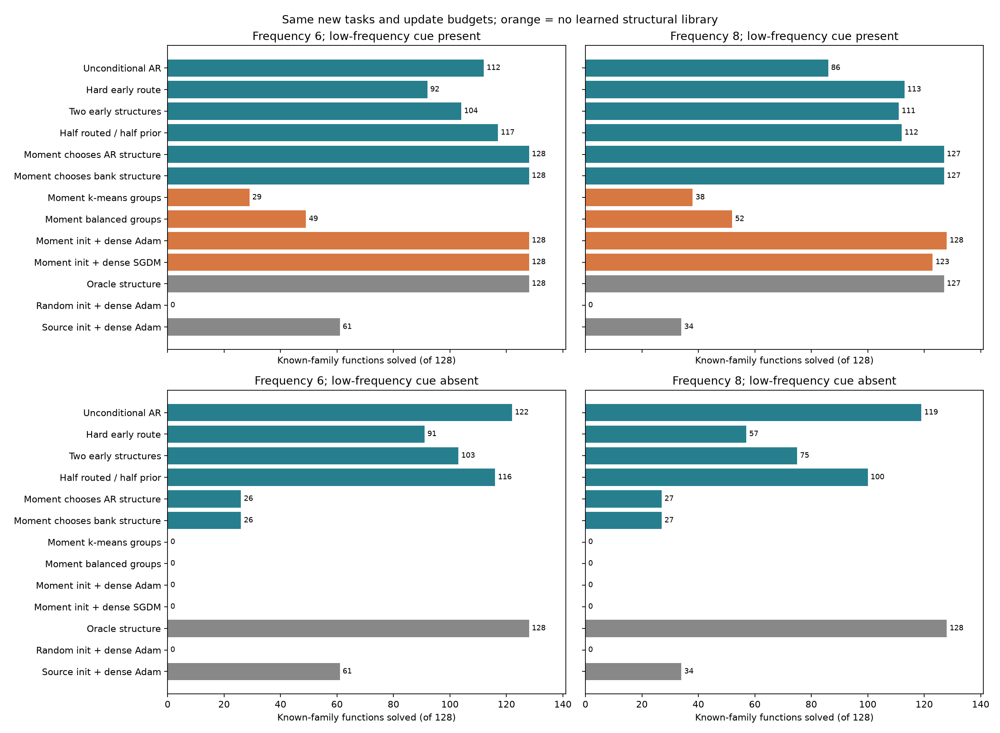

# Что даёт изученная структура, когда данные подсказывают направление

2 ноября 2026. [Теория](theory/INDEXATOR_TASK_ROUTING_THEORY_2026-11-02.md),
[протокол](../../experiments/basin_routing_v1/cue_protocol.json),
[протокол сильных контролей](../../experiments/basin_routing_v1/cue_control_protocol.json),
[все результаты](../../experiments/basin_routing_v1/results/cue_holdout_v1/summary.json).

**Сигнал новой задачи позволяет выбрать правильный изученный I и почти
достичь oracle. Но тот же сигнал позволяет плотному Adam решить все
задачи без изученной библиотеки.** При удалении этого сигнала выбор
структуры по нему становится почти случайным, а безусловный генератор
с новыми кодбуками сохраняет высокий успех. Эти результаты разделяют
пользу источников структур, выбора I по данным и численной инициализации.

## Постановка и что было зафиксировано

Использованы прежние три замороженные AR-модели четырёх индексаторов.
В новой выборке 128 направлений знакомых структур и 32 чужой структуры.
Для них построены парные цели с высокой частотой около 6 или 8,
с низкочастотной компонентой и без неё. Направления, примеры x, seed
предложений и численных стартов внутри пар согласованы. Это четыре
условия одной выборки, а не четыре независимые библиотеки.

Вторая новая выборка отличается от
[предыдущей серии раннего выбора](BASIN_ROUTING_RESULTS_2026-11-02.md).
До её создания зафиксированы 17 методов, все seed и настройки.
После первых результатов объявлены четыре дополнительных сильных
контроля, применённые ко всем четырём условиям без подбора по ним.
Эти дополнительные сравнения ретроспективные на той же выборке.

В каждой задаче бюджет — 65536 обновлений моделей. Все основные методы
получают полностью новые случайные C и выходную амплитуду. Данные для
выбора I отделены от финальной query; population MSE используется только
для отчёта. Истинный I получает только oracle.

## Признак задачи и три способа его использовать

По 4096 отдельным примерам вычисляется среднее произведение x*y.
Для Gaussian-входов его population-значение пропорционально истинному
направлению, с коэффициентом из теоретической записки. В основном
методе этот вектор служит только для ранжирования предложенных I:
выбирается схема, в подпространство которой он проецируется с наименьшим
остатком. Затем выполняются 32 независимых новых численных старта.
Признак не используется как инициализация C или амплитуды.

Первый контроль получает тот же вектор, но извлекает из него группы
без библиотеки: scalar k-means с тремя группами либо сортировка с
разбиением на три группы по восемь координат. Затем тоже обучает все C
заново. Число и размеры групп здесь известны.

Второй контроль использует признак как начальное направление плотных
весов. Проверяются восемь заранее указанных норм: 0,5; 1; 2; 4; 6; 8; 10; 12,
по четыре старта каждой, по 2048 шагов. Шаги Adam/SGDM взяты из прежней
независимой калибровки плотных методов. Финальная query выбирает радиус,
старт и checkpoint. Это отдельный конкурент с численной инициализацией,
он не меняет инвариант основного метода «переносить только I».

## Результаты: решённые знакомые функции из 128

| Метод | ≈6, сигнал есть | ≈8, сигнал есть | ≈6, сигнал убран | ≈8, сигнал убран |
|---|---:|---:|---:|---:|
| Безусловный исправленный AR, три seed | 112–122 | 86–96 | 118–122 | 116–119 |
| Ранний выбор по численному обучению, три seed | 92–105 | 113–119 | 91–97 | 48–67 |
| Два лучших ранних I, seed 1 | 104 | 111 | 103 | 75 |
| Половина бюджета выбранному I, половина новым предложениям, seed 1 | 117 | 112 | 116 | 100 |
| Признак выбирает AR-структуру, три seed | 128 | 127–128 | 26 | 27 |
| Признак выбирает I из банка | 128 | 127 | 26 | 27 |
| Признак → k-means → свежий C | 29 | 38 | 0 | 0 |
| Признак → равные группы → свежий C | 49 | 52 | 0 | 0 |
| Признак → плотный Adam | 128 | 128 | 0 | 0 |
| Признак → плотный SGDM | 128 | 123 | 0 | 0 |
| Oracle I, свежий C | 128 | 127 | 128 | 128 |
| Плотный SGDM или Adam со случайного старта | 0 | 0 | 0 | 0 |
| Исходные численные веса + Adam | 61 | 34 | 61 | 34 |

Все методы используют тот же бюджет обновлений. В таблице сохранены
все основные отрицательные результаты. Диапазоны относятся к трём
генераторам на одних и тех же задачах, не к независимым утроенным выборкам.

## Что подтвердилось

При наличии слабой компоненты признак выбирает точный I во всех 128
знакомых задачах у всех трёх генераторов. Медианный косинус между
эмпирическим признаком и истинным направлением — 0,969–0,970.
Истинная норма признака около 0,219, медианная ошибка оценки — 0,055–0,057.
Небольшая оставшаяся доля неудач после выбора I относится к новому
численному обучению, что согласуется с oracle.

При удалении компоненты истинный первый момент почти исчезает:
медианные нормы около 7,8e−8 и 8,2e−14. Эмпирический вектор имеет
норму около 0,052–0,053, то есть определяется шумом. Косинус падает
до 0,132–0,149; правильных I выбрано 26/128 и 27/128, около четверти.
Это соответствует предсказанному механизму первого момента.

Структурный prior остаётся полезен без такого сигнала: безусловный AR
продолжает предлагать знакомые подпространства и решает 118–122 и
116–119 задач. Направлять весь бюджет по неинформативному признаку
значительно хуже, чем сохранить разнообразие предложений.

Резерв безусловных попыток смягчает ошибку раннего выбора, но не даёт
универсального улучшения: при частоте 8 без сигнала 100 успехов лучше
57 у жёсткого выбора первого seed, но хуже 119 у безусловного поиска.

## Что нельзя приписывать генератору

При наличии сигнала плотный Adam с тем же признаком решает 128/128
знакомых и 32/32 чужих задач в обоих частотных режимах. Поэтому успех
выбора I по первому моменту не доказывает превосходства над плотными
градиентными методами, которые получают столь же информативную
инициализацию. Прежние нули относились к проверенным случайным стартам.

Обученная библиотека при этом резко лучше прямого выделения групп
из шумной оценки: k-means восстанавливает точный I лишь в 19/128 и
28/128 знакомых задачах, сбалансированная группировка — в 34/128 и
42/128. Выбрать одну из нескольких знакомых схем легче, чем заново
угадать все равенства. Но приблизительного численного направления
может уже хватить плотному оптимизатору; точное восстановление I ему
не требуется. Это разные задачи, и их показатели не взаимозаменяемы.

Преимущества AR над хранением четырёх I снова не обнаружено.
Аналитический признак не является обученным энкодером или новым
обученным условным генератором. Он проверяет возможность направлять
уже изученные предложения, сохраняя полностью новое обучение C.

## Границы отрицательного контроля и воспроизводимость

Удаление низкой компоненты меняет не только первый момент, но и
ландшафт численного обучения. Поэтому этот опыт подтверждает механизм
признака, но не изолирует все причины изменения успеха оптимизации.
Чистая одночастотная цель допускает нулевой риск при весах h*v и
амплитуде 1. При этом существование прежнего плохого строгого минимума
после удаления слабой компоненты не утверждается: здесь проверяется
поиск при слабом сигнале и конечном бюджете.
Численные настройки оставлены прежними: без сигнала плотные оптимизаторы
не калибровались заново. Ноль в этих условиях не является доказательством
неуспеха всех хорошо настроенных плотных методов для чистого sine.

Данные для вычисления признака, проверки кандидатов и поиска масштаба
создают дополнительную работу. Равенство обновлений не означает равенства
всех FLOPs или полной задержки. Основной и моментный плотный методы
используют одну и ту же выборку для признака; финальная query общая.

Все запуски завершены. Проверены совпадения входных хешей в момент
запусков, снимки исполнявшегося кода, фактическое число обновлений из
steps/starts/configs и наличие выбранных результатов. В двух новых
сериях вместе с дополнительными контролями завершены 147 оценок
методов по 160 функциям, условно на одну изученную библиотеку.
Три seed и парные условия не увеличивают число независимых библиотек.

Основные методы не получили численной инициализации из источника или
признака задачи. Такая инициализация есть только в явно обозначенных
контролях. Все результаты, включая контроли, сохранены; статья и
Git-публикация не менялись. Модульные тесты не добавлялись и не запускались.
