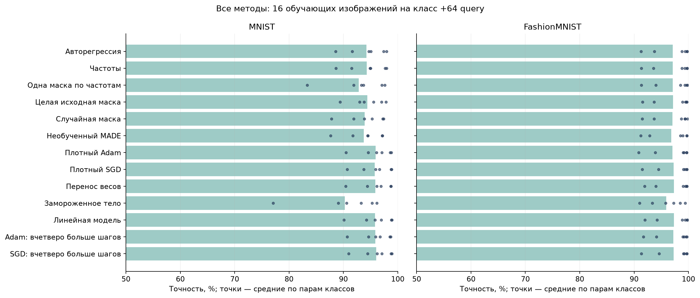
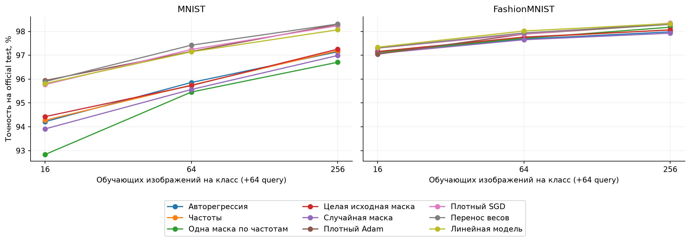
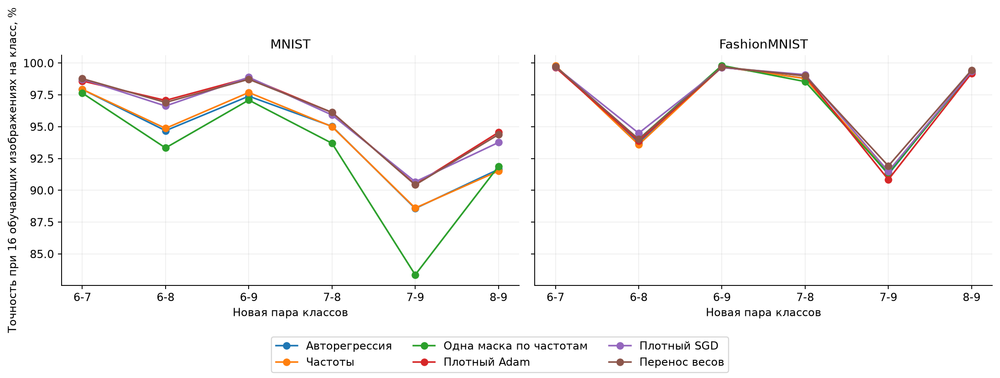
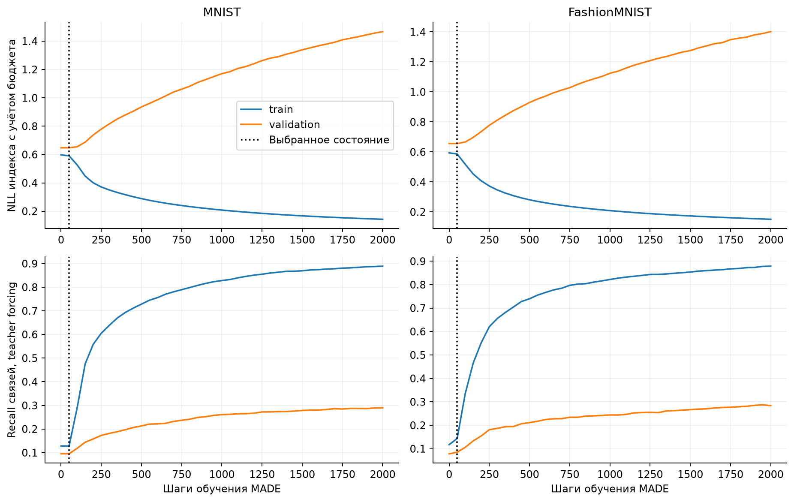
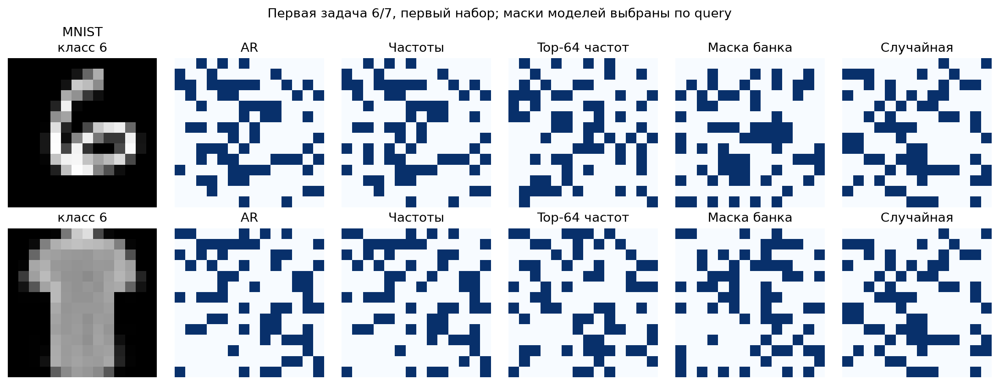
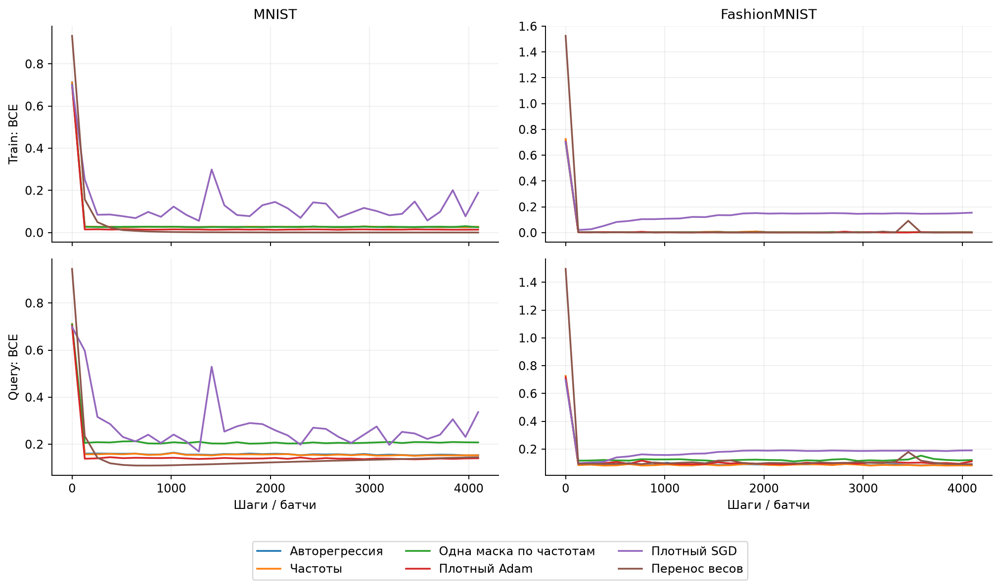
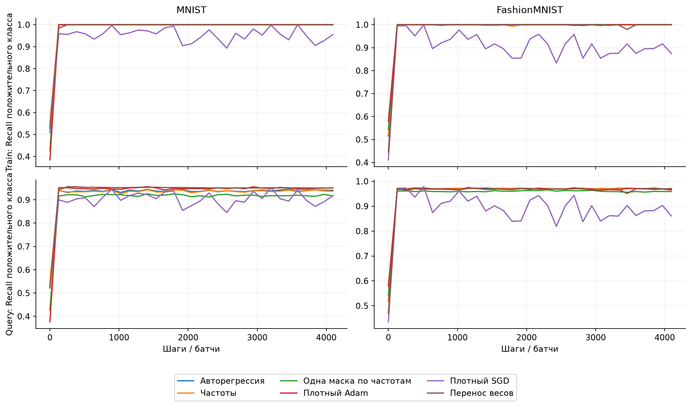

# Авторегрессионный перенос масок на реальных изображениях

**Устойчивого преимущества метода в этой серии не получили.** AR уступил плотному SGD по средней test-точности во всех шести сочетаниях датасета и размера обучения. Частоты и случайные маски дают близкое к AR качество. Это отрицательный результат для данного банка и варианта масок, а не доказательство невозможности структурного переноса.

Проверили основной авторегрессионный генератор на MNIST и Fashion-MNIST. На входе одно реальное изображение с исходной меткой, уменьшенное до 14×14. Отвлекающих картинок и скрытой перестановки нет. Задача бинарная: различить выбранные два класса. Исходные классы — 0–5, новые — 6–9.

## Что и как переносили

Индексатор выбирает 64 из 196 входов. После фиксации маски заново обучается MLP 64→16→1. Все ненулевые коэффициенты независимы: это проверка масок, частного случая индексатора, а не переноса равенств ненулевых весов. У модели 1057 активных параметров; у плотной MLP — 3169.

Обозначим маску через m, а список включённых входов через S. Модель задаётся формулами:

$$
\begin{aligned}
m&\in\{0,1\}^{196},\quad \sum_i m_i=64,\quad S=\{i:m_i=1\},\\
f(x)&=a^\top\operatorname{ReLU}(C^\top x_S+b)+o,\quad C\in\mathbb R^{64\times16},\quad a,b\in\mathbb R^{16}.
\end{aligned}
$$

Маска фиксируется, а C, a, b и o обучаются по бинарной кросс-энтропии; положительный логит означает второй класс пары. У каждого активного веса C собственное численное значение.

В прежнем исходном банке каждого датасета было 832 маски. Каждую заново проверили при двух скоростях обучения, по четыре старта численных весов и 2048 шагов: всего восемь обучений на маску. Оставили лучшие 75% внутри исходной задачи и роли ветви поиска: 624 маски, из них 312 для обучения, по 156 для выбора генератора и аудита. Порог почти идеальной точности не требовался.

MADE получает только маски. Порядок позиций случайный и фиксирован заранее. Известен только бюджет 64: при декодировании оставшиеся биты принудительно задаются, когда бюджет исчерпан или нужны все оставшиеся позиции. Это же ограничение применяется к частотам. Корреляции пикселей, координатная геометрия и функциональная полезность входов не используются.

Численные параметры, температура и генератор выбирались на исходных данных. Отложенные исходные пары — 0/5 и 2/3. Все настройки заморожены до создания целевых случаев. На новой задаче — восемь стартов по 4096 шагов; состояние и старт выбираются по query BCE. Для Adam/SGD при малом support дополнительно проверен четырёхкратный бюджет.

## Основная таблица

В каждой ячейке — средняя test-точность по шести новым парам классов и восьми наборам обучения на пару. На класс дополнительно доступны 64 query-изображения для выбора, test содержит 512 изображений из официальной тестовой части. Поэтому 16 support на класс не означает только 16 доступных размеченных изображений.

| Метод | MNIST: 16 | 64 | 256 | Fashion: 16 | 64 | 256 |
| :-- | --: | --: | --: | --: | --: | --: |
| Авторегрессия | 94.21% | 95.86% | 97.15% | 97.11% | 97.68% | 97.98% |
| Частоты | 94.27% | 95.75% | 97.19% | 97.10% | 97.74% | 98.07% |
| Одна маска по частотам | 92.84% | 95.46% | 96.71% | 97.12% | 97.71% | 98.18% |
| Целая исходная маска | 94.43% | 95.73% | 97.26% | 97.16% | 97.76% | 98.06% |
| Случайная маска | 93.91% | 95.56% | 96.99% | 97.07% | 97.65% | 97.92% |
| Необученный MADE | 93.78% | 95.35% | 96.93% | 96.82% | 97.45% | 97.98% |
| Плотный Adam | 95.94% | 97.16% | 98.30% | 97.04% | 97.89% | 98.30% |
| Плотный SGD | 95.77% | 97.24% | 98.24% | 97.30% | 97.89% | 98.35% |
| Перенос весов | 95.89% | 97.42% | 98.31% | 97.31% | 97.93% | 98.30% |
| Замороженное тело | 90.25% | 93.93% | 94.97% | 95.89% | 96.75% | 97.26% |
| Линейная модель | 95.82% | 97.14% | 98.07% | 97.34% | 98.02% | 98.33% |
| Adam: вчетверо больше шагов | 95.87% | — | — | 97.22% | — | — |
| SGD: вчетверо больше шагов | 96.06% | — | — | 97.26% | — | — |

## Предварительно выбранное основное сравнение

Fashion-MNIST, 16 обучающих изображений на класс: AR против «Adam: вчетверо больше шагов», выбранного по исходной калибровке. Разница AR − конкурент: **-0.11 п.п.** По шести парам: +0.22; -0.39; -0.04; -0.16; -0.48; +0.18 п.п.

Описательный bootstrap пересэмплирует пары, затем наборы внутри пары. Его 95% интервал: [-0.57; 0.29] п.п. Пары разделяют четыре класса и конечные тестовые изображения. Это один исходный банк на датасет, а не 48 независимых семейств и не проверка устойчивости между банками.

## Что выучил генератор

**MNIST:** ширина 128, выбран шаг 50. NLL на отложенных исходных масках: AR 0.6446, частоты 0.6447.

**FashionMNIST:** ширина 128, выбран шаг 50. NLL на отложенных исходных масках: AR 0.6495, частоты 0.6500.

Оба генератора выбрали раннее состояние, шаг 50 из 2000. NLL улучшилась слабо, а затем заметно росла на validation при снижении train NLL. Близость частот и AR не подтверждает полезного обучения сложных зависимостей. Consensus отдельно выбирает 64 наиболее частых входа; это другой способ декодирования, чем последовательное сэмплирование с бюджетом.

## Примеры структур и обучение чисел

Аналитического правильного индексатора у этих изображений нет. Ниже реальные маски выбранных моделей на первой фиксированной задаче 6/7. Изображение показано для объяснения; оно не использовалось для выбора примера или маски по test.

Кривые ниже усреднены по выбранным по query стартам всех 48 случаев. Train измеряется на текущем батче, query — на полной отложенной выборке. Продолжение кривой после лучшего состояния показывает дальнейшее обучение, а не состояние возвращённой модели.

Контроли: частоты из того же банка; одна top-64 маска; целая исходная маска; равномерная случайная маска; необученный MADE; плотные Adam/SGD; линейная модель; градиентное предобучение на том же союзе исходных изображений с дальнейшим обучением всех весов либо только новой головы. Ненулевые веса всех масочных методов обучаются заново.

Это новая оценка авторегрессионного подхода на ранее изучавшихся датасетах. Совпадают целевые бюджеты обновлений, но стоимость исходного сбора, число параметров и FLOPs различны. Группировка входов и эталонная маска не сообщаются. Протокол, индивидуальные метрики, source-банк, выбранные численные состояния, кривые, конфигурации и аудит неизменности источников сохранены в `experiments/real_image_ar/results/v1/`. Команды: `experiments/real_image_ar/README.md`.

Плотность 64/196 зафиксирована по семейству готового банка; другие бюджеты масок в этой серии не подбирались. Результат ограничен данным банком и отбором входов. Для оценки подхода с повторениями ненулевых весов нужен другой эксперимент.
Калибровочные истории в компактном архиве усреднены по конфигурациям (`*_history_by_config.json.gz`), итоговые метрики всех стартов сохранены. Калибровочные списки входов восстанавливаются как `selected_inputs_unique[selected_inputs_inverse].astype('int64')`. Целевые истории и выбранные входы сохранены полностью.

Дополнительные исходные кривые: [аудит масок](../../experiments/real_image_ar/figures/v1/bank_audit_training.png), [градиентное предобучение](../../experiments/real_image_ar/figures/v1/pretraining.png). Аудит усреднён по всем исходным стартам и двум скоростям; предобучение показывает конфигурацию и старт, выбранные по исходной validation.
