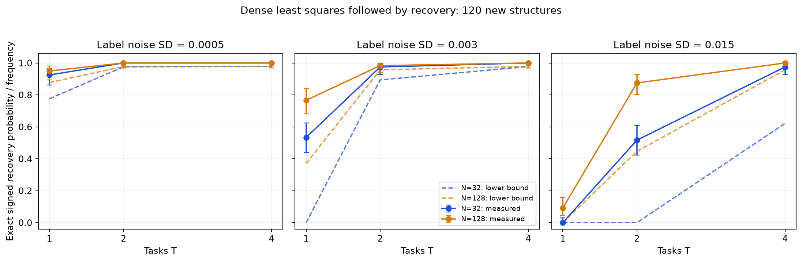
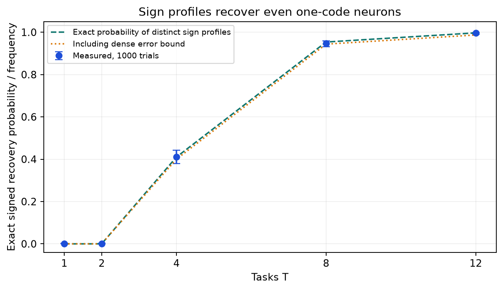
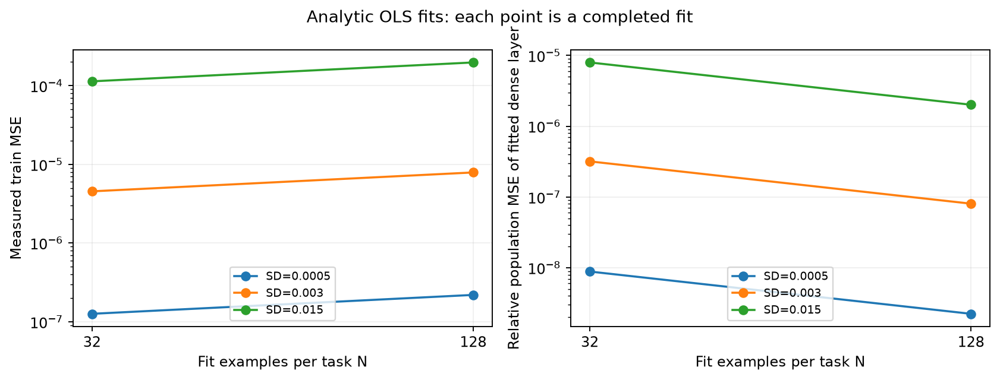

# Dense recovery: finite-sample probability study

15 November 2026. Fixed CPU study; outputs frozen before structural
audit. Dense layers were fitted from finite noisy labels by full OLS.
All columns are labelled; hidden-neuron alignment is not estimated.

## Magnitude recovery

120 independent signed structures, 16 inputs, 8 neurons, 4 codes,
12 active positions per neuron with iid uniform group labels.
Code logs are iid uniform on [-0.5,0.5]; neuron log-scales are
uniform on [-0.25,0.25]. Signs of assignments are fixed across tasks.
N, T and noise settings are paired across the same structures.
The algorithm uses known distributional bounds and its prescribed
error tolerance; true weights do not set the threshold.

This is a low-noise control. Median noise SD / signal RMS is 0.01%,
0.08% and 0.40% for the three noise levels. These numbers do not
represent high-noise neural-network learning.

| N | Noise SD | T | Exact / 120 | Frequency | Proven lower bound |
|---:|---:|---:|---:|---:|---:|
| 32 | 0.0005 | 1 | 111 | 92.50% | 77.59% |
| 32 | 0.0005 | 2 | 120 | 100.00% | 97.59% |
| 32 | 0.0005 | 4 | 120 | 100.00% | 97.83% |
| 32 | 0.003 | 1 | 64 | 53.33% | 0.00% |
| 32 | 0.003 | 2 | 117 | 97.50% | 89.39% |
| 32 | 0.003 | 4 | 120 | 100.00% | 97.77% |
| 32 | 0.015 | 1 | 0 | 0.00% | 0.00% |
| 32 | 0.015 | 2 | 62 | 51.67% | 0.00% |
| 32 | 0.015 | 4 | 117 | 97.50% | 62.16% |
| 128 | 0.0005 | 1 | 114 | 95.00% | 87.71% |
| 128 | 0.0005 | 2 | 120 | 100.00% | 97.77% |
| 128 | 0.0005 | 4 | 120 | 100.00% | 97.83% |
| 128 | 0.003 | 1 | 92 | 76.67% | 37.05% |
| 128 | 0.003 | 2 | 118 | 98.33% | 95.72% |
| 128 | 0.003 | 4 | 120 | 100.00% | 97.82% |
| 128 | 0.015 | 1 | 11 | 9.17% | 0.00% |
| 128 | 0.015 | 2 | 105 | 87.50% | 44.65% |
| 128 | 0.015 | 4 | 120 | 100.00% | 95.66% |

## Sign profiles

1000 independent replicates, 8 inputs and 8 neurons, one active
position per neuron. Each of four groups appears in two neurons.
There are no informative within-neuron magnitude ratios.
Each task has independent balanced code signs, N=32, noise SD=0.003.

| T | Exact / 1000 | Frequency | Distinct profiles | With dense bound |
|---:|---:|---:|---:|---:|
| 1 | 0 | 0.00% | 0.00% | 0.00% |
| 2 | 0 | 0.00% | 0.00% | 0.00% |
| 4 | 411 | 41.10% | 41.02% | 40.02% |
| 8 | 947 | 94.70% | 95.38% | 94.38% |
| 12 | 997 | 99.70% | 99.71% | 98.71% |

## Dense fitting and audit

The simultaneous sufficient magnitude events held in 1595 of 2160 evaluated configurations; recovery failed in 0 of those.
There were 0 wrong returned candidates; other non-successes
were inconclusive results. This observation is not a general
certificate for arbitrary inputs.
The stated dense error bound was exceeded in 9 of
7160 evaluated configurations. Configurations are paired
and correlated; this pooled count is descriptive.

Plots use measured fits; OLS has no iterative optimization trace.
Error bars are per-cell exact 95% binomial intervals, not
simultaneous intervals. The theoretical lower bound is conservative.
A zero bound is uninformative, not a prediction of failure.

## Scope and reproducibility

This is a finite-sample linear-model study, not a ReLU training
or transfer experiment. Noise level, code range and scale limits
are known model constants. Exact error bounds for a real neural
dense fit need separate justification.

Source seeds and settings: protocol.json. Inputs: dense_descriptors.npz.
Frozen candidates: predictions_frozen.json / predictions_frozen.npz.
Audit references: references_for_audit.npz. Full results: audit.json.
Tables: summary.csv / summary.json. Executed sources: executed/.
No software tests were created or run.
