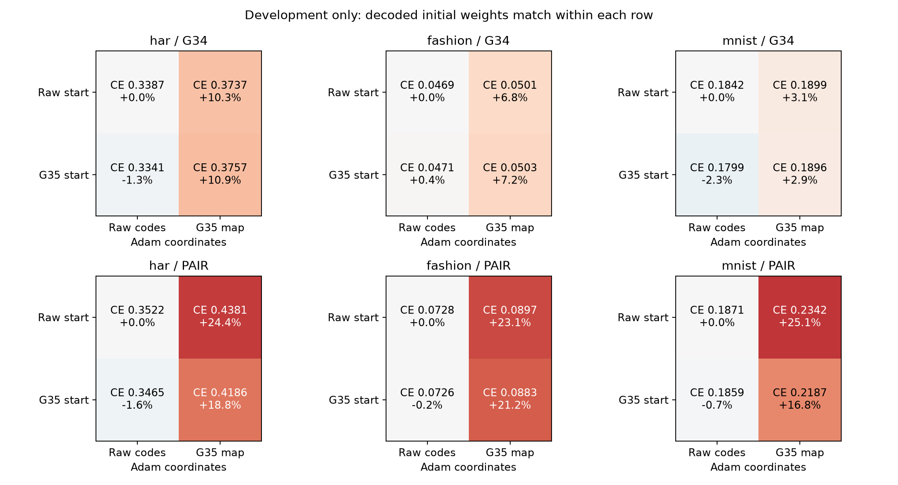

# Почему линейные связи кодов помогли на синтетике и не улучшили G34 на реальных задачах

14 ноября 2026. G34 и Pair остаются основными практическими бейзлайнами. Ниже отделены завершённые результаты от текущих гипотез. Рукопись этой серией не редактировалась.

## Что показал законченный тест

| Метод | HAR, accuracy | Fashion-MNIST, accuracy | MNIST, accuracy |
|---|---:|---:|---:|
| G34 | 84.35% | 96.14% | 92.08% |
| G35 на банке G34 | 83.52% | 95.95% | 91.44% |
| Pair | 83.94% | 95.50% | 91.65% |
| G35 на банке Pair | 84.04% | 95.86% | 91.28% |

Это новые тестовые задачи после фиксации всех параметров. Для изображений использованы192 эпизода, для HAR180 эпизодов от9 людей. Интервалы и парные разности доступны в [сравнении с собственным бейзлайном](../g35_real_2026-11-14/BASELINE_COMPARISON.md). Они условны на прежние source/class/person environments и не измеряют повторное независимое восстановление банка.

G35 на банке G34 уступил по среднему результату во всех трёх условиях. Для банка Pair результаты смешанные: нельзя утверждать, что расширение проиграло Pair везде. Полного общего преимущества G35 на реальных данных не получено.

## В выбранном мягком G35 индексатор вообще не меняется

Во всех трёх случаях G35-G34 выбрал тот же512-кодовый индексатор с положительным изотропным остатком. Все512 коэффициентов первого слоя остаются свободными. При обратимой карте кодов получается то же множество весов:

$$
\{I A z:z\in\mathbb R^m\}=\{I c:c\in\mathbb R^m\}.
$$

Поэтому его проигрыш нельзя объяснить неудачным извлечением нового индексатора или отсутствием нужных весов в этом семействе. Меняются распределение начальных весов и координаты численной адаптации. Этот вывод относится к мягкому полноранговому варианту; строгий маломерный вариант действительно ограничивает семейство.

## Одинаковые начальные веса отделили влияние координат

В отдельной проверке скрещены два начальных распределения и две системы координат Adam. В каждой строке начальные decoded weights, bias и head одинаковые. Все24 условия выполнены в float64; максимальное относительное расхождение начальных весов равно1.34e−13. Сетка learning rate/activity и бюджет2000 обновлений одинаковые, выбор по новой validation с усреднением двух стартов.

| Dataset | Банк | Обычный старт, обычные координаты | Тот же старт, координаты G35 |
|---|---|---:|---:|
| HAR | G34 | 0.33867 | 0.37365 |
| HAR | Pair | 0.35219 | 0.43810 |
| Fashion-MNIST | G34 | 0.04687 | 0.05005 |
| Fashion-MNIST | Pair | 0.07281 | 0.08966 |
| MNIST | G34 | 0.18423 | 0.18993 |
| MNIST | Pair | 0.18714 | 0.23418 |

Числа — validation cross-entropy, меньше лучше. При старте из распределения G35 обычные координаты также лучше координат G35 во всех шести условиях. Это прямое свидетельство вреда данной параметризации для Adam в проверенной сетке и конечном бюджете. Оно не доказывает невозможность подобрать другой решатель. На линейной синтетике использовался замкнутый least-squares решатель, поэтому тот результат не проверял такой же нелинейный процесс адаптации.

Первый float32 контроль и неполная попытка уточнить только обратную карту сохранены в архивах. В двух банках Pair округление мешало более точному сопоставлению стартов; поэтому основной причинный контроль целиком пересчитан в float64. Не смешивать его числа с основным float32 test.

## Число исходных функций важно, но не объясняет всё

В успешной синтетике SVD видел400–800 исходных функций, а на реальных данных —4 для HAR и10 для изображений. Число примеров внутри каждой функции этого различия не устраняет.

Мы сохранили хороший синтетический индексатор,200 примеров на функцию и уменьшили только число функций для SVD. По восемь фиксированных подмножеств для каждого неполного размера, общий новый набор500 задач. Размер карты взят из прежнего зафиксированного выбора и ограничен числом доступных функций.

| Семейство | 4 функции | 10 функций | 20 функций | Тот же I, свободные коды |
|---|---:|---:|---:|---:|
| r=2, шесть коэффициентов | 0.44836 | около1.4e−15 | около1.4e−15 | 1.20084 |
| r=5, пятнадцать коэффициентов | 0.53710 | 0.21013 | около9.3e−16 | 0.61946 |

Числа — MSE с одним support. Мало функций мешает восстановить всё подпространство. Но даже четыре функции ещё дают выигрыш над свободными кодами того же I в этой синтетике. Значит, недостаток функций не является единственным объяснением отрицательного эффекта на реальных данных. Сам I в этой абляции получен по полному прежнему source-набору; это не end-to-end оценка восстановления из четырёх функций.

## Ковариация весов не обязана быть устойчивой структурой функции

На реальных source-задачах сохранены четыре хорошо обученных численных решения каждого фиксированного индексатора. Их веса после нормировки общей нормы заметно различаются. Среднее совпадение двух главных SVD-направлений с лучшим решением составляет0.13/0.11/0.34 для G34 на HAR/Fashion/MNIST. Внутризадачная вариация параметров составляет примерно65–77% суммы измеренной внутри- и межзадачной вариации.

Это измеренная нестабильность параметров при разных численных стартах/настройках, а не доказательство единственной причины вроде ReLU-масштабов. Но она показывает, почему ковариацию нескольких найденных weight vectors нельзя автоматически считать устойчивыми отношениями между кодами.

Диагностика масштаба также не подтверждает необходимость сильных корреляций. Например, на новой Fashion-validation у Pair нормировка энергии групп без обученных корреляций даёт CE0.06115 против0.07547 исходного Pair и0.07754 прежнего G35. На других данных эффект нормировки другой. Слабое смешивание с source covariance иногда улучшает validation, но это большая диагностическая сетка; независимого test-подтверждения этих новых вариантов нет.

## Как это связано с теорией извлечения из dense

Теоретические критерии относятся к информативным, сопоставленным весовым представлениям с контролируемой ошибкой. Сходимость ошибки функции не обеспечивает это условие. При20 примерах и70 входах dense OLS имеет неопределённый компонент даже без шума. При абсолютном шуме близкие к нулю веса особенно неудобны для логарифмов; нужны наблюдаемость и зазор, а не только малый fitting loss.

Для r=2/r=5 точный индексатор содержит204 одиночные активные группы и общую маску. Он не кодирует непрерывные связи через6/15 параметров. Его code co-occurrence graph состоит из68 компонент, поэтому3-связная теорема статьи напрямую не применяется. Более точное извлечение I и более точное обучение новой функции — разные результаты; оба следует измерять.

Зарегистрированный [шумовой эксперимент](../noisy_index_recovery_2026-11-14/PROTOCOL.md) завершён:96 условий над raw dense-дескрипторами и90 парных повторов с masked source refit. При r1/n20 без шума refit устраняет сбой отдельного проекционного шага и у G34, и у Pair. При r2/r5, n80/200 правильный I присутствует в204-кодовом срезе обоих банков во всех основных условиях; простой fixed-scale профильный контроль при шуме бывает хуже. Это oracle-budget структурный аудит. [Полная парная таблица](../noisy_index_recovery_2026-11-14/MASKED_REFIT_REPORT.md) и интерпретация лежат отдельно.

Также завершён [отдельный перенос](../noisy_index_transfer_2026-11-15/INTERPRETATION.md) на24 условиях после выбора m/d/ridge по другим source-функциям. На новых256 задачах на r при observation noise.1 и n200 G34/Pair r5 выбирают правильный I204, но с1support получают MSE.6542, как oracleI. При5support их ошибка практически нулевая. Code-SVD даёт.0001625 при1support, но оставляет.0001243 при5support. Значит, польза непрерывных связей пережила этот source noise; она зависит от числа наблюдений новой задачи и не равна успешному извлечению I или полезному изменению координат Adam на реальных данных.
