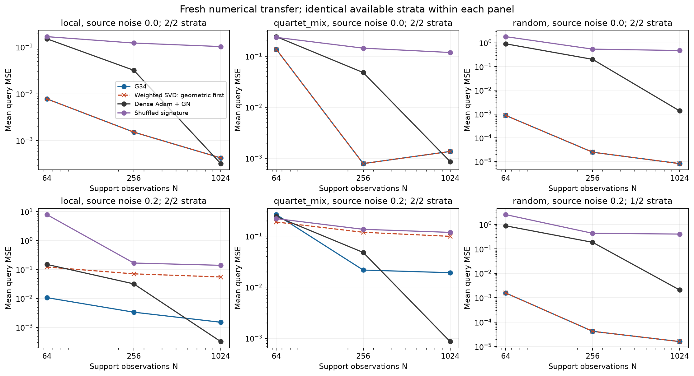
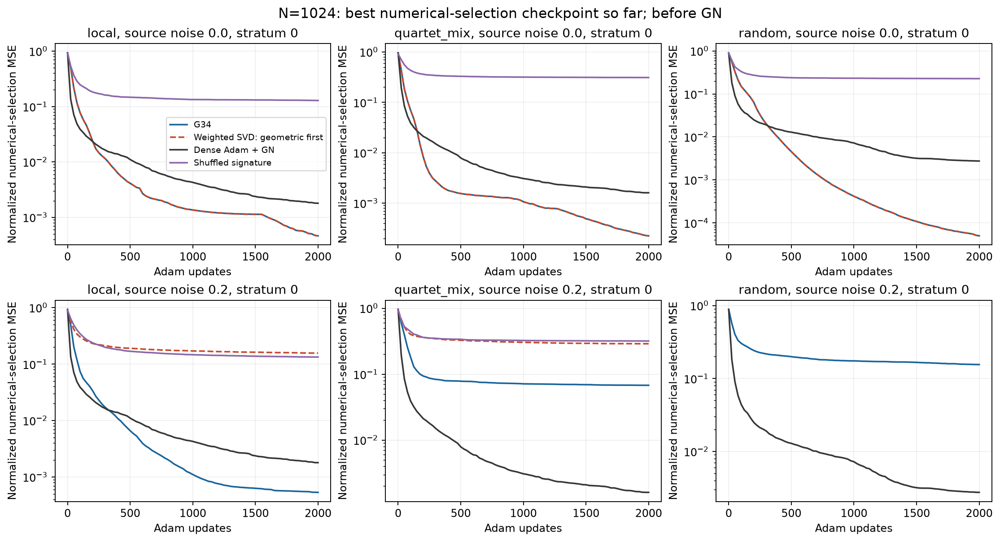
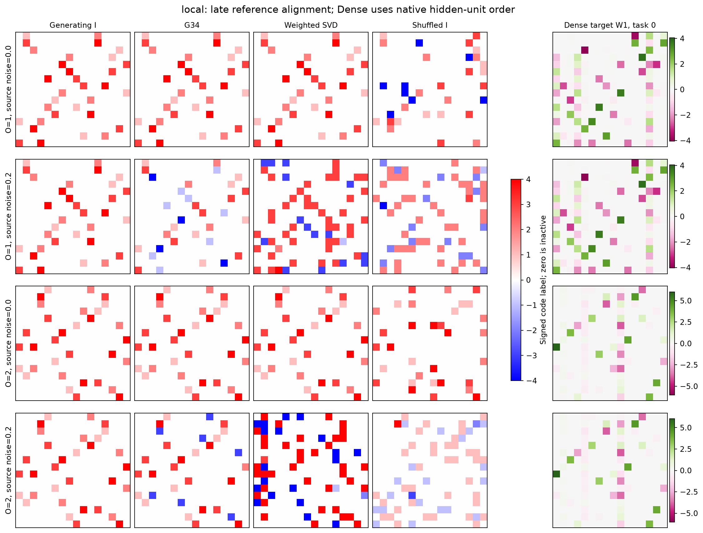
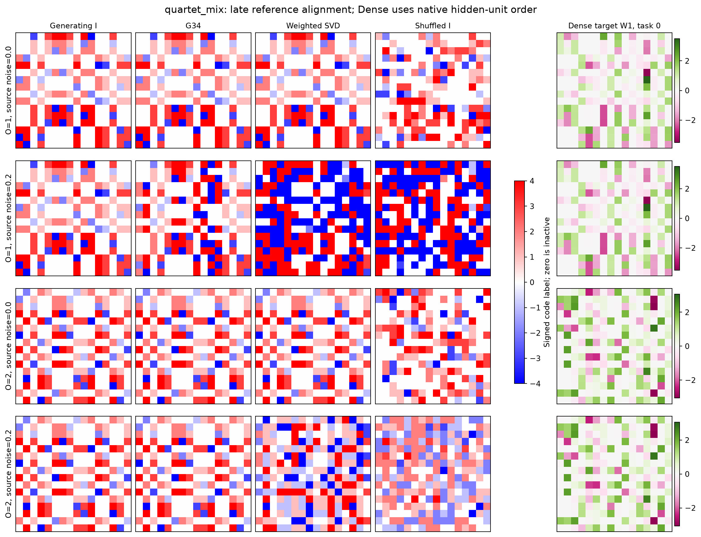
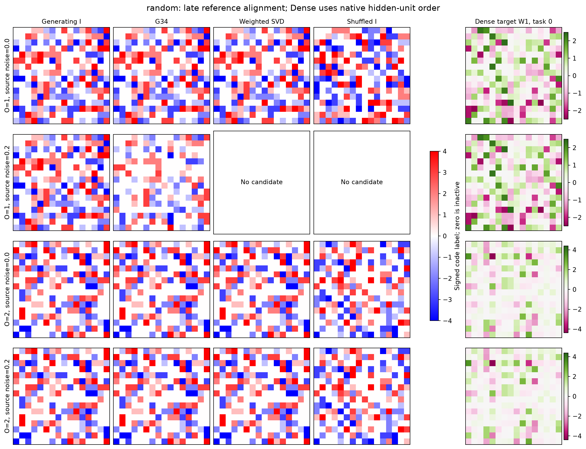

# Общая синтетика: результат проверки взвешенных сигнатур

Проверен именно первый геометрический кандидат взвешенной SVD.
На чистых исходных данных он восстанавливает все шесть истинных
структур и совпадает с G34. При исходном шуме 0,2 он менее устойчив:
ошибки на local и quartet_mix заметно выше, в одном random-условии
полное разбиение не построено.

Использованы прежние шесть структурных семейств и сохранённые source-модели,
но 48 новых численных функций. Это продолжение на известных source-семействах,
а не независимая подтверждающая серия. Каждый новый кодбук, bias, выходная
матрица и offset обучались заново. Все методы получили одинаковые 18 стартов
Adam/2000 обновлений и четыре GN-старта/48 обновлений. N=1024 означает
1024 обучающих и ещё 256 отдельных numerical-selection наблюдений.

## Ошибка переноса при N=1024

MSE ниже — лучше. Шум относится к source; target-ответы чистые.
Средние ниже охватывают обе страты каждого семейства, по восемь функций
на страту. Пропуск не подменён значением по одной успешной страте.

| Семейство | Source σ | G34 | Взвешенные сигнатуры | Dense Adam + GN |
|---|---:|---:|---:|---:|
| local | 0 | 0,000428 | 0,000428 | 0,000324 |
| quartet_mix | 0 | 0,001362 | 0,001362 | 0,000863 |
| random | 0 | 0,00000820 | 0,00000820 | 0,001365 |
| local | 0,2 | 0,001505 | 0,055168 | 0,000324 |
| quartet_mix | 0,2 | 0,019202 | 0,098714 | 0,000863 |
| random | 0,2 | 0,191809 | нет кандидата в 1/2 страт | 0,001365 |

В доступной шумной random-страте оба структурных метода нашли истинный I:
их MSE совпадает, 0,00001596, против Dense 0,002082. Во второй страте
сигнатуры не построились; G34 имеет MSE 0,383602, Dense — 0,000648.
Только первая страта входит в сопоставленную строку random в REPORT.md
и matched_primary.csv. Средние по обеим стратам — full_primary.csv.

## Что работает

- Без исходного шума точный signed I получен в 6/6 случаях у обоих методов.
  Канонические структуры совпадают; одна численная подгонка переиспользуется,
  поэтому равенство предсказаний здесь ожидаемо.
- При N=64 и N=256 чистые сигнатуры/G34 имеют меньшую среднюю MSE, чем Dense,
  на каждой из трёх геометрий. Это результат конкретного численного бюджета,
  не общая теорема о числе примеров.
- При N=1024 random остаётся существенно лучше Dense. На local и quartet_mix
  средний Dense MSE ниже даже при истинном структурном I. У двухвыходных
  target-задач остаётся ненулевой numerical-selection loss после GN;
  правильная структура сама по себе не обеспечивает удачную конечную подгонку.
- Все доступные сигнатурные структуры по среднему лучше перемешивания
  в соответствующих условиях при N=1024; этот контроль сохраняет общие
  частоты связей и signed-кодов, но не разделяет вклад маски и sharing.

## Что ломается при шуме

По отношению к G34 сигнатурный MSE на local выше примерно в 36,6 раза,
на quartet_mix — в 5,14 раза. Четыре доступных ошибочных сигнатурных
структуры одновременно имеют неправильную маску. В трёх из них видно
почти полное объединение кодов:

| Условие | Истинных связей | Найдено | Размеры четырёх групп |
|---|---:|---:|---|
| local, case_00, σ=0,2 | 32 | 61 | 1, 1, 58, 1 |
| local, case_01, σ=0,2 | 32 | 60 | 1, 1, 1, 57 |
| quartet_mix, case_02, σ=0,2 | 128 | 190 | 1, 2, 4, 183 |
| quartet_mix, case_03, σ=0,2 | 128 | 202 | 112, 8, 8, 74 |

Это наблюдаемые ошибки выбранных разбиений. Отдельные причинные вклады
маски, оценки пространства, порога и сопоставления нейронов не измерялись.
Перебора других кандидатов после открытия target-ответов не было.

С учётом всех 12 условий G34 восстанавливает signed I в 8/12,
сигнатуры — в 7/12, включая один отказ построения. Для сигнатур это
6/6 чистых и 1/6 шумных условий. Найденные кандидаты: 11/12.

## Оценка

Геометрическая конструкция работает на достаточно качественных исходных
решениях и передаёт полезный индексатор. Текущий шумный вариант пока не
подтверждает более устойчивого извлечения, чем G34. Практический приоритет —
обнаруживать неверные маски и чрезмерное объединение до переноса;
преимущество такого критерия потребует отдельной проверки на новых данных.
Основной метод остаётся G34.

Все 30 уникальных подгонок завершены, 30 receipts без нарушений.
Предсказания зафиксированы до открытия итоговых ответов. GPU освобождены.
Исторические результаты и рукопись не изменялись. После уборки 12 ноября
сохранены выбранные численные состояния всех подгонок в `states/`,
кривые N=1024 в `curves/`, предсказания, ответы для аудита, CSV и снимки кода.
Тяжёлый исходный рабочий каталог удалён. После scoring исправлена
только подача рисунков: короткие заголовки, поля и белый нулевой цвет;
это отмечено в presentation_amendment.json.

Численные детали: [REPORT.md](REPORT.md), [summary.json](summary.json),
[transfer_per_task.csv](transfer_per_task.csv),
[structure_diagnostics.json](structure_diagnostics.json).

