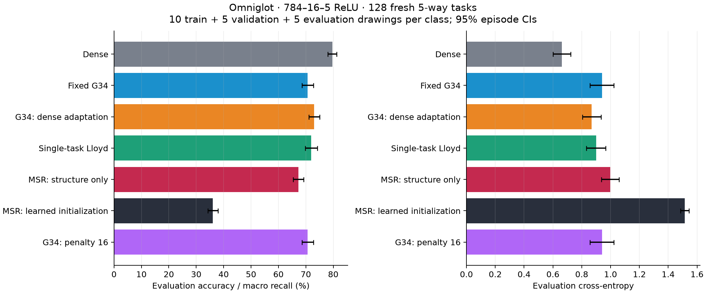
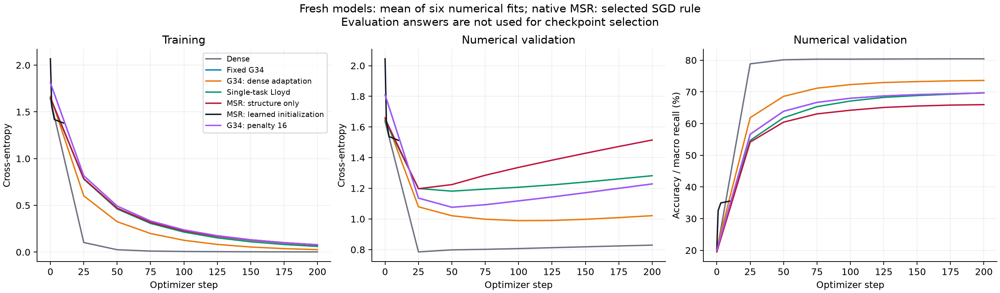

# Omniglot: dense-first adaptation with a discrete prior

15 November 2026. Fresh 128-task cohort, conditional on the retained source ensemble.

784–16–5 ReLU; five distinct characters per task, each with 10 fitting, 5 numerical-validation and 5 evaluation drawings. No query augmentation. This differs from the earlier augmented 5-shot cohort and from the native MSR CNN benchmark.

| Method | Accuracy, % (95% CI) | CE | Codes | Train accuracy, % | Validation accuracy, % |
|---|---:|---:|---:|---:|---:|
| Dense | 79.66 ± 1.60 | 0.6611 | 12544 | 99.88 | 82.47 |
| Fixed G34 | 70.69 ± 2.04 | 0.9403 | 256 | 97.28 | 77.19 |
| G34: dense adaptation | 73.03 ± 1.97 | 0.8696 | 256 | 99.53 | 79.91 |
| G34: selected penalty 0 | 73.03 ± 1.97 | 0.8696 | 256 | 99.53 | 79.91 |
| Single-task Lloyd | 72.00 ± 2.24 | 0.8996 | 64 | 98.58 | 77.00 |
| MSR: structure only | 67.31 ± 1.88 | 0.9979 | 64 | 95.42 | 72.78 |
| MSR: learned initialization | 36.06 ± 1.86 | 1.5150 | 8 | 40.98 | 35.56 |
| G34: penalty 16 | 70.69 ± 2.04 | 0.9403 | 256 | 97.28 | 77.19 |

## Global development choices

Selected common indexator: `source_full_m256`.
Ordinary adaptation: {'name': 'adapt_l0_d1', 'penalty': 0.0, 'depth': 1, 'ce': 0.8832414150238037, 'changes': 0.9932172087585034}; prior adaptation: {'name': 'adapt_l0_d1', 'penalty': 0.0, 'depth': 1, 'ce': 0.8832414150238037, 'changes': 0.9932172087585034}.
Single-task code budget: 64.
Strictly positive penalty control: {'name': 'adapt_l16_d1', 'penalty': 16.0, 'depth': 1, 'ce': 0.9086804389953613, 'changes': 0.0}.
Retained native MSR adaptation rule: {'steps': 10, 'multiplier': 0.5, 'ce': 1.4943619966506958}.

The common structure and budget were selected first; the penalty is compared on that same structure. The unshared 12544-weight control was also evaluated on development. The MSR structure-only row transfers its retained continuous basis with fresh numerical fitting. The separate learned-initialization row retains its 8-dimensional basis, source numerical initialization and learned signed per-group SGD rates; development selects a rate multiplier and step count. Both are retained MLP controls, not a new reproduction of the native CNN benchmark.

## Paired comparisons

Fixed G34 minus prior: -2.34 pp, 95% CI [-4.44, -0.25].
G34: dense adaptation minus prior: +0.00 pp, 95% CI [+0.00, +0.00].

The two main adaptation policies include a depth-zero candidate. A separate control selects among strictly positive penalties. The selected-penalty policy chose zero, so its predictions equal ordinary adaptation; the duplicate is omitted from plots. Fresh numerical parameters are fitted for all structure-only methods using the same 50 fitting and 25 validation labels per task. The native MSR control instead uses its learned initialization and the development-selected SGD rule.

Intervals summarize sampled episodes on one retained source ensemble. They do not measure uncertainty across independently learned source banks. There is no known true Omniglot indexator: assignment changes are not structural recovery accuracy. Additional source proposals use a smaller finite source search than the original retained 64-code models.

