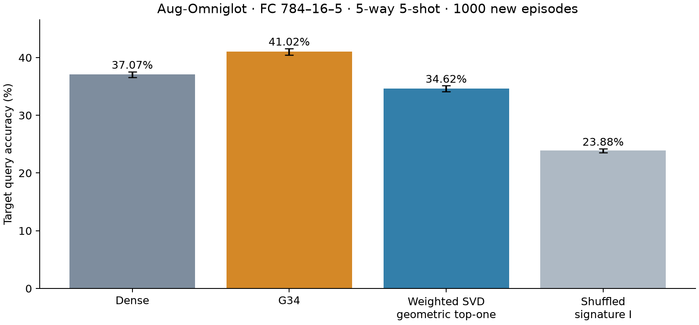

# Weighted SVD: first geometric candidate on Aug-Omniglot

The signature structure for each budget was selected only by the frozen geometric score. No source-functional reranking was used. Disjoint development tasks selected the code budget and one common support-only numerical adaptation rule. All target predictions were frozen before opening the new episode answers.

## Comparison

| Method | Accuracy (95% CI) | Cross-entropy | First-layer free values | All task parameters | Active edges |
|---|---:|---:|---:|---:|---:|
| Dense | 37.07% [36.57, 37.58] | 1.5302 | 12544 | 12645 | 12544 |
| G34 | 41.02% [40.44, 41.59] | 1.4288 | 64 | 165 | 4305 |
| Weighted SVD: geometric top-one | 34.62% [34.10, 35.15] | 1.5040 | 16 | 117 | 475 |
| Shuffled signature structure | 23.88% [23.52, 24.24] | 1.5993 | 16 | 117 | 475 |

## Paired differences

- Signature − Dense: -2.449 percentage points; 95% CI [-3.099, -1.800].
- Signature − G34: -6.393 percentage points; 95% CI [-7.062, -5.725].
- Signature − Shuffled signature structure: +10.744 percentage points; 95% CI [+10.159, +11.329].

## Scope and diagnostics

- Same fully connected architecture and query-only augmentation as the historical comparison; no pretrained encoder.
- Source panels reproduce their historical SHA-256 commitments; development uses the historical generator and seed. Dense models and G34 were rerun; final target episodes use a new seed on the same test class split.
- One source cohort, 128 source tasks, 128 development tasks; confidence intervals measure episode variation, not independent source retraining.
- Completed rank jobs: 512; complete unsigned partitions: 7. Missing code budgets were not filled by forced clustering.
- Access receipts: 16; violations: 0.
- There is no known true neural grouping on Omniglot. Predictive transfer cannot establish exact structural recovery.

