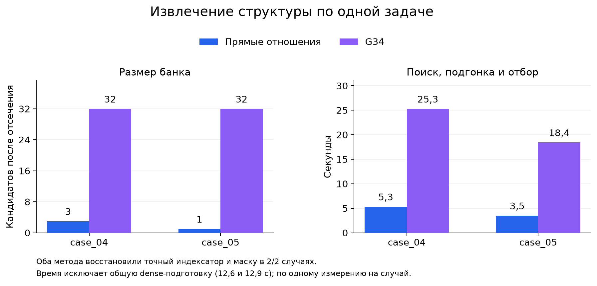
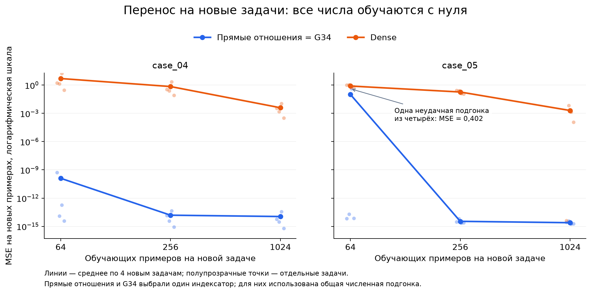
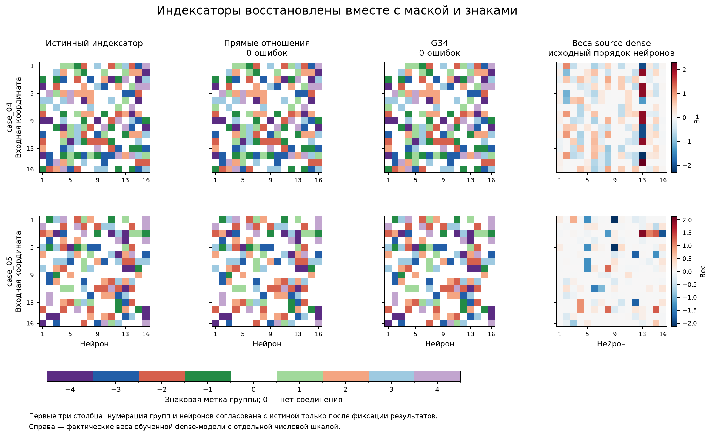

# Графики восстановления по одной задаче

Графики построены по зафиксированным результатам; обучение и выбор моделей не повторялись.

## Размер банка и время поиска с source-отбором

[PDF](bank_and_time.pdf)

## Перенос: средние и отдельные новые задачи

[PDF](transfer_mse.pdf)

## Истинные и восстановленные индексаторы

[PDF](recovered_indexators.pdf)
