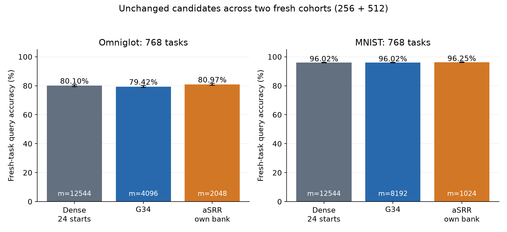
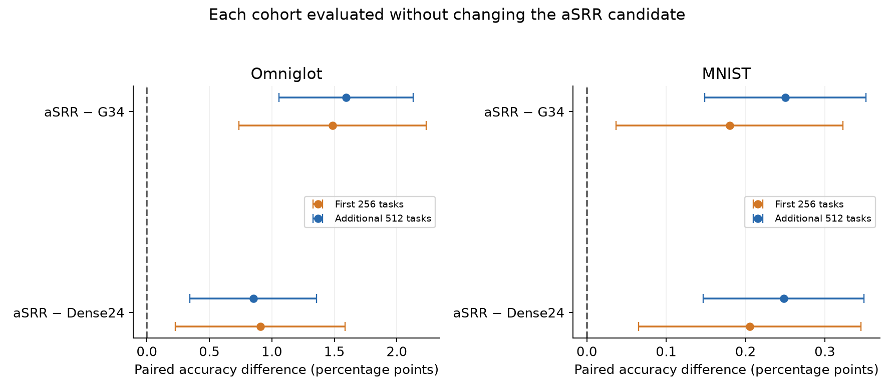
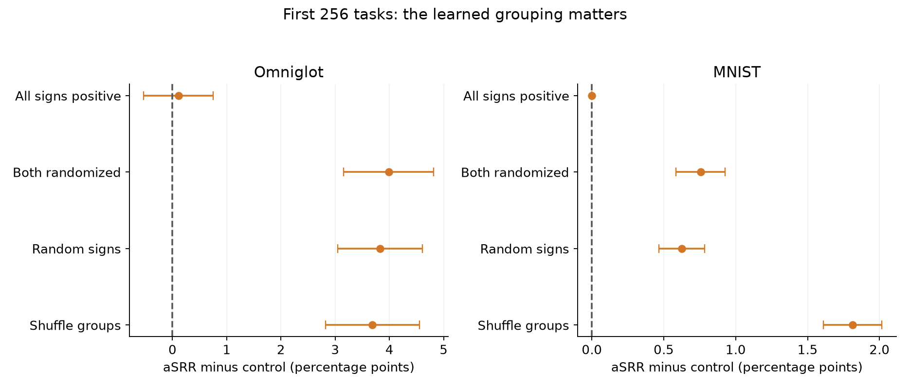
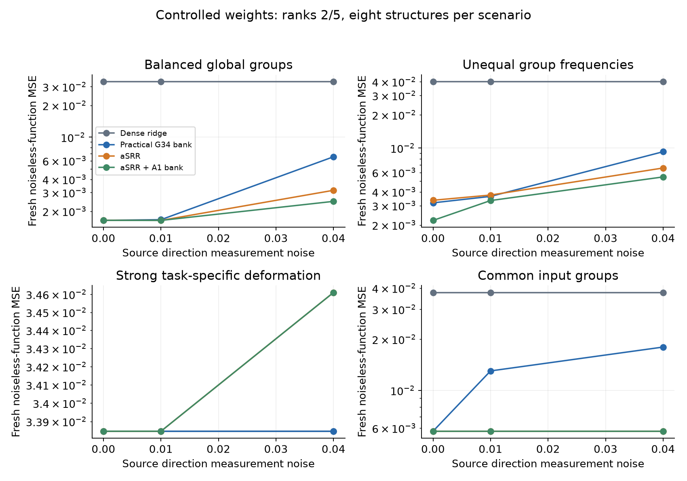

# Приближённый SRR: теория, синтетика и свежий перенос

15 ноября 2026. Рабочее название — **aSRR** (approximate Sign–Ratio Recovery). Рукопись не менялась.

**Результат:** заранее выбранные aSRR-кандидаты обошли Dense и практический G34 по accuracy и CE на Omniglot и MNIST. Выигрыш подтвердился отдельно на 256 и 512 новых задачах каждого датасета. Основное изменение — приближённые локальные группы вместо требования полного точного восстановления; число кодов выбирается на development. Дополнительный выбор более простой структуры улучшил accuracy, но на Omniglot его преимущество по CE не установлено.

## Что изменилось

Вместо полного точного восстановления строится иерархия приближённых signed-групп. Сомнительный вес сохраняет отдельный код при большом бюджете; нулевая связь принудительно не вводится. Новый signed-профиль учитывает весь вектор весов по задачам. Локальное семейство объединяет позиции внутри нейрона, сохраняя независимые коды между нейронами; input-семейство изучает общие группы входов с разными кодами в разных нейронах. Обе конструкции проверяются свежим численным обучением.

Основной теоретический вывод: корректное локальное разбиение является уточнением глобального. Пропущенное объединение увеличивает число параметров, но не вносит bias; ложное объединение может его внести. Для линейного Gaussian контроля выведен точный критерий, когда ненулевой bias компенсируется снижением дисперсии. Отдельно доказаны эквивалентность signed-расстояний с фактором sqrt(2), граница ReLU-функции через остаток весов и границы использования selection. [Выводы и доказательства](../../paper/theory/APPROXIMATE_SRR_THEORY_2026-11-15.md).

## Фиксированные кандидаты на двух новых когортах

Первая когорта содержит 256 задач каждого датасета, следующая — 512. Представленные здесь aSRR-кандидаты, m, численные правила и baseline-кандидаты были зафиксированы до первой когорты и между когортами не менялись. Объединённая оценка использует 768 эпизодов; интервалы условны фиксированным source/development данным и классам.

| Датасет | Метод | m | Accuracy, % (95% CI) | Query CE |
|---|---|---:|---:|---:|
| Omniglot | Dense, 24 starts | 12544 | 80.10 ± 0.67 | 0.65500 |
| Omniglot | Dense, 6 starts | 12544 | 79.73 ± 0.71 | 0.65741 |
| Omniglot | G34, включая дополнительное A1-уточнение | 4096 | 79.42 ± 0.66 | 0.66343 |
| Omniglot | aSRR, собственный банк | 2048 | 80.97 ± 0.65 | 0.62589 |
| Omniglot | Общий банк: aSRR + A1 + G34 + Dense | 2048 | 80.97 ± 0.65 | 0.62589 |
| MNIST | Dense, 24 starts | 12544 | 96.02 ± 0.14 | 0.13567 |
| MNIST | Dense, 6 starts | 12544 | 95.96 ± 0.14 | 0.13374 |
| MNIST | G34, включая дополнительное A1-уточнение | 8192 | 96.02 ± 0.14 | 0.13053 |
| MNIST | aSRR, собственный банк | 1024 | 96.25 ± 0.14 | 0.12513 |
| MNIST | Общий банк: aSRR + A1 + G34 + Dense | 8192 | 96.02 ± 0.14 | 0.13053 |

| Парное сравнение | Omniglot, п.п. (95% CI) | MNIST, п.п. (95% CI) |
|---|---:|---:|
| aSRR − Dense, 24 starts | +0.87 ± 0.41 | +0.23 ± 0.08 |
| aSRR − G34, включая дополнительное A1-уточнение | +1.56 ± 0.44 | +0.23 ± 0.08 |

На Omniglot выбран исходный локальный aSRR m2048; на MNIST — исходное input-разбиение m1024. Дополнительная проекция A1 не улучшила их development CE, поэтому исходные семена сохранены. A1 улучшил G34-контроль на MNIST до m8192. Таким образом, исследуется новый банк и инициализация для общего процесса, а не утверждается необходимость каждого шага A1 для выигрыша.

Общий минимизирующий development CE банк выбрал aSRR на Omniglot, но G34 на MNIST. Его MNIST-результат поэтому совпадает с G34. Отдельный aSRR-кандидат — самостоятельная заранее выбранная процедура; его нельзя задним числом выдавать за ответ общего банка.

## Дополнительное правило выбора сложности

После первой test-когорты предложен paired one-SE выбор: допустить модели в пределах одной standard error парной development-разности от минимальной CE, затем выбрать минимальное m. То же правило применено к G34, включая Dense как no-sharing endpoint. Параметр one-SE не подбирался. Это эвристика с отдельной проверкой на 512 новых задачах; первая когорта не является её независимой оценкой.

| Датасет | Правило | Выбранная модель | m | Accuracy, % (95% CI) | CE |
|---|---|---|---:|---:|---:|
| Omniglot | Общий банк, paired one-SE | asrr_input_m512 | 512 | 81.45 ± 0.79 | 0.64129 |
| Omniglot | G34, paired one-SE | g34_refined_m2048 | 2048 | 77.55 ± 0.90 | 0.72353 |
| MNIST | Общий банк, paired one-SE | asrr_input_m1024 | 1024 | 96.28 ± 0.17 | 0.12506 |
| MNIST | G34, paired one-SE | a1_g34_refined_m8192 | 8192 | 96.03 ± 0.17 | 0.12961 |

Эта проверка selection отделена от подтверждения неизменённых исходных кандидатов; новые правила не объединяются ретроспективно с первой когортой.

На второй когорте исходный aSRR с m2048/1024 получил 81.13%/96.28%, Dense с 24 стартами — 80.27%/96.03%, G34 — 79.53%/96.03%. Для paired one-SE общий банк выбрал m512/1024: 81.45%/96.28%. На Omniglot разность CE этого более простого варианта с Dense равна −0.00160 ± 0.02386, с исходным сильным G34 — −0.01503 ± 0.02448 (парные 95% интервалы): преимущество по CE не установлено. Для исходного локального m2048 преимущество над обоими контролями подтверждается по обеим метрикам.

## Что даёт именно извлечённая структура

Контроли первой когорты сохраняют число кодов, размеры групп, их появления в нейронах и шаблон знаков. Случайно меняются только позиции групп; отдельные абляции меняют знаки или оба компонента. Они зафиксированы до открытия test-ответов.

| Датасет | Вариант | Accuracy, % (95% CI) |
|---|---|---:|
| Omniglot | aSRR | 80.67 ± 1.09 |
| Omniglot | Прежний SRR без фильтра | 56.22 ± 1.84 |
| Omniglot | Сохранённый MSR-FC базис | 65.70 ± 1.39 |
| Omniglot | Случайные позиции групп, прежние знаки | 76.98 ± 1.18 |
| Omniglot | Прежние группы, случайные знаки | 76.84 ± 1.20 |
| Omniglot | Случайные группы и знаки | 76.69 ± 1.22 |
| Omniglot | Прежние группы, все знаки положительные | 80.56 ± 1.15 |
| MNIST | aSRR | 96.19 ± 0.25 |
| MNIST | Прежний SRR без фильтра | 90.88 ± 0.40 |
| MNIST | Сохранённый MSR-FC базис | 95.66 ± 0.24 |
| MNIST | Случайные позиции групп, прежние знаки | 94.37 ± 0.32 |
| MNIST | Прежние группы, случайные знаки | 95.56 ± 0.26 |
| MNIST | Случайные группы и знаки | 95.43 ± 0.28 |
| MNIST | Прежние группы, все знаки положительные | 96.19 ± 0.25 |

Случайное перемешивание групп ухудшает качество при тех же бюджетах и сохранённых знаках. На Omniglot выигрыш learned signs относительно всех положительных знаков не установлен; произвольные случайные знаки вредят. На MNIST input-кандидат изначально положительный, поэтому positive-sign контроль совпадает с ним. Это не свидетельство полезности произвольного кодбука или только сокращения числа параметров.

## Контролируемая синтетика

32 независимые структуры, четыре сценария, ранги2/5 и три парных уровня measurement noise дают96 условий. Входы восстановителя — контролируемые noisy dense-направления, а не новые SGD-обучения. G34 здесь — конечный практический full-support банк с четырьмя инициализациями и12 шагами projection на бюджет, не прежний exhaustive native алгоритм. Все методы имеют одинаковую сетку8/16/24/32/64/96 и новые численные функции. Dense получает ту же ridge-сетку, численный выбор на H; структура и m выбираются на отдельных development-функциях.

| Сценарий | Шум | Dense MSE | G34 MSE | aSRR MSE | aSRR+A1 MSE |
|---|---:|---:|---:|---:|---:|
| balanced | 0 | 0.03348 | 0.00164 | 0.00164 | 0.00164 |
| balanced | 0.01 | 0.03348 | 0.00166 | 0.00164 | 0.00164 |
| balanced | 0.04 | 0.03348 | 0.00654 | 0.00315 | 0.00248 |
| unbalanced | 0 | 0.04001 | 0.00318 | 0.00335 | 0.00220 |
| unbalanced | 0.01 | 0.04001 | 0.00363 | 0.00374 | 0.00333 |
| unbalanced | 0.04 | 0.04001 | 0.00925 | 0.00658 | 0.00546 |
| approximate | 0 | 0.03385 | 0.03385 | 0.03385 | 0.03385 |
| approximate | 0.01 | 0.03385 | 0.03385 | 0.03385 | 0.03385 |
| approximate | 0.04 | 0.03385 | 0.03385 | 0.03461 | 0.03461 |
| input_groups | 0 | 0.03768 | 0.00575 | 0.00575 | 0.00575 |
| input_groups | 0.01 | 0.03768 | 0.01302 | 0.00575 | 0.00575 |
| input_groups | 0.04 | 0.03768 | 0.01799 | 0.00575 | 0.00575 |

При сильной индивидуальной деформации sharing не обязан помогать: выбор обычно возвращается к Dense, иногда проигрывает из-за конечной selection-выборки. Это согласуется с bias–variance расчётом. В других сценариях новый банк устойчивее к measurement noise. Эти development-результаты не доказывают превосходства над любым бюджетом полного native G34.

### Восстановление самих групп

При measurement noise 0.04 можно проверить выбранные индексаторы по скрытым истинным группам. Precision — доля предложенных общих пар с правильной группой и относительным знаком; recall — доля истинных общих пар, найденных с правильным знаком. Ни истинный индексатор, ни этот аудит не используются для выбора. В каждой строке средние по восьми независимым структурам (ранги 2 и 5, по четыре структуры). Среднее m может быть нецелым; число кодов выбиралось отдельно для каждой структуры.

| Сценарий | Метод | Среднее m | Signed precision, % | Signed recall, % |
|---|---|---:|---:|---:|
| balanced | Практический G34 | 22 | 91.78 | 51.18 |
| balanced | aSRR | 8 | 92.55 | 93.84 |
| balanced | aSRR+A1, общий банк | 8 | 93.44 | 95.24 |
| unbalanced | Практический G34 | 26 | 94.85 | 40.87 |
| unbalanced | aSRR | 14 | 88.73 | 72.98 |
| unbalanced | aSRR+A1, общий банк | 14 | 91.34 | 74.63 |
| input_groups | Практический G34 | 47 | 83.43 | 52.86 |
| input_groups | aSRR | 24 | 100.00 | 100.00 |
| input_groups | aSRR+A1, общий банк | 24 | 100.00 | 100.00 |

В сбалансированном случае aSRR восстанавливает существенно больше общих пар при сопоставимой precision. При неравномерных группах остаётся компромисс precision/recall; полного доминирования нет. В input-сценарии новое семейство восстанавливает группы точно в этой серии. Для сильной task-specific деформации исходные группы уже не задают точные равенства весов: низкий recall выбранного Dense здесь не означает ошибку выбора.

## Протокол, масштаб и ограничения

Omniglot:784–16–5, пять классов, по10 train+5 numerical validation+5 query изображений на класс. MNIST:784–16–2, по100+50+100 на класс. Source/development/test классы не пересекаются. На MNIST source0–4, development5–6, test-пары7–9; на Omniglot Vinyals1028/172/423. Source dense модели взяты из сохранённых обучений: Omniglot16 лучших H-задач, MNIST10 задач по8000 обучающих изображений. Все численные параметры новых задач обучаются с нуля; реплики source не переносят значения target-кодов.

Согласуются четыре source-реплики; их направления усредняются. Это практическая стабилизация, а не certified оценка одного истинного ReLU-параметра. Структурные семейства и весь диапазон m16–8192 задаются до test; no-sharing endpoint12544 представлен тем же Dense. Кодовые и знаковые gauges канонизируются, чтобы переименование не давало скрытых дополнительных стартов.

Численное обучение: Adam200, LR.003/.01/.03, шесть стартов; checkpoints и старты выбираются только на numerical validation. Дополнительно Dense получает четыре таких пула с выбором по той же H —24 старта. По development основной Dense-контроль выбирает этот вариант. G34 сохраняет исходные банки, их capacity-refinements и дополнительное A1-уточнение на том же source-consensus. Расширение больших m не является полным новым native source-search. Сохранённый MSR-FC — только вторичный basis-only контроль первой когорты; новые MSR source/CNN-запуски не выполнялись.

Локальная конструкция не требует глобальной матрицы расстояний по всем весам: последовательно строятся H иерархий из D позиций. При T source-профилях и фиксированной сетке бюджетов её порядок работы O(H D² T + H D²), память O(D² + DH T). Глобальный вариант требует O((DH)²) памяти; он остаётся исследовательским семейством, а не обязательным этапом для локального варианта. Время конкурентных GPU jobs не является сравнением скорости методов.

Все среды классов уже изучались раньше; новые эпизоды дают условное подтверждение на этих средах, а не утверждение о любых датасетах. Пересечения исходных изображений между эпизодами возможны. Exact recovery на реальных данных неизвестен. Линейная теорема не даёт безусловной гарантии для ReLU; новое численное обучение и перенос проверены экспериментально.

## Файлы

Теория: APPROXIMATE_SRR_THEORY_2026-11-15.md. Код: experiments/srr_approx_v1. Контролируемые опыты: artifacts/srr_approx_synthetic_2026-11-15. Реальные данные: artifacts/srr_approx_real_2026-11-15 и confirmation/. Raw-панели, индексы и fitted predictions: artifacts/local/srr_approx_real_2026-11-15. Заморозки предшествуют открытию query-ответов; дополнительный one-SE выбор зарегистрирован отдельно после первой когорты. Протоколы и исходники с хэшами сохранены. Software tests не создавались и не запускались; выполнены исследовательские эксперименты и Ruff.
