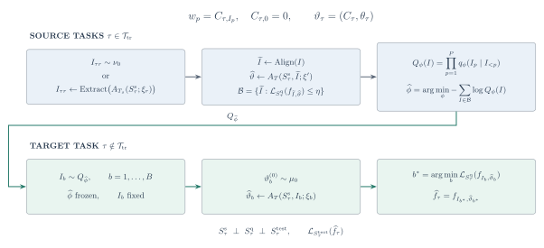
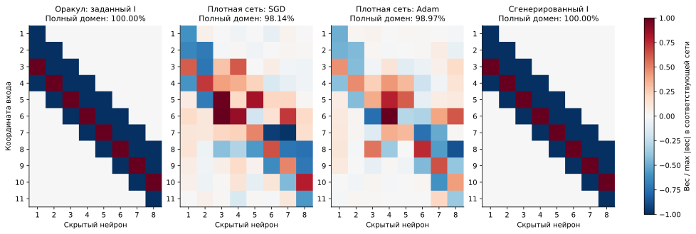
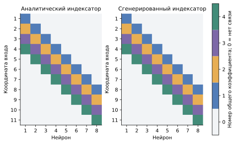
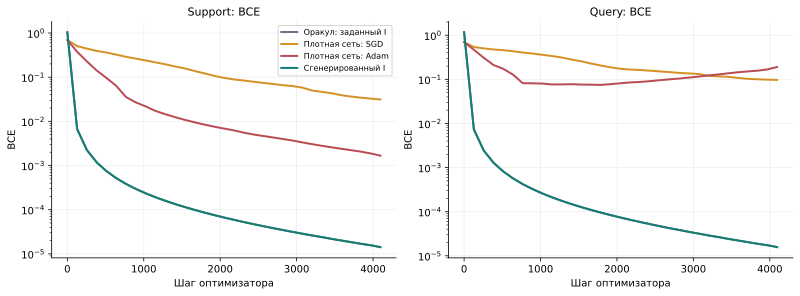
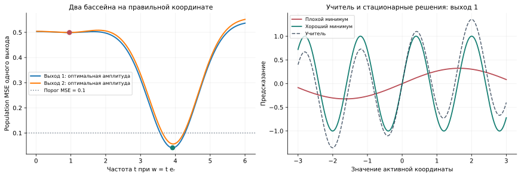
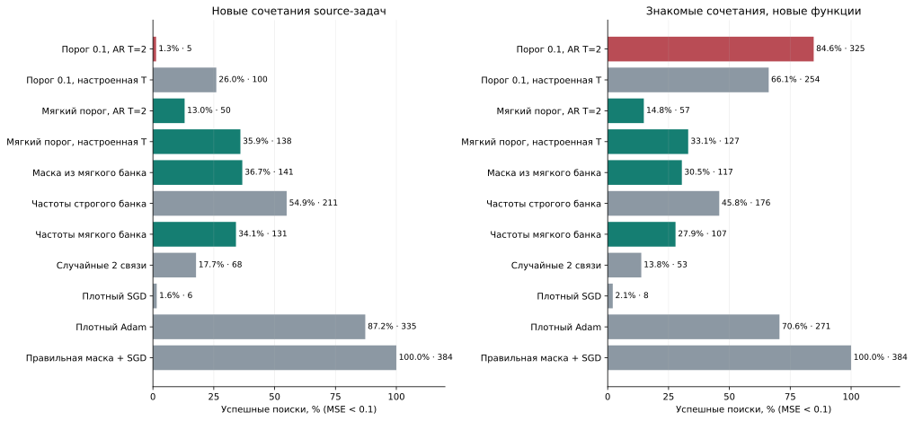
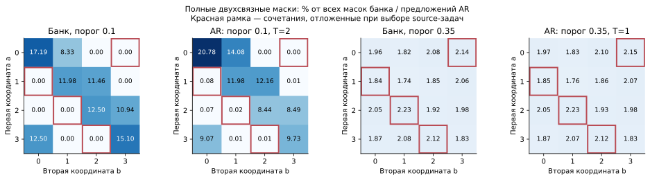
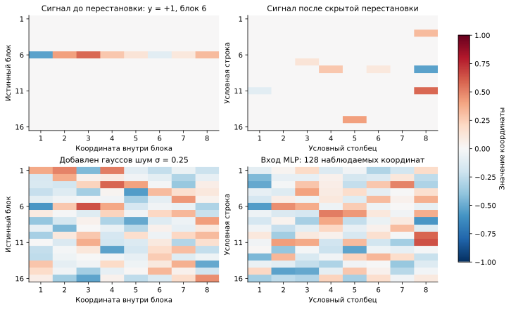
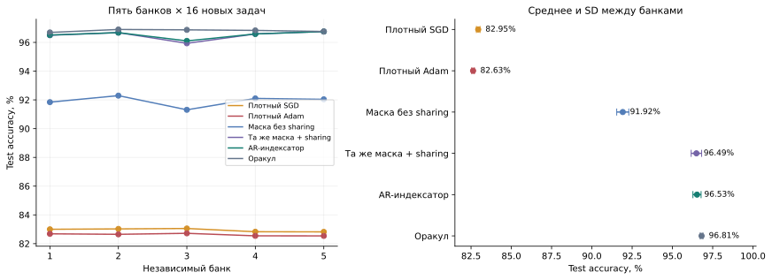
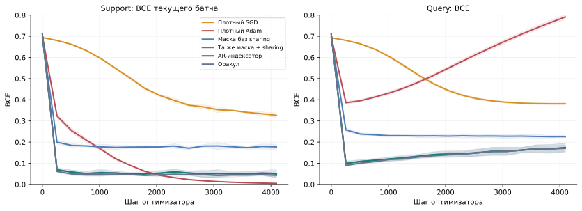

# Перенос структуры нейросети между задачами

**Итоговый отчёт на 3 ноября 2026 года.** Метод изложен в обозначениях текущей [статьи](../paper/sections/preliminary.tex). Pattern и Dynamic Signal используют завершённые серии 1 ноября; рисунки весов и сводные графики собраны заново из сохранённых результатов. Синусоидальная задача заново запущена 3 ноября с текущим авторегрессионным генератором; сравниваются строгий и мягкий отбор случайных исходных масок.

[TeX схемы](assets/2026-11-03/method.tex) · [SVG](assets/2026-11-03/method.svg) · [PDF](assets/2026-11-03/method.pdf).

## 1. Метод

### Что переносим

Для семейства задач фиксируем архитектуру сети. Структуру её весов задаём **индексатором**: целочисленным массивом, который определяет отсутствующие связи и группы связей с общим обучаемым коэффициентом. Числа в кодбуке зависят от задачи:

$$
\begin{aligned}
I&\in\{0,\ldots,K\}^{P},\\
w_p&=C_{\tau,I_p},\qquad C_{\tau,0}=0,\\
\vartheta_\tau&=(C_\tau,\theta_\tau),\qquad
f_\tau=f_{I,C_\tau,\theta_\tau}.
\end{aligned}
$$

Одинаковые положительные индексы означают один общий коэффициент; ноль фиксирует вес в нуле. Остальные параметры сети, например смещения и выходной слой, входят в отдельный численный вектор. Маска связности — частный случай: каждой активной связи назначается собственный коэффициент. Переименование кодов вместе с кодбуком и согласованная перестановка скрытых нейронов не меняют функцию сети.

Между задачами переносится распределение структур. На целевой задаче **все численные параметры и состояние их оптимизатора создаются заново**. Индексатор остаётся фиксированным на протяжении одной попытки обучения.

### Как получаем обучающие данные для генератора

Сначала собираем решения исходных задач. Есть два используемых в опытах пути. В Pattern и Dynamic Signal обучаем плотные сети, разреживаем их и извлекаем группы общих коэффициентов. После объединения весов проверяем структуру новым обучением кодбука: хорошее исходное решение само по себе ещё не гарантирует, что извлечённый индексатор полезен. В синусоидальном опыте исходные маски сразу выбираются случайно, численные веса обучаются SGD, а маски отбираются по порогу ошибки на независимых примерах. Мягкий порог допускает и частичные решения.

Перед обучением генератора согласуем эквивалентные записи структур. Для MLP это перестановки скрытых нейронов и названий кодов; для двух различимых выходов sine сохраняем порядок выходов. Отбор использует качество предсказания исходных задач. Истинная структура синтетического учителя нужна только для последующей диагностики восстановления.

Таким образом, обучение генератора получает банк дискретных индексаторов, прошедших проверку численным обучением. Уровень ошибки, бюджет поиска и ограничения класса структур заданы протоколом каждого опыта. Это существенно: случайный сбор не означает отсутствия предположений об архитектуре или допустимом числе связей.

### Как обучаем и используем текущую модель

Текущая модель — авторегрессионный MADE. Она предсказывает индекс каждой позиции по уже известному префиксу. Обучение максимизирует вероятность индексаторов банка:

$$
\begin{aligned}
Q_\phi(I)&=\prod_{p=1}^{P}q_\phi(I_p\mid I_{<p}),\\
\widehat\phi&=\arg\min_\phi
\left[-\frac{1}{|\mathcal B_{\mathrm{tr}}|}
\sum_{I\in\mathcal B_{\mathrm{tr}}}\sum_{p=1}^{P}
\log q_\phi(I_p\mid I_{<p})\right].
\end{aligned}
$$

Состояние генератора выбирается по отложенным исходным структурам. Температура декодирования и численные настройки решателя выбираются на калибровочных задачах, после чего замораживаются. При положительной температуре очередной индекс выбирается случайно из softmax; нулевая температура означает последовательный выбор максимума:

$$
q_{\phi,T_{\mathrm{dec}}}(I_p=k\mid I_{<p})
=\operatorname{softmax}\!\left(\frac{\ell_\phi(I_{<p})}{T_{\mathrm{dec}}}\right)_k,
\qquad T_{\mathrm{dec}}>0.
$$

На новой задаче генератор предлагает структуры. Каждая получает независимую инициализацию кодбука и обычное обучение по support. По query выбираются кандидат и, если это предусмотрено протоколом, момент остановки. Итоговая метрика считается на независимом test либо по точной ожидаемой ошибке, когда она аналитически доступна:

$$
\begin{aligned}
I_b&\sim Q_{\widehat\phi,T_{\mathrm{dec}}},\qquad
\vartheta_b^{(0)}\sim\mu_0,\\
\widehat\vartheta_b&=A_T(S_\tau^{\mathrm s},I_b;\vartheta_b^{(0)}),\\
b^*&=\arg\min_b\mathcal L_{S_\tau^{\mathrm q}}
\bigl(f_{I_b,\widehat\vartheta_b}\bigr).
\end{aligned}
$$

Здесь есть два отдельных источника неудачи: генератор может не предложить полезный индексатор, а численный оптимизатор может не найти хорошее решение даже с правильной структурой. Поэтому в каждом опыте нужен oracle с правильным индексатором и новым обучением чисел. Стоимость исходного банка учитывается отдельно от бюджета решения новой задачи.

## 2. Pattern: восстановление повторяющегося локального фильтра

### Задача и точное решение

На входе 11 битов; требуется определить, встречается ли заданный четырёхбитовый шаблон хотя бы в одном из восьми окон. Между задачами меняется шаблон. Например, строка `11001010110` содержит `0010` в позициях 3–6.

Ученик — сеть 11 → 8 ReLU → 1. При кодировании битов числами −1 и +1 точное решение реализуется одним четырёхэлементным фильтром, сдвигающимся по входу. Для шаблона с коэффициентами фильтра ниже получаем:

$$
\begin{aligned}
p_r&=2\,\mathrm{pattern}_r-1,\qquad r=1,\ldots,4,\\
h_j(x)&=\operatorname{ReLU}\!\left(\sum_{r=1}^{4}p_r x_{j+r-1}-3\right),
\qquad j=1,\ldots,8,\\
\widehat y(x)&=\mathbf1\!\left\{2\sum_{j=1}^{8}h_j(x)-1>0\right\}.
\end{aligned}
$$

Каждый скрытый нейрон отвечает за одно окно. Правильный индексатор содержит 32 активные связи из 88 и четыре общих коэффициента. Их значения меняются между шаблонами, расположение групп сохраняется.

### Банк и протокол

Генератор обучался на 12 исходных шаблонах. Исходный банк получен из 1536 решений через разреживание и извлечение индексаторов; после проверки свежего кодбука осталось 187 обучающих, 24 validation и 26 audit-записей. Подготовка заранее задаёт четыре связи на скрытый нейрон и четыре группы по восемь связей. Конкретные окна не передаются извлекателю как правильные ответы.

MADE имеет 88 категориальных позиций, пять вариантов индекса и два скрытых слоя ширины 256. В рассматриваемом этапе его веса уже заморожены. По четырём исходным шаблонам выбрана температура 0.1; переобучения генератора или нового сбора банка здесь не было. После такой калибровки 7873 из 8192 диагностических предложений совпали с правильной структурой с учётом симметрий — **96.11%**, против 4 из 8192 при температуре 1.

Целевые шаблоны: `0010`, `0100`, `1011`, `1101`. На каждый — 768 support-примеров, 256 query и 512 test, 32 старта по 4096 шагов. Кодбуки обучаются Adam с шагом 0.1; плотные Adam и SGD — с шагами 0.01 и 0.3 соответственно. Старты и checkpoints выбираются только по query BCE. Train BCE сбалансирована по классам, query/test BCE обычная.

В структурной модели обучаются четыре кода, одно общее скрытое смещение, один общий выходной вес и выходное смещение — семь чисел. В плотной сети смещения и выходные веса независимы, всего 105 чисел. Поэтому это сравнение полных параметризаций; оно не изолирует только sharing первого слоя.

### Веса после согласования нейронов

**Рисунок 1.** Первый заранее фиксированный шаблон `0010`; для каждого метода взят лучший по query старт. В колонке «оракул» показаны обученные веса сети с заданным правильным индексатором. В последней колонке структура предложена AR, а числа обучены заново. Цвет показывает подписанный вес, делённый на максимальный модуль веса соответствующей сети. Такая нормировка сравнивает расположение и относительные значения связей, а не абсолютный масштаб между сетями. Плотные веса не разреживались и не пороговались ради изображения.

Скрытые нейроны сопоставлены аналитическим окнам венгерским алгоритмом по косинусному сходству входящих весов и смещения. Вместе со столбцами первого слоя переставлены скрытые смещения и выходные веса. Знаки нейронов не менялись. Проверка на всём домене из 2048 входов дала максимальное изменение выхода 2.84e−14. [Сравнение до и после выравнивания](assets/2026-11-03/pattern_alignment.svg) и [исходные матрицы](assets/2026-11-03/pattern_heatmap_data.npz) сохранены отдельно.

После выравнивания у плотных сетей видна приблизительная локальность, но остаются лишние связи и неодинаковые фильтры. У структурной модели воспроизводится повторяющаяся полоса оракула. Отдельная карта индексов позволяет проверить именно равенства коэффициентов, которые нельзя надёжно вывести только из цвета близких численных весов:

**Рисунок 2.** Ноль означает отсутствие связи; четыре цвета — четыре независимо обучаемых общих коэффициента. Названия кодов согласованы после обучения. Для показанного решения индексаторы совпадают полностью.

### Качество на четырёх задачах

| Метод | Test accuracy, % | Все 2048 входов, % | Безошибочных стартов | Полностью решённых задач |
|---|---:|---:|---:|---:|
| Оракул: правильный индексатор | 100.00 | 100.00 | 62/128 | 4/4 |
| Плотный SGD | 96.09 | 97.42 | 0/128 | 0/4 |
| Плотный Adam | 96.97 | 98.16 | 0/128 | 0/4 |
| **AR, температура 0.1** | **100.00** | **100.00** | **59/128** | **4/4** |
| Независимые частоты, температура 0.25 | 100.00 | 100.00 | 9/128 | 4/4 |
| Один извлечённый индексатор | 100.00 | 100.00 | 62/128 | 4/4 |
| AR, температура 1 | 87.35 | 87.71 | 0/128 | 0/4 |

Проценты в первых двух столбцах усредняют четыре выбранные модели. Полный домен включает обучающие входы и служит проверкой точности решения всей конечной задачи; независимый test показан отдельно. 128 стартов не являются 128 независимыми задачами.

**Рисунок 3.** Средние траектории четырёх выбранных по query стартов; по горизонтали — шаг оптимизатора. Изображены полные истории этих стартов, тогда как таблица использует их выбранные checkpoints. На оси BCE логарифмический масштаб.

Pattern показывает, что извлечённая структура доступна обученному генератору и даёт точное решение после нового обучения чисел. Этот результат относится к переносу одного общего индексатора. Частотный контроль и готовый индексатор достигают того же качества, поэтому необходимости сложных условных зависимостей в AR здесь не установлено. Кроме того, целевые шаблоны уже использовались при разработке: это завершённая отладочная серия, не новая независимая проверка.

## 3. Синусоидальная задача: случайный банк и текущий AR

### Задача и конкурирующие минимумы

На входе восемь независимых стандартных гауссовых координат. Есть два различимых выхода. Учитель складывает слабую низкочастотную и сильную высокочастотную синусоиды вдоль одной координаты для каждого выхода; у ученика на выход приходится только один sine-нейрон с обучаемой амплитудой:

$$
\begin{aligned}
x&\sim\mathcal N(0,I_8),\\
y_j(x)&=\alpha_j\sin(\ell_jx_{r_j})+\sin(h_jx_{r_j}),\\
f_j(x)&=\gamma_j\sin(w_j^\top x),\qquad j\in\{1,2\},\\
\ell_j&\in[0.65,0.75],\quad h_j\in[3.8,4.2],
\quad\alpha_j\in[0.35,0.45],\\
r_1&\in\{1,2,3,4\},\qquad r_2\in\{5,6,7,8\}.
\end{aligned}
$$

В плотной модели 16 входных весов и две амплитуды. Правильная маска оставляет по одной входной связи на выход: обучаются четыре числа. В этом опыте активные веса не объединяются между собой, поэтому индексатор задаёт только связность.

Низкая частота создаёт плохой локальный минимум. Хорошее решение воспроизводит сильную высокую частоту; остающаяся слабая компонента даёт малую ненулевую ошибку. Для одной из исходных функций ранее численно найдены стационарные точки со средней MSE **4.99e−1** и **4.88e−2**. Минимальные собственные значения полных гессианов положительны: **1.30e−2** и **4.90e−1**; нормы градиента — **7.96e−9** и **2.61e−10**. Это подтверждает локальную геометрию конкретного примера, но не означает, что каждая неудачная попытка SGD или Adam закончилась именно в этой стационарной точке.

**Рисунок 4.** Слева — аналитическая ошибка каждого выхода при движении вдоль его правильной координаты и оптимальной амплитуде. Справа — учитель и два сохранённых стационарных решения первого выхода. Рисунок относится к исходной функции `a0_b0_f0`; это иллюстрация геометрии, а не выбор успешного целевого запуска.

Для гауссова входа ожидаемая MSE вычисляется без конечного тестового сэмпла через тождество:

$$
\begin{aligned}
K(u,v)&=\mathbb E\bigl[\sin(u^\top x)\sin(v^\top x)\bigr]\\
&=\frac12\left(e^{-\|u-v\|^2/2}-e^{-\|u+v\|^2/2}\right),\\
\mathcal R&=\frac12\sum_{j=1}^{2}\Bigl[
\gamma_j^2K(w_j,w_j)
-2\gamma_j\bigl(\alpha_jK(w_j,\ell_je_{r_j})+K(w_j,h_je_{r_j})\bigr)\\
&\hspace{30mm}+\alpha_j^2K(\ell_je_{r_j},\ell_je_{r_j})
+K(h_je_{r_j},h_je_{r_j})
+2\alpha_jK(\ell_je_{r_j},h_je_{r_j})\Bigr].
\end{aligned}
$$

**Успех — population MSE меньше 0.1.** Точная формула используется только для итогового измерения. Выбор банка, настроек и целевого кандидата опирается на эмпирическую query MSE. Глобальность найденного хорошего минимума не доказана; в отчёте утверждается достижение этого порога качества.

### Случайный банк, порог отбора и обучение AR

На 16 исходных задачах — восемь пар координат, по две функции — собрано **262144** попытки. Маска равномерно выбирается среди **120 вариантов двух из 16 связей**, без IMP и знания правильных координат. Каждая получает новые веса и 1024 шага SGD, batch 64, шаг 0.05, масштаб инициализации 2. Отбор использует MSE на 4096 независимых query-примерах; разделение train/validation задано до фильтрации.

Строгий порог **0.1** оставляет **244** карточки и всего **8** разных train-масок. Ослабление до **0.35** даёт **18705** карточек и **92** train-маски. Мягкий банк допускает частичные решения: в проверенной исходной задаче почти все добавленные карточки хорошо решают один выход и плохо другой. Все четыре целевые пары, отсутствовавшие в строгом банке, уже встречаются в мягком.

`IndexMADE` получает только 16 бинарных признаков активности: два скрытых слоя ширины 128, 3000 шагов Adam с шагом 0.001, три seed. Checkpoint выбирается по NLL отложенных карточек; дубликаты сохраняют исходные частоты. Активные численные веса всегда обучаются заново и независимо:

$$
M_p\in\{0,1\},\qquad I_p=pM_p,\qquad p=1,\ldots,16.
$$

Температура в исходном запуске применялась правильно, но сетка заканчивалась на T=2. Расширенная калибровка по query MSE после полного поиска выбрала **T=6 для строгого банка** и **порог 0.35, T=1 для мягкого**. Настройки сохранены до генерации новых численных функций. Плотные методы используют прежние калиброванные шаг/масштаб: SGD — 0.2/1.25, Adam — 0.1/0.7; структурные — SGD 0.05/2.

### Результаты на новых функциях

«Новые» и «знакомые» сочетания относятся к парам координат **исходных задач**: четыре отложенные пары дают восемь новых функций, восемь знакомых — 16. Это не утверждение об отсутствии маски в мягком банке. В каждом условии выполнено **384 поиска на метод**, по **64 обучения × 1024 шага × batch 64**. Структурные методы расходуют 32 попытки на предложения масок и 32 на свежие обучения выбранной; плотные методы и oracle — 64 независимых старта. Выбор конечного решения использует только query MSE; критерий успеха остаётся **population MSE < 0.1**.

| Метод | Новые сочетания: успех, % | Знакомые сочетания: успех, % |
|---|---:|---:|
| AR, порог 0.1, T=2 | 1.30 | 84.64 |
| AR, порог 0.1, T=6 | 26.04 | 66.15 |
| **AR, порог 0.35, T=1** | **35.94** | **33.07** |
| Выбор целой маски из мягкого банка | 36.72 | 30.47 |
| Независимые частоты строгого банка | 54.95 | 45.83 |
| Случайные две связи | 17.71 | 13.80 |
| Плотный SGD | 1.56 | 2.08 |
| Плотный Adam | 87.24 | 70.57 |
| Оракул: правильная маска + SGD | 100.00 | 100.00 |

**Рисунок 5.** Все методы сравниваются на одних новых функциях; столбцы показывают долю успехов из 384 поисков. Дополнительно показаны мягкий AR с прежней T=2 и частоты мягкого банка. Поиски повторяются на восьми либо 16 задачах с тремя генераторами одного банка, поэтому не являются 384 независимыми задачами.

### Что изменилось и где остаётся ограничение

Исходный AR почти точно воспроизводил восемь полных масок. Расширение температурной сетки подняло успех на новых сочетаниях **с 1.30% до 26.04%**; мягкий фильтр с выбранной температурой — **до 35.94%**. Цена расширения банка — снижение успеха на знакомых сочетаниях **с 84.64% до 33.07%**.

**Рисунок 6.** Эмпирические вероятности полных пар в train-банках и точные вероятности AR, усреднённые по трём генераторам. Красные рамки отмечают целевые пары, отсутствующие среди исходных задач. Мягкий фильтр вводит их в банк; непоказанная масса приходится на другие маски.

Простой выбор маски из мягкого банка даёт **36.72%**: разность мягкого AR с ним составляет −0.78 п.п. (95% task-bootstrap **[−6.51; 4.69]**, условно на одном банке). Все **138** успешных решений мягкого AR выбрали уже присутствующую в нём маску. У строгого AR с T=6 все **100** успехов используют маски вне строгого банка; иногда успешна и более широкая маска.

Таким образом, фильтр и температура существенно влияют на перенос. Правильная структура делает SGD надёжным — oracle успешен во всех 768 поисках, — но **преимущества текущего AR над выбором маски из банка, частотами или Adam здесь нет**. Структурное разбиение уже исследовано, поэтому это диагностика метода даже с новыми численными функциями. Исторический положительный опыт NF/VAE с обучением по частям относится к другому генератору и не подменяет этот результат.

[Подробный разбор и все измерения](../mds/SINE_AR_FILTER_DIAGNOSIS_2026-11-03.md) содержат сетку порогов/температур и проверки сэмплера. Создание исходного банка стоило 4096 целевых бюджетов; диагностика добавила 15 обучений генератора, 270336 калибровочных обучений решателя и 16384 повторных обучения для анализа частичных решений. Эта офлайн-цена не включена в одинаковые целевые бюджеты таблицы.

## 4. Dynamic Signal Distribution: локальность и sharing

### Постановка из статьи 2024 года

В работе Aakash Lahoti, Stefani Karp, Ezra Winston, Aarti Singh и Yuanzhi Li *Role of Locality and Weight Sharing in Image-Based Tasks: A Sample Complexity Separation between CNNs, LCNs, and FCNs*, ICLR 2024, введено синтетическое распределение Dynamic Signal Distribution. Сигнал расположен в случайном блоке входа, его знак задаёт метку, а все координаты зашумлены. Положение сигнала меняется от примера к примеру. Авторы используют эту конструкцию для изучения роли локальности и общих весов. [Первичная статья, §4.1](https://proceedings.iclr.cc/paper_files/paper/2024/file/71b17f00017da0d73823ccf7fbce2d4f-Paper-Conference.pdf).

Наш опыт — собственная адаптация этого распределения к переносу между задачами и скрытой перестановке входов. Это синтетические данные; численные результаты ниже получены нашей реализацией, а не взяты из статьи.

Для одной задачи фиксируется единичный восьмимерный вектор сигнала. Между задачами вектор меняется. Каждый пример содержит 16 блоков по восемь координат; только один блок получает сигнал:

$$
\begin{aligned}
c_\tau&\in\mathbb R^8,\qquad\|c_\tau\|_2=1,\\
y&\sim\operatorname{Unif}\{-1,+1\},\qquad
b\sim\operatorname{Unif}\{1,\ldots,16\},\\
u_g&=\varepsilon_g+\mathbf1\{g=b\}\,yc_\tau,
\qquad\varepsilon_g\sim\mathcal N(0,\sigma^2I_8),\\
x&=\Pi(u_1,\ldots,u_{16}).
\end{aligned}
$$

Перестановка общая внутри одного банка и его целевых задач. В пяти повторах она новая. Решатель видит 128 перемешанных координат, поэтому соседство в наблюдаемом векторе не раскрывает истинные блоки.

**Рисунок 7.** Иллюстративный положительный пример с сигналом первой целевой задачи первого банка и новым шумом, seed 20261103. Верхний ряд показывает средний сигнал, нижний — сигнал с шумом. Справа наблюдаемый вектор условно развёрнут в прямоугольник 16 × 8; его строки не являются истинными блоками. Истинная перестановка использована только для этой иллюстрации.

При известных блоках и сигнале байесовский классификатор сравнивает две смеси гауссиан:

$$
\Lambda(x)=
\log\sum_{g=1}^{16}\exp\!\left(\frac{c_\tau^\top u_g}{\sigma^2}\right)
-\log\sum_{g=1}^{16}\exp\!\left(-\frac{c_\tau^\top u_g}{\sigma^2}\right).
$$

Положительный знак этой величины означает положительный класс. Шум создаёт ненулевую ошибку даже у оптимального классификатора. Наш oracle в таблице — другая величина: MLP с правильным индексатором и заново обученными числами; это архитектурный ориентир, а не точное байесовское решение.

### Как находим структуру

Ученик — MLP 128 → 32 ReLU → 1. Правильная структура подключает каждый блок к двум скрытым нейронам и повторяет одни и те же два восьмимерных фильтра во всех блоках. Индексатор имеет размер 128 × 32, 256 активных связей и 16 обучаемых кодов. С независимыми скрытыми смещениями и выходными весами это **81 численный параметр**; плотная модель содержит 4161, та же маска без sharing — 321.

В каждом повторе используем 12 исходных задач: восемь для извлечения, две для validation и две для контроля. Обучаем по четыре плотные сети, затем постепенно оставляем 256 связей первого слоя. Состав групп восстанавливаем по совместному появлению входов в скрытых нейронах; роли координат внутри групп — по изменению вкладов входа между исходными задачами:

$$
\begin{aligned}
A_{pq}&=\sum_{n,h}\mathbf1\{W^{(n)}_{ph}\ne0\}
\mathbf1\{W^{(n)}_{qh}\ne0\},\qquad p\ne q,\\
v_{pt}&=\frac14\sum_{s=1}^{4}\sum_hW^{(t,s)}_{ph}a^{(t,s)}_h.
\end{aligned}
$$

Кластеризация этих статистик предлагает блоки и общие позиции. Числа блоков, позиций и фильтров заданы заранее: 16, 8 и 2. Их фактическое расположение извлекается из весов без истинной перестановки. Для каждого кандидата заново обучается кодбук; сохраняются до двух лучших индексаторов на задачу с query BCE меньше 0.65.

Банк выбирается по отложенным исходным задачам; MADE учится на категориальных индексаторах из 4096 позиций. Каждый из пяти банков содержит 24 записи и только 3–8 уникальных структур. Это небольшой набор вариантов одной общей организации входов, а не большая библиотека различных архитектур.

### Сравнение на новых задачах

Основное условие: шум 0.25, 2048 support-примеров, 1024 query и 16 384 test на задачу. В каждом из пяти независимо собранных банков — 16 новых целевых задач, всего 80. Каждому методу доступны восемь стартов по 4096 обновлений с batch 128. Настройки перенесены из независимой калибровки и заморожены до создания целевых данных; query выбирает старт и checkpoint.

| Метод | Что обучается на новой задаче | Численных параметров | Test accuracy, % | SD между банками, п.п. | Test BCE |
|---|---|---:|---:|---:|---:|
| Плотный SGD | Все веса с нуля | 4161 | 82.95 | 0.11 | 0.38 |
| Плотный Adam | Все веса с нуля | 4161 | 82.63 | 0.08 | 0.39 |
| Извлечённая маска без sharing | Каждая активная связь независимо | 321 | 91.92 | 0.38 | 0.22 |
| Та же опорная маска с индексатором | Общие коды + смещения и выход | 81 | 96.49 | 0.32 | 0.10 |
| **AR-индексатор** | **Новые общие коды + смещения и выход** | **81** | **96.53** | **0.25** | **0.10** |
| Независимые частоты | Новые общие коды + смещения и выход | 81 | 96.54 | 0.27 | — |
| Оракул: правильный индексатор | Новые общие коды + смещения и выход | 81 | 96.81 | 0.08 | 0.09 |

Средние и SD посчитаны по пяти средним значениям банков. Увеличение бюджета плотных методов до 16 384 шагов не закрыло разрыв: Adam — 82.63%, SGD — 82.92%.

**Рисунок 8.** Слева — отдельные банки, справа — среднее и межбанковое SD. Два контроля с одной опорной маской отличаются наличием общих коэффициентов; они выделяют вклад sharing. AR может выдавать другие варианты индексатора, поэтому его сравнение с маской проверяет всю процедуру переноса.

AR превосходит маску без sharing в среднем на **4.61 п.п.**; разница положительна на всех 80 задачах. Описательный иерархический bootstrap, пересэмплирующий сначала банки, затем задачи, даёт 95% интервал **[4.40; 4.81] п.п.** Независимых банков пять: 80 задач не следует считать 80 независимыми обучениями генератора. Пара с неизменной опорной маской показывает близкий выигрыш от sharing — **4.57 п.п.**

**Рисунок 9.** По одному выбранному по query старту каждой из 80 задач; линии — средние, полосы — SD пяти средних банков. Слева loss текущего обучающего батча, справа всей query-выборки. Таблица использует лучшие query-checkpoints, график показывает полные траектории до 4096 шагов.

Кривые уточняют причину разрыва. Плотный Adam продолжает уменьшать обучающую ошибку, но query BCE растёт: в этом опыте проблема не сводится к неспособности оптимизатора уменьшить train loss. Маска уже существенно улучшает обобщение; дополнительные равенства весов дают следующий выигрыш. AR, независимые частоты и один общий индексатор почти совпадают. Эти результаты поддерживают пользу переноса структуры и sharing, но не отдельное преимущество авторегрессионной генерации.

## 5. Границы выводов и воспроизводимость

Pattern и Dynamic Signal подтверждают пользу переноса общей структуры при новом обучении чисел. В синусоидальной задаче мягкий отбор и температура улучшают результат на новых сочетаниях, но ухудшают перенос знакомых; преимущества AR над простыми контролями не установлено. Во всех трёх задачах один индексатор, частоты или выбор целой структуры из банка необходимы для оценки вклада именно генератора.

Все сравнения относятся к конкретным семействам задач, размерам данных, инициализациям и бюджетам. Достижение заданной ошибки не означает доказательства глобального минимума. Равный целевой бюджет не включает создание исходного банка и обучение генератора; равные шаги и предъявления примеров также не означают равные FLOPs.

Отдельный [контроль 3 ноября](../mds/BASIN_RELEASE_CONTROL_2026-11-03.md) на другой sine-параметризации показывает, почему необходимо отделять структуру от численного оптимизатора: преимущество настроенного обучения при фиксированном индексаторе над плотным обучением из тех же весов исчезает в контроле с одинаковым обычным SGD. Поэтому результаты этого отчёта не формулируются как универсальная польза фиксации равенств для любого градиентного метода.

| Материал | Источник |
|---|---|
| Определения метода | [Текущий Preliminary статьи](../paper/sections/preliminary.tex) |
| Pattern: веса, индексаторы и все старты | [Сохранённый запуск](../pattern/runs/autoregressive_debug_20261101_v1/); [оракул](../pattern/runs/autoregressive_20261101_v2/oracle.npz) |
| Синусы: отбор банка и температура AR | [Протокол и код](../experiments/sine_ar_current_v1/README.md), [итоговые числа](../experiments/sine_ar_current_v1/results/diagnosis_20261103/summary.json), [таблица](../experiments/sine_ar_current_v1/results/diagnosis_20261103/comparison.csv), [рисунки и источники](../mds/assets/2026-11-03/sine_ar_diagnosis/README.md), [исходный запуск](../experiments/sine_ar_current_v1/results/run_20261103/) |
| Синусы: историческая серия VAE | [Сохранённая сводка](assets/2026-11-03/sine_summary.json), [Git-ревизия и SHA](assets/2026-11-03/sine_summary_origin.json) |
| Dynamic Signal: пять банков | [Агрегаты](../experiments/dynamic_signal_v1/results/bank_repeats/summary.json), [таблица по банкам](../experiments/dynamic_signal_v1/results/bank_repeats/comparison.csv) |
| Pattern, Dynamic Signal и исторические синусы: числа и кривые | [JSON](assets/2026-11-03/report_data.json), [CSV](assets/2026-11-03/learning_curves.csv) |
| Построение рисунков | [Python](assets/2026-11-03/build_figures.py), [источники и SHA-256](assets/2026-11-03/sources.json) |

SVG имеют растровые PNG-копии рядом с ними. Графики Pattern и Dynamic Signal построены из индивидуальных результатов и сохранённых историй; таблицы не пересчитывались новым обучением. Исторические итоги VAE сохранены как отдельная серия и не смешиваются с новым AR-запуском. Тесты не создавались и не запускались.
