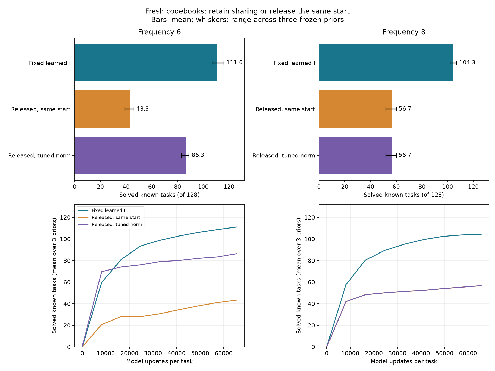

# Что даёт сохранение индексатора после одинакового старта

3 ноября 2026. [Основной протокол](../experiments/basin_release_v1/protocol.json),
[протокол дополнительного SGD-контроля](../experiments/basin_release_v1/sgd_protocol.json),
[код и команды](../experiments/basin_release_v1/README.md).

**Настроенное обучение кодбука при фиксированном I заметно лучше плотного
обучения из тех же начальных весов. Однако при одинаковом обычном SGD
этого преимущества нет.** Поэтому результат относится к взаимодействию
структурного ограничения с численным оптимизатором. Он не подтверждает,
что сохранение равенств само по себе всегда улучшает градиентный поиск.

## Задача и известное хорошее решение

Сохранено семейство из [предыдущих опытов](BASIN_STRUCTURE_TRANSFER_RESULTS_2026-11-02.md):
24 Gaussian-входа, один sine-нейрон и обучаемая выходная амплитуда.
Цель содержит слабую низкую и сильную высокую частоту вдоль одного
единичного направления. Его 24 координаты объединены в три группы
по восемь равных значений:

$$
\begin{aligned}
x&\sim\mathcal N(0,I_{24}),\qquad \|v\|=1,\\
y(x)&=a\sin(\ell v^\top x)+\sin(hv^\top x),\\
f_{w,b}(x)&=b\sin(w^\top x),\\
a&\in[0.35,0.45],\qquad \ell\in[0.65,0.75].
\end{aligned}
$$

Высокая частота лежит в интервалах [5,8; 6,2] или [7,8; 8,2].
Успех означает ожидаемую MSE меньше 0,1. Допустимый кандидат с весами
вдоль высокой частоты имеет аналитически известную ошибку:

$$
w=hv,\qquad b=1,\qquad
\mathcal R(w,b)=\frac{a^2}{2}(1-e^{-2\ell^2})<0.069.
$$

Например, при амплитуде 0,4 и низкой частоте 0,7 эта ошибка равна
примерно 0,050. Глобальность такого кандидата не утверждается.
Вычисление точной Gaussian-MSE используется только для итогового отчёта.

Генератор переносит индексатор. Все кодовые значения и выходная
амплитуда в каждом обучении новые. Координаты кодбука нормированы
по размеру группы, чтобы устранить соответствующий множитель в GD.

## Данные и сравниваемые методы

Использованы прежний банк четырёх извлечённых структур и три замороженные
AR-модели. Для каждого режима создана новая калибровка из 32 функций
знакомых структур. Итоговая выборка содержит 128 других знакомых функций
и 32 функции чужой структуры. Между частотами согласованы направления,
низкие компоненты и случайные потоки; меняется высокая частота.

Калибровка перебирает SGD, SGD с momentum и Adam; шаги
0,003/0,01/0,03/0,1/0,3 и радиусы 0,5/1/2/4/6/8. Каждая настройка
получает 16 стартов. Предложения на калибровке сбалансированы между
четырьмя извлечёнными I. Настройки выбираются по query и сохраняются
до создания итоговых функций. На целевой задаче каждому методу доступны
32 старта по 2048 обновлений, по 128 примеров на обновление:
65536 обновлений и 8388608 предъявлений примеров отдельным моделям.
Минибатчи общие между попытками и методами; независимая query содержит
4096 примеров и выбирает checkpoint и кандидата.

| Метод | Что обучается | Как выбираются настройки |
|---|---|---|
| Фиксированный I | Новый кодбук и амплитуда | Лучшие оптимизатор, шаг и радиус по калибровке |
| Плотный, тот же старт | Все веса и амплитуда, равенства сняты до первого шага | Радиус как у фиксированного I; оптимизатор и шаг калибруются отдельно |
| Плотный, свой радиус | Все веса из тех же структурированных случайных направлений | Оптимизатор, шаг и радиус калибруются независимо |
| Плотный, обычный старт | Все веса из изотропной случайной инициализации | Отдельный подбор для каждого из трёх оптимизаторов |
| Oracle-пара | Верный I для каждой задачи; числа новые | Настройки основной пары без дополнительной oracle-калибровки |

Основная пара получает одинаковые предложения и численные старты.
Максимальное расхождение восстановленных начальных весов — 1,61e−6
при норме 8, в пределах заранее указанной погрешности float32 2e−6.
Начальные амплитуды совпадают точно; seeds минибатчей и query одинаковы.
Контроль со своим радиусом относится к сравнению настроенных процедур,
а не обязательно одинаковых начальных весов.

## Результат основной серии

Количество решённых знакомых задач из 128. Диапазон показывает три
генератора на одних задачах; он не является доверительным интервалом.

| Метод | Частота около 6 | Частота около 8 |
|---|---:|---:|
| Фиксированный изученный I | **107–116** | **102–107** |
| Плотное обучение из тех же весов | 39–46 | 52–60 |
| Плотное обучение со своим радиусом | 83–89 | 52–60 |
| Плотные SGD / momentum / Adam с обычного старта | 0 / 0 / 0 | 0 / 0 / 0 |
| Фиксированный oracle I | 128 | 128 |
| Плотное обучение из oracle-старта | 107 | 118 |

В обоих режимах кодбук выбрал Adam с шагом 0,3 и радиусом 8.
Плотный контроль с тем же стартом выбрал Adam с шагом 0,01 при частоте 6
и momentum с шагом 0,03 при частоте 8. Свободный подбор радиуса при
частоте 6 выбрал SGD с шагом 0,3 и радиусом 6; при частоте 8 выбрана
та же настройка, что у основного плотного контроля. Последние две
строки AR-контролей для частоты 8 поэтому не являются независимыми
подтверждениями: конфигурации и случайные потоки совпадают.

Средняя MSE по всем знакомым задачам, включая неудачи: 0,114 против
0,379 у совпадающих стартов и 0,214 у свободного радиуса при частоте 6;
0,138 против 0,330 у обоих плотных контролей при частоте 8.

Парное преимущество фиксированного I по доле успехов:

| Сравнение | Около 6, п.п. | Около 8, п.п. |
|---|---:|---:|
| Против одинакового старта | +52,9 [46,9; 58,9] | +37,2 [31,0; 43,5] |
| Против свободного радиуса | +19,3 [14,1; 24,7] | +37,2 [31,0; 43,5] |

Интервалы — парный bootstrap задач, стратифицированный по четырём
фиксированным семьям. Три генератора усредняются внутри каждой задачи.
Интервалы условны на выученную библиотеку и завершённую калибровку.

Все знакомые задачи получили верный I у каждого генератора. Из 3117
попыток с верным I успешны 784 при сохранении структуры против 159
при освобождении весов с тем же стартом в режиме 6; в режиме 8 —
663 против 218. Это описательная агрегация, а не независимые 3117 задач.

На чужой структуре фиксированные изученные I дали 0/32. Освобождение
весов решило 2–3/32 в основной паре и 3–5/32 при свободном радиусе
для частоты 6; 2–3/32 для частоты 8. Oracle с сохранением верного I
решил 32/32, освобождённый oracle — 26/32 и 27/32 соответственно.

## Дополнительный контроль с одинаковым SGD

После основной серии калибровочные результаты показали, что обычный
SGD ведёт себя близко в двух представлениях. Чтобы отделить этот случай
от преимущества настроенной процедуры, объявлена дополнительная
проверка на **ещё одной независимой выборке** 128 знакомых и 32 чужих
функций. Она не входила в исходный протокол.

Обе стороны используют один SGD, один шаг, радиус, предложения, начальные
веса, амплитуды и данные. Общая настройка выбрана по среднему query двух
сторон на уже завершённой калибровке: шаг 0,3, радиус 6 или 8 соответственно.
Новых калибровочных обучений и выбора по итоговым функциям нет.
Максимальная разница начальных весов 1,87e−6; амплитуды совпадают точно.

| Метод на новой выборке | Частота около 6 | Частота около 8 |
|---|---:|---:|
| SGD, фиксированный I | 79 / 80 / 85 | 49 / 55 / 56 |
| Тот же SGD, равенства сняты | 81 / 82 / 90 | 53 / 54 / 59 |

Числа перечислены по трём генераторам. Парная разница долей успеха
«фиксированный минус освобождённый» составляет −2,34 п.п.
[−4,69; −0,26] и −1,56 п.п. [−3,39; 0,00]. В этом контроле
сохранение равенств не дало выигрыша; при частоте 6 оно немного хуже.
На чужой структуре фиксированный метод снова дал 0/32, освобождённый —
0–1/32. Эти числа нельзя непосредственно вычитать из основной таблицы:
в дополнительной серии другие задачи и старты.

## Что это означает для теории

Основная серия показывает пользу обучения в структурированных
координатах сверх выбора начальных весов при проверенном бюджете и
калибровке. Дополнительная серия показывает зависимость этой пользы
от оптимизатора. Объяснение «сохранение равенств всегда помогает тому же
SGD» противоречит полученному контролю.

Есть и точная граница для этой Gaussian-модели. Population-риск при
фиксированной амплитуде зависит от весов через их норму и скалярное
произведение с направлением цели, поэтому

$$
\nabla_w\mathcal R(w,b)\in\operatorname{span}\{w,v\}.
$$

Если верное структурное подпространство содержит начальные веса и
направление цели, точный population-GD с одинаковыми шагами остаётся
в нём и без явного ограничения. В ортонормированных координатах
кодбука его траектория совпадает с плотной, включая обновления амплитуды.
Это аналитическое следствие симметрии риска; численные опыты здесь
используют стохастические минибатчи, а не точный population-градиент.

У Adam адаптивная нормировка применяется к градиенту общего кодового
значения; в плотной сети она применяется отдельно к каждому весу.
Ортонормировка групп делает GD сопоставимым по масштабу, но не превращает
Adam в один и тот же алгоритм в двух представлениях. Полезное направление
теории — объяснить взаимодействие группировки, шума и адаптивных
обновлений. Этот опыт ещё не выделяет вклад каждого из этих механизмов.

Результат не отменяет [прежний сильный контроль](INDEXATOR_TASK_CUE_RESULTS_2026-11-02.md):
плотный Adam с информативным моментным признаком задачи решал все функции
той серии. Здесь проверяется структурированная случайная инициализация
со свежими числами, а не такая информативная инициализация.
Общего превосходства над градиентными методами, переноса результата
на произвольную MLP и преимущества AR над retrieval не установлено.

## Воспроизводимость и границы

Обе серии используют одну исходную библиотеку. Разные генераторы,
парные частоты и множество численных попыток не заменяют независимых
банков структур. Калибровка конечна: 32 функции и указанная сетка,
а не все оптимизаторы и гиперпараметры. Бюджеты равны по обновлениям
и предъявлениям примеров, не по FLOPs или полной стоимости источников.

Завершены четыре GPU-запуска, всего 40 оценок методов по 160 функциям
в соответствующих режимах. Сохранены оба протокола, настройки,
исходные модели, снимки исполнявшегося кода, начальные числа,
query-траектории, итоговые параметры и точные риски. Хеши входов,
совпадение стартов и данные/бюджеты проверены. Новые поля в `core.fit`
только сохраняют начальную амплитуду и seeds; численный алгоритм не менялся.
Модульные тесты не добавлялись и не запускались.

Основные данные: [summary.json](../experiments/basin_release_v1/results/heldout_v1/summary.json),
[tasks.csv](../experiments/basin_release_v1/results/heldout_v1/tasks.csv),
[проверка завершения](../experiments/basin_release_v1/results/heldout_v1/completion_audit.json).
Дополнительный контроль: [summary.json](../experiments/basin_release_v1/results/sgd_control_v1/summary.json).
Все изменения локальны; статья в рамках этого опыта не редактировалась.
