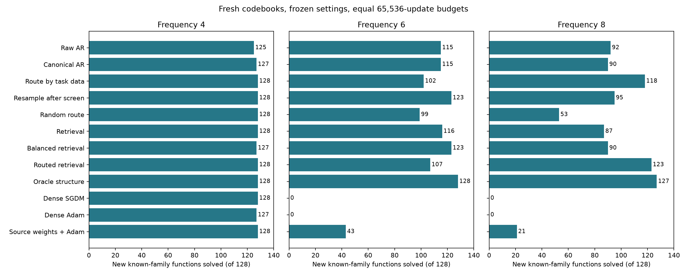

# Новые задачи: когда направлять поиск на одну структуру

2 ноября 2026. [Протокол](../experiments/basin_routing_v1/protocol.json),
[код](../experiments/basin_routing_v1/run.py),
[все результаты](../experiments/basin_routing_v1/results/heldout_v1/summary.json),
[теория выбора структуры](theory/INDEXATOR_TASK_ROUTING_THEORY_2026-11-02.md).

**Выбор структуры по короткому численному обучению помогает в одном
сложном режиме и вредит в другом.** Успех зависит от надёжности раннего
выбора. Простое исправление первого символа почти не меняет итоговый
успех: основное ограничение находится дальше в поиске.

## Проспективный протокол

После прежней диагностики зафиксированы 21 метод, три частотных режима,
все seed и прежние настройки оптимизаторов. Затем созданы 128 новых
функций знакомых структур и 32 функции чужой структуры. Направления,
низкие частоты и амплитуды совпадают между режимами; меняется только
центр высокой частоты. Это парные варианты одной новой выборки,
а не три независимых библиотеки или 384 независимые исходные задачи.

Генераторы и численные настройки заморожены. Все C и амплитуды новые.
Методы получают по 65536 обновлений и 8388608 обучающих model-examples
на задачу. Точный population MSE применяется только для отчёта.

Безусловный поиск: 32 старта по 2048 шагов. Направленный: 32 предложения
по 256 шагов, выбор I по отдельной gate-query, затем 28 новых C по
2048 шагов. Решения предварительной фазы также допускаются в итоговый
выбор. Gate-query и финальная query по 4096 примеров независимы.

Контроль resample после той же короткой фазы выбирает 28 новых I из
генератора. Контроль random route выбирает один I без учёта query и
отдаёт ему 28 новых C. Они отделяют выбор по качеству от другой разбивки
бюджета и большего общего числа коротких стартов. Balanced retrieval
выделяет ровно восемь полных попыток каждому из четырёх I банка.

Исправление сэмплирования выполнено точным rejection sampling: принимаются
только сырые последовательности с первым индексом 0. Готовое разбиение
не исправляется задним числом. Стоимость отброшенных предложений
учтена в диагностике генерации.

## Число решённых знакомых функций из 128

| Метод | Частота ≈4 | ≈6 | ≈8 |
|---|---:|---:|---:|
| Исходный AR, диапазон трёх seed | 125–126 | 113–119 | 82–92 |
| AR с правильным первым символом | 126–127 | 115–118 | 88–90 |
| Ранний выбор I, три seed | 128 | 99–103 | 118–121 |
| Короткая фаза + новые случайные I, seed 1 | 128 | 123 | 95 |
| Короткая фаза + случайный один I, seed 1 | 128 | 99 | 53 |
| Случайный целый I из банка | 128 | 116 | 87 |
| По восемь попыток каждому I банка | 127 | 123 | 90 |
| Ранний выбор из банка | 128 | 107 | 123 |
| Oracle I | 128 | 128 | 127 |
| Плотный SGD | 0 | 0 | 0 |
| Плотный SGDM | 128 | 0 | 0 |
| Плотный Adam | 127 | 0 | 0 |
| Длинный плотный Adam | 123 | 0 | 0 |
| Исходные численные веса + Adam | 128 | 43 | 21 |

На чужой структуре все варианты переноса только знакомых I дают 0/32;
oracle — 32/32. Плотные методы решают чужие задачи только в простом
режиме. Полная таблица с MSE и контрольным oracle после короткой фазы
сохранена в JSON.

## Почему ранний выбор может вредить

При частоте 6 ранний I точен только в 102, 103 и 99 задачах из 128.
Итоговое число успехов совпадает с этими числами: вторая фаза надёжно
обучает C, когда ей достался правильный I, но почти весь бюджет ошибочного
выбора уже потерян. Безусловный поиск продолжает пробовать разные I
и решает больше задач.

При частоте 8 ранний выбор точен в 119, 123 и 120 задачах. Направление
оставшегося бюджета на эти I даёт 118, 121 и 118 успехов. Здесь выигрыш
существенно выше контроля с новыми случайными I и контроля со случайным
одним I. В простом режиме многие решения найдены уже короткой фазой,
поэтому 128 успехов random route не означают полезность случайного выбора.

Среднее по трём seed изменение доли успеха относительно исправленного
безусловного AR: +1,04 / −11,46 / +23,18 процентного пункта для частот
4/6/8. Парный bootstrap по задачам внутри фиксированных четырёх семейств
даёт интервалы 95%: [0,26; 2,08], [−15,63; −7,29], [17,19; 29,43].
Seed усредняются внутри задачи, а не считаются независимыми задачами.
Интервалы описательные, условны на эту библиотеку и замороженные модели;
поправка на множественные сравнения не применялась.

Для исправления первого символа изменения +0,78 / +0,26 / +1,30 пункта;
все соответствующие интервалы включают ноль. Исправление повышает
валидность предложений, но не устраняет ограничение численных попыток.

## Границы и последующие контроли

Равенство бюджетов относится к обновлениям и обучающим model-examples.
У двухфазных методов две query-выборки и больше проверок кандидатов;
FLOPs, полная задержка и стоимость предобучения не уравнены. Контроли
resample и random route имеют ту же двухфазную работу с query.
Численное время в JSON не включает генерацию, отдельное пересчитывание
финальной query для короткой фазы и подготовку данных.

Все три процесса завершились успешно, входные хеши до и после совпали.
Сохранены точные снимки исполнявшегося кода, модели и истории.
Модульные тесты не добавлялись и не запускались; статья и Git-публикация
не изменялись.

Завершено отдельное продолжение на новой выборке:
[протокол проверки сигнала задачи](../experiments/basin_routing_v1/cue_protocol.json).
Оно проверяет два способа оставить резерв бюджета и выбор I по
эмпирическому среднему x*y. Удаление низкочастотной компоненты проверяет,
действительно ли этот признак использует предсказанный теорией сигнал.
[Результаты продолжения и сильные контроли](INDEXATOR_TASK_CUE_RESULTS_2026-11-02.md)
опубликованы полностью. Они показывают пользу информативного признака
и для выбора I, и для плотной численной инициализации.

Также завершён [контроль с одинаковыми стартами](BASIN_RELEASE_CONTROL_2026-11-03.md),
включая отдельное сравнение при одинаковом обычном SGD.
