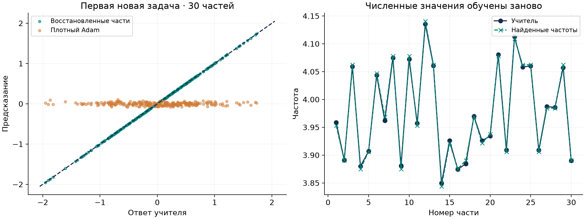
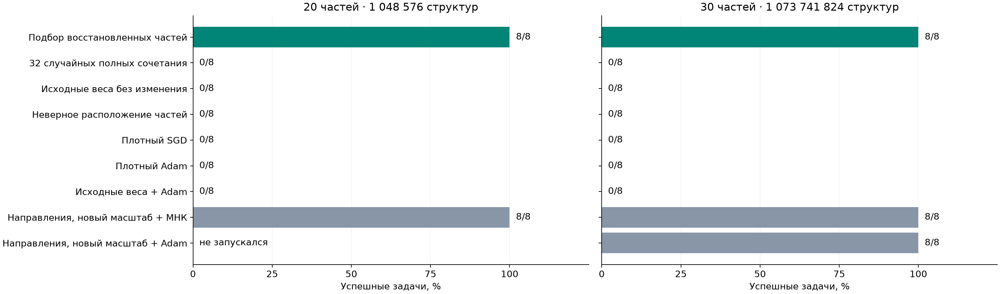

# Перенос частей при миллионе и миллиарде структур

Пилот · 28 октября 2026.

## Задача

Проверяем, можно ли извлечь повторяющиеся части из простых решений
и собрать новое решение при слишком большом числе сочетаний для полного
перебора. Используем 20 или 30 частей, у каждой два варианта.
Число допустимых структур — 1 048 576 и 1 073 741 824 соответственно.

У каждой части восемь полезных входов. Их расположение скрыто одной общей
перестановкой координат. Ответ учителя — сумма синусоид:

$$
\begin{aligned}
J&\in\{20,30\},\qquad x\sim\mathcal N(0,I_{8J}),\\
y_s(x)&=\frac1{\sqrt J}\sum_{j=1}^{J}
a_j\sin(\omega_jv_{j,s_j}^{\top}x),\qquad s_j\in\{0,1\},\\
a_j&\in[0.8,1.2],\qquad \omega_j\in[3.8,4.2].
\end{aligned}
$$

Каждый вариант части — вектор длины 1 с восемью ненулевыми весами.
Их знаки соответствуют шаблонам 11110000 или 11001100.
У разных частей полезные входы не пересекаются. Полную структуру
задают 20 или 30 двоичных индексов.

## Аналитическое решение

Ученик — сумма синусоид с обучаемыми весами и выходными коэффициентами.
Точное решение существует: выбрать правильный вариант каждой части,
умножить его вектор на частоту учителя и взять выходной коэффициент
учителя, поделённый на корень из числа частей:

$$
w_j=\omega_jv_{j,s_j},\qquad
c_j=\frac{a_j}{\sqrt J}
\quad\Longrightarrow\quad f(x)=y_s(x),\quad R=0.
$$

Разные части используют независимые входы. Поэтому их можно сначала
сравнивать по связи с ответом новой задачи по отдельности, затем совместно
уточнять коэффициенты. Миллион или миллиард полных сочетаний перечислять
для этого не требуется.

## Пример найденного решения

На первой новой задаче с 30 частями восстановлены все 30 выбранных
вариантов. Частоты, которых не было в исходном банке, подобраны заново.
На рисунке показаны ответы на 256 новых входах и найденные частоты.
Пример взят по номеру задачи, без отбора по качеству.

## Данные и методы

Для каждой размерности собрали отдельный банк из 40 или 60 элементарных
низкочастотных задач — по одной на каждый вариант части.
Это задачи с одной синусоидой и частотой от 0,8 до 1,2.
Каждую решали плотным SGD с четырёх стартов по 2048 шагов.
Полученные веса разделили на три кластера: отрицательные, нулевые
и положительные. Совпадение ненулевых координат позволило объединить
варианты в пары. Все 40 и 60 частей восстановлены правильно.
Границы групп и правильные индексы новых задач методу не передавались.

Таким образом, в банке есть все элементарные части, но нет полных
многокомпонентных сочетаний новых задач. Пилот проверяет сборку знакомых
частей; совершенно новые элементарные части здесь не проверялись.

**Подбор восстановленных частей:** на 4096 примерах новой задачи
сравнить два варианта каждой части и 64 возможные частоты от 0,125 до 8.
Затем подобрать амплитуды методом наименьших квадратов и дважды уточнить
частоты по остаткам. Истинные частоты учителя методу неизвестны.

**32 случайных полных сочетания:** выбрать целиком 32 структуры
из восстановленных частей. Для каждой подобрать частоты и амплитуды
тем же способом и выбрать лучшую по отдельным 4096 примерам.

**Исходные веса без изменения:** зафиксировать все низкочастотные векторы
банка и обучить только выходные коэффициенты.
**Неверное расположение частей:** повторить подбор частей после новой
перестановки их входных координат.

**Плотные SGD и Adam:** обучать все входные веса и выходные коэффициенты
с новых случайных стартов. **Исходные веса + Adam:** начать с обученных
исходных векторов, затем разрешить всем весам меняться.
VAE в этом пилоте не использовался.

Дополнительный контроль — **нормированные исходные направления**.
Сохраняем направления всех исходных векторов, выбираем один общий масштаб
из 0,5/1/2/4/8 по двум настроечным задачам, затем обучаем выходные
коэффициенты методом наименьших квадратов (МНК). Выбран масштаб 4.
В GPU-проверке дополнительно обучаем все веса Adam с такого старта;
его шаг также выбран по настроечным задачам.

На каждую размерность взяли две отдельные задачи для настройки
оптимизаторов и восемь новых задач для итоговой проверки.
Пилот с 20 частями: восемь стартов по 1024 шага, сеть из 40 синусоид.
Усиленная проверка с 30 частями на V100: 16 стартов по 4096 шагов;
число синусоид 30 или 60, масштаб старта и шаг выбраны на настройке.
Для Adam со стартом из исходных весов шаг настроен отдельно
в усиленной проверке. Размер минибатча — 64.

## Результаты

Успех — точная MSE ниже 0,1 по нормальному распределению входов.
Ошибка вычисляется по аналитической формуле среднего произведения
синусоид. В таблице один результат — лучший выбранный поиск на одной
новой задаче; это не доля отдельных стартов.

| Метод | Успех: 20 частей | MSE: 20 частей | Успех: 30 частей | MSE: 30 частей |
| --- | --- | --- | --- | --- |
| Подбор восстановленных частей | 8/8 | 0.000011 | 8/8 | 0.000013 |
| 32 случайных полных сочетания | 0/8 | 0.154169 | 0/8 | 0.159848 |
| Исходные веса без изменения | 0/8 | 0.527390 | 0/8 | 0.504153 |
| Неверное расположение частей | 0/8 | 0.533705 | 0/8 | 0.512734 |
| Плотный SGD | 0/8 | 0.521842 | 0/8 | 0.496577 |
| Плотный Adam | 0/8 | 0.522336 | 0/8 | 0.498144 |
| Исходные веса + Adam | 0/8 | 0.525893 | 0/8 | 0.496571 |
| Направления, новый масштаб + МНК | 8/8 | 0.006897 | 8/8 | 0.006114 |
| Направления, новый масштаб + Adam | — | — | 8/8 | 0.000018 |

Подбор извлечённых частей решает новые задачи с очень малой ошибкой.
Случайный выбор целых сочетаний, сохранение исходной частоты
и неверное расположение частей такого результата не дают.

Контроль масштаба важен для интерпретации: перенос исходных направлений
с новым масштабом также решает задачи, даже без явного выбора
дискретного сочетания. Значит, полезен извлечённый словарь направлений,
а специальная процедура выбора частей не является единственным
успешным методом. Узкий диапазон новых частот облегчает этот контроль.
Adam с нормированными исходными направлениями также дал 8/8 успехов
в усиленной проверке. Поэтому результат относится к пользе исходного
представления для обучения, а не к невозможности решить задачу градиентом.

Результат поддерживает перенос структуры в пространстве,
где полный перебор уже не укладывается в использованный бюджет.
Но найденная структура делает задачу разложимой на части:
экспоненциальное число сочетаний само по себе не означает, что
единственный альтернативный способ — полный перебор.

Это два небольших пилота, по одному исходному банку и восьми новым
задачам на размерность. Исходные задачи содержат отдельные готовые части;
выделение частей из сложных смешанных решений здесь не проверялось.
Спектральный подбор использует специальную
форму синусоидальной модели. Его затраты не приравниваются к затратам
градиентного обучения по числу стартов или предъявлений примеров.
Доказательства превосходства над всеми градиентными методами
или преимущества самого VAE здесь нет.

Исходные банки потребовали 160 и 240 обучений соответственно.
Их подготовка и настройка методов оплачиваются отдельно от поиска
на одной новой задаче; общая экономия FLOPs не измерялась.

## Воспроизводимость

[Постановка и команды](../experiments/compositional_sine_v2/README.md),
[протокол первого пилота](../experiments/compositional_sine_v2/protocol.json),
[протокол усиленной проверки](../experiments/compositional_sine_v2/protocol_gpu_30.json).
В папках results/pilot_v1 и results/gpu_30_v1 сохранены исходные
и найденные веса, отдельные результаты, настройки, контрольные суммы
протоколов и точные копии запущенного скрипта.
