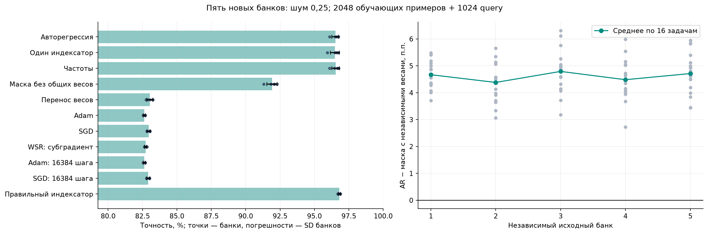
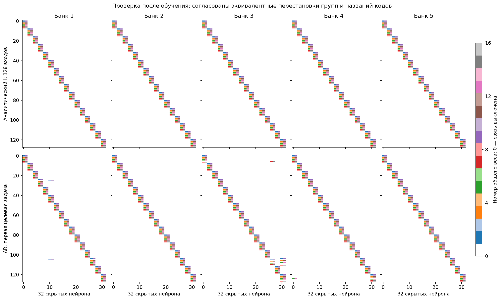
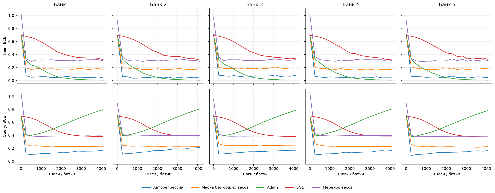
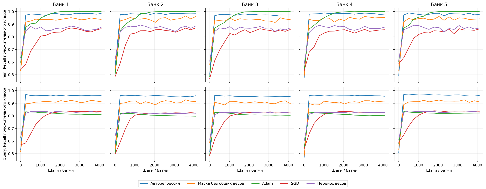
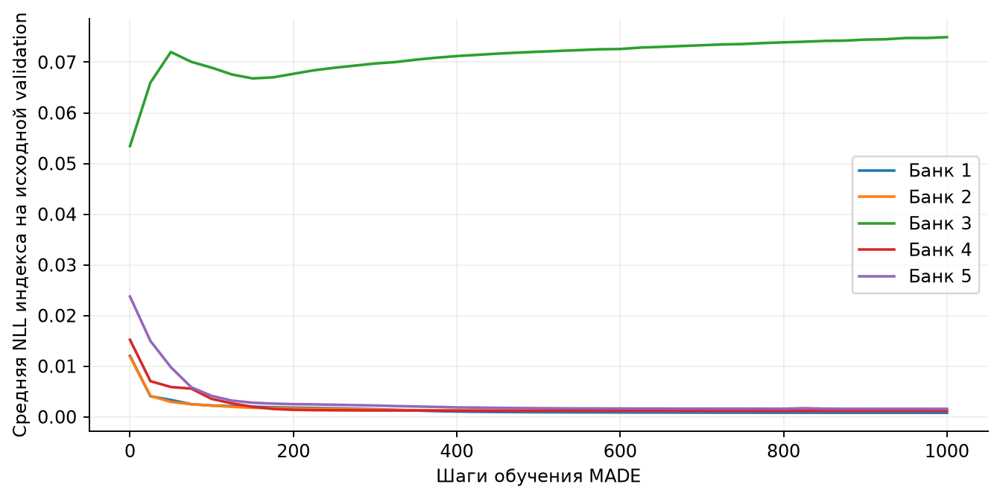

# Перенос структуры: пять независимых банков

Повторили основное сравнение при шуме 0,25: 2048 обучающих примеров, 1024 query для выбора старта и остановки, 16 384 тестовых примера на задачу. Каждый повтор использует новую скрытую перестановку входов, новый исходный банк и 16 новых целевых задач. Всего пять банков и 80 целевых задач.

В каждом повторе заново обучили исходные MLP, выполнили разреживание, извлекли индексаторы из весов и обучили MADE. Один банк из трёх уровней шума выбирали по отложенным исходным задачам. Настройки целевых методов перенесли из предыдущей независимой калибровки без нового подбора. Генератор и настройки заморозили до создания целевых данных. У каждого метода восемь стартов и 4096 шагов; у длинных Adam/SGD — 16 384 шага. Сбор банка требует дополнительных исходных вычислений: одинаков здесь целевой бюджет, а не полная стоимость всех этапов.

Это повтор основного заранее выбранного условия; остальные 11 сочетаний шума и размера выборки остаются в [первом отчёте](DYNAMIC_SIGNAL_STRUCTURES_2026-11-01.md). Там же приведены постановка задачи и аналитический индексатор.

## Результат по каждому банку

| Банк | AR, % | Маска без общих весов, % | Adam, % | SGD, % | AR − маска, п.п. |
| :-- | --: | --: | --: | --: | --: |
| 1 | 96.51 | 91.84 | 82.68 | 83.00 | 4.67 |
| 2 | 96.68 | 92.30 | 82.65 | 83.02 | 4.38 |
| 3 | 96.10 | 91.31 | 82.72 | 83.06 | 4.79 |
| 4 | 96.59 | 92.10 | 82.54 | 82.83 | 4.48 |
| 5 | 96.75 | 92.04 | 82.54 | 82.82 | 4.71 |

Средний выигрыш AR над выбранным ранее основным конкурентом: **4.61 п.п.**; между банками SD = 0.17 п.п. Иерархический bootstrap даёт описательный 95% интервал [4.40; 4.81] п.п.: сначала пересэмплируются банки, затем задачи внутри них. Независимых банков всего пять; 80 задач нельзя считать 80 независимыми проверками обучения банка.

## Все методы

| Метод | Средняя точность, % | SD между банками, п.п. |
| :-- | --: | --: |
| Правильный индексатор | 96.81 | 0.08 |
| Частоты | 96.54 | 0.27 |
| Авторегрессия | 96.53 | 0.25 |
| Один индексатор | 96.49 | 0.32 |
| Маска без общих весов | 91.92 | 0.38 |
| Перенос весов | 83.04 | 0.22 |
| SGD | 82.95 | 0.11 |
| SGD: 16384 шага | 82.92 | 0.11 |
| WSR: субградиент | 82.73 | 0.08 |
| Линейная модель | 82.64 | 0.12 |
| Adam | 82.63 | 0.08 |
| Adam: 16384 шага | 82.63 | 0.08 |
| Случайные входы | 75.32 | 0.27 |

Контроль «Маска без общих весов» получает опорную маску выбранного банка и обучает каждую связь независимо. «Один индексатор» использует ту же структуру с общими коэффициентами. Эта пара выделяет пользу совместного использования весов. AR и частоты могут выдавать другие индексаторы того же банка, поэтому их сравнение с маской проверяет весь способ переноса. WSR — субградиентный вариант регуляризации первого слоя, с ранее подобранными штрафами; полный проксимальный метод статьи не воспроизводился.

## Что удалось восстановить

| Банк | Строк в банке | Уникальных I | Уникальных I в обучении | Правильные связи AR, % | Правильные активные индексы AR, % |
| :-- | --: | --: | --: | --: | --: |
| 1 | 24 | 3 | 3 | 98.44 | 98.44 |
| 2 | 24 | 5 | 5 | 100.00 | 99.22 |
| 3 | 24 | 8 | 7 | 95.31 | 95.31 |
| 4 | 24 | 3 | 3 | 99.22 | 99.22 |
| 5 | 24 | 5 | 5 | 100.00 | 100.00 |

Сравнение с аналитическим индексатором выполняется после обучения, с согласованием эквивалентных перестановок групп и названий коэффициентов. Истинная перестановка не используется для извлечения или отбора банка. Извлекатель заранее знает бюджеты: 16 групп, восемь ролей и два фильтра на группу. Проверяется восстановление состава групп и назначений коэффициентов при этих предположениях.

## Как шло обучение

Кривые усреднены по 16 задачам каждого банка. Для каждой задачи показан старт, выбранный по query, без выбора по test. Train loss и recall измерены на текущем батче, query — на полной отложенной выборке.

Пять повторов проверяют перенос одной общей структуры внутри каждого семейства задач. Близость AR, частот и одного индексатора не даёт оснований приписывать выигрыш именно авторегрессии. Малое число уникальных индексаторов также сохраняется: генерация новых сложных сочетаний этим опытом не проверена. Неполное восстановление в части банков нужно отличать от полного восстановления в первоначальном опыте.

Код воспроизведения: `experiments/dynamic_signal_v1/repeat_banks.py`; таблицы, индивидуальные метрики, исходные веса извлечения, индексаторы, настройки и проверка хешей — в `experiments/dynamic_signal_v1/results/bank_repeats/`. Seeds зафиксированы: 2111481, 3111481, 4111481, 5111481, 6111481.
