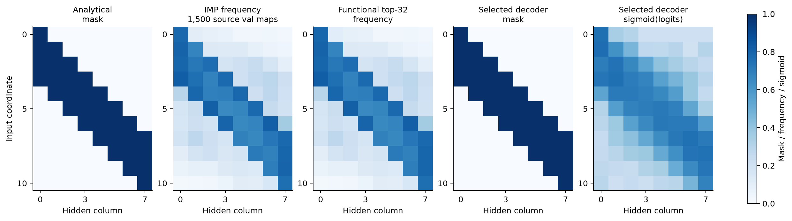
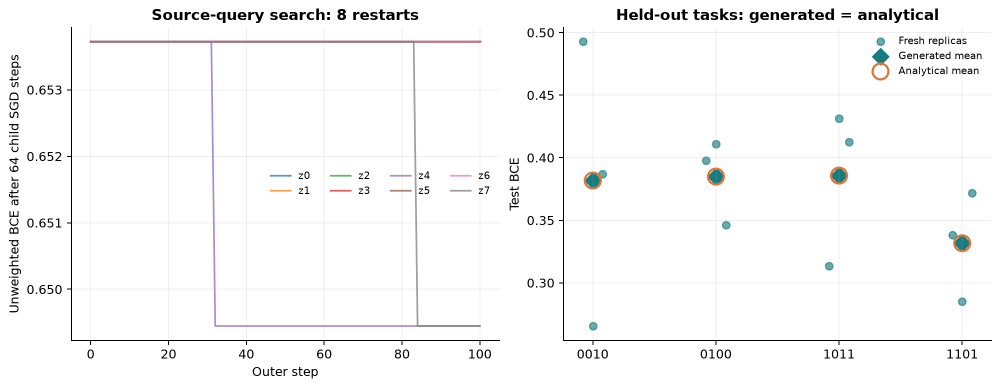

# Отчёт за 13 октября 2026 года

**На Pattern общий decoder восстановил точную теплицеву маску из 32 связей и перенёс её на четыре отложенные задачи: IoU = 1, средняя test BCE = 0,3710. Однако преимущество поиска по `z` пока не показано: выбранная маска уже была правильной до оптимизации.** Следующий эксперимент, `multimask`, реализован, но его полный банк и перенос ещё не завершены.

Это сводка сохранённых результатов на 13 октября, а не новый запуск обучения. Основной источник — `pattern/runs/nf_vae_v2`, обучение и оценка от 9 октября. Числа прежнего 600-эпохового опыта из обсуждения не смешиваются с текущим пятиэпоховым раном.

## Постановка и устройство эксперимента

Pattern: бинарный вход длины 11; метка показывает наличие заданного четырёхбитового паттерна в одном из восьми окон. MLP содержит восемь ReLU-нейронов. Аналитическая поддержка — матрица `11×8`, четыре последовательные связи на колонку, всего **32 связи из 88**. Речь о теплицевой **маске**, а не о равенстве значений обученных весов на диагоналях.

Для каждой source-задачи независимо обучаем MLP, выполняем IMP с возвратом к исходной инициализации и заново обучаем разреженную сеть. В банк сохраняем три канала: эффективные веса, градиент support BCE по весам и функциональную карту. Нормируем каналы отдельно и совместно упорядочиваем скрытые колонки по функциональному центроиду.

У каждой задачи свои два NF-слоя и VAE encoder; decoder общий. Здесь NF — слой с эквивариантностью к перестановке скрытых колонок и фиксированными координатами входа. Decoder выдаёт logits, из которых выбираются ровно top-32 связи. Loss генератора: `0,8 × weighted mask BCE + 0,2 × hard-mask MSE + beta × KL`.

[SVG-схема](assets/2026-10-13/protocol.svg) · [LaTeX-исходники формул](assets/2026-10-13/protocol_math.tex). Формулы отрисованы MathJax из LaTeX в векторные контуры; SVG содержит только ASCII, без Unicode-математических символов.

## Pattern: банк, обучение и перенос

Source-паттерны: `0000, 0001, 0011, 0101, 0110, 0111, 1000, 1001, 1010, 1100, 1110, 1111`. Отложенные: `0010, 0100, 1011, 1101`. Новый банк содержит **12 000 сетей**, по 1000 на задачу; разбиение по инициализациям — 750/125/125 train/validation/test. Пулы наблюдений разделены: support 768, query 256, probe 128, validation 384, test 512.

### Качество исходных MLP

Сводка ниже рассчитана по всем сохранённым последним IMP-раундам и маскам, без отбора сетей по качеству.

| Банк | Карт на задачу | Support BCE | Query BCE | Разрыв | Средний aligned IoU | Точное совпадение |
|---|---:|---:|---:|---:|---:|---:|
| `imp32_batched_v2` | 128 | 0,1358 | 0,4925 | 0,3567 | 0,5281 | 0 / 1536 |
| `imp32_fullsupport_1000_20261009` | 1000 | 0,1752 | 0,2371 | 0,0619 | 0,5969 | 4 / 12 000 |

В новом протоколе используются все 768 support-наблюдений, class-balanced BCE, L2 = 0,001 и выбор минимальной query BCE каждые 25 шагов каждого IMP-раунда. Adam: lr = 0,03, до 1000 шагов на раунд; удаляется 20% оставшихся связей до 32. У **95,8%** сетей последний выбранный checkpoint оказался раньше лимита; медиана — 625 шагов.

Это не парное сравнение: одновременно изменились объём данных, балансировка loss и checkpoint selection. Меньший разрыв согласуется с лучшим контролем переобучения, но не устанавливает причину улучшения. Query участвовал в выборе весов, поэтому его BCE не является независимой итоговой оценкой. Утверждать, что исходные MLP совсем не переобучаются или достигли глобального оптимума, оснований нет.

### Генератор восстановил структуру за пять эпох

Размеры модели: NF 8 каналов, encoder 64, `z` 16, decoder 128. AdamW: lr = 0,001, weight decay = 0,01, batch 128 на задачу. Полный beta = 0,005; разогрев рассчитан на 30 эпох, поэтому на пятой эпохе beta оптимизации ещё равен 0,000833. Checkpoint выбран по максимальному validation IoU, затем по минимальному loss.

| Эпоха | Train loss | Validation loss | Validation IoU | Validation KL | 0,005 × KL |
|---:|---:|---:|---:|---:|---:|
| 1 | 0,7823 | 0,7821 | 0,4545 | 0,0809 | 0,0004 |
| 3 | 0,7109 | 0,7116 | 0,7997 | 0,4730 | 0,0024 |
| 5 | 0,6005 | 0,6024 | **1,0000** | 4,1570 | 0,0208 |

Диагностические кривые вычислены при `z = mu` и одинаковом полном beta = 0,005; это не stochastic loss шага оптимизации. На этих пяти эпохах расхождения train/validation почти нет. Это локальное наблюдение, а не гарантия поведения при долгом обучении. Прежний обсуждавшийся график на 600 эпохах показывал расхождение loss и рост KL; его полный временной ряд в текущем каталоге ранов отсутствует.

Частоты посчитаны по 1500 validation-картам source-задач после индивидуального выравнивания к аналитическому эталону. **IMP frequency** — доля разрешённых IMP-связей; **functional frequency** — доля попаданий связи в top-32 функциональной карты. Это частоты бинарных решений. Последняя панель отдельно показывает **sigmoid decoder logits** для выбранного `z`, с той же перестановкой колонок, что у его бинарной маски. Sigmoid не является доказанно калиброванной вероятностью полезности связи.

### Перенос на четыре задачи

Decoder заморожен. Восемь `z` стартуют из стандартного нормального распределения; 100 внешних Adam-шагов используют только 12 source-задач. Внешний loss — обычная source-query BCE после 64 внутренних SGD-шагов свежих дочерних MLP. Рестарт выбирается по отдельной source-validation после новых Adam fits. Затем маска фиксируется, и на каждой отложенной задаче обучаются веса трёх новых MLP: до 1000 шагов, query-checkpoint каждые 25 шагов. Test-метки не участвуют в поиске или выборе.

| Отложенный паттерн | Generated test BCE | Analytical test BCE | Accuracy | SD BCE трёх инициализаций |
|---|---:|---:|---:|---:|
| `0010` | 0,3817 | 0,3817 | 83,33% | 0,1137 |
| `0100` | 0,3849 | 0,3849 | 82,42% | 0,0342 |
| `1011` | 0,3857 | 0,3857 | 82,16% | 0,0633 |
| `1101` | 0,3317 | 0,3317 | 84,96% | 0,0436 |
| **Среднее по задачам** | **0,3710** | **0,3710** | **83,22%** | — |

SD описывает разброс трёх инициализаций, а не доверительный интервал. Generated и analytical обучались с одинаковыми seeds; маски совпали, поэтому совпали и результаты. Эти test BCE — обычные, без балансировки; сравнивать их напрямую с balanced support BCE банка нельзя. Dense и случайная маска в данной итоговой оценке отсутствуют: превосходство над ними не проверено.

**Польза оптимизации `z` не подтверждена.** Все 8 исходных масок имели IoU = 1. У выбранного рестарта №0 лучший шаг — **0**, маска не изменилась. Ещё пять рестартов сохранили шаг 0. У двух поиск снизил короткий source-query loss, но ухудшил IoU до 0,9394; source-validation BCE стала 0,2754 вместо 0,2521, и они не были выбраны. Дополнительно 124 из 128 сохранённых prior-масок совпали с эталоном после выравнивания. Ненулевой KL сам по себе не доказывает полезного разнообразия пространства поиска.

## Multimask: следующий опыт пока не завершён

Новая синтетика имеет два независимых семейства A/B, вход длины 68 и четыре известных равноценных маски на задачу: два значимых бита можно независимо заменить их точными копиями. Маска по-прежнему содержит 32 связи. Одной такой маски недостаточно для точного решения обеих независимых функций A/B. Поэтому опыт должен проверить выбор структуры, который Pattern с общей поддержкой проверить не смог.

Протокол: 12 source-задач, 4 отложенные, по **1024 карты на source-задачу**, всего планируется 12 288. Отдельные эпизоды поиска: шесть задач A → две новые A, затем аналогично B. Среди контролей предусмотрен лучший случайный `z`, выбранный по той же source-validation, без оптимизации.

| Состояние на 13 октября | Сохранённые данные |
|---|---|
| Полностью записанная задача | Только `A_0000`, 1024 карты; 1 из 12 source-задач |
| Query soft-target BCE / аналитический минимум | 0,6469 / 0,5453; превышение 0,1016 |
| Средний nearest-reference IoU / точные маски | 0,3647 / 0% |
| Manifest | `running`; это статус артефакта, не подтверждение активного процесса |
| Обученный генератор / оценка переноса | Сохранённых завершённых ранов нет |

В отличие от Pattern, здесь BCE использует мягкую целевую вероятность и имеет ненулевой минимум `BCE(p,p)`. Эти значения нельзя напрямую сопоставлять с Pattern. Качество первых учителей пока далеко от известного эталона; выводы о восстановлении всех четырёх вариантов или переносе делать рано. [Постановка и параметры](../multimask/README.md).

## Выводы и следующий шаг

1. Восстановление общей теплицевой поддержки на Pattern и её перенос подтверждены одним сохранённым полным раном. Аналитический эталон используется для выбора checkpoint по IoU и диагностического выравнивания: это восстановление известной структуры, а не независимое открытие неизвестного prior.
2. Поиск `z` в этом опыте не дал выигрыша; общий структурный ответ почти всегда доступен уже из prior. Нужен контроль против случайных стартов и сравнение после полного обучения дочерних сетей, а не только короткого внутреннего loss.
3. Для `multimask` сначала следует оценить качество учителей относительно известного BCE-минимума, затем завершить банк и провести source-only перенос. Проверять полезность маски по свежей MLP, а разнообразие равноценных вариантов — отдельно. Параметры нового опыта пока стартовые, не доказанно оптимальные.

## Источники и данные для графиков

- [Метрики переноса](../pattern/runs/nf_vae_v2/evaluations/20261009T010526Z_50ecfc29/metrics.json), [протокол](../pattern/runs/nf_vae_v2/evaluations/20261009T010526Z_50ecfc29/protocol.json), [выбор рестарта](../pattern/runs/nf_vae_v2/evaluations/20261009T010526Z_50ecfc29/selection.json).
- [История обучения](../pattern/runs/nf_vae_v2/history.json), [конфигурация](../pattern/runs/nf_vae_v2/config.json), [manifest нового Pattern-банка](../data/pattern/banks/imp32_fullsupport_1000_20261009/manifest.json), [manifest Multimask](../data/multimask/banks/imp32_1024_v1/manifest.json).
- Таблицы отчёта: [банки](assets/2026-10-13/banks.csv), [обучение](assets/2026-10-13/training.csv), [перенос](assets/2026-10-13/transfer.csv), [рестарты z](assets/2026-10-13/latent_restarts.csv). [Полная численная сводка](assets/2026-10-13/summary.json) и [пути/хеши основных источников](assets/2026-10-13/sources.json).

Банки и исходные раны исключены из Git; таблицы и изображения этого отчёта самодостаточны. Новое обучение не запускалось, исходные эксперименты не изменялись. Выводы относятся к имеющимся seeds и протоколу; независимая репликация всего опыта пока отсутствует.
