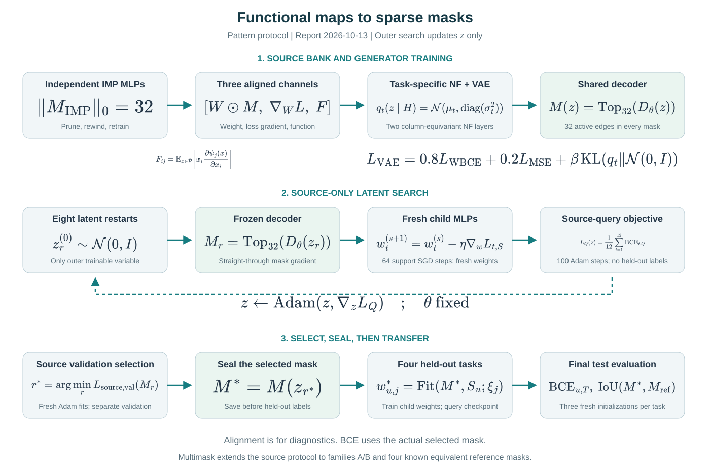
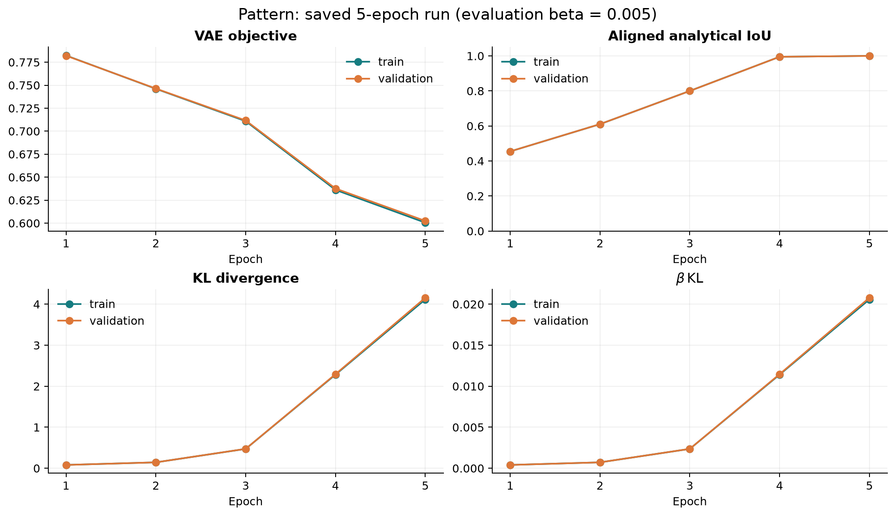
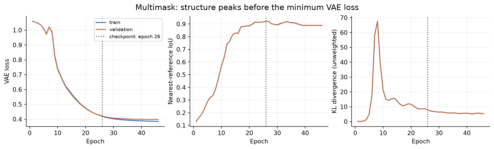
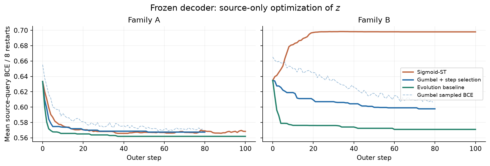
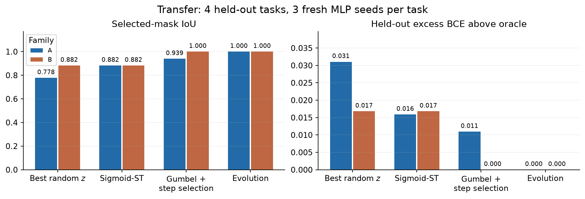
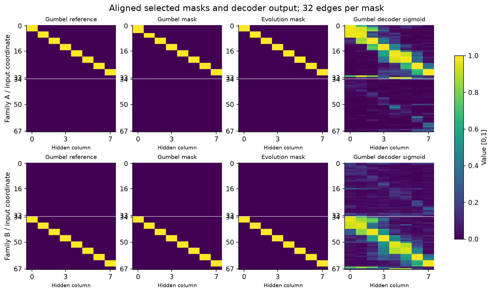

# Итоговый отчёт — 13 октября 2026

**Pattern: точная теплицева маска и перенос, но поиск z не дал выигрыша. Multimask: Gumbel-поиск улучшил случайные старты и достиг точной маски B; evolution baseline достиг точных масок A и B.**

## Протокол

12 source-задач, 4 отложенные. IMP оставляет **32 связи**. Три канала банка: веса, градиенты BCE, функциональные карты. Модель: два NF-слоя → VAE encoder задачи → общий decoder. При переносе обучается только z; decoder заморожен. Поиск и выбор маски используют только source-данные; отложенные задачи оцениваются после её фиксации.

Схема — для Pattern; в Multimask эпизод использует шесть source-задач семейства. Математика SVG отрисована из [LaTeX](assets/2026-10-13/protocol_math.tex), без Unicode-математики.

## Pattern

Банк: **12 000 карт**, средняя query BCE MLP — **0,2371**, aligned IoU — **0,5969**. Генератор достиг validation IoU = **1** за пять эпох; KL = **4,157**.

На четырёх отложенных задачах: **test BCE = 0,3710; accuracy = 83,22%**. Generated и аналитическая маски совпали. Все восемь стартовых масок уже имели IoU = 1; выбран шаг **0**. Польза оптимизации z не подтверждена.

## Multimask: банк и обучение

Два независимых семейства A/B, по четыре известных равноценных маски благодаря дублированным входам. Полный банк: **128 карт на задачу, всего 1536**. Средние query BCE / аналитический минимум: **0,5666 / 0,5470**; IoU — **0,8615**, точных масок — **14,13%**.

Лучший checkpoint по validation IoU — **эпоха 26**: validation IoU = **0,9218**, KL = **7,830**. К эпохе 46 loss снизился, но IoU упал до 0,8889: меньший VAE loss не гарантирует лучшую структуру.

## Multimask: поиск z и перенос

Восемь одинаковых N(0,I)-стартов. Внутреннее обучение: 512 SGD-шагов, lr = 2; итоговая оценка: 1000 Adam-шагов, три свежие MLP на задачу. Параметры и рестарт выбирались по source-данным.

**Gumbel-Top-k / RelaxedTopK:** Adam обучает z по BCE через обучение MLP; маска в прямом проходе бинарная. Проверяются длины шага 1/0,5/2 вдоль направления Adam; ухудшающий BCE без шума шаг откатывается. Настройки: **80 шагов, lr = 0,05, температура 2→1, шум 0,25→0,05, две выборки на шаг**. Evolution: 100 шагов, четыре Gaussian-предложения на рестарт, радиус 0,3.

Пунктир — BCE Gumbel-выборок для градиента; синяя сплошная линия — BCE без шума для принятия шага. Показаны средние восьми рестартов, а не loss выбранной маски. Прежний sigmoid-ST ухудшал B.

| Метод | IoU A / B | Test BCE A / B |
|---|---:|---:|
| Лучший случайный z по source-validation | 0,7778 / 0,8824 | 0,57962 / 0,56220 |
| Прежний sigmoid-ST | 0,8824 / 0,8824 | 0,56446 / 0,56220 |
| **Gumbel + проверка шага** | **0,9394 / 1,0000** | **0,55952 / 0,54540** |
| **Evolution baseline** | **1,0000 / 1,0000** | **0,54858 / 0,54540** |

Gumbel выбрал шаги **28 / 72** для A/B. Для B достигнут аналитический риск; для A excess BCE = **0,01094**, evolution лучше. Здесь BCE имеет мягкую цель и минимум BCE(p,p); абсолютные значения несопоставимы с Pattern.

Каждая маска выровнена к своему ближайшему эталону только для визуализации; sigmoid переставлен вместе с Gumbel-маской. Evolution нашёл по одному варианту A/B, Gumbel — один вариант B. Покрытие всех четырёх оптимумов не показано.

**Вывод:** на Multimask поиск z полезен относительно случайных стартов. Gumbel исправил ухудшение B, но уступает evolution для A. Сравнение использует один decoder, одинаковые seeds и неизменный банк; независимой репликации ещё нет.

## Данные

[Сводка](assets/2026-10-13/summary.json) · [источники и SHA-256](assets/2026-10-13/sources.json) · CSV: [обучение](assets/2026-10-13/multimask_training.csv), [поиск](assets/2026-10-13/multimask_search.csv), [перенос](assets/2026-10-13/multimask_transfer.csv) · [значения хитмапов](assets/2026-10-13/multimask_masks.json).

Графики и таблицы включены в репозиторий. Обновление выполнено по сохранённым ранам, без нового обучения.
