# Перенос разреженных масок на новые задачи Итоговый отчёт за 20 октября 2026

**W/G-декодер с эволюционным поиском z позволяет решать новые функции лучше текущих IMP и плотной MLP в двух проверенных постановках.** Для уже известных структур точная маска найдена в 65/72 поисков. В композиционном пилоте, где полная правильная маска отсутствует в train, — в 12/24. Во втором опыте средняя избыточная BCE ниже IMP на 26,4% и плотной MLP на 58,6%.

Результаты относятся к качеству в заданных валидационных протоколах. Полная стоимость методов не уравнена: W/G использует предварительно обученные банк и декодер. При известных масках случайный поиск z даёт меньшую среднюю ошибку, чем evolution; на новых сочетаниях лучше evolution. Gumbel в обоих опытах слабее.

## 1. Датасет и смысл задачи

### Входы, маска и семейство функций

Каждый объект — 48 независимо сгенерированных чисел из стандартного нормального распределения. Первые 32 входа определяют ответ учителя, последние 16 — независимый шум с тем же распределением. Шумовые входы полноценные: они не обнулены и не являются копиями полезных признаков.

Учитель — сеть 48→8→1 с ReLU в скрытом слое и sigmoid на выходе. Её **маска** — бинарная матрица 48×8: строка соответствует входу, столбец — скрытому нейрону, единица разрешает связь между ними. Нумерация входов и нейронов начинается с нуля.

У каждого нейрона есть два закреплённых входа, общих для всех семейств, и два переменных входа из диапазона 16–31. Переменные пары не пересекаются: каждый из этих 16 входов используется ровно один раз. Поэтому в правильной маске 32 связи из 384 возможных: 16 общих и 16 определяющих семейство.

$$
\begin{aligned}
x&\sim\mathcal N(0,I_{48}),\qquad M\in\{0,1\}^{48\times8},\\
M_{ih}&=\mathbf1\{i\in\{2h,2h+1\}\cup V_h\},\qquad
|V_h|=2,\quad h=0,\ldots,7,\\
\bigcup_{h=0}^{7}V_h&=\{16,\ldots,31\},\qquad
V_h\cap V_k=\varnothing\ (h\ne k),\qquad \|M\|_0=32.
\end{aligned}
$$

Например, нейрон 0 в одном семействе использует входы {0,1,18,30}, а в другом — {0,1,22,31}. Правильная группировка неизвестна обучаемой модели.

**Семейство** задаёт маску, **функция** — численные параметры учителя, **выборка** — наблюдения этой функции. Внутри семейства маска сохраняется, но для каждой функции заново выбираются положительные веса разрешённых связей, пороги ReLU, знаки и величины выходных коэффициентов. Ненулевые веса равномерны на [0,5; 1,5] и нормируются до единичной длины для каждого нейрона; пороги равномерны на [−0,5; 0,5]. Выходные коэффициенты имеют случайный знак и модуль из [0,8; 1,2], делённый на корень из восьми. Сдвиг c центрирует средний логит. Учитель вычисляет:

$$
y(x)=\sigma\!\left(c+\sum_{h=0}^{7}a_h\operatorname{ReLU}\!\left(
\sum_{i=0}^{47}M_{ih}w_{ih}x_i-\tau_h\right)\right),\qquad
\sigma(u)=\frac1{1+e^{-u}}.
$$

Таким образом, одна маска решает разные функции. Проверяется перенос структуры между функциями, а не только предсказание на новых объектах той же функции.

### Что видит алгоритм и как измеряется качество

Метки — точные вероятности учителя, без сэмплирования бинарного ответа. У каждой функции три независимых набора наблюдений:

| Набор | Размер | Назначение |
| --- | ---: | --- |
| Support | 2048 | Обновление весов MLP |
| Query | 2048 | Выбор маски или checkpoint на соответствующем этапе |
| Test | 8192 | Оценка зафиксированного результата |

В обоих опытах функции 0–3 обучающих семейств используются для банка и VAE. По support/query новых функций 4/5 выбирается одна маска. Выбор фиксируется до открытия других новых функций 6/7. На каждой из них численные веса MLP обучаются с нуля; query выбирает checkpoint, test измеряет ошибку. Функции 8–11 пока не использовались. Название test BCE здесь означает отдельную выборку объектов, а не завершённую итоговую проверку на резервных задачах.

Обучаемая MLP имеет ту же архитектуру, что учитель. Без маски это одна сеть с 401 параметром; с 32 разрешёнными связями — 49 эффективных параметров. Bias и выходной слой обучаются во всех методах и не обрезаются.

На схеме входы пронумерованы с единицы: блоки 1–16, 17–32 и 33–48 соответствуют диапазонам 0–15, 16–31 и 32–47 в тексте и хитмапах. Каждый блок означает 16 отдельных входов.

Обучение минимизирует BCE с мягкими метками и L2-штрафом. Даже идеальный учитель имеет ненулевую BCE, поэтому основной показатель — **excess BCE**: превышение ошибки над энтропией вероятностей учителя. Чем ближе он к нулю, тем точнее восстановлена функция.

$$
\begin{aligned}
\ell(y,p)&=-y\log p-(1-y)\log(1-p),\\
\Delta_D&=\frac1{|D|}\sum_{(x,y)\in D}
\left[\ell\!\left(y,\widehat y(x)\right)-\ell(y,y)\right].
\end{aligned}
$$

Структуру оцениваем по **IoU**: число совпавших связей, делённое на число связей в объединении двух масок. IoU=1 означает точное совпадение. Перед сравнением разрешается переставить скрытые столбцы, поскольку их порядок не меняет функцию сети; входные строки переставлять нельзя. Аналитическое сопоставление используется для метрик и рисунков, а не для выбора маски. IoU переменной части отдельно учитывает строки 16–31.

## 2. Методы и общий протокол

Основной генератор обучается по **W/G-картам**: весам первого слоя W, градиентам support BCE по этим весам G и фактическим маскам IMP. Аналитические маски не являются targets VAE. У каждой исходной функции собственный NF-энкодер, общий декодер преобразует 16-мерный z в 384 оценки связей. Top-32 оставляет 32 связи; четыре связи в каждом нейроне и отсутствие шумовых входов отдельно не навязываются.

NF-энкодер учитывает перестановки скрытых колонок; reconstruction дополнительно сопоставляет колонки предсказания и IMP-target. Декодер — MLP 16→128→128→384, prior — стандартное нормальное распределение. **При переносе энкодер не нужен:** декодер заморожен, z выбирается по новым адаптационным данным.

| Метод | Как получается маска |
| --- | --- |
| MLP без маски | Все 384 связи разрешены; одна сеть на каждый повтор, без ансамбля прогнозов. |
| Аналитическая маска | Контроль достижимой точности: правильные связи известны, численные веса учатся с нуля. В поиск этот ответ не добавляется. |
| IMP | Обучение плотной сети, удаление наименьших по модулю весов и возврат оставшихся весов к исходной инициализации. Повторяется до 32 связей. |
| W/G evolution | Случайные изменения z; сохраняются улучшения адаптационной query BCE. |
| W/G Gumbel | Обновление z по градиенту через непрерывный суррогат дискретной top-32 маски. |
| Случайные z | Проверяются 1608 независимых кандидатов prior, включая общие исходные старты. |
| Лучший исходный z / нулевой z | Выбор из восьми стартов / фиксированный код z=0. |
| Частотная маска | Top-32 частот связей в обучающих IMP-картах. |
| Выбор из IMP-банка | Кандидат из train-карт выбирается по адаптационной BCE, без обращения к правильной маске. |
| Сборка двух IMP-масок | В композиционном пилоте смешиваются по четыре колонки двух train-карт; число связей доводится до 32 внутри их объединения. |

Чтобы оценить кандидата, **внутри fitness обучаются свежие MLP** на функциях 4/5: Adam, 64 шага, lr=0,1, warmup=32. Это обучение отличается от предварительного обучения банка. Настройка выбрана на восьми валидационных семействах первого опыта и сохранена для композиционного пилота.

У Gumbel и evolution восемь стартов и 40 внешних шагов. Они, случайный поиск и банковские контроли используют по 1608 оценок кандидатов. Это равенство числа оценок, а не времени: дифференцируемое обучение дороже обычного. Итоговая MLP каждого метода обучается одинаково: Adam, 2000 шагов, lr=0,03, warmup LeakyReLU 200 шагов, три инициализации. Все обучения выполняются на CUDA.

## 3. Новые функции с уже известной маской

### Результаты

В первой постановке 24 обучающих семейства имеют разные маски с попарным пересечением 16–20 связей; полные группы входов нейронов между семействами не повторяются. В обучение VAE входят 9216 train-карт 96 исходных функций из банка 13 312 карт. Новые функции 4–7 используют те же правильные маски. Оценка охватывает 24 семейства × три W/G-декодера — 72 поиска.

| Метод | Test excess BCE ↓ | IoU ↑ | Точные маски |
| --- | ---: | ---: | ---: |
| Аналитическая маска | 2,6e-8 | 1,0000 | Контроль |
| MLP без маски | 0,002757 | — | — |
| IMP на новой функции | 0,001504 | 0,8399 | 28/144 |
| W/G evolution | 0,000775 | 0,9471 | 65/72 |
| W/G Gumbel | 0,005857 | 0,6587 | 16/72 |
| Случайные 1608 z | 0,000219 | 0,9916 | 62/72 |
| Выбор из IMP-банка | 2,6e-8 | 1,0000 | 24/24 семейства |
| Лучший из восьми стартов | 0,009076 | 0,4991 | 0/72 |
| Нулевой z | 0,012673 | 0,3965 | 0/72 |
| Частотная маска | 0,018177 | 0,3263 | 0/72 |

У W/G знаменатель 72 — выбранные переносимые маски. У IMP знаменатель 144 — отдельные оценочные сети: 24 семейства × две функции × три инициализации. Банковский контроль повторяется при разных декодерах и учитывается как 24 семейства. Он действительно содержит правильные маски, однако выбирает их по query BCE, а не оракульно по IoU.

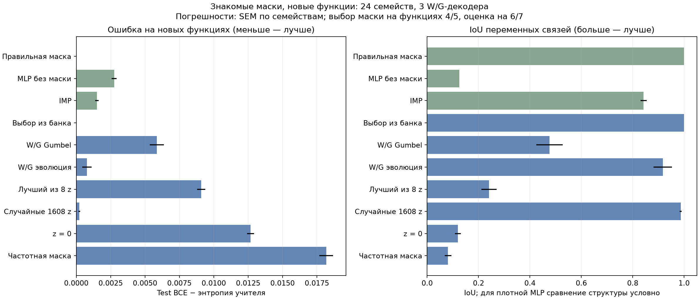

**Evolution чаще находит точную маску, но random имеет меньшую среднюю ошибку.** Семь промахов evolution грубее десяти промахов random: средние IoU неточных результатов около 0,456 и 0,939 соответственно. Во всех 62 случайных пулах, где был точный ответ, fitness выбрала его.

### Почему помогла настройка внутреннего обучения

Прежние 64 шага SGD сильно недообучали MLP внутри fitness: даже с правильной маской закрывалось лишь 8,17% разрыва от константного прогноза до учителя. После перехода на выбранный Adam — 99,90%. Банк и декодеры при этом не переобучались. Эффект сохранился и на 16 семействах вне подбора: excess BCE evolution 0,000971, random 0,000258, IMP 0,001637.

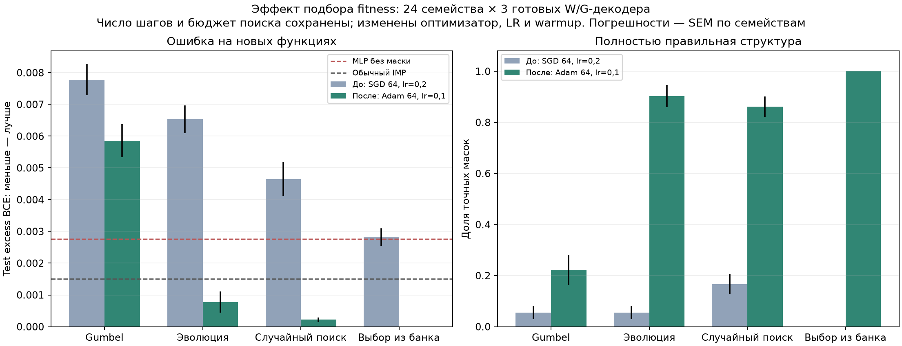

Gumbel остаётся слабым: random лучше по самой fitness в 55/72 случаях, принимается 4,35% предложенных обновлений. Исправление внутреннего обучения улучшило критерий отбора, но не устранило проблему внешнего градиентного поиска.

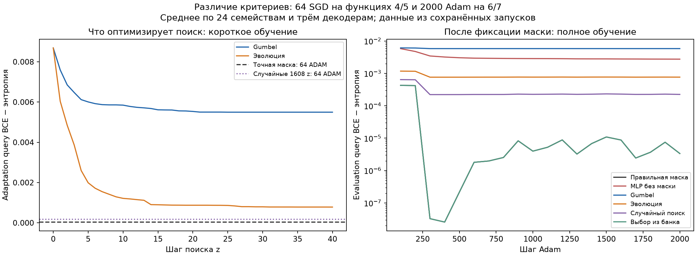

Слева — fitness адаптационных функций, справа — query-ошибка при полном обучении на других оценочных функциях. Показаны текущие кривые; итоговый checkpoint выбирается по минимуму query BCE.

### Декодер до и после поиска и найденные маски

На хитмапах строки 0–15 — общие входы, 16–31 — переменные, 32–47 — шум. Колонки выровнены с эталоном только для рисунка. Верхняя строка пар «до/после» показывает sigmoid от оценок связей, нижняя — используемую бинарную top-32 маску. В каждой паре взят один и тот же старт: его начальный z и конечный z выбранной траектории.

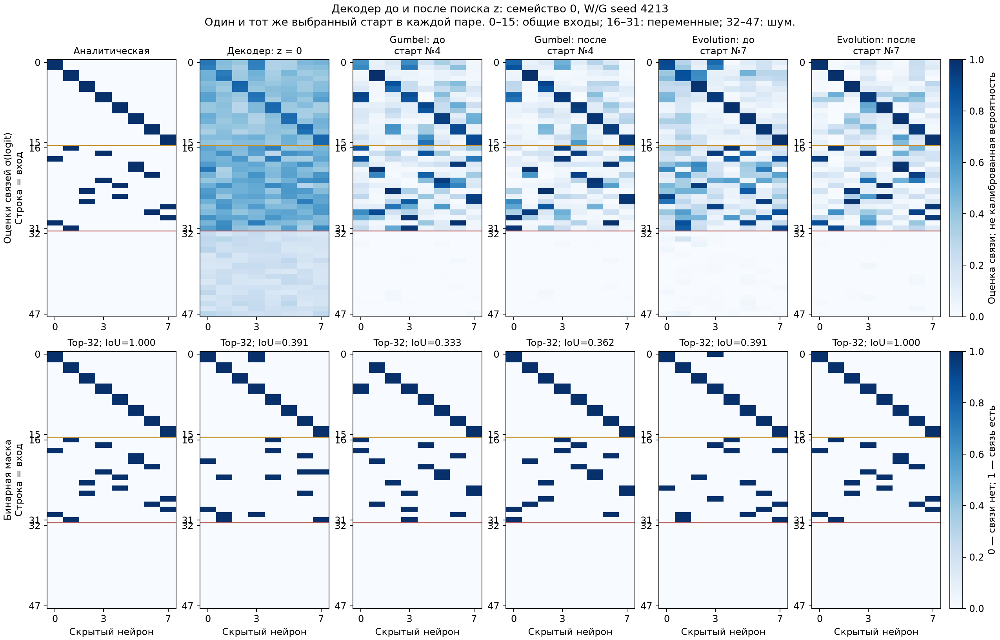

В семействе 0 evolution повышает IoU с 0,391 до 1, Gumbel — с 0,333 до 0,362.

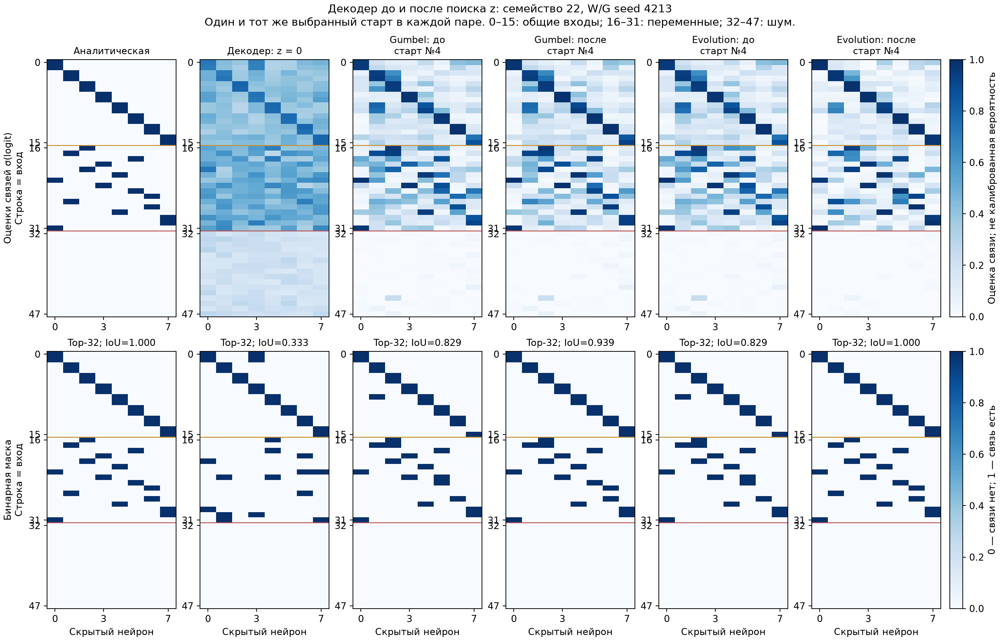

В семействе 22 evolution также находит точную маску. Примеры ниже используют тот же seed декодера 4213. Средний IMP — частота связей в шести выровненных масках, а не отдельная сеть или ансамбль предсказаний. Полностью синяя маска MLP означает наличие всех связей, а не равенство их весов.

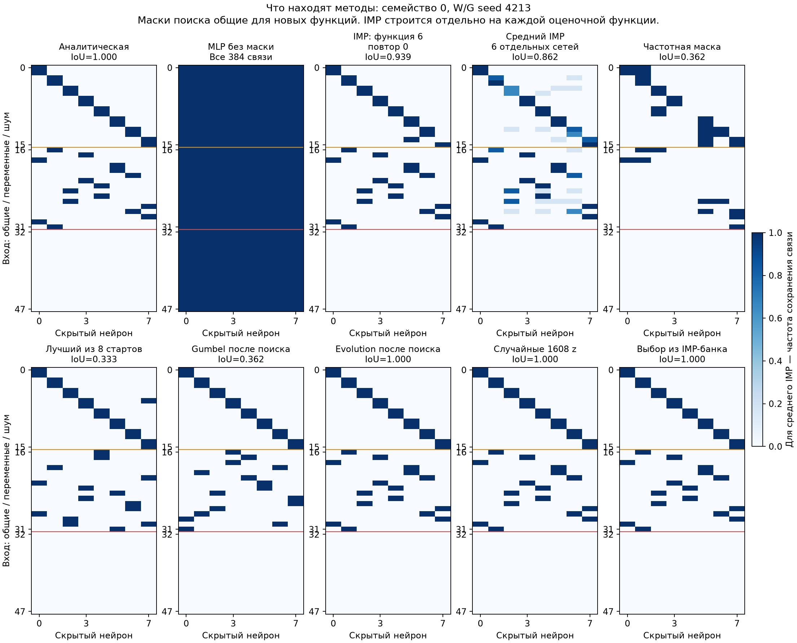

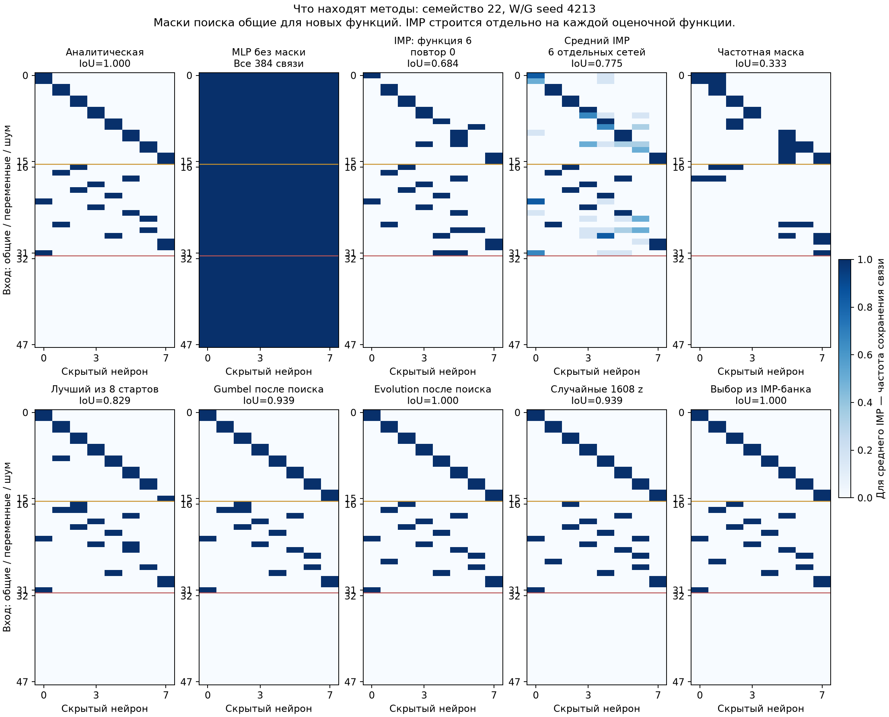

Этот опыт подтверждает перенос известных структур на новые функции. Сам по себе он не проверяет сборку маски, которой целиком не было в train.

## 4. Новые задачи: сборка маски из известных частей

### Постановка

Во втором опыте **полная нужная маска отсутствует в train, но целиком собирается из частей двух обучающих масок**. Первые четыре скрытых нейрона образуют блок A, последние четыре — B. Каждый блок содержит 16 связей. Входы 16–23 распределяются внутри A, входы 24–31 — внутри B; остальные свойства учителя сохраняются.

У каждого блока шесть вариантов. Из 36 сочетаний 24 входят в обучение, шесть новых — в валидационный пилот, ещё шесть оставлены для будущего test. Каждый вариант A и B встречается в четырёх обучающих сочетаниях, но полные отложенные маски не совпадают с train даже после перестановки скрытых колонок.

$$
M_{ij}=[A_i\mid B_j],\qquad A_i,B_j\in\{0,1\}^{48\times4}.
$$

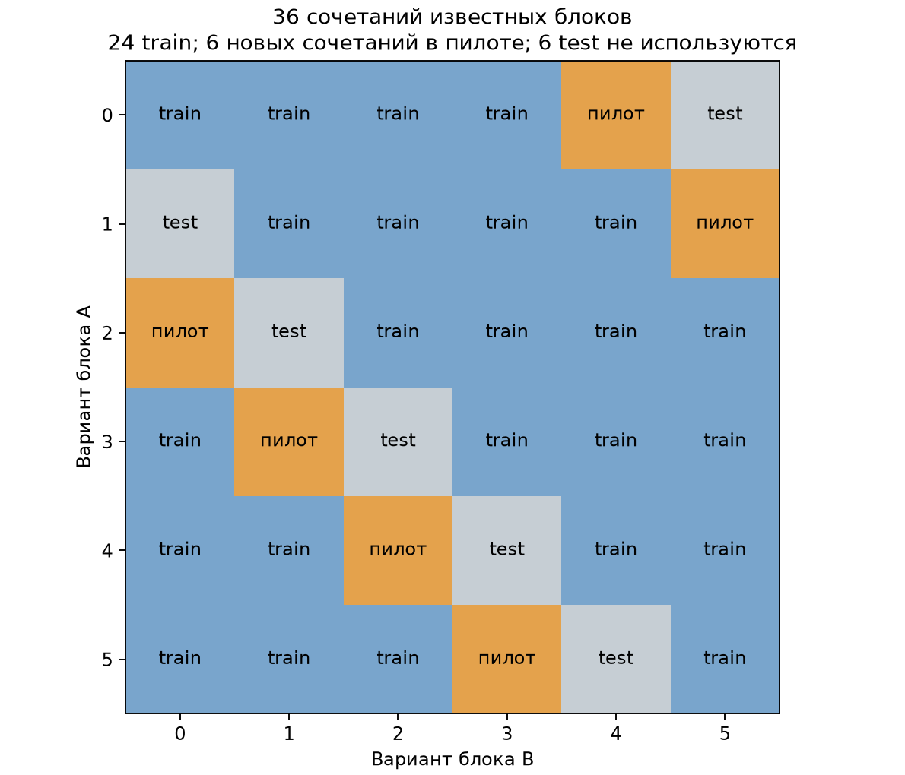

Например, новая A0+B4 собирается из обучающих A0+B3 и A4+B4: берём блок A первого родителя и блок B второго. Объединение содержит 48 уникальных связей, нужная маска — 32. В показанных парах остальных валидационных сочетаний объединения содержат 46–47 связей. Все нужные связи присутствуют; аналитические маски и правильные родители поиску не передаются.

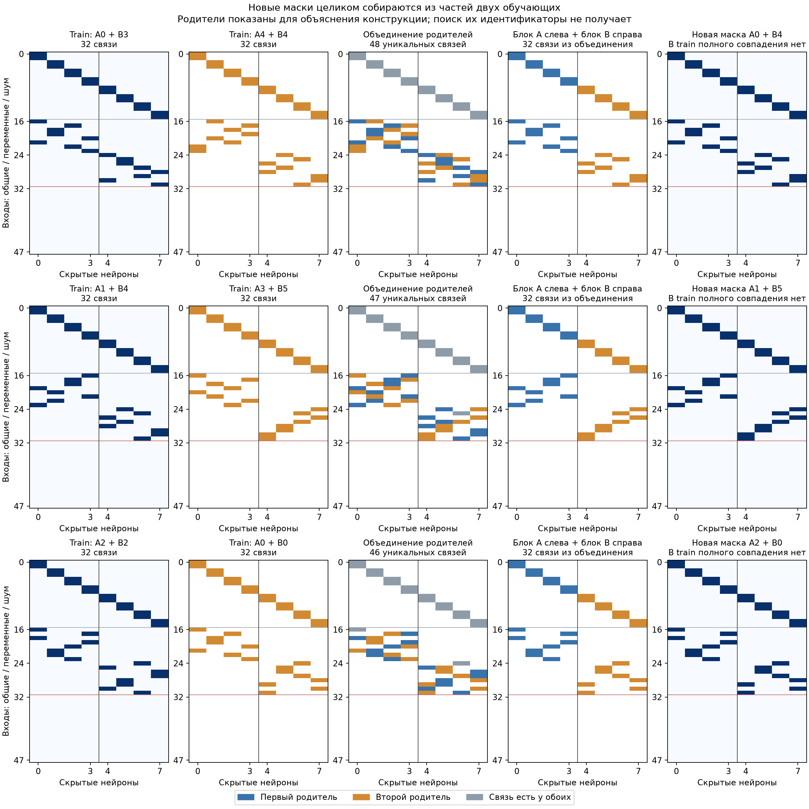

### Пилот и результаты

Собран отдельный банк из 1536 IMP-карт только 24 обучающих сочетаний: по четыре функции и 16 MLP на функцию. Разбиение карт — 1152/192/192 для обучения VAE, выбора checkpoint и диагностики. Ни одной из шести новых масок нет во всём банке. Обучены четыре W/G-декодера; аналитический IoU реконструкций известных структур составляет 0,983–0,995.

Оценены шесть новых сочетаний × четыре декодера — 24 поиска. Настройки fitness и поиска сохранены из первого опыта. В контроле сборки две train-карты выбираются случайно, их колонки сопоставляются по пересечению, затем смешиваются по четыре колонки каждого родителя. Это эвристика из 1608 кандидатов, а не полный перебор подмасок всех объединений.

| Метод | Test excess BCE ↓ | IoU ↑ | Точные маски |
| --- | ---: | ---: | ---: |
| Аналитическая маска | 6,62e-9 | 1,0000 | Контроль |
| MLP без маски | 0,002763 | — | — |
| IMP на новой функции | 0,001554 | 0,8450 | 8/36 |
| **W/G evolution** | **0,001144** | **0,9184** | **12/24** |
| W/G Gumbel | 0,003636 | 0,7364 | 1/24 |
| Случайные 1608 z | 0,001663 | 0,9016 | 4/24 |
| Сборка двух IMP-масок | 0,003225 | 0,8342 | 1/24 |
| Выбор одной IMP-маски | 0,002975 | 0,7618 | 0/24 |
| Лучший исходный z | 0,005099 | 0,6525 | 0/24 |
| Нулевой z | 0,007888 | 0,5444 | 0/24 |
| Частотная маска | 0,007886 | 0,5835 | 0/24 |

Здесь 24 — число выбранных переносимых масок, 36 у IMP — число отдельных сетей на шести сочетаниях, двух оценочных функциях и трёх инициализациях. Повторение одинаковых IMP-контролей при разных декодерах не увеличивает число наблюдений. В обоих опытах средние и SEM считаются по семействам после усреднения внутренних повторов.

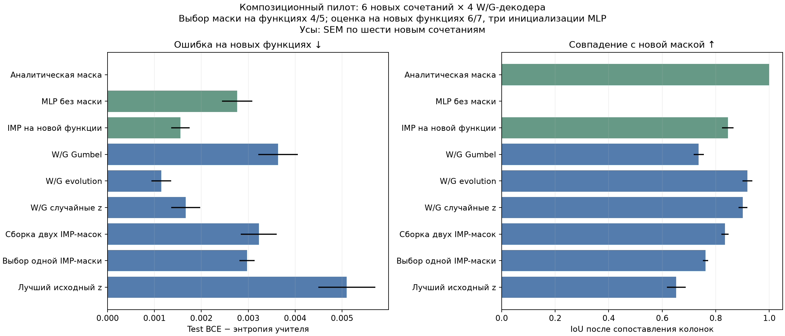

**Evolution лучше IMP по средней ошибке в 4/6 семейств и плотной MLP — в 6/6.** Для каждого нового сочетания хотя бы один из четырёх запусков нашёл точную маску. Относительно random средняя ошибка ниже на 31,2%, точных ответов втрое больше. Gumbel хуже плотной MLP.

Ниже показаны два случая с фиксированным seed 4213. Для A0+B4 evolution промахивается и уступает IMP. Для A2+B0 evolution и random находят точную новую маску, тогда как средний IoU IMP равен 0,760. Общая таблица включает все запуски, а не только удачные примеры.

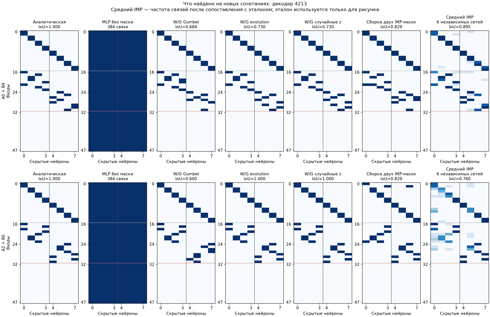

Пилот подтверждает возможность точного восстановления новых сочетаний известных частей. Устойчивость ещё неполная: половина отдельных поисков evolution неточна, два семейства по средней ошибке уступают IMP. Следующий этап — зафиксировать выбор между декодерами по адаптационным данным и проверить шесть оставленных итоговых сочетаний. Подробности и результаты по каждому семейству — в [отдельном отчёте пилота](COMPOSITION_PILOT_2026-10-20.md).

## 5. Предыдущие опыты Pattern, Multimask и AGOP

Эти результаты получены 17–18 октября на прежних постановках и объясняют выбор текущего подхода. Их численные метрики напрямую не объединяются с двумя опытами выше.

### Общие энкодеры и декодеры

Замена 12 энкодеров и одного декодера на один энкодер и 12 декодеров уменьшила модель с 10,31 до 1,92 млн параметров, но bank-test IoU снизился с 0,9316 до 0,8979. При переносе на seed 4213 IoU семьи A ухудшился с 0,9394 до 0,8824; для B остался равным 1. Преимущество общего энкодера для переноса не установлено.

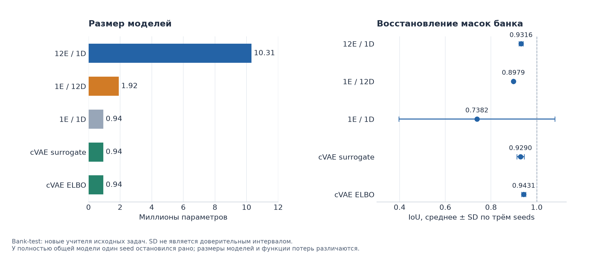

Теоретически sharing не гарантирует одинакового смысла координат z: приватные декодеры могут обращать разные преобразования латентного кода. Также ненулевой Jacobian не гарантирует изменения top-32 маски — для этого должен поменяться порядок оценок на её границе. Поэтому reconstruction loss дополняется контролями разнообразия и улучшения после поиска.

### Почему Pattern почти оптимален до поиска

Сохранённый z₀ — случайный вектор prior, а не буквальный ноль. Из 4096 prior-масок точны 96,92%, средний IoU — 0,9981; при z=0 IoU равен 0,9394. Это не сводится к визуальному выравниванию: top-32 частот канонизированных train-масок уже совпадает с общей аналитической поддержкой. Все задачи Pattern имеют одну такую поддержку, поэтому сильного общего prior достаточно для точного ответа без поиска.

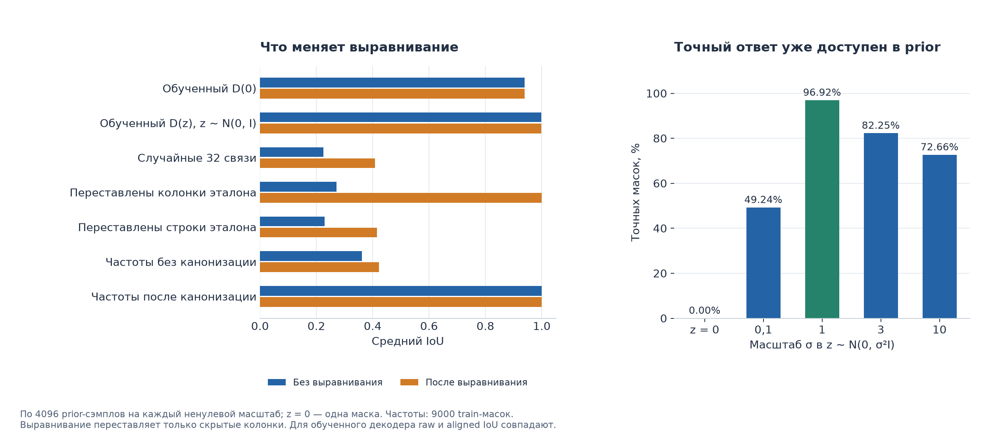

Исключительная причинная роль канонизации не доказана: полного переобучения без неё не было. Но выбранный шаг 0 не демонстрирует улучшения от оптимизации z.

### cVAE на Multimask

Условие A/B повышает устойчивость восстановления банка: ELBO-вариант достиг IoU 0,9431 ± 0,0091. При этом одновременно менялся loss, поэтому весь эффект нельзя приписать conditioning. Полный перенос на seed 4213 не улучшился относительно исходной модели: IoU 0,9394 для A и 1 для B.

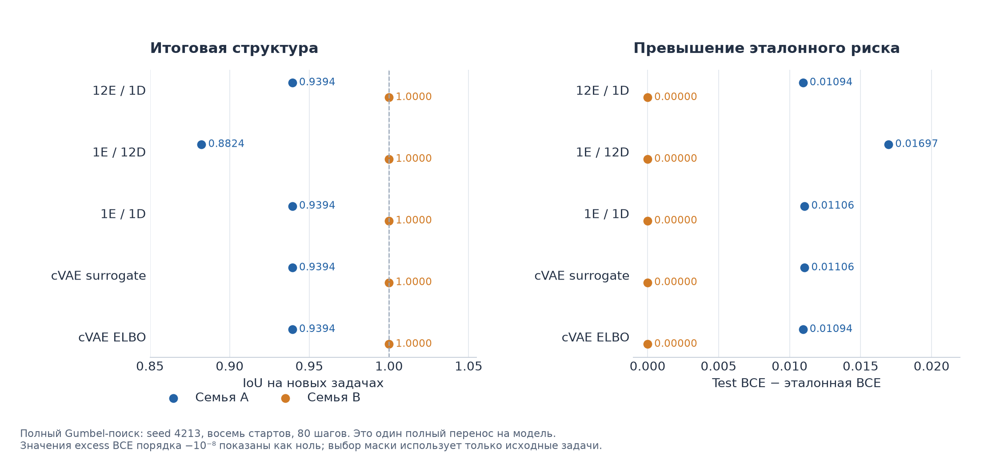

Точный ответ B получается и из простого частотного контроля, а у ELBO-модели — уже при нулевом коде. Среди 512 prior-сэмплов на пару seed/семья находили максимум один точный вариант из четырёх. Высокая доля точных ответов не означает покрытия всех допустимых структур.

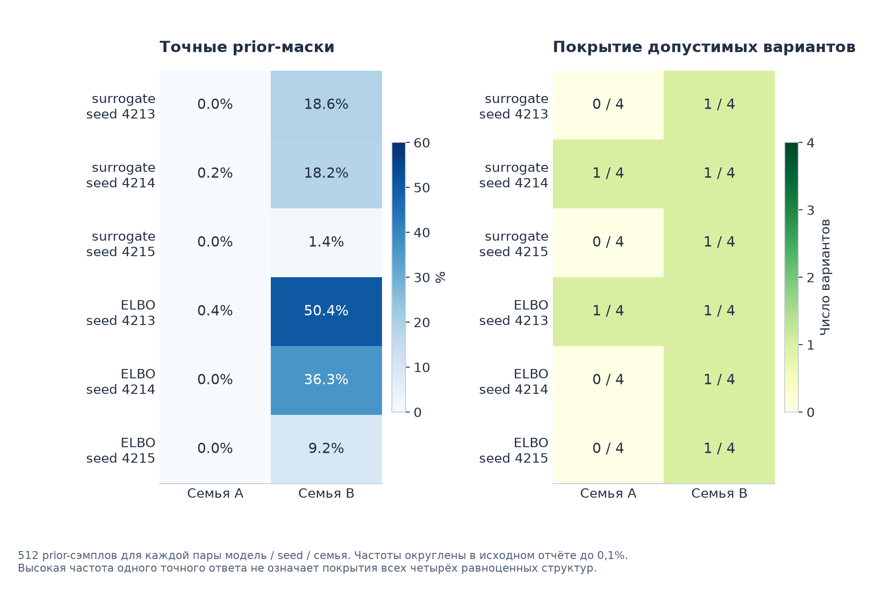

### AGOP и способ поиска

В отдельной парной серии AGOP, функциональная карта F и нулевая ветка сравнивались при одинаковых 11,33 млн параметров. Средний evolution IoU — 0,9798 с AGOP против 0,9697 с нулевой веткой, но выигрыш сосредоточен в одном из трёх seeds. Устойчивого преимущества AGOP не установлено; основной текущий вариант — W/G.

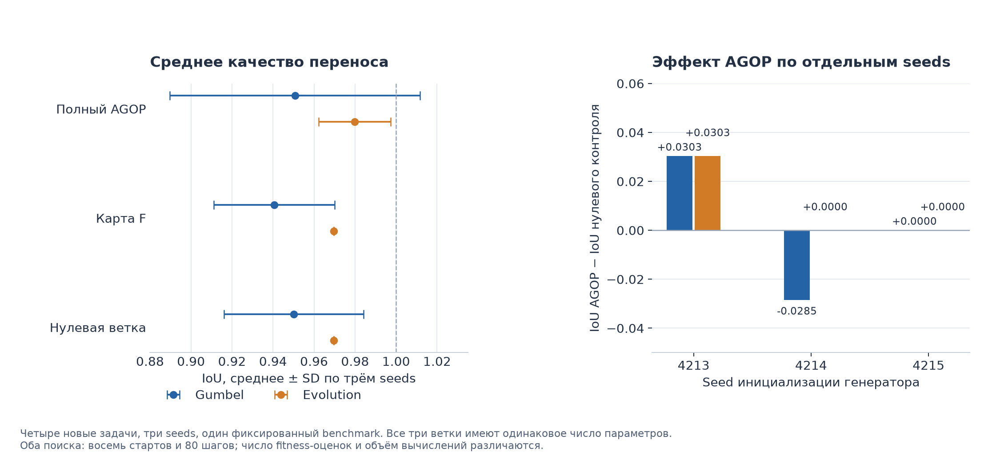

В этой серии evolution улучшал IoU относительно Gumbel в 4/9 checkpoints и совпадал в остальных. Равное число внешних шагов не обеспечивало равной стоимости вычислений, поэтому контролируемого вывода о скорости нет.

## 6. Воспроизведение и источники

Рабочий код и команды находятся в [overlapping_groups](../overlapping_groups/README.md). Новые банки используют только W/G. Первый опыт выполнен на восьми V100, композиционный пилот — только на GPU 1 и 2, с четырьмя процессами поиска на карту и наблюдаемой загрузкой 99%. Все 72 и 24 задания соответственно завершены без ошибок. Итоговые задачи остаются отложенными.

Сводки и полные таблицы: [известные структуры](assets/2026-10-20/overlapping_groups/transfer_summary.json), [4320 оценочных строк первого опыта](assets/2026-10-20/overlapping_groups/results.csv), [композиционный пилот](assets/2026-10-20/composition_pilot/pilot_summary.json), [1584 строки пилота](assets/2026-10-20/composition_pilot/results.csv), [проверка отсутствия новых масок в банке](assets/2026-10-20/composition_pilot/bank_quality.json). Подробности подбора сохранены в [его численной сводке](assets/2026-10-20/overlapping_groups/fitness_tuning_summary.json).

Исторические протоколы: [общий энкодер](../tmp/research_20261017/reports/01_shared_encoder_many_decoders.md), [теория](../tmp/research_20261017/reports/02_theory.md), [Pattern](../tmp/research_20261017/reports/03_pattern_initial_z.md), [cVAE](../tmp/research_20261017/reports/04_multimask_cvae.md), [AGOP](../tmp/research_20261017/reports/05_agop.md). Их рисунки и [численные источники](assets/2026-10-20/chart_data.json) сохранены рядом с отчётом.
